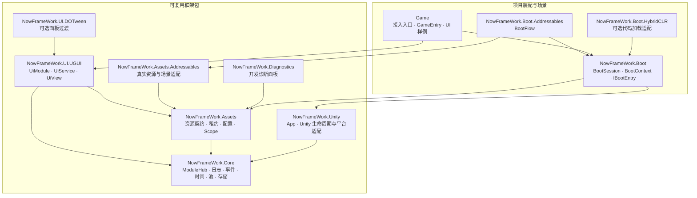
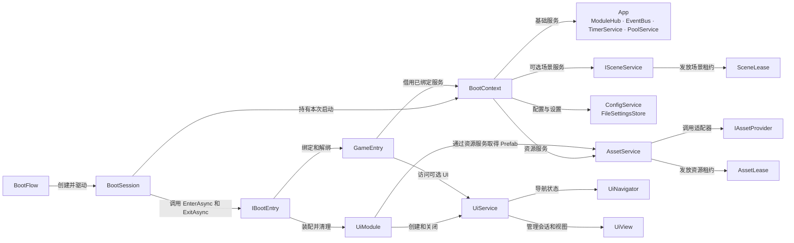

# 33 · NowFrameWork 结构图与 API 导览

在场景中从 `BootFlow` 启动。在入口的 `IBootEntry.EnterAsync()` 内使用 `BootContext` 做模块装配。接入代码在 `GameEntry.IsReady` 后使用已绑定的服务，或者由入口直接注入所需接口。第一次动手可以按使用手册运行现有样例。 [框架使用手册](32-NowFrameWork框架使用手册.md)

## 1. 框架结构图

图中箭头指向所使用的模块。图列出关键依赖和接入位置。

`Assets/Aot/Boot` 和 `Assets/Game` 提供当前工程的装配与样例，通用模块位于仓库同级 `Framework/`。例如，`UiModule` 通过 `IAssetService` 请求 Prefab，`BootFlow` 组装时才选用真实的 Addressables Provider。DOTween 和 HybridCLR 分别从面板过渡与代码加载的扩展点接入。 [架构分层与依赖](../01-架构与规划/02-架构分层与依赖规则.md)

## 2. 运行时对象结构图

箭头上的文字说明对象间的关系。底层 Provider 由资源服务调用，租约由申请者或接管它的模块负责归还。

按生命周期看，启动由 `BootFlow` 发起，服务初始化后才调用 `EnterAsync()`。停止先调用入口的 `ExitAsync()`，再清理 Boot 持有的场景、配置和基础模块。自己申请的租约、打开的附加场景、注册的订阅和计时器，都应在其所属生命周期的退出位置收尾。 [启动与停止顺序](21-Boot启动整合.md) · [GameEntry 生命周期](28-GameEntry服务入口与生命周期.md)

## 3. API 从哪里调用

下面的表按使用场景列出入口。代码表达式省略了当前方法的 `CancellationToken ct` 声明，完整例子见使用手册。

| 想做什么 | API | 调用时机和结果 |
|---|---|---|
| 启动、停止场景中的框架 | `await flow.Run()`、`await flow.Stop()` | `BootFlow` 提供场景宿主入口，启动和清理异常会写到 Console。能直接持有 `BootSession` 的代码可以用 `StartAsync(ct)`、`StopAsync()` 并检查 `State`、`FailureStage` 与 `LastError`。 |
| 装配自己的模块 | `IBootEntry.EnterAsync(context, ct)`、`ExitAsync()`、`scope.Modules.Register(module)` | 入口用 `context` 取得基础服务。自有模块在自己的 Scope 启动前注册。退出时等待本入口的实例、任务和租约清理。 |
| 获取已绑定服务 | `GameEntry.IsReady`、`GameEntry.Assets`、`GameEntry.UI` | 绑定后使用。先确认 `IsReady`，再用 `HasUI` 或 `HasScenes` 检查可选服务。 |
| 临时读一个资源 | `await context.Assets.AcquireAsync<T>(key, ct)` | 返回 `AssetLease<T>`。用 `lease.Asset` 访问资源，结束后 `Dispose()`。实例关联的租约持有到实例真正销毁。 |
| 读常驻配置 | `await context.Configs.LoadAsync<T>(key, ct)` | 返回配置对象，缓存租约由 `ConfigService` 持有，随 Boot 停止清理。必要配置地址缺失会使启动失败。 |
| 加载附加场景 | `await context.Scenes.LoadAdditiveAsync(key, ct)` | 返回 `SceneLease`，由持有者 `await lease.UnloadAsync()`。由 Boot 配置加载的场景随 Boot 停止卸载。 |
| 重复借用对象 | `context.App.Pools.GetOrCreate<T>(...)`、`AssetPool<T>.CreateAsync(...)` | 普通池用 `Get()`，Prefab 资源池用 `Rent()`，借用完用 `Release(item)`。Prefab 池退出时等待 `DisposeAsync()`。 |
| 保存设置 | `context.Settings.Value`、`context.Settings.Save()` | Boot 已加载当前设置。修改内存值后显式保存。 |
| 写日志和发事件 | `context.App.Log.Write(...)`、`Events.Subscribe<T>(...)`、`Events.Publish(...)` | `Events` 从 `context.App` 或 `GameEntry` 取得。事件为 `struct`，退出时释放订阅令牌。 |
| 设置延时或循环任务 | `Timers.Delay(...)`、`DelayUnscaled(...)`、`Interval(...)`、`Cancel(handle)` | `Timers` 从 `context.App` 或 `GameEntry` 取得。等待计时器触发的流程在 Boot 进入 Running 后执行。 |
| 打开和关闭面板 | `ui.OpenAsync(key, args, ct)`、`HideAsync`、`ShowAsync`、`CloseAsync` | `ui` 是 `IUiService`。用 `UiOpenResult.IsOpen` 检查结果，成功时得到 `UiHandle`。Hide 保留会话，Close 结束会话。 |
| 页面切换和返回 | `ui.Navigation.PushAsync(...)`、`PopAsync(ct)`、`ui.RequestBackAsync(ct)` | 页面用导航栈管理。项目返回动作可交给 `RequestBackAsync()`，由框架处理弹窗优先级和页面历史。 |
| 清面板缓存、查资源占用 | `ui.TrimCacheAsync(ct)`、`CachedCount`、`context.Assets.DumpLeases(buffer)` | 缓存清理针对可回收的空闲视图。资源诊断可结合 `ActiveLeases` 和 `PendingRequests` 检查退出后的状态。 |
| 准备并下载更新 | `HotUpdateService.PrepareAsync(key, ct)`、`DownloadAsync(key, progress, ct)` | 在配置、场景和 DLL 开始持有资源之前执行。直接使用时先创建 `HotUpdateService` 实例。 |

## 4. 常见接入路线

1. **先跑启动和停止**。打开 `BootIntegration.scene`，看 `BootFlow` 怎样从启动进入 Running，再通过停止按钮完成清理。 [Boot 场景与接入](21-Boot启动整合.md)
2. **第一次调用 API**。用 `FrameworkApiSample.scene` 跑完事件、计时器、配置、Prefab 池和附加场景，看每种资源在哪里申请、在哪里释放。 [场景操作与代码示例](23-Unity手动测试与API.md)
3. **第一次接 UI**。从 `UIIntegration.scene` 的一张面板开始，再看 `UIWindows.scene` 的页面和弹窗，最后看 `UITween.scene` 的动画与缓存。 [最小 UI 流程](25-UI最小流程与接入.md) · [多窗口](29-UI多窗口导航与Canvas规范.md) · [面板缓存](31-UI面板缓存与接入.md)
