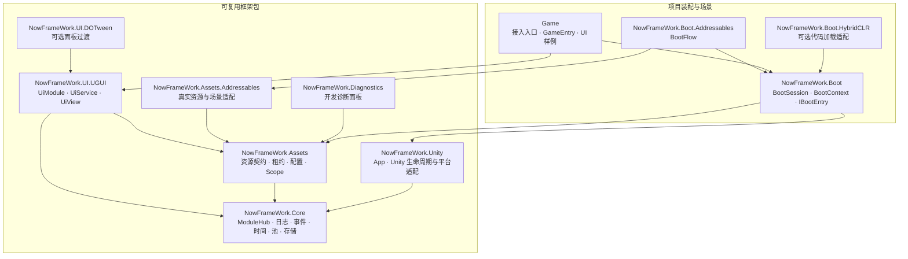
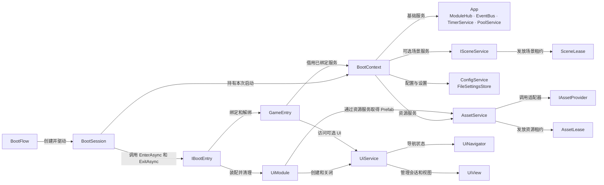

# NowFrameWork 文档总览（单文件版）

> 由 `Tools/build-docs-bundle.mjs` 自动生成，请勿手改。
> 源文档仍在 `docs/` 各自目录；本文用于通读、搜索与整体导航。

## 目录

- [1. NowFrameWork Unity 通用框架设计与路线图](#doc-README)
  - [1 当前设计基线](#doc-README-h1)
  - [2 分阶段交付](#doc-README-h2)
  - [3 文档导航](#doc-README-h3)
  - [4 修订记录](#doc-README-h4)
- [2. 27 · 完成与未完成清单](#doc-05-进度与评审-27-完成与未完成清单)
  - [1 已完成](#doc-05-进度与评审-27-完成与未完成清单-h1)
  - [2 未完成](#doc-05-进度与评审-27-完成与未完成清单-h2)
  - [3 明确不做](#doc-05-进度与评审-27-完成与未完成清单-h3)
  - [4 建议顺序](#doc-05-进度与评审-27-完成与未完成清单-h4)
- [3. 26 · 阶段总结与下一步](#doc-05-进度与评审-26-阶段总结与下一步)
  - [1 框架能力总览](#doc-05-进度与评审-26-阶段总结与下一步-h1)
  - [2 验证结果](#doc-05-进度与评审-26-阶段总结与下一步-h2)
  - [3 证据索引](#doc-05-进度与评审-26-阶段总结与下一步-h3)
  - [4 尚未完成](#doc-05-进度与评审-26-阶段总结与下一步-h4)
  - [5 建议下一步](#doc-05-进度与评审-26-阶段总结与下一步-h5)
  - [6 已知限制](#doc-05-进度与评审-26-阶段总结与下一步-h6)
- [4. 32 · NowFrameWork 框架使用手册](#doc-04-测试与接入-32-NowFrameWork框架使用手册)
  - [1. 第一次运行](#doc-04-测试与接入-32-NowFrameWork框架使用手册-h1)
  - [2. 把启动入口接进场景](#doc-04-测试与接入-32-NowFrameWork框架使用手册-h2)
  - [3. 资源、配置和场景](#doc-04-测试与接入-32-NowFrameWork框架使用手册-h3)
  - [4. 对象池、模块和 Scope](#doc-04-测试与接入-32-NowFrameWork框架使用手册-h4)
  - [5. UI 面板、导航、动画与缓存](#doc-04-测试与接入-32-NowFrameWork框架使用手册-h5)
  - [6. 设置、日志、事件和计时器](#doc-04-测试与接入-32-NowFrameWork框架使用手册-h6)
  - [7. 资源更新、热更与诊断](#doc-04-测试与接入-32-NowFrameWork框架使用手册-h7)
  - [8. 服务速查](#doc-04-测试与接入-32-NowFrameWork框架使用手册-h8)
  - [9. 音频](#doc-04-测试与接入-32-NowFrameWork框架使用手册-h9)
  - [10. 输入](#doc-04-测试与接入-32-NowFrameWork框架使用手册-h10)
  - [11. 本地化](#doc-04-测试与接入-32-NowFrameWork框架使用手册-h11)
  - [12. Windows 资源发布与恢复](#doc-04-测试与接入-32-NowFrameWork框架使用手册-h12)
  - [13. 层级状态机](#doc-04-测试与接入-32-NowFrameWork框架使用手册-h13)
  - [14. 取消、错误与性能](#doc-04-测试与接入-32-NowFrameWork框架使用手册-h14)
  - [15. 测试与 CI](#doc-04-测试与接入-32-NowFrameWork框架使用手册-h15)
- [5. Boot 与服务入口 API](#doc-06-模块API-01-Boot与服务入口)
  - [常用 API](#doc-06-模块API-01-Boot与服务入口-h1)
  - [调用示例](#doc-06-模块API-01-Boot与服务入口-h2)
  - [使用和清理约定](#doc-06-模块API-01-Boot与服务入口-h3)
- [6. 模块和 Scope API](#doc-06-模块API-02-模块与Scope)
  - [常用 API](#doc-06-模块API-02-模块与Scope-h1)
  - [调用示例](#doc-06-模块API-02-模块与Scope-h2)
  - [使用和清理约定](#doc-06-模块API-02-模块与Scope-h3)
- [7. 资源加载与卸载 API](#doc-06-模块API-03-资源加载与卸载)
  - [常用 API](#doc-06-模块API-03-资源加载与卸载-h1)
  - [调用示例](#doc-06-模块API-03-资源加载与卸载-h2)
  - [使用和清理约定](#doc-06-模块API-03-资源加载与卸载-h3)
- [8. 配置 API](#doc-06-模块API-04-配置)
  - [常用 API](#doc-06-模块API-04-配置-h1)
  - [调用示例](#doc-06-模块API-04-配置-h2)
  - [使用和清理约定](#doc-06-模块API-04-配置-h3)
- [9. 设置与本地存储 API](#doc-06-模块API-05-设置与存储)
  - [常用 API](#doc-06-模块API-05-设置与存储-h1)
  - [调用示例](#doc-06-模块API-05-设置与存储-h2)
  - [使用和清理约定](#doc-06-模块API-05-设置与存储-h3)
- [10. 附加场景 API](#doc-06-模块API-06-附加场景)
  - [常用 API](#doc-06-模块API-06-附加场景-h1)
  - [调用示例](#doc-06-模块API-06-附加场景-h2)
  - [使用和清理约定](#doc-06-模块API-06-附加场景-h3)
- [11. 对象池 API](#doc-06-模块API-07-对象池)
  - [常用 API](#doc-06-模块API-07-对象池-h1)
  - [调用示例](#doc-06-模块API-07-对象池-h2)
  - [使用和清理约定](#doc-06-模块API-07-对象池-h3)
- [12. UI 面板与导航 API](#doc-06-模块API-08-UI面板与导航)
  - [常用 API](#doc-06-模块API-08-UI面板与导航-h1)
  - [调用示例](#doc-06-模块API-08-UI面板与导航-h2)
  - [使用和清理约定](#doc-06-模块API-08-UI面板与导航-h3)
- [13. 事件 API](#doc-06-模块API-09-事件)
  - [常用 API](#doc-06-模块API-09-事件-h1)
  - [调用示例](#doc-06-模块API-09-事件-h2)
  - [使用和清理约定](#doc-06-模块API-09-事件-h3)
- [14. 时钟和计时器 API](#doc-06-模块API-10-时钟与计时器)
  - [常用 API](#doc-06-模块API-10-时钟与计时器-h1)
  - [调用示例](#doc-06-模块API-10-时钟与计时器-h2)
  - [使用和清理约定](#doc-06-模块API-10-时钟与计时器-h3)
- [15. 取消和任务 API](#doc-06-模块API-11-取消与任务)
  - [常用 API](#doc-06-模块API-11-取消与任务-h1)
  - [调用示例](#doc-06-模块API-11-取消与任务-h2)
  - [使用和清理约定](#doc-06-模块API-11-取消与任务-h3)
- [16. 日志和诊断 API](#doc-06-模块API-12-日志与诊断)
  - [常用 API](#doc-06-模块API-12-日志与诊断-h1)
  - [调用示例](#doc-06-模块API-12-日志与诊断-h2)
  - [使用和清理约定](#doc-06-模块API-12-日志与诊断-h3)
- [17. 资源更新和代码加载 API](#doc-06-模块API-13-资源更新与代码加载)
  - [常用 API](#doc-06-模块API-13-资源更新与代码加载-h1)
  - [调用示例](#doc-06-模块API-13-资源更新与代码加载-h2)
  - [使用和清理约定](#doc-06-模块API-13-资源更新与代码加载-h3)
- [18. 平台和应用生命周期 API](#doc-06-模块API-14-平台与生命周期)
  - [常用 API](#doc-06-模块API-14-平台与生命周期-h1)
  - [调用示例](#doc-06-模块API-14-平台与生命周期-h2)
  - [使用和清理约定](#doc-06-模块API-14-平台与生命周期-h3)
- [19. 音频 API](#doc-06-模块API-15-音频)
  - [常用 API](#doc-06-模块API-15-音频-h1)
  - [Boot 项目入口接入](#doc-06-模块API-15-音频-h2)
- [20. 输入与返回导航 API](#doc-06-模块API-16-输入与返回导航)
  - [常用 API](#doc-06-模块API-16-输入与返回导航-h1)
  - [调用示例](#doc-06-模块API-16-输入与返回导航-h2)
  - [分发规则](#doc-06-模块API-16-输入与返回导航-h3)
  - [与 UI 的 `BackBehavior` 组合](#doc-06-模块API-16-输入与返回导航-h4)
  - [动作门控与改键样例](#doc-06-模块API-16-输入与返回导航-h5)
  - [平台差异](#doc-06-模块API-16-输入与返回导航-h6)
  - [未覆盖](#doc-06-模块API-16-输入与返回导航-h7)
- [21. 本地化接入](#doc-06-模块API-17-本地化)
  - [运行样例](#doc-06-模块API-17-本地化-h1)
  - [接入 API](#doc-06-模块API-17-本地化-h2)
- [22. Windows 普通 AOT 资源发布与恢复](#doc-06-模块API-18-Windows资源发布与恢复)
  - [版本流程](#doc-06-模块API-18-Windows资源发布与恢复-h1)
  - [Catalog 构建约定](#doc-06-模块API-18-Windows资源发布与恢复-h2)
  - [验收样例](#doc-06-模块API-18-Windows资源发布与恢复-h3)
  - [Windows 端到端待测](#doc-06-模块API-18-Windows资源发布与恢复-h4)
- [23. 层级状态机 API](#doc-06-模块API-19-层级状态机)
  - [配置和驱动](#doc-06-模块API-19-层级状态机-h1)
  - [退出协调和故障恢复](#doc-06-模块API-19-层级状态机-h2)
- [24. 05 资源与热更技术方案](#doc-03-模块设计-05-技术方案-Addressables与HybridCLR)
  - [1 资源边界](#doc-03-模块设计-05-技术方案-Addressables与HybridCLR-h1)
  - [2 租约 引用与取消](#doc-03-模块设计-05-技术方案-Addressables与HybridCLR-h2)
  - [3 预加载 场景与内存](#doc-03-模块设计-05-技术方案-Addressables与HybridCLR-h3)
  - [4 地址 分组与变体](#doc-03-模块设计-05-技术方案-Addressables与HybridCLR-h4)
  - [5 普通与代码热更构建](#doc-03-模块设计-05-技术方案-Addressables与HybridCLR-h5)
  - [6 发布集与回退](#doc-03-模块设计-05-技术方案-Addressables与HybridCLR-h6)
  - [7 资源版本与风险](#doc-03-模块设计-05-技术方案-Addressables与HybridCLR-h7)
- [25. 09 模块详细设计](#doc-03-模块设计-09-模块详细设计)
  - [1 设计补齐进度](#doc-03-模块设计-09-模块详细设计-h1)
  - [2 文本与语言基础](#doc-03-模块设计-09-模块详细设计-h2)
  - [3 数据与格式化](#doc-03-模块设计-09-模块详细设计-h3)
  - [4 上层语言协调器](#doc-03-模块设计-09-模块详细设计-h4)
  - [5 字体与资源选择](#doc-03-模块设计-09-模块详细设计-h5)
  - [6 验证与预算](#doc-03-模块设计-09-模块详细设计-h6)
- [26. 11 对象池与资源租约](#doc-03-模块设计-11-对象池与资源租约)
  - [1 职责边界](#doc-03-模块设计-11-对象池与资源租约-h1)
  - [2 契约](#doc-03-模块设计-11-对象池与资源租约-h2)
  - [3 与资源租约的对接规则](#doc-03-模块设计-11-对象池与资源租约-h3)
  - [4 释放语义](#doc-03-模块设计-11-对象池与资源租约-h4)
  - [5 对账](#doc-03-模块设计-11-对象池与资源租约-h5)
  - [6 性能约定](#doc-03-模块设计-11-对象池与资源租约-h6)
  - [7 后续（unity 包）](#doc-03-模块设计-11-对象池与资源租约-h7)
  - [8 异步租用与保活租约（2026-11-15）](#doc-03-模块设计-11-对象池与资源租约-h8)
- [27. 13 Scope 与资源层设计](#doc-03-模块设计-13-Scope与资源层设计)
  - [1 要解决什么](#doc-03-模块设计-13-Scope与资源层设计-h1)
  - [2 资源层契约](#doc-03-模块设计-13-Scope与资源层设计-h2)
  - [3 Provider 边界](#doc-03-模块设计-13-Scope与资源层设计-h3)
  - [4 Scope](#doc-03-模块设计-13-Scope与资源层设计-h4)
  - [5 关键时序](#doc-03-模块设计-13-Scope与资源层设计-h5)
  - [6 失败矩阵](#doc-03-模块设计-13-Scope与资源层设计-h6)
  - [7 验收用例](#doc-03-模块设计-13-Scope与资源层设计-h7)
  - [8 待拍板（剩余）](#doc-03-模块设计-13-Scope与资源层设计-h8)
  - [9 实测：AssetBundle 卸载语义（2026-11-15）](#doc-03-模块设计-13-Scope与资源层设计-h9)
  - [10 评审意见处理对照（2026-11-15）](#doc-03-模块设计-13-Scope与资源层设计-h10)
- [28. 19 · 存储与设置设计](#doc-03-模块设计-19-存储与设置设计)
  - [1. 本轮契约](#doc-03-模块设计-19-存储与设置设计-h1)
  - [2. 文件提交与恢复](#doc-03-模块设计-19-存储与设置设计-h2)
  - [3. 编解码和迁移](#doc-03-模块设计-19-存储与设置设计-h3)
  - [4. 接入示例](#doc-03-模块设计-19-存储与设置设计-h4)
  - [5. 验证与后续](#doc-03-模块设计-19-存储与设置设计-h5)
- [29. 22 · UI 框架设计与制作计划](#doc-03-模块设计-22-UI框架设计)
  - [1. 首版范围](#doc-03-模块设计-22-UI框架设计-h1)
  - [2. 包与对象职责](#doc-03-模块设计-22-UI框架设计-h2)
  - [3. Canvas 与 Prefab 制作规范](#doc-03-模块设计-22-UI框架设计-h3)
  - [4. 显示、隐藏、关闭与销毁](#doc-03-模块设计-22-UI框架设计-h4)
  - [5. 显隐实现策略](#doc-03-模块设计-22-UI框架设计-h5)
  - [6. 生命周期回调与事件](#doc-03-模块设计-22-UI框架设计-h6)
  - [7. 过渡接口与 DOTween](#doc-03-模块设计-22-UI框架设计-h7)
  - [8. 并发、取消与导航输入](#doc-03-模块设计-22-UI框架设计-h8)
  - [8.1 多层级弹窗栈与父子归属](#doc-03-模块设计-22-UI框架设计-h9)
  - [9. 资源、缓存与失败清理](#doc-03-模块设计-22-UI框架设计-h10)
  - [10. 接入 UiModule、Scope 与 Boot](#doc-03-模块设计-22-UI框架设计-h11)
  - [11. 对外服务接口草案](#doc-03-模块设计-22-UI框架设计-h12)
  - [12. 实现顺序与验收计划](#doc-03-模块设计-22-UI框架设计-h13)
  - [14 实现记录与下一步（2026-11-16）](#doc-03-模块设计-22-UI框架设计-h14)
  - [13 评审定稿（2026-11-16）](#doc-03-模块设计-22-UI框架设计-h15)
- [30. 27 · 依赖传递方案对比](#doc-03-模块设计-27-依赖传递方案对比)
  - [1 问题](#doc-03-模块设计-27-依赖传递方案对比-h1)
  - [2 方案 A：场景根注入（GameRoot + 接口）](#doc-03-模块设计-27-依赖传递方案对比-h2)
  - [3 方案 B：创建时注入（工厂/池/UI）](#doc-03-模块设计-27-依赖传递方案对比-h3)
  - [4 方案 C：静态上下文（Service Locator）](#doc-03-模块设计-27-依赖传递方案对比-h4)
  - [5 方案 D：Unity 序列化引用 + 单例 MonoBehaviour](#doc-03-模块设计-27-依赖传递方案对比-h5)
  - [6 方案 E：DI 容器（VContainer / Zenject）](#doc-03-模块设计-27-依赖传递方案对比-h6)
  - [7 方案对比](#doc-03-模块设计-27-依赖传递方案对比-h7)
  - [8 组合建议（供讨论）](#doc-03-模块设计-27-依赖传递方案对比-h8)
  - [9 需要讨论的问题](#doc-03-模块设计-27-依赖传递方案对比-h9)
  - [10 与现状的关系](#doc-03-模块设计-27-依赖传递方案对比-h10)
  - [11 已选方案](#doc-03-模块设计-27-依赖传递方案对比-h11)
- [31. 28 · 输入能力边界与路线](#doc-03-模块设计-28-输入能力边界与路线)
  - [1 结论](#doc-03-模块设计-28-输入能力边界与路线-h1)
  - [2 复用边界表](#doc-03-模块设计-28-输入能力边界与路线-h2)
  - [3 架构与命名](#doc-03-模块设计-28-输入能力边界与路线-h3)
  - [4 多人输入：需要写进框架吗](#doc-03-模块设计-28-输入能力边界与路线-h4)
  - [5 路线（竖切，不是模块）](#doc-03-模块设计-28-输入能力边界与路线-h5)
  - [6 明确不做](#doc-03-模块设计-28-输入能力边界与路线-h6)
  - [7 与现有实现对照](#doc-03-模块设计-28-输入能力边界与路线-h7)
  - [8 本轮完成与未完成（2026-11-22）](#doc-03-模块设计-28-输入能力边界与路线-h8)
- [32. 17 · PC 回归入口与实测](#doc-04-测试与接入-17-PC回归入口与实测)
  - [1. 入口与夹具](#doc-04-测试与接入-17-PC回归入口与实测-h1)
  - [2. 回归模式](#doc-04-测试与接入-17-PC回归入口与实测-h2)
  - [3. 构建顺序](#doc-04-测试与接入-17-PC回归入口与实测-h3)
  - [4. 运行与补丁](#doc-04-测试与接入-17-PC回归入口与实测-h4)
  - [5. 本次实测](#doc-04-测试与接入-17-PC回归入口与实测-h5)
  - [6. 范围](#doc-04-测试与接入-17-PC回归入口与实测-h6)
- [33. 20 · 存储 Player 验证](#doc-04-测试与接入-20-存储Player验证)
  - [1. 为什么使用独立工程](#doc-04-测试与接入-20-存储Player验证-h1)
  - [2. 运行与复现](#doc-04-测试与接入-20-存储Player验证-h2)
  - [3. 10 个阶段及实际结果](#doc-04-测试与接入-20-存储Player验证-h3)
  - [4. 本轮边界与下一步](#doc-04-测试与接入-20-存储Player验证-h4)
- [34. 21 · Boot 启动整合](#doc-04-测试与接入-21-Boot启动整合)
  - [1. 启动顺序与所有权](#doc-04-测试与接入-21-Boot启动整合-h1)
  - [2. 取消、停止与重试](#doc-04-测试与接入-21-Boot启动整合-h2)
  - [3. 包与适配边界](#doc-04-测试与接入-21-Boot启动整合-h3)
  - [4. 如何运行](#doc-04-测试与接入-21-Boot启动整合-h4)
  - [5. 验证与后续](#doc-04-测试与接入-21-Boot启动整合-h5)
- [35. 23 · Unity 手动流程测试与 API](#doc-04-测试与接入-23-Unity手动测试与API)
  - [1. 直接运行现成场景](#doc-04-测试与接入-23-Unity手动测试与API-h1)
  - [2. 已添加的入口接口](#doc-04-测试与接入-23-Unity手动测试与API-h2)
  - [3. 从项目入口取得服务](#doc-04-测试与接入-23-Unity手动测试与API-h3)
  - [4. 单项资源、配置与场景调用](#doc-04-测试与接入-23-Unity手动测试与API-h4)
  - [5. 资源更新接口与时机](#doc-04-测试与接入-23-Unity手动测试与API-h5)
  - [6. 可选代码热更与验证边界](#doc-04-测试与接入-23-Unity手动测试与API-h6)
  - [7. 统一业务程序集 Game](#doc-04-测试与接入-23-Unity手动测试与API-h7)
- [36. 24 · Addressables 资源键生成器](#doc-04-测试与接入-24-Addressables资源键生成器)
  - [使用顺序](#doc-04-测试与接入-24-Addressables资源键生成器-h1)
  - [生成规则](#doc-04-测试与接入-24-Addressables资源键生成器-h2)
  - [冲突处理与保护](#doc-04-测试与接入-24-Addressables资源键生成器-h3)
  - [验证范围](#doc-04-测试与接入-24-Addressables资源键生成器-h4)
- [37. 25 · UI 最小流程与接入](#doc-04-测试与接入-25-UI最小流程与接入)
  - [在 Unity 中运行](#doc-04-测试与接入-25-UI最小流程与接入-h1)
  - [项目入口代码](#doc-04-测试与接入-25-UI最小流程与接入-h2)
  - [显隐及生命周期约定](#doc-04-测试与接入-25-UI最小流程与接入-h3)
  - [资源及诊断](#doc-04-测试与接入-25-UI最小流程与接入-h4)
  - [自动验证](#doc-04-测试与接入-25-UI最小流程与接入-h5)
- [38. 28 · GameEntry 服务入口与生命周期](#doc-04-测试与接入-28-GameEntry服务入口与生命周期)
  - [1 初始化顺序](#doc-04-测试与接入-28-GameEntry服务入口与生命周期-h1)
  - [2 业务调用](#doc-04-测试与接入-28-GameEntry服务入口与生命周期-h2)
  - [3 项目入口的所有权](#doc-04-测试与接入-28-GameEntry服务入口与生命周期-h3)
  - [4 运行示例](#doc-04-测试与接入-28-GameEntry服务入口与生命周期-h4)
  - [5 后续模块规则](#doc-04-测试与接入-28-GameEntry服务入口与生命周期-h5)
  - [6 验证](#doc-04-测试与接入-28-GameEntry服务入口与生命周期-h6)
- [39. 29 · UI 多窗口导航与 Canvas 规范](#doc-04-测试与接入-29-UI多窗口导航与Canvas规范)
  - [1 在 Unity 中测试](#doc-04-测试与接入-29-UI多窗口导航与Canvas规范-h1)
  - [2 页面、模态与返回](#doc-04-测试与接入-29-UI多窗口导航与Canvas规范-h2)
  - [3 Prefab 与排序](#doc-04-测试与接入-29-UI多窗口导航与Canvas规范-h3)
  - [4 动静分离的取舍](#doc-04-测试与接入-29-UI多窗口导航与Canvas规范-h4)
  - [5 验证与后续](#doc-04-测试与接入-29-UI多窗口导航与Canvas规范-h5)
  - [6 键盘与手柄焦点导航](#doc-04-测试与接入-29-UI多窗口导航与Canvas规范-h6)
- [40. 30 · UI 面板动画与 DOTween 接入](#doc-04-测试与接入-30-UI面板动画与DOTween接入)
  - [1 运行不同面板动画](#doc-04-测试与接入-30-UI面板动画与DOTween接入-h1)
  - [2 选择优先级](#doc-04-测试与接入-30-UI面板动画与DOTween接入-h2)
  - [3 在 Inspector 配置](#doc-04-测试与接入-30-UI面板动画与DOTween接入-h3)
  - [4 取消与资源所有权](#doc-04-测试与接入-30-UI面板动画与DOTween接入-h4)
  - [5 依赖与接入](#doc-04-测试与接入-30-UI面板动画与DOTween接入-h5)
  - [6 验证与后续](#doc-04-测试与接入-30-UI面板动画与DOTween接入-h6)
- [41. 31 · UI 面板缓存与接入](#doc-04-测试与接入-31-UI面板缓存与接入)
  - [在 Unity 里试用](#doc-04-测试与接入-31-UI面板缓存与接入-h1)
  - [项目配置](#doc-04-测试与接入-31-UI面板缓存与接入-h2)
  - [会话与实例生命周期](#doc-04-测试与接入-31-UI面板缓存与接入-h3)
  - [验证](#doc-04-测试与接入-31-UI面板缓存与接入-h4)
- [42. 32 · NowFrameWork 框架使用手册](#doc-04-测试与接入-32-NowFrameWork框架使用手册)
  - [1. 第一次运行](#doc-04-测试与接入-32-NowFrameWork框架使用手册-h1)
  - [2. 把启动入口接进场景](#doc-04-测试与接入-32-NowFrameWork框架使用手册-h2)
  - [3. 资源、配置和场景](#doc-04-测试与接入-32-NowFrameWork框架使用手册-h3)
  - [4. 对象池、模块和 Scope](#doc-04-测试与接入-32-NowFrameWork框架使用手册-h4)
  - [5. UI 面板、导航、动画与缓存](#doc-04-测试与接入-32-NowFrameWork框架使用手册-h5)
  - [6. 设置、日志、事件和计时器](#doc-04-测试与接入-32-NowFrameWork框架使用手册-h6)
  - [7. 资源更新、热更与诊断](#doc-04-测试与接入-32-NowFrameWork框架使用手册-h7)
  - [8. 服务速查](#doc-04-测试与接入-32-NowFrameWork框架使用手册-h8)
  - [9. 音频](#doc-04-测试与接入-32-NowFrameWork框架使用手册-h9)
  - [10. 输入](#doc-04-测试与接入-32-NowFrameWork框架使用手册-h10)
  - [11. 本地化](#doc-04-测试与接入-32-NowFrameWork框架使用手册-h11)
  - [12. Windows 资源发布与恢复](#doc-04-测试与接入-32-NowFrameWork框架使用手册-h12)
  - [13. 层级状态机](#doc-04-测试与接入-32-NowFrameWork框架使用手册-h13)
  - [14. 取消、错误与性能](#doc-04-测试与接入-32-NowFrameWork框架使用手册-h14)
  - [15. 测试与 CI](#doc-04-测试与接入-32-NowFrameWork框架使用手册-h15)
- [43. 33 · NowFrameWork 结构图与 API 导览](#doc-04-测试与接入-33-NowFrameWork结构图与API导览)
  - [1. 框架结构图](#doc-04-测试与接入-33-NowFrameWork结构图与API导览-h1)
  - [2. 运行时对象结构图](#doc-04-测试与接入-33-NowFrameWork结构图与API导览-h2)
  - [3. API 从哪里调用](#doc-04-测试与接入-33-NowFrameWork结构图与API导览-h3)
  - [4. 常见接入路线](#doc-04-测试与接入-33-NowFrameWork结构图与API导览-h4)
- [44. 34 · CI 回归接入](#doc-04-测试与接入-34-CI回归接入)
  - [1 前置条件](#doc-04-测试与接入-34-CI回归接入-h1)
  - [2 注册 Windows Runner](#doc-04-测试与接入-34-CI回归接入-h2)
  - [3 配置团结编辑器路径](#doc-04-测试与接入-34-CI回归接入-h3)
  - [4 工作流](#doc-04-测试与接入-34-CI回归接入-h4)
  - [5 本地与 CI 的对应关系](#doc-04-测试与接入-34-CI回归接入-h5)
  - [6 首次验收](#doc-04-测试与接入-34-CI回归接入-h6)
  - [7 已知限制](#doc-04-测试与接入-34-CI回归接入-h7)
- [45. 35 · 双人独立焦点接入方案](#doc-04-测试与接入-35-双人独立焦点接入方案)
  - [1 使用场景](#doc-04-测试与接入-35-双人独立焦点接入方案-h1)
  - [2 Unity 配置](#doc-04-测试与接入-35-双人独立焦点接入方案-h2)
  - [3 当前限制与框架接入点](#doc-04-测试与接入-35-双人独立焦点接入方案-h3)
  - [4 验收清单](#doc-04-测试与接入-35-双人独立焦点接入方案-h4)
- [46. 06 工程规范 测试与验收](#doc-02-开发规范-06-工程规范-测试与验收)
  - [1 目录与版本管理](#doc-02-开发规范-06-工程规范-测试与验收-h1)
  - [2 语言与代码规范](#doc-02-开发规范-06-工程规范-测试与验收-h2)
  - [3 依赖与构建检查](#doc-02-开发规范-06-工程规范-测试与验收-h3)
  - [4 测试与性能](#doc-02-开发规范-06-工程规范-测试与验收-h4)
  - [5 构建脚本与流水线目标](#doc-02-开发规范-06-工程规范-测试与验收-h5)
  - [6 验收记录模板](#doc-02-开发规范-06-工程规范-测试与验收-h6)
  - [7 模块与里程碑 DoD](#doc-02-开发规范-06-工程规范-测试与验收-h7)
  - [8 资源命名](#doc-02-开发规范-06-工程规范-测试与验收-h8)
  - [9 新工程接入目标](#doc-02-开发规范-06-工程规范-测试与验收-h9)
- [47. 14 框架代码基础规则](#doc-02-开发规范-14-框架代码基础规则)
  - [1 分层与依赖](#doc-02-开发规范-14-框架代码基础规则-h1)
  - [2 命名与文件](#doc-02-开发规范-14-框架代码基础规则-h2)
  - [3 异步](#doc-02-开发规范-14-框架代码基础规则-h3)
  - [4 异常](#doc-02-开发规范-14-框架代码基础规则-h4)
  - [5 生命周期与资源](#doc-02-开发规范-14-框架代码基础规则-h5)
  - [6 性能与 GC](#doc-02-开发规范-14-框架代码基础规则-h6)
  - [7 线程](#doc-02-开发规范-14-框架代码基础规则-h7)
  - [8 测试](#doc-02-开发规范-14-框架代码基础规则-h8)
  - [9 代码风格](#doc-02-开发规范-14-框架代码基础规则-h9)
  - [10 工程细节](#doc-02-开发规范-14-框架代码基础规则-h10)
  - [11 提交前自检（直接照抄 [12 §6](../05-进度与评审/12-框架缺口清单.md)）](#doc-02-开发规范-14-框架代码基础规则-h11)
  - [12 违反规则的代价（真实案例）](#doc-02-开发规范-14-框架代码基础规则-h12)
- [48. 18 · 主线程约束与验证](#doc-02-开发规范-18-主线程约束与验证)
  - [1. 约定与登记](#doc-02-开发规范-18-主线程约束与验证-h1)
  - [2. 检查范围与行为](#doc-02-开发规范-18-主线程约束与验证-h2)
  - [3. 正式构建与开销](#doc-02-开发规范-18-主线程约束与验证-h3)
  - [4. 验证与边界](#doc-02-开发规范-18-主线程约束与验证-h4)
- [49. 01 目标与范围](#doc-01-架构与规划-01-目标与范围)
  - [1 定位](#doc-01-架构与规划-01-目标与范围-h1)
  - [2 首版交付边界](#doc-01-架构与规划-01-目标与范围-h2)
  - [3 平台与设备矩阵](#doc-01-架构与规划-01-目标与范围-h3)
  - [4 质量要求](#doc-01-架构与规划-01-目标与范围-h4)
  - [5 成功标准](#doc-01-架构与规划-01-目标与范围-h5)
  - [6 术语](#doc-01-架构与规划-01-目标与范围-h6)
  - [7 屏幕适配与接入项目配置](#doc-01-架构与规划-01-目标与范围-h7)
- [50. 02 架构分层与依赖规则](#doc-01-架构与规划-02-架构分层与依赖规则)
  - [1 分层与依赖](#doc-01-架构与规划-02-架构分层与依赖规则-h1)
  - [2 契约与注入](#doc-01-架构与规划-02-架构分层与依赖规则-h2)
  - [3 资源与场景契约](#doc-01-架构与规划-02-架构分层与依赖规则-h3)
  - [4 UI 与输入](#doc-01-架构与规划-02-架构分层与依赖规则-h4)
  - [5 唯一启动顺序](#doc-01-架构与规划-02-架构分层与依赖规则-h5)
  - [6 生命周期](#doc-01-架构与规划-02-架构分层与依赖规则-h6)
  - [7 普通与热更模式](#doc-01-架构与规划-02-架构分层与依赖规则-h7)
  - [8 目录与接入边界](#doc-01-架构与规划-02-架构分层与依赖规则-h8)
- [51. 03 模块清单与优先级](#doc-01-架构与规划-03-模块清单与优先级)
  - [1 Core 模块](#doc-01-架构与规划-03-模块清单与优先级-h1)
  - [2 Foundation 模块](#doc-01-架构与规划-03-模块清单与优先级-h2)
  - [3 Gameplay 候选模块](#doc-01-架构与规划-03-模块清单与优先级-h3)
  - [4 Tooling 模块](#doc-01-架构与规划-03-模块清单与优先级-h4)
  - [5 裁剪与实现顺序](#doc-01-架构与规划-03-模块清单与优先级-h5)
- [52. 04 里程碑与实现顺序](#doc-01-架构与规划-04-里程碑与实现顺序)
  - [1 阶段原则](#doc-01-架构与规划-04-里程碑与实现顺序-h1)
  - [2 M0 技术预研与工具链](#doc-01-架构与规划-04-里程碑与实现顺序-h2)
  - [3 M1 内核与 Unity 基础适配](#doc-01-架构与规划-04-里程碑与实现顺序-h3)
  - [4 M2 资源与基础数据](#doc-01-架构与规划-04-里程碑与实现顺序-h4)
  - [5 M3 UI 输入与双维度样例](#doc-01-架构与规划-04-里程碑与实现顺序-h5)
  - [6 M4 构建 更新与交付](#doc-01-架构与规划-04-里程碑与实现顺序-h6)
  - [7 依赖与后续阶段](#doc-01-架构与规划-04-里程碑与实现顺序-h7)
- [53. 07 架构决策记录（ADR）](#doc-01-架构与规划-07-架构决策记录ADR)
  - [索引](#doc-01-架构与规划-07-架构决策记录ADR-h1)
  - [ADR-001 框架以 UPM 本地包交付](#doc-01-架构与规划-07-架构决策记录ADR-h2)
  - [ADR-002 自研轻量模块容器，不引入 DI 框架](#doc-01-架构与规划-07-架构决策记录ADR-h3)
  - [ADR-003 异步统一使用 UniTask](#doc-01-架构与规划-07-架构决策记录ADR-h4)
  - [ADR-004 资源层封装 Addressables，Provider 可替换](#doc-01-架构与规划-07-架构决策记录ADR-h5)
  - [ADR-005 AOT 与热更层的边界](#doc-01-架构与规划-07-架构决策记录ADR-h6)
  - [ADR-006 主机采用 AOT 双模式](#doc-01-架构与规划-07-架构决策记录ADR-h7)
  - [ADR-007 首包内置兜底热更 dll 与 safe-mode](#doc-01-架构与规划-07-架构决策记录ADR-h8)
  - [ADR-008 UI 采用 UGUI + 轻量 MVP](#doc-01-架构与规划-07-架构决策记录ADR-h9)
  - [ADR-009 配置表自研导出，IConfigSource 可插拔](#doc-01-架构与规划-07-架构决策记录ADR-h10)
  - [ADR-010 三版本清单（App/Resource/Hotfix）](#doc-01-架构与规划-07-架构决策记录ADR-h11)
  - [ADR-011 加载必须可取消且进度归一化](#doc-01-架构与规划-07-架构决策记录ADR-h12)
  - [ADR-012 Release 保留轻量日志与性能采样](#doc-01-架构与规划-07-架构决策记录ADR-h13)
  - [ADR-013 目录与地址命名规范](#doc-01-架构与规划-07-架构决策记录ADR-h14)
  - [ADR-014 测试门槛：Core 80% / Foundation 60%](#doc-01-架构与规划-07-架构决策记录ADR-h15)
  - [ADR-015 单机优先，网络与云只留接口](#doc-01-架构与规划-07-架构决策记录ADR-h16)
  - [ADR-016 框架不绑定渲染管线](#doc-01-架构与规划-07-架构决策记录ADR-h17)
  - [ADR-017 引擎选型：团结引擎 1.8.2 单环境](#doc-01-架构与规划-07-架构决策记录ADR-h18)
  - [ADR-018 Addressables 版本升级策略（锁 1.22.4-t1）](#doc-01-架构与规划-07-架构决策记录ADR-h19)
  - [ADR-019 资源方案选型：Addressables 为主，不采用裸 AB](#doc-01-架构与规划-07-架构决策记录ADR-h20)
  - [ADR-020 Boot 场景归属与首场景约定](#doc-01-架构与规划-07-架构决策记录ADR-h21)
  - [ADR-021 维度中立：框架不提供 2D/3D 实现](#doc-01-架构与规划-07-架构决策记录ADR-h22)
  - [ADR-022 三平台与双维度首版范围](#doc-01-架构与规划-07-架构决策记录ADR-h23)
  - [ADR-023 能力包与单向依赖](#doc-01-架构与规划-07-架构决策记录ADR-h24)
  - [ADR-024 普通 AOT 与可选热更](#doc-01-架构与规划-07-架构决策记录ADR-h25)
  - [ADR-025 独立资源租约与共享加载取消](#doc-01-架构与规划-07-架构决策记录ADR-h26)
  - [ADR-026 启动数据与移动生命周期](#doc-01-架构与规划-07-架构决策记录ADR-h27)
  - [ADR-027 兼容发布集与重启回退](#doc-01-架构与规划-07-架构决策记录ADR-h28)
  - [ADR-028 工程规范与阶段验收](#doc-01-架构与规划-07-架构决策记录ADR-h29)
  - [ADR-029 框架定位与屏幕方向适配](#doc-01-架构与规划-07-架构决策记录ADR-h30)
  - [ADR-030 基础设施优先复用官方与成熟实现](#doc-01-架构与规划-07-架构决策记录ADR-h31)
  - [ADR-031 项目业务使用 GameEntry 应用服务入口](#doc-01-架构与规划-07-架构决策记录ADR-h32)
- [54. 08 依赖与资源清单](#doc-01-架构与规划-08-依赖与资源清单)
  - [1 当前工程事实](#doc-01-架构与规划-08-依赖与资源清单-h1)
  - [1.1 DOTween 安装记录（2026-11-16）](#doc-01-架构与规划-08-依赖与资源清单-h2)
  - [2 目标依赖集合](#doc-01-架构与规划-08-依赖与资源清单-h3)
  - [3 工具链核对](#doc-01-架构与规划-08-依赖与资源清单-h4)
  - [4 M0 环境记录模板](#doc-01-架构与规划-08-依赖与资源清单-h5)
  - [5 准备顺序](#doc-01-架构与规划-08-依赖与资源清单-h6)
  - [6 非代码资源](#doc-01-架构与规划-08-依赖与资源清单-h7)
  - [7 完成条件](#doc-01-架构与规划-08-依赖与资源清单-h8)
- [55. NowFrameWork 首版范围与开工评审](#doc-01-架构与规划-10-首版范围与开工评审)
  - [1 首版范围表](#doc-01-架构与规划-10-首版范围与开工评审-h1)
  - [2 文档冲突表](#doc-01-架构与规划-10-首版范围与开工评审-h2)
  - [3 M0 验收清单](#doc-01-架构与规划-10-首版范围与开工评审-h3)
  - [4 执行清单与当前状态](#doc-01-架构与规划-10-首版范围与开工评审-h4)
  - [5 技术核对资料](#doc-01-架构与规划-10-首版范围与开工评审-h5)
  - [6 v0.4 冲突处理跟踪](#doc-01-架构与规划-10-首版范围与开工评审-h6)
  - [7 屏幕方向与框架边界验收补充](#doc-01-架构与规划-10-首版范围与开工评审-h7)
  - [8 已登记实测记录](#doc-01-架构与规划-10-首版范围与开工评审-h8)
- [56. 12 框架缺口清单](#doc-05-进度与评审-12-框架缺口清单)
  - [0 状态与优先级](#doc-05-进度与评审-12-框架缺口清单-h1)
  - [1 核对结论：评审表中 6 条已实现](#doc-05-进度与评审-12-框架缺口清单-h2)
  - [2 P0 缺口](#doc-05-进度与评审-12-框架缺口清单-h3)
  - [3 P1 缺口](#doc-05-进度与评审-12-框架缺口清单-h4)
  - [4 P2 缺口](#doc-05-进度与评审-12-框架缺口清单-h5)
  - [5 明确不做 / 需再讨论](#doc-05-进度与评审-12-框架缺口清单-h6)
  - [6 自检五问（PR 检查项）](#doc-05-进度与评审-12-框架缺口清单-h7)
  - [7 执行顺序](#doc-05-进度与评审-12-框架缺口清单-h8)
- [57. 15 · 进度与下一步](#doc-05-进度与评审-15-进度与下一步)
  - [当前交付与待办](#doc-05-进度与评审-15-进度与下一步-h1)
  - [1. 已交付](#doc-05-进度与评审-15-进度与下一步-h2)
  - [2. 关键实测结论](#doc-05-进度与评审-15-进度与下一步-h3)
  - [3. 欠账](#doc-05-进度与评审-15-进度与下一步-h4)
  - [4. 下一步计划](#doc-05-进度与评审-15-进度与下一步-h5)
  - [5. 怎么验证](#doc-05-进度与评审-15-进度与下一步-h6)
- [58. 16 · 框架审查与修复记录](#doc-05-进度与评审-16-框架审查与修复记录)
  - [1. 问题与处理](#doc-05-进度与评审-16-框架审查与修复记录-h1)
  - [2. API 与行为变化](#doc-05-进度与评审-16-框架审查与修复记录-h2)
  - [3. 验证](#doc-05-进度与评审-16-框架审查与修复记录-h3)
  - [4. Player 验证跟踪](#doc-05-进度与评审-16-框架审查与修复记录-h4)
  - [5. 主线程与设置存储提交前审核（2026-11-16）](#doc-05-进度与评审-16-框架审查与修复记录-h5)
  - [6. 音频与 UI 导航复查（2026-11-22）](#doc-05-进度与评审-16-框架审查与修复记录-h6)
  - [7. 输入模块复查（2026-11-22）](#doc-05-进度与评审-16-框架审查与修复记录-h7)
  - [8. 输入演示与重绑定（2026-11-22）](#doc-05-进度与评审-16-框架审查与修复记录-h8)
- [59. 26 · 阶段总结与下一步](#doc-05-进度与评审-26-阶段总结与下一步)
  - [1 框架能力总览](#doc-05-进度与评审-26-阶段总结与下一步-h1)
  - [2 验证结果](#doc-05-进度与评审-26-阶段总结与下一步-h2)
  - [3 证据索引](#doc-05-进度与评审-26-阶段总结与下一步-h3)
  - [4 尚未完成](#doc-05-进度与评审-26-阶段总结与下一步-h4)
  - [5 建议下一步](#doc-05-进度与评审-26-阶段总结与下一步-h5)
  - [6 已知限制](#doc-05-进度与评审-26-阶段总结与下一步-h6)
- [60. 27 · 完成与未完成清单](#doc-05-进度与评审-27-完成与未完成清单)
  - [1 已完成](#doc-05-进度与评审-27-完成与未完成清单-h1)
  - [2 未完成](#doc-05-进度与评审-27-完成与未完成清单-h2)
  - [3 明确不做](#doc-05-进度与评审-27-完成与未完成清单-h3)
  - [4 建议顺序](#doc-05-进度与评审-27-完成与未完成清单-h4)

---

<a id="doc-README"></a>

## 1. NowFrameWork Unity 通用框架设计与路线图

> 源文件：`docs/README.md`

> 内核、资源、存储、Boot、UI、音频、输入、本地化、GameEntry 与 Core 层级状态机均已实现。主工程无图形 EditMode **481/481** 通过（2026-11-25）；GitHub Actions 回归与失败归档验收通过；Windows 发布恢复（HTTP/坏文件/断流/强杀）通过；Android 真机输入/UI/本地化/音频播放通过，iOS 未开始。 [当前进度](05-进度与评审/15-进度与下一步.md) · [审查记录](05-进度与评审/16-框架审查与修复记录.md)
> 目标平台：Android、iOS、PC（电脑端首版为 Windows x64）｜ 项目维度：2D 与 3D

NowFrameWork 提供可复用的 Unity 工程底座：启动与生命周期、资源与场景、UI 与输入、配置与存档。框架通过 UPM 包交付，业务源码与框架分离。本项目只交付框架及验证载体，不开发具体游戏。首版先覆盖单机与离线运行，普通 AOT 模式独立可用，HybridCLR 是可选适配。

当前工程使用团结 1.8.2（2022.3.62t4），它是 M0 的起始环境，不代表三平台已验证。macOS、Linux、主机、小游戏与鸿蒙不进入首版验收；PC 范围如需扩大，应增加对应构建与运行矩阵。

<a id="doc-README-h1"></a>
### 1 当前设计基线

| 项目 | 决策 |
|---|---|
| 范围 | Android ARM64、iOS ARM64、Windows x64，均验证 IL2CPP 与普通 AOT；iOS Build Support 已由用户确认安装，本轮编译与真机验证后置 |
| 屏幕适配 | 同版框架支持接入项目固定横屏、固定竖屏或按允许方向旋转；具体布局由接入项目提供 |
| 维度 | 相同框架版本支撑 2D、3D 两个最小闭环，玩法物理与相机由样例实现 |
| 分层 | Core、Foundation 能力包、Provider 适配、业务、Tooling；不锁死程序集数量 |
| 交付 | 独立 UPM 包集合，样例按需导入，第三方依赖只由所选包声明 |
| 资源 | IAssetService + 独立租约 AssetLease；Addressables 为首个待验证 Provider |
| 更新 | 资源更新独立于代码更新；普通 AOT 不安装 HybridCLR |
| 代码热更 | 选定平台与渠道按需启用，加载前选择兼容版本，加载后失败按重启恢复 |
| 移动端 | Pause、Resume、Shutdown 分离，触控、安全区、后台恢复、低内存处理进入首版 |
| 配置与本地化 | 先实现简单读取、校验、文本与语言切换；Excel 工具和复杂生成器后置 |
| Gameplay | 首版只做验证样例；39 个模块是候选路线图，不是全量交付承诺 |
| 性能 | 按设备、构建类型和场景记录基线，M0 后冻结阈值 |
| 工期 | 原 PC 范围的 71–92 人日不适用三平台，M0 结论后重新估算 |

<a id="doc-README-h2"></a>
### 2 分阶段交付

| 阶段 | 产物 | 退出依据 |
|---|---|---|
| M0 | 三平台工具链与最小原型、两种维度样例、故障实验 | 10 中 V01–V14；启用热更时另验 H01–H05 |
| M1 | 模块容器、生命周期、日志、事件、调度、基础池与取消规则 | Core 独立消费工程、依赖与清理测试 |
| M2 | 资源租约、场景流程、存储、基础配置与设置数据 | 共享加载取消、损坏恢复、场景多轮清理 |
| M3 | UI、输入、音频、语言适配、移动端恢复 | 2D/3D 正式样例三平台闭环 |
| M4 | 可复现构建、资源更新、可选代码热更、接入指南 | 干净检出、发布与回退证据、首版交付验收 |
| 后续 | 真实项目推动的 Gameplay、云存档及增强工具 | 单独范围与 ADR |

M0 用原型证伪假设，不要求先写完整框架。M1 不提前验收尚未交付的 UI 和资源系统。

<a id="doc-README-h3"></a>
### 3 文档导航

第一次接触框架先看 [32 NowFrameWork 框架使用手册](#doc-04-测试与接入-32-NowFrameWork框架使用手册)。查看 [15 进度与下一步](05-进度与评审/15-进度与下一步.md) 了解当前交付状态，开发前阅读 [14 框架代码基础规则](02-开发规范/14-框架代码基础规则.md)。原始测试报告见 [证据归档](evidence/README.md)。

改动框架包、Boot 装配或构建场景后，可从仓库根目录运行一键回归。入口覆盖构建场景与包依赖预检、主工程全量 EditMode 和两套独立消费工程。[一键回归命令与报告位置](05-进度与评审/15-进度与下一步.md#t03-本地一键回归)

文档按用途分目录，保留原编号便于查阅历史引用。

#### 架构与规划

| 文档 | 内容 |
|---|---|
| [01 目标与范围](01-架构与规划/01-目标与范围.md) | 首版边界、设备矩阵、质量要求 |
| [02 架构分层与依赖规则](01-架构与规划/02-架构分层与依赖规则.md) | 包依赖、接口、启动与生命周期 |
| [03 模块清单与优先级](01-架构与规划/03-模块清单与优先级.md) | 原 39 模块的首版归属与后置范围 |
| [04 里程碑与实现顺序](01-架构与规划/04-里程碑与实现顺序.md) | M0 任务与 M1–M4 依赖顺序 |
| [07 架构决策记录](01-架构与规划/07-架构决策记录ADR.md) | 历史 ADR 与当前 ADR-022–029 |
| [08 依赖与资源清单](01-架构与规划/08-依赖与资源清单.md) | 当前依赖事实、待准备工具链 |
| [10 首版范围与开工评审](01-架构与规划/10-首版范围与开工评审.md) | D01–D18 跟踪、M0 完整验收清单 |

#### 开发规范

| 文档 | 内容 |
|---|---|
| [06 工程规范与验收](02-开发规范/06-工程规范-测试与验收.md) | 测试、构建、设备记录和接入规范 |
| [14 框架代码基础规则](02-开发规范/14-框架代码基础规则.md) | 写框架代码前的开工清单：分层、异步、异常、生命周期、性能、线程、测试、自检 |
| [18 主线程约束与验证](02-开发规范/18-主线程约束与验证.md) | 宿主登记、Editor/Development 入口诊断、206 项阶段回归与正式调用擦除 |

#### 模块设计

| 文档 | 内容 |
|---|---|
| [05 资源与热更技术方案](03-模块设计/05-技术方案-Addressables与HybridCLR.md) | 租约、取消、兼容清单与回退 |
| [09 模块详细设计](03-模块设计/09-模块详细设计.md) | 本地化的分层设计与后续设计模板 |
| [11 对象池与资源租约](03-模块设计/11-对象池与资源租约.md) | C06 契约、与资源租约的对接规则、释放语义与对账 |
| [13 Scope 与资源层设计](03-模块设计/13-Scope与资源层设计.md) | G-05 契约草案：IAssetService/AssetLease/Provider、Scope 树与关闭顺序、失败矩阵 |
| [19 存储与设置设计](03-模块设计/19-存储与设置设计.md) | 单写入者契约、显式保存、备份恢复与迁移、256 项回归及未测范围 |
| [27 依赖传递方案对比](03-模块设计/27-依赖传递方案对比.md) | 五种方案对比；已选择框架内部显式注入、项目业务使用 GameEntry |
| [28 输入能力边界与路线](03-模块设计/28-输入能力边界与路线.md) | 复用 Input System 的边界表、框架只做的 5 件事、多人输入契约与竖切路线 |
| [22 UI 框架设计](03-模块设计/22-UI框架设计.md) | 功能范围、动静 Canvas、显隐/动画生命周期、资源与 UiModule/Boot 接入；§13 为评审定稿，UI-1 第 1–5 步已实现，反向过渡及真实资源/模块验证见 §14.5 |

#### 测试与接入

按功能查询时，可以直接打开 [模块 API 索引](06-模块API/README.md)。

| 文档 | 内容 |
|---|---|
| [34 CI 回归接入](04-测试与接入/34-CI回归接入.md) | 自托管 runner、工作流步骤、首次接入验证清单与限制 |
| [35 双人独立焦点接入方案](04-测试与接入/35-双人独立焦点接入方案.md) | 双手柄设备配对、每玩家焦点与返回隔离、框架接入点与验收 |
| [17 PC 回归入口与实测](04-测试与接入/17-PC回归入口与实测.md) | Windows IL2CPP 夹具、构建/发布入口、基础与断网实测、未测范围 |
| [20 存储 Player 验证](04-测试与接入/20-存储Player验证.md) | 独立普通 AOT 消费工程、Windows IL2CPP 10 进程存储回归与复现脚本 |
| [21 Boot 启动整合](04-测试与接入/21-Boot启动整合.md) | 设置/模块/资源/可选代码加载、项目入口、取消与重试、279 项回归 |
| [23 Unity 手动测试与 API](04-测试与接入/23-Unity手动测试与API.md) | 不依赖 UI 的本地流程场景、Boot 接入、资源/配置/场景/设置与更新 API |
| [24 Addressables 资源键生成器](04-测试与接入/24-Addressables资源键生成器.md) | 按目录与文件后缀生成多层资源键、冲突预览和确认写入 |
| [25 UI 最小流程与接入](04-测试与接入/25-UI最小流程与接入.md) | 真实 Prefab 工厂、显隐反向、UiRoot/UiModule、Boot 场景和 Player 验证 |
| [28 GameEntry 服务入口与生命周期](04-测试与接入/28-GameEntry服务入口与生命周期.md) | 项目静态服务入口、统一绑定、停止门禁、所有者解绑与 Boot 示例 |
| [29 UI 多窗口导航与 Canvas 规范](04-测试与接入/29-UI多窗口导航与Canvas规范.md) | 共享全屏遮罩、页面历史、返回、焦点、Prefab 和动静分离规范 |
| [30 UI 面板动画与 DOTween 接入](04-测试与接入/30-UI面板动画与DOTween接入.md) | 默认过渡与面板覆盖、共享预设、淡入/位移/缩放、取消及独立消费验证 |
| [31 UI 面板缓存与接入](04-测试与接入/31-UI面板缓存与接入.md) | 按面板启用、容量和到期策略、清理 API 与 Unity 试用入口 |
| [32 NowFrameWork 框架使用手册](#doc-04-测试与接入-32-NowFrameWork框架使用手册) | 从现成场景入门，接入 Boot、资源、UI、事件、计时器和设置 |
| [33 NowFrameWork 结构图与 API 导览](04-测试与接入/33-NowFrameWork结构图与API导览.md) | 框架分层、运行时对象关系和常用 API 入口 |

#### 进度与评审

| 文档 | 内容 |
|---|---|
| [12 框架缺口清单](05-进度与评审/12-框架缺口清单.md) | 评审表核对结论、G-01–G-17 缺口与执行顺序、PR 自检五问 |
| [15 进度与下一步](05-进度与评审/15-进度与下一步.md) | 交付能力、历史实测与待办 |
| [16 框架审查与修复记录](05-进度与评审/16-框架审查与修复记录.md) | R01–R16 缺陷、API 调整、本次回归与 Player 验证边界 |
| [27 完成与未完成清单](#doc-05-进度与评审-27-完成与未完成清单) | 一页看清已交付与缺口（平台/功能/工程），含"明确不做"与建议顺序 |
| [26 阶段总结与下一步](#doc-05-进度与评审-26-阶段总结与下一步) | 当前能力总览、验证结果、证据索引、未完成项与下一步顺序 |

阅读顺序：01 → 02 → 03 → 04；接入测试看 21、23；实现模块时查对应模块设计与开发规范。07 中已废弃的决策仅供历史追溯，不作为当前约束。

<a id="doc-README-h4"></a>
### 4 修订记录

| 版本 | 日期 | 变更 |
|---|---|---|
| v0.1–v0.3.1 | 截至 2026-11-11 | PC 单机方案及团结、资源、热更路线；决策历史保存在 07 |
| v0.4 | 2026-11-11 | 改为三平台与双维度验证；普通 AOT 为基础，热更可选；修正依赖、租约、启动和移动端生命周期；重新定义 M0；实测状态保持待执行 |
| v0.4.1 | 2026-11-11 | 明确只实现框架；Windows 指电脑端范围，Android/iOS 保持目标；横竖屏与旋转为接入配置，补充适配和验证要求，追加 ADR-029 |
| v0.4.2 | 2026-11-14 | 实测同步：编辑器补装 iOS 模块（3.5 GB）并完成 iOS 目标脚本编译（0 错误，真机未验证）；manifest 移除本机工具依赖，D17 关闭；M0 拆为 M0a（Windows+Android 真机）/ M0b（iOS） |
| v0.4.3 | 2026-11-14 | 登记实测记录：另一台机器 Git 干净检出后 Windows/Android 构建运行成功（V01/V02 记为部分通过，证据待归档）；新增 10 §8 证据表 |
| v0.4.4 | 2026-11-14 | 热更链路实测：远端 catalog 下载新 dll 并 `Assembly.Load` 成功，10 步测试全 OK（H02 记部分通过，未在 Player 验证）；补记"远端服务未开时回退旧缓存"的现象 |
| v0.4.5 | 2026-11-14 | **H02 通过（Windows x64）**：同一 Player 未重打，仅发布新 bundle 即生效（「中文-补丁A」+ `HotUpdate 0.1.1.0`）；05 §5 固化热更四条硬基线 |
| v0.4.6 | 2026-11-14 | **H03 通过（Windows x64）**：A/B 对照证明 AOT 泛型缺失可定位（`MissingMethodException` 指明程序集与方法），补充元数据后 `Describe<AotData>`/`MakeList<AotData>` 均通过；05 §5 增补"补充元数据"一条基线 |
| v0.4.7 | 2026-11-14 | **V03 通过**（副本移除 HybridCLR 后 Win64 IL2CPP 构建启动无异常）；**M1 开工**：落地 `com.now.nowframework.core` 骨架（C01 模块容器 + EditMode 用例） |
| v0.4.8 | 2026-11-14 | **C01 加固 + 性能规则**：帧回调改为缓存列表（拓扑序分发）、排序去闭包、`TryGetAll` 零分配查询；新增 06 §4.2「性能与 GC 规则」（R1 稳态零分配 / R2 一次性预算 / R3 热路径禁用清单）与 6 个性能门禁用例，实测 20/20 通过 |
| v0.4.9 | 2026-11-14 | **C03 日志落地**：`ILog`/`ILogSink`/`LogEntry`/`Logger`（级别过滤 + 多 Sink + 环形缓冲），关闭级别与静态消息均零分配；`ModuleHub` 清理异常不再静默吞掉；用例 20 → 29 全绿 |
| v0.4.10 | 2026-11-14 | **C04 事件总线落地**：struct 事件 + `in` 传参、快照派发（派发中增删安全）、单 handler 异常隔离并记日志、延迟派发按类型 FIFO；委托与接口两种订阅，三条零分配门禁通过；用例 29 → 41 全绿 |
| v0.4.11 | 2026-11-14 | **C05 时间与调度落地**：`IClock`/`ManualClock`（双时间轴 × TimeScale）、`TimerService`（槽位数组 + 空闲栈 + 版本号防 ABA）；Update 与触发路径均零分配；用例 41 → 54 全绿 |
| v0.4.12 | 2026-11-14 | **C02 启动器 + unity 适配包**：新增 `com.now.nowframework.unity`（`UnityClock`/`UnityConsoleSink`/`App`/`GameBootstrap`，日志与控制台打通），菜单一键生成 Boot 场景；修正 06 §4.2 的测量方法并记录自动 GC 门禁失败的实测数据；用例 45 → 50 全绿 |
| v0.4.13 | 2026-11-14 | **ADR-030 复用优先**：C06 泛型池改为复用 `UnityEngine.Pool`，只自研租约与重复释放检测；事件总线保留薄实现但借鉴 MessagePipe 的订阅泄漏检测；明确不引入 DI 容器与自研 Task 封装 |
| v0.4.14 | 2026-11-14 | **C06 对象池**：空闲列表 + 活跃集合 + `IPoolItemFactory`（创建/销毁即资源租约的申请/释放），带 Create/Destroy 对账与严格/强制释放语义；新增 [11 对象池与资源租约](03-模块设计/11-对象池与资源租约.md)；**回调边界异常隔离**（模块 Tick、计时器、日志 Sink、池销毁）并写入 06 §4.3 |
| v0.4.15 | 2026-11-14 | **新增 12 框架缺口清单**：核对评审表 32 条，其中 6 条已实现（两阶段初始化/冻结容器/订阅令牌/回调内取消/按 key 分池/日志时间戳不依赖 IClock），其余整理为 G-01–G-17；新增 PR 自检五问与执行顺序；否决「砍掉池的活跃集合」 |
| v0.4.16 | 2026-11-14 | **全量回归通过**：EditMode 74/74（我方 73 + Addressables 示例 1）；修正 `PoolService_Dispose_ReleasesAllPools` 的错误断言（原用例未取对象却期望销毁 2 个） |
| v0.4.17 | 2026-11-14 | **G-01 C02 分段启动与进度**：新增 `IStartupProgress` / `ScaledProgress`，Hub 上报 Initialize/Start 两阶段与归一化进度，失败回调阶段名 + 模块 Id；`App`/`GameBootstrap` 已透传；缺口清单 G-01 标记完成 |
| v0.4.18 | 2026-11-15 | **G-02 + G-06**：`ErrorBudget`（作为 `ILogSink` 自动收集 Error，按模块+消息聚合，超阈值触发 Fatal 一次）与 `CrashDump`（Unity 异常/退出时把环形缓冲落盘）；顺带修掉 `LogEntry`/`Logger` 与 UnityEngine 同名的编译冲突；用例 81 → 90 全绿 |
| v0.4.19 | 2026-11-15 | **命名空间按模块拆分**：`NowFrameWork.Core.Logging/Events/Time/Pooling/Diagnostics/Startup`，根命名空间只留跨模块契约；06 §2.1 固化约定与统一别名写法；用例 90/90 仍全绿 |
| v0.4.20 | 2026-11-15 | **G-03 事件递归派发保护**：`EventBus.MaxPublishDepth = 16`，超限丢弃并记 Error，正常嵌套不受影响；用例 90 → 93 全绿 |
| v0.4.21 | 2026-11-15 | **G-04 池的异步租用**：`IAsyncPoolItemFactory` + `RentAsync`，`_reserved` 预留保证并发不超上限，取消即销毁不占名额；11 §8 记录「池级保活租约」设计与失败矩阵；用例 93 → 98 全绿 |
| v0.4.22 | 2026-11-15 | **G-05 设计定稿**：新增 [13 Scope 与资源层设计](03-模块设计/13-Scope与资源层设计.md)——`IAssetService`/`AssetLease`/`IAssetProvider` 契约、Scope 树与「子→模块→池→租约」关闭顺序、失败矩阵、8 条验收用例、4 个待拍板项 |
| v0.4.23 | 2026-11-15 | **实测 AssetBundle 卸载语义**：`Unload(true)` 后资源**立即**不可用（fake-null），而 Addressables 1.22.4-t1 在 `AssetBundleProvider.cs:885` 正是调它 → 得出硬规则 R-1「禁止同帧销毁实例并释放租约」，写入 13 §10；新增探针 `BundleUnloadProbe` |
| v0.4.24 | 2026-11-15 | **13 号文档收敛为最终版**：采纳评审 H-01~H-03、M-01~M-05、G-01~G-08；跨 Scope 解析定为**构造注入**（Hub 不改）；补 `DisposeAsync` 状态机、场景租约归属、失败回滚、17 条验收用例；06 §2 新增两条硬规则（构造注入、跨帧释放租约） |
| v0.4.25 | 2026-11-15 | **C07 异步落地**：`CancellationScope`（父子取消传播、Dispose 即取消、幂等）与 `TaskRunner`（预期取消不记 Error、真异常记 Error 并聚合到 ErrorBudget、`Running` 可观测）；用例 98 → 106 全绿 |
| v0.4.26 | 2026-11-15 | **C08 工具落地**：`Guard`（参数校验，抛标准异常）、`SafeCast`（不可信来源的安全转换）、`Hash`（FNV-1a，跨进程稳定，用于池键/地址映射）；只做实际用到的，不堆框架；用例 106 → 117 全绿 |
| v0.4.27 | 2026-11-15 | **C12 平台契约落地**：`IPlatformInfo`（持久化/只读/缓存路径 + 系统语言）与 `AppLifecycle`（四状态 + **信号幂等**，移动端 pause 与 focus 叠加只触发一次）；unity 侧 `UnityPlatformInfo` + `GameBootstrap` 转发；**M1 全部模块完成**，用例 117 → 123 全绿 |
| v0.4.28 | 2026-11-15 | **新增 14 框架代码基础规则**（分层/命名/异步/异常/生命周期/性能/线程/测试/风格/工程细节 + 12 条真实违规代价）；13 §2.3 定稿加载键 `AssetKey`（Variant 不参与相等、稳定哈希、Provider 做 canonical、v1 不支持 Tag） |
| v0.4.29 | 2026-11-16 | **R01–R16 审查修复**：异步生命周期、资源释放、`ConfigService` canonical 合并等；新增 [16 框架审查与修复记录](05-进度与评审/16-框架审查与修复记录.md) |
| v0.4.30 | 2026-11-16 | **主线程约束落地**：`MainThreadGuard` 入口断言、宿主登记、正式调用擦除；新增 [18](02-开发规范/18-主线程约束与验证.md)，206 项阶段回归通过 |
| v0.4.31 | 2026-11-16 | **存储与设置**：`FileSettingsStore<T>` / `ISettingsCodec<T>` / `JsonSettingsCodec<T>`，备份恢复与迁移；新增 [19](03-模块设计/19-存储与设置设计.md)、[20](04-测试与接入/20-存储Player验证.md)，256 项回归 + 独立 Windows IL2CPP 10 进程通过 |
| v0.4.32 | 2026-11-16 | **PC 回归入口与实测**：`Build/PCRegression` 夹具、V1/V2 DLL、断网/取消/超时；七轮 Player 运行通过；新增 [17](04-测试与接入/17-PC回归入口与实测.md)；证据归档于 `docs/evidence/` |
| v0.4.33 | 2026-11-16 | **Boot 启动整合**：`BootSession` / `BootContext`，设置→模块→资源→可选代码加载，取消与重试；279/279 通过；新增 [21](04-测试与接入/21-Boot启动整合.md) |
| v0.4.34 | 2026-11-16 | **UI 框架设计（待实现）**：动静 Canvas、显隐/动画生命周期、资源清理、`UiModule` 接入；新增 [22](03-模块设计/22-UI框架设计.md)；记录 DOTween 1.3.045 安装 |
| v0.4.35 | 2026-11-16 | **UI 设计评审定稿**：`TArgs : class`、一页一个 addressable Prefab（bundle 划分归项目）、新增 `IUiViewFactory` 可测接缝、`UiHandle`/`UiOpenOptions` 字段、输入阻挡与 `IUiBackSource`、`UnityObjectLifecycle` 复用；见 [22 §13](03-模块设计/22-UI框架设计.md) |
| v0.4.36 | 2026-11-16 | **UI-1 第 1–2 步落地**：`com.now.nowframework.ui.ugui`（`UiKey`/`UiHandle`/`UiDefinition`/`IUiViewFactory`/`UiService`/`ImmediateUiTransition`），单实例合并、忙状态、晚到结果回收、取消回滚；8 条用例，全量 287/287；修正"假设工厂观察 ct"的缺口 |
| v0.4.37 | 2026-11-18 | **GameEntry 服务入口**：项目静态入口、模块就绪后统一绑定、停止门禁与所有者解绑；343/343 通过；新增 [28](04-测试与接入/28-GameEntry服务入口与生命周期.md) |
| v0.4.38 | 2026-11-18 | **UI 多窗口/动画/缓存**：页面历史、模态与共享遮罩、返回与焦点恢复；面板独立过渡与 DOTween 可选适配；按面板缓存与 `TrimCacheAsync`；361/377/388 三阶段通过；新增 [29](04-测试与接入/29-UI多窗口导航与Canvas规范.md)~[31](04-测试与接入/31-UI面板缓存与接入.md) |
| v0.4.39 | 2026-11-18 | **失败路径修复 + UI 验收**：退页清理失败后继续导航、Provider 释放失败可重试；主工程与独立消费工程均 392，验收阶段 396/396；Windows Mono 与 IL2CPP Development Player 双环境通过 |
| v0.4.40 | 2026-11-18 | **文档补记**：Addressables Groups 报错排查、UITween 复测记录 |
| v0.4.41 | 2026-11-20 | **使用手册与导览**：新增 [32 使用手册](#doc-04-测试与接入-32-NowFrameWork框架使用手册)、[33 结构图与 API 导览](04-测试与接入/33-NowFrameWork结构图与API导览.md)，补充 Boot 验收记录 |
| v0.4.42 | 2026-11-20 | **模块 API 文档拆分**：新增 `06-模块API/` 15 篇（Boot/模块/资源/配置/存储/场景/池/UI/事件/时钟/取消/日志/更新/平台/音频）与索引 |
| v0.4.43 | 2026-11-20 | **UI 样例与测试脚本**：保存样例场景与资源测试脚本改动 |
| v0.4.66 | 2026-11-25 | **框架手册扩充**：[32 使用手册](#doc-04-测试与接入-32-NowFrameWork框架使用手册) 新增服务速查、音频、输入、本地化、发布恢复、HFSM、取消/性能、测试与 CI 共 8 章，补齐"顺序、边界、坑与取舍" |
| v0.4.65 | 2026-11-25 | **完成/未完成分类**：新增 [27 完成与未完成清单](#doc-05-进度与评审-27-完成与未完成清单)（已完成能力与验收、平台/功能/工程缺口、明确不做、建议顺序）；修正 03 模块清单中发布/音频/输入/CI 的过期状态 |
| v0.4.64 | 2026-11-25 | **文档收口**：重写 [26 阶段总结](#doc-05-进度与评审-26-阶段总结与下一步)（能力总览、验证结果、证据索引、未完成项、下一步）；修正 15 号输入/本地化过期描述；README 状态行更新到 481/481 与当前验收结论 |
| v0.4.63 | 2026-11-25 | **移动端可用性修复**：非 Windows x64 平台跳过 Windows 发布恢复、直接使用随包内容（此前 `PlatformNotSupportedException` 会阻断 Boot）；发布探针在非 Windows 自动隐藏；音频探针随 Boot 正常就绪，481/481 通过 |
| v0.4.62 | 2026-11-25 | **音频接入 Boot**：`BootContext` 注册 `AudioModule`，`GameEntry.HasAudio/Audio` 暴露入口，`BootFlow.Context` 可查；新增 `audio/bgm`、`audio/sfx` 样例与 `AudioProbe`；修复 `AudioModule` 编辑模式销毁报错（R30）；481/481 通过 |
| v0.4.61 | 2026-11-25 | **Windows 试用期强杀验收通过**：暂存 v2 → 试用启动 → 检测到 `TrialManifest=v2` 后 10ms 内强杀 → 重启回退 `v3（已确认）`，Trial/Pending 清空；新增 `-stageRelease` 命令行入口、Mono 验收包构建入口与 `Tools/ReleaseKillProbe.ps1`；证据见 [验收记录](evidence/2026-11-25-release-kill-trial/README.md) |
| v0.4.60 | 2026-11-25 | **PlayMode 不纳入 CI 的评估结论**：batchmode 下 17 条 PlayMode 用例 14 条失败，本地化专项放宽到 120 秒仍超时（UI 场景 + Boot + Addressables 组合不成立）；保留本地交互验证，证据见 [评估记录](evidence/2026-11-25-playmode-batchmode/README.md) |
| v0.4.59 | 2026-11-25 | **CI 失败归档验收通过**（运行 #7）：失败结论、`run.json` 478/479、XML 注入消息、`ci-step.log`、17.5MB artifact 均符合预期；过程中修复"失败不传播"（`exit` → `throw`）与"脚本 BOM 丢失"两个真实缺陷；证据见 [2026-11-25 CI 失败归档验收](evidence/2026-11-25-ci-failure-path/README.md) |
| v0.4.58 | 2026-11-25 | **CI 首次通过**：自托管 runner `tuanjie-win`，运行 #3 耗时 10 分 4 秒，四阶段 2/2、479/479、191/191、324/324；修复执行策略导致临时 `.ps1` 无法加载的问题（改用 `cmd` + `-ExecutionPolicy Bypass` 调 `Tools/Ci-*.ps1`）；证据见 [2026-11-25 CI 首次通过](evidence/2026-11-25-ci-first-run/README.md) |
| v0.4.57 | 2026-11-25 | **Windows 真实 HTTP 发布验收通过**：正常升级、同 ID 拒绝覆盖、坏文件、传输中断、恢复后重试；证据见 [2026-11-25 Windows HTTP 发布验收](evidence/2026-11-25-windows-http-release/README.md)；新增 `Tools/DropServer.py` 断流辅助 |
| v0.4.56 | 2026-11-25 | **HFSM 拆分**：`StateMachine.cs` 由 851 行拆为 4 个 partial（主 452 / 转移 221 / 退出 99 / 诊断 77），公开 API 与行为不变；全量 481/481 通过 |
| v0.4.55 | 2026-11-25 | **InputCameraDemo 触屏控件**：运行时生成左下摇杆与右下跳跃按钮（`VirtualJoystick.Configure` 装配），手机可直接测相机相对移动与双指独立；改键轮询补 `allKeys` 判空 |
| v0.4.54 | 2026-11-25 | **修复方向导航两个缺陷**：导航构建跳过禁用 CanvasGroup/`blocksRaycasts=false` 的控件；当前焦点控件失效时按控件顺序就近迁移，不再清空焦点；重建本方向链路前清除旧链路，避免失效控件残留；新增 2 条 EditMode 用例（481/481） |
| v0.4.53 | 2026-11-24 | **文档**：新增 [35 双人独立焦点接入方案](04-测试与接入/35-双人独立焦点接入方案.md)（明确框架暂缓与 `UiRoot` 单 EventSystem 限制）；补 CI 配置与 Windows 本地化复测记录 |
| v0.4.52 | 2026-11-25 | **UI 方向导航、低内存回收与改键增强**：同面板 UGUI 方向选择；`Application.lowMemory` 触发闲置缓存回收；改键支持 2D 复合的单方向并提供同 Action Map 冲突提示 |
| v0.4.51 | 2026-11-25 | **Core 层级状态机**：层级与历史恢复、条件/事件转移、退出协调与可重试清理、编辑器观察器；新增 [19 层级状态机 API](06-模块API/19-层级状态机.md) 与 PlayMode 用例；新增 `com.now.nowframework.input.inputsystem` 适配包 |
| v0.4.50 | 2026-11-23 | **CI 回归接入**：新增 `.github/workflows/framework-regression.yml`（自托管 Windows runner、Step Summary、失败也上传 artifact）与 [34 CI 回归接入](04-测试与接入/34-CI回归接入.md)；本地已验证脚本退出码可用（错误编辑器路径返回 1） |
| v0.4.49 | 2026-11-23 | **一键回归本机通过**：preflight 2/2、主工程 452/452、Core 消费 171/171、UI 消费 299/299；修复脚本在 Windows PowerShell 5.1 下因无 BOM 无法解析的问题；证据见 [2026-11-23 回归](../evidence/2026-11-23-framework-regression/README.md) |
| v0.4.48 | 2026-11-23 | **本地化 / 资源发布 / 编辑器预检**：Unity Localization 中英切换与缺译回退；Windows 普通 AOT 发布暂存、试用与回退；T01 预检接入回归；新增 [17 本地化 API](06-模块API/17-本地化.md)、[18 Windows 资源发布与恢复](06-模块API/18-Windows资源发布与恢复.md) |
| v0.4.47 | 2026-11-22 | **输入能力闭环**：设备类型通知、单键重绑定与持久化、相机相对移动演示（Cinemachine）；新增 [28 输入能力边界与路线](03-模块设计/28-输入能力边界与路线.md)；430/430 通过 |
| v0.4.46 | 2026-11-22 | **输入与返回导航**：新增 `com.now.nowframework.input`（`InputModule`/`IBackSource`/`IBackFallback`/`DoubleBackQuitFallback`），Esc/Android 返回/手柄 B 统一分发；UI 多窗口样例改用模块；新增 [16 输入与返回导航 API](06-模块API/16-输入与返回导航.md)；407/407 通过 |
| v0.4.45 | 2026-11-22 | **Android IL2CPP 冒烟通过**（真机，`UIIntegration`，先 Mono 后 IL2CPP）；复查音频与 UI 导航，修复 R17（初始化回滚）/R18（暂停空引用），R19 评估后未采纳并回滚；见 [证据](../evidence/2026-11-22-android-il2cpp/README.md)、[16 §6](05-进度与评审/16-框架审查与修复记录.md) |
| v0.4.44 | 2026-11-21 | **基础音频包**：`com.now.nowframework.audio`（循环 BGM、并发音效、两类音量、暂停恢复、失败重试）；Play 回归 6/6；主工程 396/396；新增 [音频 API](06-模块API/15-音频.md) |

---

<a id="doc-05-进度与评审-27-完成与未完成清单"></a>

## 2. 27 · 完成与未完成清单

> 源文件：`docs/05-进度与评审/27-完成与未完成清单.md`

> 更新：2026-11-25。基线 `1949ffb`。本清单只回答两件事：**已经做完什么**、**还差什么**。
> 细节与证据见 [26 阶段总结](#doc-05-进度与评审-26-阶段总结与下一步) 与 [15 进度](15-进度与下一步.md)。

<a id="doc-05-进度与评审-27-完成与未完成清单-h1"></a>
### 1 已完成

#### 1.1 框架能力

| 模块 | 完成的内容 | 验证 |
|---|---|---|
| Core 内核 | 模块拓扑启停、日志、事件、时钟、对象池、存储与设置 | EditMode + 消费工程 |
| Core HFSM | 层级与历史、条件/事件转移、退出协调、可重试清理、编辑器观察器；已拆 4 个 partial | 191 条消费工程用例 |
| Assets | `IAssetService`/`AssetLease`、Addressables 适配、资源键生成 | EditMode + Player |
| UI | 多窗口、模态遮罩、返回与导航、方向导航、面板缓存与低内存回收、过渡 | 324 条消费工程用例 + 真机 |
| Audio | BGM/SFX、音量、暂停与后台恢复；**已接入 Boot** | Play 6/6 + Android 真机播放 |
| Input | 动作读取与门控、返回分发、设备类型通知、虚拟摇杆、改键与冲突提示 | 481 主工程 + 真机 |
| Boot | 启动编排、项目入口、取消/失败清理、Windows 发布恢复接入 | EditMode + Player |
| 本地化 | Unity Localization 中英切换、缺译回退、设置恢复 | Android / Windows 复测 |
| GameEntry | 服务入口：Assets/Configs/Settings/UI/Scenes/Actions/**Audio** | EditMode |

#### 1.2 工程与验收

| 项 | 完成的内容 | 证据 |
|---|---|---|
| Windows 资源发布 | HTTP 正常升级、同 ID 拒绝、坏文件、断流、恢复重试、试用期强杀 | [HTTP](../evidence/2026-11-25-windows-http-release/README.md) · [强杀](../evidence/2026-11-25-release-kill-trial/README.md) |
| 编辑器预检 T01 | 构建场景、Boot/UI 引用、Addressables 地址、框架包反向引用与跨包依赖 | 回归 `preflight` 2/2 |
| 一键回归 T03 | PowerShell 入口（预检 → 主工程 → 两套消费工程） | 四阶段通过 |
| GitHub Actions | 自托管 runner `tuanjie-win`，首次通过 10 分 4 秒；失败归档验收通过 | [CI 首次](../evidence/2026-11-25-ci-first-run/README.md) · [失败归档](../evidence/2026-11-25-ci-failure-path/README.md) |
| Android 真机 | 返回键、双按退出、遮罩、本地化、触屏摇杆、双指独立、音频播放 | [输入/UI](../evidence/2026-11-25-android-input/README.md) · [音频](../evidence/2026-11-25-android-audio/README.md) |
| 文档 | 54+ 篇：架构、规范、模块设计、API、进度、证据 | `docs/README.md` 索引 |

<a id="doc-05-进度与评审-27-完成与未完成清单-h2"></a>
### 2 未完成

#### 2.1 平台缺口

| 项 | 缺口 | 阻塞原因 |
|---|---|---|
| **iOS** | 构建、签名、安装、运行全未开始 | 需要 Mac + Xcode + 证书 |
| Android 音频后台 | 播放已验，`IsPaused` 前后台切换与低内存回收未验 | 机型限制 adb 输入注入（`INJECT_EVENTS`） |
| 物理手柄真机 | 设备类型通知与改键仅逻辑验证 | 需要手柄 + OTG/蓝牙 |

#### 2.2 功能缺口

| 项 | 缺口 | 备注 |
|---|---|---|
| HybridCLR 代码发布 | 只支持普通 AOT 资源发布，代码热更未接入发布集 | 需要 DLL/AOT 元数据与 Catalog 同集 |
| 双人独立 UI 焦点 | 仅有方案（[35](../04-测试与接入/35-双人独立焦点接入方案.md)） | `UiRoot` 仍只允许一个 EventSystem |
| UI 横竖屏/安全区/字体 | 未做专项适配与字体方案 | 当前按横屏设计 |
| 键位图标 | 按设备切换的按键提示未做 | 设备类型已可识别 |
| 跨 Action Map 改键冲突 | 冲突策略由项目决定 | 当前只提示同一 Action Map |

#### 2.3 工程缺口

| 项 | 缺口 | 影响 |
|---|---|---|
| **Player 冒烟进 CI** | CI 只跑编辑器测试 | 无法证明"打出来的包能启动" |
| PlayMode 进 CI | 评估后不纳入（batchmode 17 条中 14 条失败） | 本地化 PlayMode 仅手工跑 |
| CI 稳定性 | 只成功运行少量次数；runner 前台运行，关机即离线 | 需要多次运行观察与常驻方案 |
| 证据完整性 | 部分验收无 logcat/截图（Android 音频、本地化逐项日志） | 追溯能力弱 |

<a id="doc-05-进度与评审-27-完成与未完成清单-h3"></a>
### 3 明确不做

| 项 | 原因 |
|---|---|
| 重造 Input System（设备配对/映射引擎/处理器） | 上游已提供，框架只做门控、返回与设备通知 |
| 输入录制回放 | 无产品需求 |
| PlayMode 强行进 CI | batchmode 下不可靠，投入产出比低 |
| 多人设备配对管理 | 交给 `InputUser`/`PlayerInputManager`，框架只留每玩家 `ActionInput` 契约 |

<a id="doc-05-进度与评审-27-完成与未完成清单-h4"></a>
### 4 建议顺序

| 顺序 | 事项 | 理由 |
|---|---|---|
| 1 | Player 冒烟进 CI | 补"能打包、能启动"的验证，成本可控 |
| 2 | Android 音频后台 + 低内存 | 需要允许 adb 输入注入的设备 |
| 3 | iOS 接入 | 依赖 Mac 环境 |
| 4 | 双人 UI / 键位图标 | 产品需求明确后再做 |

---

<a id="doc-05-进度与评审-26-阶段总结与下一步"></a>

## 3. 26 · 阶段总结与下一步

> 源文件：`docs/05-进度与评审/26-阶段总结与下一步.md`

> 更新：2026-11-25。代码基线：`91960ef`（origin/main）。
> 本阶段完成：输入闭环、HFSM 拆分、Windows 发布恢复验收、CI 接入与失败归档、音频接入 Boot。

<a id="doc-05-进度与评审-26-阶段总结与下一步-h1"></a>
### 1 框架能力总览

| 模块 | 能力 | 状态 |
|---|---|---|
| Core | 模块注册与依赖排序、启动关闭、日志、事件、时间、对象池、设置存储 | ✅ |
| Core / HFSM | 层级状态机：历史恢复、条件与事件转移、退出协调、可重试清理、编辑器观察器 | ✅ 已拆分为 4 个 partial |
| Assets | `IAssetService` + `AssetLease`、Addressables 适配、资源键生成、预检 | ✅ |
| Assets / 发布 | Windows 普通 AOT：清单校验、暂存、试用确认、回退 | ✅ 端到端验收 |
| UI | 面板会话、显隐并发、过渡、缓存、模态遮罩、返回与导航、方向导航 | ✅ |
| Audio | BGM/SFX、音量、暂停与后台恢复 | ✅ 已接入 Boot |
| Input | 动作读取与门控、返回导航、设备通知、虚拟摇杆、改键 | ✅ |
| Boot | 启动编排、项目入口、取消与失败清理、平台适配 | ✅ |
| 本地化 | Unity Localization 中英切换、缺译回退、设置恢复 | ✅ 项目侧接入 |
| Diagnostics | 崩溃转储、调试面板基础 | 🟡 基础版 |

<a id="doc-05-进度与评审-26-阶段总结与下一步-h2"></a>
### 2 验证结果

| 验证 | 结果 |
|---|---|
| 主工程 EditMode | **481 / 481** 通过（无图形，2026-11-25） |
| Core 独立消费工程 | 191 / 191 |
| Core + Assets + UGUI 消费工程 | 324 / 324 |
| GitHub Actions 回归 | 首次通过：2/2、479/479、191/191、324/324，10 分 4 秒 |
| CI 失败归档 | 通过：失败结论、`run.json` 478/479、17.5MB artifact |
| Windows 真实 HTTP 发布 | 通过：正常升级、同 ID 拒绝、坏文件、断流、恢复重试 |
| Windows 试用期强杀 | 通过：`Trial=v2` 时强杀，重启回退 `v3（已确认）` |
| Android 真机 | 通过：返回键、双按退出、遮罩、本地化、触屏摇杆、双指独立、音频播放 |
| PlayMode 进 CI | ❌ 评估后不纳入：batchmode 下 17 条中 14 条失败 |

<a id="doc-05-进度与评审-26-阶段总结与下一步-h3"></a>
### 3 证据索引

| 主题 | 记录 |
|---|---|
| Windows HTTP 发布 | [2026-11-25-windows-http-release](../evidence/2026-11-25-windows-http-release/README.md) |
| 试用期强杀 | [2026-11-25-release-kill-trial](../evidence/2026-11-25-release-kill-trial/README.md) |
| CI 首次通过 | [2026-11-25-ci-first-run](../evidence/2026-11-25-ci-first-run/README.md) |
| CI 失败归档 | [2026-11-25-ci-failure-path](../evidence/2026-11-25-ci-failure-path/README.md) |
| PlayMode 评估 | [2026-11-25-playmode-batchmode](../evidence/2026-11-25-playmode-batchmode/README.md) |
| Android 输入/UI/本地化 | [2026-11-25-android-input](../evidence/2026-11-25-android-input/README.md) |
| 音频（编辑器 + 真机播放） | [2026-11-25-audio-editor](../evidence/2026-11-25-audio-editor/README.md) · [2026-11-25-android-audio](../evidence/2026-11-25-android-audio/README.md) |

<a id="doc-05-进度与评审-26-阶段总结与下一步-h4"></a>
### 4 尚未完成

| 项 | 说明 |
|---|---|
| iOS 接入 | 需要 Mac + Xcode + 签名；尚未开始 |
| Android 音频前后台 | 播放已验；`IsPaused` 切换与低内存回收未验（adb 输入注入被机型限制） |
| HybridCLR 代码发布集 | 资源发布仅普通 AOT，代码热更未接入发布流程 |
| Player 冒烟进 CI | 目前 CI 只跑编辑器测试，不证明"打出来的包能启动" |
| 双人独立 UI 焦点 | 只有方案（文档 35），`UiRoot` 仍只允许一个 EventSystem |
| 物理手柄真机 | 设备类型通知与改键已验证逻辑，真机未验 |

<a id="doc-05-进度与评审-26-阶段总结与下一步-h5"></a>
### 5 建议下一步

| 顺序 | 工作 | 理由 |
|---|---|---|
| 1 | **Player 冒烟进 CI** | 补上"打包后能启动"的验证空白，成本可控 |
| 2 | Android 音频前后台 + 低内存 | 需要一台允许 adb 输入注入的设备 |
| 3 | 双人 UI 焦点 | 有方案，改 `UiRoot` 与 `UiView` 的焦点归属 |
| 4 | iOS 接入 | 依赖 Mac 环境 |

<a id="doc-05-进度与评审-26-阶段总结与下一步-h6"></a>
### 6 已知限制

- CI 需要自托管 Windows runner（团结编辑器 + 许可证），当前 `tuanjie-win` 前台运行；
- CI 主工程为 479 条（比本地少 2 条 `RequiresGraphicsDevice`）；
- PlayMode 测试不可在 batchmode 下稳定运行，保留本地交互验证；
- 移动端音频后台测试受机型 adb 权限限制。

---

<a id="doc-04-测试与接入-32-NowFrameWork框架使用手册"></a>

## 4. 32 · NowFrameWork 框架使用手册

> 源文件：`docs/04-测试与接入/32-NowFrameWork框架使用手册.md`

本手册适用于当前团结工程。第一次接触框架时，先在已有样例里观察启动、资源使用和停止，再把需要的服务接进自己的入口。例子只使用框架测试资源和测试面板。

模块之间的关系、启动后的对象结构和常用 API 入口可以对照 [33 NowFrameWork 结构图与 API 导览](33-NowFrameWork结构图与API导览.md)。

需要按功能查询具体调用与释放方式时，使用 [模块 API 索引](../06-模块API/README.md)。

<a id="doc-04-测试与接入-32-NowFrameWork框架使用手册-h1"></a>
### 1. 第一次运行

在团结编辑器中打开 **Window → Asset Management → Addressables → Groups**，将 **Play Mode Script** 设为 **Use Asset Database (fastest)**。这是本地 Play 模式的样例配置。然后按下表顺序打开场景。

| 场景 | 操作 | 成功标志 |
|---|---|---|
| [BootIntegration.scene](../../Scenes/BootIntegration.scene) | 按 Play，等启动完成，点 Game 窗口左上角「取消 / 停止」。 | 先显示 `Running / Running / 100%`，停止后出现「停止与清理完成」。预设使用空配置、空附加场景和占位入口。 |
| [FrameworkApiSample.scene](../../Scenes/FrameworkApiSample.scene) | 按 Play 并等 `[API] 入口已就绪`。在 Hierarchy 选中 `FrameworkApiSample`，从组件右上角菜单执行「1.运行完整 API 流程」和「2.输出资源诊断」。 | Console 依次输出事件、计时器、配置、Prefab 池、附加场景与卸载结果。测试 Prefab 是空物体，在 Hierarchy 里看 `ApiSample_PooledInstance`。流程完成后，配置缓存仍可能持有一个租约，Boot 停止时归还。 |
| [UIIntegration.scene](../../Scenes/UIIntegration.scene) | 按 Play，依次试 Open、Hide、Show、Close 和 Reverse。 | Hide 后可以用同一会话 Show。Close 后重新 Open。Reverse 最终回到可见。 |
| [UIWindows.scene](../../Scenes/UIWindows.scene) | 点 Next page 进入 Inventory，再打开 Settings 和 Confirm。用 Back 逐层关闭，最后回到 Home。 | 上层模态持有输入，关闭后恢复下层焦点。Confirm 不响应遮罩点击，Settings 可以通过遮罩关闭。回到根页后继续 Back 不会关闭根页。 |
| [UITween.scene](../../Scenes/UITween.scene) | 观察 Home、Inventory 和弹窗的不同动画。体验缓存时，在进入 Play 前给 `UiWindowsSample` 勾选 **Cache Settings**。 | 关闭 Settings 后显示 **Trim cache (1)**。15 秒内重开可复用实例。按 **Trim cache**、等待空闲到期或停止 Boot，可以清理缓存。 |

每个场景都先点「取消 / 停止」，等停止完成再退出 Play。清理过程中需要 Unity 继续执行帧循环，比如等待已调用 `Destroy` 的对象真正消失。试资源、配置或 UI 时，先记住正常运行时有哪些常驻租约，再观察重复操作是否回到基线。 [手动 API 流程](23-Unity手动测试与API.md) · [UI 基础流程](25-UI最小流程与接入.md) · [多窗口测试](29-UI多窗口导航与Canvas规范.md)

<a id="doc-04-测试与接入-32-NowFrameWork框架使用手册-h2"></a>
### 2. 把启动入口接进场景

`BootFlow` 是场景里的 Unity 组件。它创建 `BootSession`，驱动 `App` 的帧循环，并在控制台记录启动和停止结果。`BootSession` 负责启动阶段、上下文和失败清理。`IBootEntry` 是你接入框架服务的地方。

启动顺序为 **创建上下文 → 读取设置 → 启动基础模块和初始化资源 → 可选资源更新 → 可选配置 → 可选代码加载 → 可选附加场景 → 入口初始化 → Running**。

#### 2.1 最小入口脚本

在 `Assets/Game` 新建 `MinimalFrameworkEntry.cs`。把脚本挂到和 `BootFlow` 同一个对象，并在 Inspector 把该组件拖到 **Project Entry**。初次接入可以沿用 `BootIntegration.scene` 的配置，或者复制它作为自己的测试场景。

```csharp
using System.Threading;
using Cysharp.Threading.Tasks;
using Game;
using NowFrameWork.Boot;
using NowFrameWork.Core.Logging;
using UnityEngine;

public sealed class MinimalFrameworkEntry : MonoBehaviour, IBootEntry
{
    private GameEntry.Binding _binding;

    public UniTask EnterAsync(BootContext context, CancellationToken ct)
    {
        ct.ThrowIfCancellationRequested();
        _binding = GameEntry.Bind(context);
        context.App.Log.Write(LogLevel.Info, "FRAMEWORK", "入口已就绪");
        return UniTask.CompletedTask;
    }

    public UniTask ExitAsync()
    {
        _binding?.BeginStopping();
        _binding?.Dispose();
        _binding = null;
        return UniTask.CompletedTask;
    }
}
```

在已有 `Project Entry` 引用的样例场景中，原有入口负责模块装配和绑定。接入自己的模块时，先启动模块，再调用 `GameEntry.Bind(context, ui)`。开始退出时调用 `BeginStopping()`，取消并等待自己发起的任务，清理所持有的资源，然后解绑。若清理失败，保留相关字段和绑定供下一次 Stop 重试。上面这个最小入口只持有绑定，因此可以立即解绑。

#### 2.2 什么时候可以取服务

入口初始化用传入的 `context`。其他代码可以在 `GameEntry.IsReady` 为真后访问 `GameEntry.Assets`、`Configs`、`Settings`、`Log`、`Events`、`Clock` 和 `Timers`。在就绪后用 `HasUI` 和 `HasScenes` 判断可选服务是否已接入。`GameEntry` 就绪只表示服务已绑定。需要依赖 Boot 帧驱动的操作，例如等待 `App.Timers` 触发，应在 Boot 进入 `Running` 后执行。

场景对象的 `Awake` 或 `Start` 可能早于入口绑定。可以由入口显式启动依赖服务的对象，或者让这些对象等待就绪。框架 API、Unity 对象操作以及会恢复到框架代码的回调和取消操作应遵守主线程约定。

如果脚本属于自己的 asmdef，在 Inspector 的 **Assembly Definition References** 添加实际使用的程序集，例如 `NowFrameWork.Boot`、`NowFrameWork.Core`、`NowFrameWork.Unity`、`NowFrameWork.Assets` 和 `UniTask`。调用 `GameEntry` 需要引用 `Game`。直接使用 `BootFlow` 需要 `NowFrameWork.Boot.Addressables`，使用 UI 类型需要 `NowFrameWork.UI.UGUI`。当前工程的 `Game` 程序集可以作为参考。 [Boot 启动整合](21-Boot启动整合.md) · [GameEntry 生命周期](28-GameEntry服务入口与生命周期.md)

<a id="doc-04-测试与接入-32-NowFrameWork框架使用手册-h3"></a>
### 3. 资源、配置和场景

#### 3.1 加载资源与归还租约

在 Addressables Groups 给资源登记地址。代码可以传地址字符串、`AssetKey` 或生成的键。以下片段放在接收 `CancellationToken ct` 的异步方法中，`context` 来自入口。

```csharp
using (var lease = await context.Assets.AcquireAsync<TextAsset>("PCProbe/Config", ct))
{
    Debug.Log(lease.Asset.text);
}
```

每次申请都会得到一份独立租约，同资源的底层加载可以共享。只在租约有效期间使用 `lease.Asset`。若用 Prefab 创建长寿命实例，保存实例和对应租约，先销毁实例并等待真正销毁，再归还租约。反复创建和回收的对象可以交给下一节的 `AssetPool<T>`。

如果 Provider 释放失败，保留原租约并重试 `Dispose()`。释放开始后，租约的 `Asset` 已不可继续使用。加载异常优先检查地址、资源类型、分组和所用的 Play Mode Script。

#### 3.2 生成资源键和读取常驻配置

在 **NowFrameWork → Assets → 资源键生成器** 中选择资源根目录，先扫描并处理冲突，再预览并确认生成。生成文件是 `Assets/Generated/AssetKeys/AssetKeys.g.cs`，调用方可以引用 `NowFrameWork.Generated.AssetKeys`。本仓库当前的测试配置键为 `NowFrameWork.Generated.AssetKeys.Tests.PCRegression.Config_txt`。重新选择扫描根目录会影响生成的类层级。 [资源键生成器](24-Addressables资源键生成器.md)

配置通常使用 `context.Configs.LoadAsync<T>()`，由 `ConfigService` 持有缓存租约，Boot 停止时统一清理。将配置作为只读数据使用。若把地址填进 BootFlow 的 **Config Address**，该项改为启动所必需，缺失会使 Boot 在 `Config` 阶段失败。

```csharp
TextAsset config = await context.Configs.LoadAsync<TextAsset>("PCProbe/Config", ct);
Debug.Log(config.text);
```

#### 3.3 加载和卸载附加场景

`LoadAdditiveAsync` 返回 `SceneLease`。如果需要自行控制其生命周期，把租约保存在能负责退出清理的字段里。只有在卸载成功后才清空字段。

```csharp
_scene = await context.Scenes.LoadAdditiveAsync("PCProbe/Scene", ct);

// 在负责退出的异步方法里执行。
await _scene.UnloadAsync();
_scene = null;
```

如果 **Scene Address** 由 BootFlow 配置，则这份场景租约由 Boot 持有和卸载。通过入口直接申请的附加场景由入口自己卸载。测试场景详情见现有 API 样例。 [资源、配置和场景示例](23-Unity手动测试与API.md)

<a id="doc-04-测试与接入-32-NowFrameWork框架使用手册-h4"></a>
### 4. 对象池、模块和 Scope

- **普通对象池**。用 `context.App.Pools.GetOrCreate<T>(key, create, destroy)` 创建或取得池，`Get()` 借出，`Release(item)` 归还。退出时由持有者调用 `DisposePool(key)` 移除在 App 池服务中登记的池。先处理所有借出的对象。
- **Prefab 资源池**。用 `AssetPool<GameObject>.CreateAsync(...)` 建池，由池保留一份 Prefab 租约。用 `Rent()` 和 `Release(item)` 管理对象，退出时 `await pool.DisposeAsync()`。池会等待实例真正销毁，再归还保活租约。可以参考 `FrameworkApiSample.TestPoolAsync` 的完整生命周期。
- **模块**。实现 `IAppModule`，声明依赖、初始化、启动和关闭。在所属 `ModuleHub` 启动前注册。进入 `IBootEntry.EnterAsync` 时，基础 App Hub 已启动，入口自有模块可以注册到入口创建的独立 Scope。
- **Scope**。用来表示一组有共同寿命的模块、对象池和子 Scope。创建后注册模块，再 `await scope.StartupAsync(ct)`。需要划分更短的生命周期时，在运行中的 Scope 上 `CreateChild(name)`，再启动子作用域。退出时 `await scope.DisposeAsync()`。临时取得的租约仍由申请者管理。使用 UI 或 Prefab 池等有专用异步清理的服务时，先等待其清理成功再释放上层 Scope。

资源池、场景租约和安装的模块应有清晰的退出位置，建议和入口的 `ExitAsync()` 一起检查。 [对象池与资源租约](../03-模块设计/11-对象池与资源租约.md) · [Scope 和资源层](../03-模块设计/13-Scope与资源层设计.md)

<a id="doc-04-测试与接入-32-NowFrameWork框架使用手册-h5"></a>
### 5. UI 面板、导航、动画与缓存

#### 5.1 接入一个面板

1. 准备 `UiRoot` 和一个有效的 `EventSystem`。从现有样例复用 UI Root 的配置可减少层级错误，Root 下有 Page、Popup 和 Toast 容器。
2. 让面板根节点挂载 `UiView` 派生组件，配好 Canvas、CanvasGroup 和所需的 GraphicRaycaster，并登记其 Prefab 的 Addressables 地址。
3. 用 `UiDefinition` 将项目内唯一的数字 ID 对应到 Prefab。用相同 ID 创建 `UiKey<TArgs>`，参数类型是引用类型。无参数面板使用 `UiKey<EmptyArgs>` 与 `EmptyArgs.Default`。
4. 在入口创建 `UiModule`，传入资源服务、Root、面板定义、默认动画和 EventSystem。等待模块初始化、启动后，再把 `module.Service` 交给 `GameEntry.Bind(context, module.Service)`。参考 `UiWindowsSample.EnterAsync` 或 `UiFlowSample.EnterAsync`。

下面是入口装配片段。`_rootPrefab` 和 `_eventSystem` 由 Inspector 赋值，`_module` 和 `_binding` 由入口持有，退出时先等待模块的 `DisposeAsync()` 再解绑。

```csharp
var definition = new UiDefinition(1, "SamplePanel", AssetKey.From("UiProbe/Panel"));
_module = new UiModule(context.Assets, _rootPrefab, new[] { definition },
    new CanvasGroupUiTransition(), _eventSystem, log: context.App.Log);
await _module.InitializeAsync(ct);
await _module.StartAsync(ct);
ct.ThrowIfCancellationRequested();
_binding = GameEntry.Bind(context, _module.Service);
```

下面的操作片段在模块绑定后执行。为了在画面上观察各状态，可以把每个操作绑定到独立的测试按钮。 [最小 UI 样例源码](../../Game/UiFlowSample.cs)

```csharp
var panelKey = new UiKey<EmptyArgs>(1, "SamplePanel");
var ui = GameEntry.UI;
var opened = await ui.OpenAsync(panelKey, EmptyArgs.Default, ct);
if (!opened.IsOpen) return;

await ui.HideAsync(opened.Handle, ct);
await ui.ShowAsync(opened.Handle, ct);
await ui.CloseAsync(opened.Handle, ct);
```

打开结果为 `Ok` 或 `AlreadyOpen` 时能取得有效句柄。`Busy` 表示已有相关操作在途，应等当前操作结束。Hide 保留会话和资源，Show 恢复该会话。Close 结束会话，旧句柄不能控制下次打开的会话。Show、Hide、Close 和导航的调用者取消只结束本次等待，服务仍可能在收尾。

面板在 `OnOpenAsync` 接收本次参数，在 `OnCloseAsync` 清理会话里的任务和订阅。需要跨缓存复用保留的组件初始化可放在 `OnCreate`，最终解绑放在 `OnDispose`。只在可见期间运行的任务使用 `VisibleToken`，维持到会话关闭的任务使用 `SessionToken`。 [面板生命周期和 UI 接入](25-UI最小流程与接入.md)

#### 5.2 页面、模态和返回

页面栈使用 `ui.Navigation.PushAsync(key, args, ct)` 和 `PopAsync(ct)`。Push 会隐藏前页，Pop 恢复前页并关闭当前页。导航栈拥有这些页面的显隐和关闭，项目通过导航 API 操作它们。

弹窗定义使用 `Layer = UiLayer.Popup`。需要阻挡背景输入时设置 `Modal = true`，允许点击遮罩关闭时再设置 `CloseOnBackdrop = true`。模态窗口之间共用一张遮罩。设置 `UiView.DefaultFocus` 可指定窗口获得焦点时的默认控件。使用 `await ui.RequestBackAsync(ct)` 分发项目返回动作，框架先处理弹窗，再处理页面历史。 [多窗口与返回规则](29-UI多窗口导航与Canvas规范.md)

#### 5.3 动画和面板缓存

默认过渡由 `UiModule` 装配，可以使用即时切换或 `CanvasGroupUiTransition`。要给部分面板设置独立动画，在面板根节点配置启用的 `UiTransitionBehaviour`。使用 DOTween 适配时，在 **Assets → Create → NowFrameWork → UI → Tween Preset** 创建预设，然后为 `DOTweenUiTransition` 配置预设和动画节点。位移、缩放应绑定到面板内的 MotionRoot。 [DOTween 过渡接入](30-UI面板动画与DOTween接入.md)

给某个定义设置 `CacheOnClose = true` 后，该面板关闭时可以保留空闲实例和 Prefab 租约。模块用 `UiCacheOptions` 控制容量与空闲时间。默认容量为 16、空闲 60 秒，容量 0 会禁用缓存。`CachedCount` 表示当前可复用的空闲实例，`await ui.TrimCacheAsync(ct)` 可清理空闲缓存，Boot 停止时也会清理。缓存里的实例再次打开时仍会收到新参数和新句柄。 [面板缓存接入](31-UI面板缓存与接入.md)

<a id="doc-04-测试与接入-32-NowFrameWork框架使用手册-h6"></a>
### 6. 设置、日志、事件和计时器

#### 6.1 读写设置

Boot 已加载 `context.Settings`。修改内存值后调用 `Save()` 才会写盘。在 `FrameworkApiSample.scene` 可以用组件菜单「3.保存测试语言 zh-CN」试一次，重新启动后查看读取结果。

```csharp
context.Settings.Value.Language = "zh-CN";
context.Settings.Save();
Debug.Log(context.Settings.FilePath);
```

样例的 `Language` 是保存下来的设置数据。应用语言要由接入层处理。要保存自己的设置 DTO，可用 `FileSettingsStore<T>` 配 `JsonSettingsCodec<T>`，明确数据版本和校验规则。标记默认值、主文件和备份恢复的结果来自 `Load()`。文件放在平台的持久化目录，文件路径可通过 `FilePath` 查看。 [存储与设置设计](../03-模块设计/19-存储与设置设计.md)

#### 6.2 日志、事件和计时器

```csharp
// using NowFrameWork.Core.Logging;
context.App.Log.Write(LogLevel.Info, "FRAMEWORK", "测试入口已启动");

// 事件类型使用 struct。订阅令牌应由订阅者持有和释放。
using (context.App.Events.Subscribe<SampleSignal>((in SampleSignal evt) => Debug.Log(evt.Value)))
{
    context.App.Events.Publish(new SampleSignal { Value = 42 });
}

```

`SampleSignal` 可定义为 `struct SampleSignal { public int Value; }`。即时发布用 `Publish`，希望由 App 帧循环处理时可以用 `PublishDeferred`。

计时器使用秒为单位。`Delay`、`Interval` 走缩放时钟，`DelayUnscaled`、`IntervalUnscaled` 走无缩放时钟。Boot 进入 Running 后调用 `context.App.Timers.DelayUnscaled(0.5, () => Debug.Log("计时完成"))`。把返回的 `TimerHandle` 存为入口字段，在入口退出时调用 `context.App.Timers.Cancel(handle)`。

`context.App.Platform` 提供平台信息，`context.App.Lifecycle` 提供应用生命周期信号。BootFlow 转发 Unity 的暂停、焦点和退出事件。可以在入口按需要接入这些信号，并在退出时解除订阅。 [核心 API 样例](23-Unity手动测试与API.md) · [主线程约束](../02-开发规范/18-主线程约束与验证.md)

<a id="doc-04-测试与接入-32-NowFrameWork框架使用手册-h7"></a>
### 7. 资源更新、热更与诊断

#### 7.1 资源更新

首次上手优先用本地样例。需要验证资源更新时，在项目启动流程中设置 **Check Resource Updates** 和 **Update Key**，让 Boot 在申请配置、场景、实例或 DLL 租约之前更新。也可以在独立的更新入口中创建 `HotUpdateService`，按顺序调用 `PrepareAsync(key, ct)` 与 `DownloadAsync(key, progress, ct)`。Update Key 应覆盖启动资源及其依赖。

HybridCLR 代码加载通过可选的 `HybridClrBootLoader` 接入。只有明确启用代码热更时才在 BootFlow 配置 **Load Code** 和 **Code Loader**。一旦代码加载已尝试，进程必须重启才能重新进行启动尝试。远端 Catalog、DLL 与 AOT 元数据的验证用既有 PC 回归夹具。 [Windows 资源与热更回归](17-PC回归入口与实测.md) · [Boot 热更适配](21-Boot启动整合.md)

#### 7.2 排查问题

| 现象 | 检查位置 |
|---|---|
| Play 后没有正常启动 | 看 Console 第一条错误和 `[Boot]` 报出的阶段。若停在 Config，核对 **Config Address** 是否已登记且资源类型正确。 |
| 资源加载失败 | 检查 Address、分组、资源类型和 Play Mode Script。运行本地样例时先用 Asset Database 模式。 |
| 访问 `GameEntry` 报尚未就绪 | 检查入口是否完成绑定，以及调用是否早于入口。对于 UI 和场景服务，也要确认其可选服务已经装配。 |
| UI 打开后无输入 | 检查样例是否配置了有效的 EventSystem 和 GraphicRaycaster，关注顶层模态、显隐状态和导航过渡是否正在阻挡输入。 |
| Close 后租约未少 | 检查是否启用了面板缓存、是否还有同资源的实例持有租约，以及清理是否仍在等待销毁。使用 `CachedCount` 或 `TrimCacheAsync()` 区分空闲缓存。 |
| Stop 报「清理未完成，可重试」 | 找到未释放的池、场景、租约或失败回调，修复后再点停止。清理成功后才能开始新的 Boot 上下文。 |
| 编译提示找不到框架命名空间 | 检查当前脚本所属 asmdef 的引用，尤其是 `Game`、`NowFrameWork.Boot.Addressables`、`NowFrameWork.UI.UGUI` 和生成资源键程序集。 |
| Addressables Groups 重绘时索引越界 | 先关闭并重开 Groups，再区分新出现的 Console 报错和上次编辑器错误。 [已记录的复测](../05-进度与评审/15-进度与下一步.md#53-addressables-groups-报错与-uitween-复测) |

资源问题可以用 `FrameworkApiSample` 的「2.输出资源诊断」查看 `Pending`、`ActiveLeases` 和租约明细。项目也可以在编辑器或 Development Player 中引用 `NowFrameWork.Diagnostics`，用 `DiagnosticsOverlay.Install(context.Assets, context.App.Errors)` 安装诊断面板，退出时管理该面板的生命周期。正式构建会返回空引用。

修改框架后，可以从 **NowFrameWork → Tests → 运行全部 EditMode 测试** 验证回归。当前实现状态、已验收平台和后续模块以进度文档为准。键盘与手柄的控件焦点导航和虚拟列表见后续方案。 [进度与下一步](../05-进度与评审/15-进度与下一步.md) · [验收证据](../evidence/README.md)

<a id="doc-04-测试与接入-32-NowFrameWork框架使用手册-h8"></a>
### 8. 服务速查

| 需要什么 | 从哪里取 | 接口 |
|---|---|---|
| 资源 | `context.Assets` / `GameEntry.Assets` | `IAssetService` |
| 配置 | `context.Configs` / `GameEntry.Configs` | `ConfigService` |
| 设置 | `context.Settings` / `GameEntry.Settings` | `FileSettingsStore<BootPreferences>` |
| 场景 | `context.Scenes` / `GameEntry.Scenes` | `ISceneService` |
| UI | `GameEntry.UI` | `IUiService` |
| 音频 | `GameEntry.Audio` / `context.Audio` | `AudioModule` |
| 动作 | `GameEntry.Actions` | `ActionInput` |
| 日志 / 事件 / 时钟 / 池 | `context.App.Log/Events/Clock/Pools` | core 接口 |

先判断 `GameEntry.IsReady`/`HasUI`/`HasAudio` 再取服务；可选服务未装配时取用会抛异常，而不是返回 null。

<a id="doc-04-测试与接入-32-NowFrameWork框架使用手册-h9"></a>
### 9. 音频

音频模块随 Boot 注册，入口在 `GameEntry.Audio`。资源必须是 Addressables 条目（样例：`audio/bgm`、`audio/sfx`）。

```csharp
await GameEntry.Audio.PlayMusicAsync("audio/bgm");   // 循环 BGM，后一次请求替换前一次
await GameEntry.Audio.PlayEffectAsync("audio/sfx");  // 并发音效，受 maxEffects 限制
GameEntry.Audio.SetVolumes(0.8f, 1f);                // 0..1
GameEntry.Audio.StopMusic();
```

| 行为 | 说明 |
|---|---|
| 后台暂停 | 由 `IAppLifecycle` 驱动，`IsPaused` 可查；回前台继续，不从头播 |
| 通道上限 | 音效满时返回 `false`，不抛异常，调用方决定是否丢弃 |
| 资源释放 | 切歌/停止后，无引用的 Clip 租约自动释放 |
| 平台差异 | 非 Windows x64 跳过发布恢复，但音频本身仍走随包 Catalog |

常见坑：音频资源只放进资源目录、没标 Addressable，运行时报「找不到唯一资源」。

<a id="doc-04-测试与接入-32-NowFrameWork框架使用手册-h10"></a>
### 10. 输入

| 层 | 职责 |
|---|---|
| `IActionSource` | 设备适配：Input Actions、手柄、虚拟摇杆 |
| `ActionInput` | 多来源合并、门控、取值 |
| `InputModule` | 返回键分发：一帧一次、后台不补发、异常隔离 |
| `IBackSource` / `IBackFallback` | 返回键来源 / UI 不处理时的兜底 |

```csharp
var input = new ActionInput(
    new InputActionsSource(asset, (Actions.Move, "Player/Move")),
    new JoystickActionSource(joystick, Actions.Move));

Vector2 move = input.GetVector(Actions.Move);
input.SetGate("ui.modal", topModal);   // 每帧同步，幂等
```

| 约定 | 说明 |
|---|---|
| 门控分域 | `SetGate` 是幂等开关；`Suppress` 返回 `IDisposable` 令牌，两者可叠加 |
| 热路径轮询 | 用 `GetVector`/`WasPressed`，不要再订阅动作回调，避免双触发 |
| 二维动作 | `ActionState.Value` 是长度（强度），方向用 `Vector2 Vector` |
| 改键 | 复合动作要按 binding 索引逐方向改；同 ID 冲突只提示同一 Action Map |

<a id="doc-04-测试与接入-32-NowFrameWork框架使用手册-h11"></a>
### 11. 本地化

Unity Localization 负责查表、回退与格式化；项目接入层负责语言选择与保存。

```csharp
await language.InitializeAsync(store.Load(() => new BootPreferences()).Source, ct);
await language.SwitchAsync(LanguageSelection.Chinese, ct);
```

| 约定 | 说明 |
|---|---|
| 缺译回退 | 表缺键回退英文，不抛错 |
| 持久化 | 选择写入 `BootPreferences`，重启恢复 |
| 字体 | 中文需自带字体；当前按横屏设计，竖屏适配未做 |

<a id="doc-04-测试与接入-32-NowFrameWork框架使用手册-h12"></a>
### 12. Windows 资源发布与恢复

```csharp
await releases.StageFromServerAsync(new Uri("http://127.0.0.1:8080/v2/release.json"), ct);
// 暂存成功 → 下次启动试用 → Boot 进入 Running 才确认
```

| 规则 | 说明 |
|---|---|
| 清单校验 | 每个文件记录长度与 SHA-256；坏文件/断流失败且不落盘 |
| 同 ID 拒绝 | 不能用当前确认版本 ID 再暂存，重发内容必须换 ID |
| 回退 | 试用期失败或强杀，重启回到已确认版本 |
| 平台 | 非 Windows x64 跳过发布选择，直接用随包内容 |

验收脚本 `Tools/ReleaseKillProbe.ps1` 可复现「暂存 → 试用 → 强杀 → 回退」。

<a id="doc-04-测试与接入-32-NowFrameWork框架使用手册-h13"></a>
### 13. 层级状态机

```csharp
var fsm = new StateMachine<Phase>();
fsm.AddState(Phase.Ready, new ReadyState());
fsm.SetInitialState(Phase.Ready);
fsm.AddEventTransition(Phase.Ready, "Begin", Phase.Active);
fsm.Enter();
```

| 约定 | 说明 |
|---|---|
| 回调内请求 | 状态回调里的切换在回调结束后统一处理 |
| 退出协调 | 实现 `IStateExitHandler` 可延迟切换；强制规则可打断等待 |
| 异常 | 回调抛错停止活动链，用 `Faulted`/`FaultPath`/`LastException` 定位 |
| 清理重试 | `Exit()` 失败保留待清理状态，`HasPendingCleanup` 后重试 |

<a id="doc-04-测试与接入-32-NowFrameWork框架使用手册-h14"></a>
### 14. 取消、错误与性能

| 规则 | 做法 |
|---|---|
| 取消是正常路径 | `OperationCanceledException` 不记 Error |
| 即发即忘 | 走 `TaskRunner.Run`，异常进 `ErrorBudget` |
| 等待外部资源 | 销毁/卸载必须带超时与重试路径，失败保留句柄 |
| 热路径零分配 | 避免闭包、LINQ、字符串拼接；缓存委托 |
| 断言 | `MainThreadGuard.Assert` 带 `[Conditional]`，正式包零成本 |
| 资源计数 | `ActiveLeases`/`PendingRequests` 用于验收，不要每帧轮询 |

<a id="doc-04-测试与接入-32-NowFrameWork框架使用手册-h15"></a>
### 15. 测试与 CI

| 入口 | 用途 |
|---|---|
| 菜单 `NowFrameWork → Tests → 运行全部 EditMode 测试` | 编辑器内全量（481 条） |
| `Tools/Run-FrameworkRegression.ps1` | 预检 + 主工程 + 两套消费工程 |
| GitHub Actions `Framework Regression` | 自托管 runner；失败也上传 artifact |
| PlayMode | 本地交互验证；batchmode 下不可靠，不纳入 CI |

CI 排障顺序：看 `run.json` 阶段名 → 对应 `.log`/`.xml` → `ci-step.log`。

---

<a id="doc-06-模块API-01-Boot与服务入口"></a>

## 5. Boot 与服务入口 API

> 源文件：`docs/06-模块API\01-Boot与服务入口.md`

`BootFlow` 是场景组件，`BootSession` 管理一次启动和清理，`IBootEntry` 是接入自有模块的位置。装配在 `EnterAsync()` 中使用 `BootContext`。已绑定服务可通过 `GameEntry` 访问。

<a id="doc-06-模块API-01-Boot与服务入口-h1"></a>
### 常用 API

| API                                                | 何时使用                                                                              |
| -------------------------------------------------- | --------------------------------------------------------------------------------- |
| `BootFlow.Run() / Stop()`                          | 从场景代码发起启动或停止。组件把失败写到 Console，验收时看阶段和最终停止日志。                                       |
| `BootSession.StartAsync(ct) / StopAsync()`         | 供持有会话的宿主调用，异步结果直接报告异常。用 `State`、`FailureStage`、`LastError` 定位失败。                  |
| `IBootEntry.EnterAsync(context, ct) / ExitAsync()` | 由 Boot 调用。入口在这里启动自有模块，在退出时等待其任务、实例和租约清理。                                          |
| `GameEntry.Bind(context, ui)`                      | 由入口在依赖就绪后绑定。返回的 `Binding` 由入口保存。先 `BeginStopping()` 关闭访问，再完成清理并调用 `Dispose()` 解绑。 |
| `GameEntry.IsReady / HasUI / HasScenes`            | 先检查就绪，再判断 UI 和场景服务是否已装配。已取得的服务引用也应遵循自己的生命周期。                                      |

<a id="doc-06-模块API-01-Boot与服务入口-h2"></a>
### 调用示例

```csharp
// 接入代码在入口绑定完成后读取配置。
if (!GameEntry.IsReady) return;
var config = await GameEntry.Configs.LoadAsync<TextAsset>("PCProbe/Config", ct);
Debug.Log(config.text);
```

<a id="doc-06-模块API-01-Boot与服务入口-h3"></a>
### 使用和清理约定

进入 Play 或构建前，可在团结编辑器运行 **NowFrameWork → 检查 → 预检当前场景**，也可以一次检查 **启用的构建场景**。预检检查项目入口和代码加载器的接口、发布模式选项、本地 Addressables 的配置及场景地址，以及框架 UI 样例的根 Prefab、EventSystem 和面板 `UiView`。

Console 报错包含检查编号、场景路径和层级位置。点击打开场景的报错可定位对象，未打开的场景会定位到场景资产。检查读取场景和本地 Addressables 设置，运行时远端 Catalog 与动态装配仍由运行验收覆盖。

修改 UPM 依赖或 `.asmdef` 后，可运行 **NowFrameWork → 检查 → 预检框架包与程序集**。检查以已安装的 NowFrameWork 包为起点，解析 `references` 中的程序集名称和 GUID：

- `DEP001` 表示框架程序集反向引用了项目程序集。
- `DEP002` 表示跨包引用了程序集，但当前包的 `package.json` 缺少直接依赖声明。
- `DEP003` 表示程序集引用缺失或存在歧义，`DEP004` 表示无法读取框架程序集定义。

报错可点击定位到发出引用的 `.asmdef`。测试程序集使用宿主 Unity Test Framework 提供的两个 TestRunner 程序集，普通跨包引用仍需显式声明。预编译 DLL 和动态加载关系由独立消费工程或运行验收覆盖。

需要同时执行构建场景预检、包依赖预检与 EditMode 回归时，可使用 [本地一键回归](../05-进度与评审/15-进度与下一步.md#t03-本地一键回归)。

在 `BootIntegration.scene` 的 Game 窗口观察 `Running`，点击「取消 / 停止」后等清理完成。入口退出失败时保留清理所需字段，后续 Stop 重试。帧驱动计时器应在 Running 后等待。平台信息与暂停、恢复等信号分别从 `context.App.Platform` 和 `context.App.Lifecycle` 获取。

[Boot 启动与停止](../04-测试与接入/21-Boot启动整合.md) · [GameEntry 接入](../04-测试与接入/28-GameEntry服务入口与生命周期.md) · [全部模块 API](README.md)

---

<a id="doc-06-模块API-02-模块与Scope"></a>

## 6. 模块和 Scope API

> 源文件：`docs/06-模块API\02-模块与Scope.md`

`ModuleHub` 按依赖顺序启停模块。`Scope` 把模块、池和子作用域组织到同一个生命周期。

<a id="doc-06-模块API-02-模块与Scope-h1"></a>
### 常用 API

| API | 何时使用 |
|---|---|
| `IAppModule.Id / DependsOn` | 声明模块唯一 ID 及依赖的其他模块 ID。 |
| `InitializeAsync(ct) / StartAsync(ct) / ShutdownAsync(ct)` | 实现初始化、启动和收尾。Hub 按依赖顺序启动，清理按逆序进行。 |
| `ModuleHub.Register(module) / Get<T>() / TryGet<T>(out module)` | 启动之前注册。查询用具体类型或服务接口，多个实现用带列表参数的 `TryGetAll<T>(buffer)`。 |
| `Scope.StartupAsync(ct) / CreateChild(name) / DisposeAsync()` | 启动后才能创建子 Scope。关闭时按子作用域、模块、池的顺序收尾。 |

<a id="doc-06-模块API-02-模块与Scope-h2"></a>
### 调用示例

```csharp
// scope 和 myModule 是由项目入口持有的字段或对象。
scope.Modules.Register(myModule);
await scope.StartupAsync(ct);
// 在负责退出的异步方法中调用 await scope.DisposeAsync()。
```

<a id="doc-06-模块API-02-模块与Scope-h3"></a>
### 使用和清理约定

Boot 的基础 Hub 到项目入口时已启动。自有模块可挂在独立 Scope。局部变量里取得的租约由调用者持有。需要异步等待对象销毁的资源池和 UI 模块要等待各自的清理。

[Scope 与资源层](../03-模块设计/13-Scope与资源层设计.md) · [UI Scope 样例](../../Game/UiFlowSample.cs) · [全部模块 API](README.md)

---

<a id="doc-06-模块API-03-资源加载与卸载"></a>

## 7. 资源加载与卸载 API

> 源文件：`docs/06-模块API\03-资源加载与卸载.md`

入口使用 `context.Assets`，接入代码也可在绑定后使用 `GameEntry.Assets`。普通资源通过 `AcquireAsync` 获取 `AssetLease<T>`，结束后调用租约的 `Dispose()`。

<a id="doc-06-模块API-03-资源加载与卸载-h1"></a>
### 常用 API

| API | 何时使用 |
|---|---|
| `AcquireAsync<T>(key, ct)` | 接收地址字符串、`AssetKey` 或生成的资源键。返回一份独立的租约。同址并发请求可以共享底层加载。 |
| `AcquireCacheAsync<T>(key, ct)` | 用于对象池或常驻服务保留资源。得到的租约同样需要释放。 |
| `AssetLease<T>.Asset / Dispose()` | 使用 `Asset` 访问对象。最后一份租约归还时，资源服务释放底层句柄。失败时保留原租约以便重试。 |
| `PendingRequests / ActiveLeases / DumpLeases(buffer)` | 查看在途加载、当前所有租约和资源归属。`ActiveLeases` 包含保活租约。 |

<a id="doc-06-模块API-03-资源加载与卸载-h2"></a>
### 调用示例

```csharp
using var lease = await GameEntry.Assets.AcquireAsync<TextAsset>("PCProbe/Config", ct);
Debug.Log(lease.Asset.text);
```

#### Prefab 实例

以下是实例拥有者的创建与清理方法。`_prefabLease` 声明为 `AssetLease<GameObject>`，`_instance` 声明为 `GameObject`。创建前应完成上一次实例的清理。

```csharp
async UniTask CreateAsync(CancellationToken ct)
{
    _prefabLease = await GameEntry.Assets.AcquireAsync<GameObject>("PCProbe/Prefab", ct);
    _instance = UnityEngine.Object.Instantiate(_prefabLease.Asset);
}

async UniTask DestroyAsync()
{
    if (_instance != null) UnityEngine.Object.Destroy(_instance);
    if (!await UnityObjectLifecycle.WaitDestroyedAsync(_instance))
        throw new System.TimeoutException("Prefab 实例尚未销毁，可重试清理");

    _prefabLease?.Dispose();
    _prefabLease = null;
    _instance = null;
}
```

实例化失败时，外层拥有者仍应调用清理方法。租约归还前保持字段引用，这样销毁超时或 Provider 释放失败后能再次清理。

<a id="doc-06-模块API-03-资源加载与卸载-h3"></a>
### 使用和清理约定

`using` 适合同一作用域内用完且不保留实例的资源。跨帧使用时，把租约留在负责收尾的字段。Prefab 实例先 `Destroy(instance)`，然后 `await UnityObjectLifecycle.WaitDestroyedAsync(instance)`。只有返回 `true` 才归还 Prefab 租约，失败时保留引用供下次清理。场景和面板有专用 API。

[资源键生成器](../04-测试与接入/24-Addressables资源键生成器.md) · [资源与场景样例](../04-测试与接入/23-Unity手动测试与API.md) · [全部模块 API](README.md)

---

<a id="doc-06-模块API-04-配置"></a>

## 8. 配置 API

> 源文件：`docs/06-模块API\04-配置.md`

`ConfigService` 加载并缓存共享的只读配置。入口用 `context.Configs`，接入代码也可从 `GameEntry.Configs` 取得它。

<a id="doc-06-模块API-04-配置-h1"></a>
### 常用 API

| API | 何时使用 |
|---|---|
| `LoadAsync<T>(key, ct)` | 按地址或资源键加载指定 Unity 对象类型的配置。类型不匹配会报错。 |
| `Count` | 查看当前缓存的配置键数量。 |
| `DisposeAsync()` | 由配置服务拥有者清理。Boot 持有的配置由 Boot 统一收尾。 |

<a id="doc-06-模块API-04-配置-h2"></a>
### 调用示例

```csharp
var config = await context.Configs.LoadAsync<TextAsset>("PCProbe/Config", ct);
Debug.Log(config.text);
```

<a id="doc-06-模块API-04-配置-h3"></a>
### 使用和清理约定

填入 BootFlow 的 `Config Address` 后，该资源成为启动必需项，失败会停在 Config 阶段。一次性读取普通文本或二进制可使用普通资源租约。

[配置加载样例](../04-测试与接入/23-Unity手动测试与API.md) · [必需配置失败验收](../evidence/2026-11-19-boot-windows/README.md) · [全部模块 API](README.md)

---

<a id="doc-06-模块API-05-设置与存储"></a>

## 9. 设置与本地存储 API

> 源文件：`docs/06-模块API\05-设置与存储.md`

`FileSettingsStore<T>` 保存小型类型化设置。Boot 在启动时加载 `context.Settings`。

<a id="doc-06-模块API-05-设置与存储-h1"></a>
### 常用 API

| API | 何时使用 |
|---|---|
| `FileSettingsStore<T>.Load(createDefault)` | 加载主文件，按规则尝试备份或创建默认值。返回 `SettingsLoadResult`。 |
| `Value / SetValue(value) / Save()` | 访问当前内存值、替换整份值、显式保存。 |
| `FilePath / BackupPath / TemporaryPath` | 定位主文件、备份和临时文件。 |
| `JsonSettingsCodec<T>` | 提供 JSON 编解码，配置数据版本、校验和迁移规则。 |

<a id="doc-06-模块API-05-设置与存储-h2"></a>
### 调用示例

```csharp
context.Settings.Value.Language = "zh-CN";
context.Settings.Save();
Debug.Log(context.Settings.FilePath);
```

<a id="doc-06-模块API-05-设置与存储-h3"></a>
### 使用和清理约定

语言设置保存选择值，由接入层负责应用。对同一个文件安排单一写入方。可以从 `FrameworkApiSample` 组件菜单保存测试设置，并在重新启动后观察读取结果。

[存储设计](../03-模块设计/19-存储与设置设计.md) · [Windows 存储验证](../04-测试与接入/20-存储Player验证.md) · [全部模块 API](README.md)

---

<a id="doc-06-模块API-06-附加场景"></a>

## 10. 附加场景 API

> 源文件：`docs/06-模块API\06-附加场景.md`

从 `context.Scenes` 或已装配的 `GameEntry.Scenes` 调用。附加加载保留当前场景，并返回需要显式卸载的 `SceneLease`。

<a id="doc-06-模块API-06-附加场景-h1"></a>
### 常用 API

| API | 何时使用 |
|---|---|
| `ISceneService.LoadAdditiveAsync(key, ct)` | 用 Addressables 场景地址加载附加场景。结果是 `SceneLease`，由调用方保存。 |
| `SceneLease.Key / IsUnloaded` | 查看句柄对应的键及卸载是否已成功完成。 |
| `SceneLease.UnloadAsync()` | 等待卸载。成功后清空字段，失败后保留原句柄按退出流程重试。 |

<a id="doc-06-模块API-06-附加场景-h2"></a>
### 调用示例

```csharp
// 加载阶段，_scene 是拥有者保存的 SceneLease 字段。
_scene = await context.Scenes.LoadAdditiveAsync("PCProbe/Scene", ct);
```

<a id="doc-06-模块API-06-附加场景-h3"></a>
### 使用和清理约定

退出时用 `await _scene.UnloadAsync()`，成功后再将 `_scene` 设为空。填在 BootFlow 的 `Scene Address` 会让 Boot 一并管理该场景。启动或加载取消后，Adapter 负责收尾晚到的场景结果。

[附加场景样例](../04-测试与接入/23-Unity手动测试与API.md) · [Windows Player 场景验证](../04-测试与接入/17-PC回归入口与实测.md) · [全部模块 API](README.md)

---

<a id="doc-06-模块API-07-对象池"></a>

## 11. 对象池 API

> 源文件：`docs/06-模块API\07-对象池.md`

普通对象交给 `PoolService` 管理。需要长时间持有 Prefab 的池使用 `AssetPool<GameObject>`，它同时管理实例和保活租约。

<a id="doc-06-模块API-07-对象池-h1"></a>
### 常用 API

| API | 何时使用 |
|---|---|
| `Pools.GetOrCreate<T>(key, create, destroy)` | 按键取得普通池。键与元素类型应保持一致。 |
| `ObjectPool<T>.Get() / Release(item)` | 借用和归还对象。使用完成后应由借用者归还。 |
| `Pools.DisposePool(key)` | 释放池并移除登记。Boot 停止前，项目要移除自己注册到 App 池服务里的池。 |
| `AssetPool<T>.CreateAsync(...) / Rent() / DisposeAsync()` | 创建 Prefab 资源池、借用实例和等待最终释放。实例借用完用 `Release(item)`。 |

<a id="doc-06-模块API-07-对象池-h2"></a>
### 调用示例

```csharp
var pool = context.App.Pools.GetOrCreate("probe", () => new System.Text.StringBuilder());
var item = pool.Get();
try { item.Append("sample"); }
finally { item.Clear(); pool.Release(item); }
// 所有借出对象归还后，由池拥有者调用 context.App.Pools.DisposePool("probe")。
```

<a id="doc-06-模块API-07-对象池-h3"></a>
### 使用和清理约定

需要手动创建 Prefab 工厂时，先取 Prefab 租约，用它的对象构造实例工厂，再创建 `AssetPool` 获取独立保活租约。原示例展示了临时租约、池保活和销毁等待的顺序。

[对象池与资源租约](../03-模块设计/11-对象池与资源租约.md) · [Prefab 池完整实现](../../Aot/Boot/FrameworkApiSample.cs) · [全部模块 API](README.md)

---

<a id="doc-06-模块API-08-UI面板与导航"></a>

## 12. UI 面板与导航 API

> 源文件：`docs/06-模块API\08-UI面板与导航.md`

`UiModule` 启动后监听 Unity 低内存通知，通过现有缓存清理流程回收已关闭的缓存面板。正在打开或使用中的面板继续持有各自的资源。测试宿主可等待 `UiModule.TrimForLowMemoryAsync()` 验证同一回收路径。清理期间收到新通知时，会在本轮清理后重新扫描缓存；等待者在补扫结束后一起完成。模块退出时解除监听，由关闭流程负责剩余回收。

入口启动 `UiModule` 后可通过 `GameEntry.UI` 取得 `IUiService`。`UiKey<TArgs>` 标识定义，`UiHandle` 标识一次已打开的会话。

<a id="doc-06-模块API-08-UI面板与导航-h1"></a>
### 常用 API

| API | 何时使用 |
|---|---|
| `OpenAsync(key, args, ct) / ShowAsync(handle, ct) / HideAsync(handle, ct)` | 打开面板与控制显隐。通过 `UiOpenResult.IsOpen` 判断句柄能否使用。Hide 保留会话。 |
| `CloseAsync(handle, ct)` | 结束当前会话。启用 `CacheOnClose` 时，实例及租约可能进入空闲缓存。 |
| `Navigation.PushAsync(key, args, ct) / PopAsync(ct)` | 页面入栈时隐藏前页，退栈时恢复前页。**调用方取消 `ct` 只结束等待，页面仍由导航接管**（避免"点了就跳、取消后页面消失"的闪烁）；内部失败才回滚。 |
| `RequestBackAsync(ct) / TopModal / TopPopup` | 分发返回并查询顶部窗口。导航存在时优先处理弹窗，再处理页面。 |
| `TrimCacheAsync(ct) / CachedCount / SessionCount` | 清理空闲缓存、查看可复用实例与活跃会话。 |
| `UiView.SessionToken / VisibleToken` | 分别约束会话期和可见期异步任务。`OnCloseAsync()` 可以收尾本次打开创建的任务和订阅。 |

<a id="doc-06-模块API-08-UI面板与导航-h2"></a>
### 调用示例

```csharp
var key = new UiKey<EmptyArgs>(1, "SamplePanel");
var ui = GameEntry.UI;
var opened = await ui.OpenAsync(key, EmptyArgs.Default, ct);
if (opened.IsOpen) await ui.CloseAsync(opened.Handle, ct);
```

<a id="doc-06-模块API-08-UI面板与导航-h3"></a>
### 使用和清理约定

例子使用 `UIIntegration` 已登记的面板 ID。确认面板定义和 Key 使用同一个 ID。配置模态时使用 Popup 层，可通过 `CloseOnBackdrop` 控制遮罩点击。动画可由模块设置默认过渡，面板也可通过 `UiTransitionBehaviour` 覆盖。启用缓存后重开可能复用同一实例，每次打开仍取得新句柄。

[最小 UI 接入](../04-测试与接入/25-UI最小流程与接入.md) · [导航](../04-测试与接入/29-UI多窗口导航与Canvas规范.md) · [动画](../04-测试与接入/30-UI面板动画与DOTween接入.md) · [缓存](../04-测试与接入/31-UI面板缓存与接入.md) · [全部模块 API](README.md)

---

<a id="doc-06-模块API-09-事件"></a>

## 13. 事件 API

> 源文件：`docs/06-模块API\09-事件.md`

通过 `context.App.Events` 或 `GameEntry.Events` 使用事件总线。事件类型为 `struct`。把订阅放在需要接收事件的模块或对象的生命周期里。

<a id="doc-06-模块API-09-事件-h1"></a>
### 常用 API

| API | 何时使用 |
|---|---|
| `Subscribe<T>(handler)` | 注册回调或 `IEventHandler<T>`，获得可释放的订阅令牌。委托使用 `in T` 参数。 |
| `Publish<T>(in evt)` | 立即派发。 |
| `PublishDeferred<T>(in evt)` | 加入延迟队列，由 App 帧循环处理。 |
| `IEventSubscription.Dispose()` | 取消该次订阅。可用 `using` 管理局部订阅。 |

<a id="doc-06-模块API-09-事件-h2"></a>
### 调用示例

```csharp
// 例如声明 struct ProbeEvent { public int Value; }
using var subscribed = GameEntry.Events.Subscribe<ProbeEvent>(
    (in ProbeEvent evt) => Debug.Log(evt.Value));
GameEntry.Events.Publish(new ProbeEvent { Value = 1 });
```

<a id="doc-06-模块API-09-事件-h3"></a>
### 使用和清理约定

需要跨帧接收时，把订阅令牌保存到字段，在退出或关闭时释放。启动阶段还未有 BootFlow 的正常 Running 帧驱动，延迟派发用例放到启动成功之后测试。

[事件样例](../../Aot/Boot/FrameworkApiSample.cs) · [框架使用手册](#doc-04-测试与接入-32-NowFrameWork框架使用手册) · [全部模块 API](README.md)

---

<a id="doc-06-模块API-10-时钟与计时器"></a>

## 14. 时钟和计时器 API

> 源文件：`docs/06-模块API\10-时钟与计时器.md`

`context.App.Clock` 提供框架时钟，`context.App.Timers` 调度回调。绑定后也可通过 `GameEntry.Clock` 和 `GameEntry.Timers` 取得它们。

<a id="doc-06-模块API-10-时钟与计时器-h1"></a>
### 常用 API

| API | 何时使用 |
|---|---|
| `IClock.Now / UnscaledNow` | 查看累计的缩放时间和无缩放时间，单位为秒。 |
| `Delay(seconds, callback) / DelayUnscaled(seconds, callback)` | 按缩放或无缩放时间安排一次回调，返回 `TimerHandle`。 |
| `Interval(seconds, callback, immediate) / IntervalUnscaled(...)` | 重复调度。`immediate` 为真时，首轮在下一次可执行的 Tick 触发。 |
| `Cancel(handle) / PendingCount` | 取消指定任务，或查看活跃计时器数量。 |

<a id="doc-06-模块API-10-时钟与计时器-h2"></a>
### 调用示例

```csharp
// 在 Boot 进入 Running 后安排，并把句柄存入字段。
_timer = GameEntry.Timers.DelayUnscaled(0.5, () => Debug.Log("完成"));
// 退出阶段用入口保存的 context 调用 context.App.Timers.Cancel(_timer)。
```

<a id="doc-06-模块API-10-时钟与计时器-h3"></a>
### 使用和清理约定

在接入层区分暂停时也要继续的任务和随游戏时间暂停的任务。BootFlow 进入 Running 后才正常驱动 App。停止期间 GameEntry 可能已关闭访问，清理使用入口保存的上下文或服务引用。

[计时器样例](../../Aot/Boot/FrameworkApiSample.cs) · [全部模块 API](README.md)

---

<a id="doc-06-模块API-11-取消与任务"></a>

## 15. 取消和任务 API

> 源文件：`docs/06-模块API\11-取消与任务.md`

耗时操作接受 `CancellationToken`。入口、模块或面板负责取消自己创建的任务，并等待涉及资源的任务完成收尾。

<a id="doc-06-模块API-11-取消与任务-h1"></a>
### 常用 API

| API | 何时使用 |
|---|---|
| `CancellationScope(parent) / Token / CreateChild()` | 建立父子取消范围，子范围可以随着上层停止取消。 |
| `CancellationScope.Cancel() / Dispose()` | 发出取消信号并管理取消源。等待任务退出仍由持有者负责。 |
| `TaskRunner.Run(task, context)` | 观察已发起的 `UniTask`，通过日志记录异常。适合按钮或事件触发等无需直接 await 的入口。 |
| `TaskRunner.CancelAll() / Dispose()` | 管理 TaskRunner 自身的取消范围。需要用它取消的任务应显式接收 `TaskRunner.Token` 或相关令牌。 |
| `TaskRunner.RunAsync(task, context) / Running` | 取得可等待的任务观察操作，或查看正在观察的任务数量。 |

<a id="doc-06-模块API-11-取消与任务-h2"></a>
### 调用示例

```csharp
var runner = new TaskRunner(context.App.Log);
runner.Run(RunProbeAsync(runner.Token), "框架探针");
```

<a id="doc-06-模块API-11-取消与任务-h3"></a>
### 使用和清理约定

保存 runner 和工作的完成信号，在退出时取消并等待清理，成功后释放 runner。令牌停止一次 API 等待和真正完成清理是两个时点。特别是 UI 显隐、返回与关闭，服务持有的工作可能在调用者取消后继续。包括异步续体在内，框架 API 遵守 Unity 主线程约定。

[线程约束](../02-开发规范/18-主线程约束与验证.md) · [任务收尾样例](../../Game/UiFlowSample.cs) · [全部模块 API](README.md)

---

<a id="doc-06-模块API-12-日志与诊断"></a>

## 16. 日志和诊断 API

> 源文件：`docs/06-模块API\12-日志与诊断.md`

日志从 `context.App.Log` 或 `GameEntry.Log` 访问。可结合 Boot 阶段、资源计数和开发诊断面板定位启动、清理与资源问题。

<a id="doc-06-模块API-12-日志与诊断-h1"></a>
### 常用 API

| API | 何时使用 |
|---|---|
| `ILog.IsEnabled(level) / Write(level, tag, message)` | 按级别写入日志。构造较贵的消息前可以先检查级别。 |
| `AssetService.ActiveLeases / PendingRequests / DumpLeases(buffer)` | 查看总租约、进行中的加载和各资源的租约明细。 |
| `DiagnosticsOverlay.Install(assets, errors) / Visible` | Editor 或 Development Player 可以安装面板并控制显示状态。正式构建返回空引用。 |
| `BootSession.State / FailureStage / LastError` | 查看执行状态、失败阶段和异常。 |

<a id="doc-06-模块API-12-日志与诊断-h2"></a>
### 调用示例

```csharp
context.App.Log.Write(LogLevel.Info, "FRAMEWORK",
    $"leases={context.Assets.ActiveLeases}, pending={context.Assets.PendingRequests}");
```

<a id="doc-06-模块API-12-日志与诊断-h3"></a>
### 使用和清理约定

样例完成后也可能有正常持有的配置或 UI 缓存。先判断持有方，再对照清理前后计数。测试场景可使用 `FrameworkApiSample` 组件菜单「2.输出资源诊断」。

[运行时诊断源码](../../../../Framework/com.now.nowframework.diagnostics/Runtime/DiagnosticsOverlay.cs) · [排查步骤](#doc-04-测试与接入-32-NowFrameWork框架使用手册) · [全部模块 API](README.md)

---

<a id="doc-06-模块API-13-资源更新与代码加载"></a>

## 17. 资源更新和代码加载 API

> 源文件：`docs/06-模块API\13-资源更新与代码加载.md`

启动时按项目配置更新资源。代码热更是可选适配，通过 `IBootCodeLoader` 接入 Boot 的 Code 阶段。

<a id="doc-06-模块API-13-资源更新与代码加载-h1"></a>
### 常用 API

| API | 何时使用 |
|---|---|
| `BootOptions.CheckResourceUpdates / UpdateKey` | 启用 Boot 更新，并传入覆盖启动资源及依赖的键。 |
| `HotUpdateService.PrepareAsync(key, ct)` | 检查并准备 Catalog 与依赖下载计划，返回 `HotUpdatePlan`。 |
| `DownloadAsync(key, progress, ct)` | 下载指定资源依赖，可以传进度回调。 |
| `BootOptions.LoadCode / IBootCodeLoader.LoadAsync(assets, ct)` | 启用并执行代码加载，加载结果在 `BootContext.CodeAssembly`。需要 HybridCLR 时由可选适配组件装配。 |

<a id="doc-06-模块API-13-资源更新与代码加载-h2"></a>
### 调用示例

```csharp
// 在还没有配置、场景、实例或 DLL 租约的更新阶段执行。
var updates = new HotUpdateService(context.Assets, context.App.Log);
var plan = await updates.PrepareAsync(updateKey, ct);
await updates.DownloadAsync(updateKey, progress: null, ct: ct);
```

<a id="doc-06-模块API-13-资源更新与代码加载-h3"></a>
### 使用和清理约定

更新应在申请相关资源之前进行。启动中的任何代码加载尝试都可能让 `BootSession.RequiresRestart` 为真，后续启动按该状态处理。用 Windows 回归夹具体验远端 Catalog 和 DLL 流程。

[资源更新测试](../04-测试与接入/17-PC回归入口与实测.md) · [Boot 与可选代码加载](../04-测试与接入/21-Boot启动整合.md) · [全部模块 API](README.md)

---

<a id="doc-06-模块API-14-平台与生命周期"></a>

## 18. 平台和应用生命周期 API

> 源文件：`docs/06-模块API\14-平台与生命周期.md`

`BootContext.App` 提供平台信息和生命周期状态。BootFlow 转发 Unity 的暂停、焦点和退出信号。

<a id="doc-06-模块API-14-平台与生命周期-h1"></a>
### 常用 API

| API | 何时使用 |
|---|---|
| `App.Platform.PersistentDataPath / StreamingAssetsPath / CachePath` | 分别取得可持久化目录、随包资源目录和缓存目录。 |
| `App.Platform.SystemLanguage` | 取得平台系统语言，适用于初始化默认偏好设置。 |
| `App.Lifecycle.State / StateChanged` | 读取当前应用状态，或订阅状态变化。 |

<a id="doc-06-模块API-14-平台与生命周期-h2"></a>
### 调用示例

```csharp
var lifecycle = context.App.Lifecycle;
System.Action<AppState> onStateChanged = state => Debug.Log(state);
lifecycle.StateChanged += onStateChanged;
// 在退出流程用 lifecycle.StateChanged -= onStateChanged 解除订阅。
```

<a id="doc-06-模块API-14-平台与生命周期-h3"></a>
### 使用和清理约定

`AppState` 位于 `NowFrameWork.Core.Platform`。跨帧接收时保存回调，退出时使用相同委托解除订阅。移动端的暂停和焦点事件可能连续到达，按状态切换处理。

[Boot 接入和生命周期](../04-测试与接入/21-Boot启动整合.md) · [全部模块 API](README.md)

---

<a id="doc-06-模块API-15-音频"></a>

## 19. 音频 API

> 源文件：`docs/06-模块API\15-音频.md`

`AudioModule` 提供单路循环 BGM、限量并发音效、两类音量和暂停恢复。它使用 Boot 已启动的 `IAssetService`。将 AudioClip 加入现有资源系统，用地址或资源键调用。场景需要有正常工作的 Unity `AudioListener`。

<a id="doc-06-模块API-15-音频-h1"></a>
### 常用 API

| API | 用途 |
|---|---|
| `PlayMusicAsync(key, ct)` | 新音乐加载成功后替换旧 BGM。返回 `true` 表示已安排播放，重叠请求中被更新请求取代的操作返回 `false`。 |
| `PlayEffectAsync(key, ct)` | 分配一个音效播放器。已达 `maxEffects` 或在加载时调用了 `StopEffects()`，返回 `false`。 |
| `StopMusic() / StopEffects()` | 停止对应声道，解除来源对 Clip 的引用，并清理闲置租约。 |
| `SetVolumes(music, effects)` | 设置两组音量，范围 0 到 1。立即应用于现有播放器，后续新建的播放器也沿用。 |
| `SetPaused(bool) / IsPaused` | 控制、查询暂停。手动暂停和应用进入后台可独立生效，两者都解除后恢复播放。 |
| `Tick(deltaTime, unscaledDeltaTime)` | 回收正常播完的音效并归还最后一份 Clip 租约。容器启动前注册模块，由容器按帧驱动。手动接入时在宿主的更新方法中调用。 |
| `DisposeAsync()` | 取消待播放的请求，停止所有声音，清空 AudioSource 引用，归还租约并销毁播放器节点。释放失败时保留对象和原租约，供关闭流程重试。 |

`InitializeAsync` 部分失败会回滚已创建的根节点与令牌源，可安全重试；`StartAsync` 之前的暂停/播放调用会抛 `InvalidOperationException`。加载失败和调用方取消通过异步结果报告。暂停中接受的播放请求会在恢复后开始。音效使用独立的 AudioSource，重复播放同一个 Clip 时共享音频模块持有的租约。所有播放器用完后归还 Clip 租约，声源仍可供下一次播放复用。

<a id="doc-06-模块API-15-音频-h2"></a>
### Boot 项目入口接入

项目入口所属程序集引用 `NowFrameWork.Audio`。以下片段放在接入用的 MonoBehaviour 中，`_audio` 是入口持有的 `AudioModule` 字段。

```csharp
public async UniTask EnterAsync(BootContext context, CancellationToken ct)
{
    _audio = new AudioModule(context.Assets, context.App.Lifecycle, transform, log: context.App.Log);
    await _audio.InitializeAsync(ct);
    await _audio.StartAsync(ct);
}

void Update() => _audio?.Tick(Time.deltaTime, Time.unscaledDeltaTime);

public async UniTask ExitAsync()
{
    if (_audio == null) return;
    await _audio.DisposeAsync();
    _audio = null;
}
```

在项目代码中调用 `await _audio.PlayEffectAsync(yourEffectKey, ct)` 或 `await _audio.PlayMusicAsync(yourMusicKey, ct)`。需要记住玩家音量时，由项目读取已有设置并传给 `SetVolumes`。退出方法等待音频清理完成后再丢弃模块引用，Boot 仍持有资源服务以便重试。

[资源 API](03-资源加载与卸载.md) · [应用生命周期 API](14-平台与生命周期.md) · [全部模块 API](README.md)

---

<a id="doc-06-模块API-16-输入与返回导航"></a>

## 20. 输入与返回导航 API

> 源文件：`docs/06-模块API\16-输入与返回导航.md`

`InputModule` 是**唯一读返回键的地方**：把 Esc / Android 返回键 / 手柄 B 转成一次"返回意图"，先交给 UI，再由项目兜底。不做动作映射、改键与 UI 焦点导航。

<a id="doc-06-模块API-16-输入与返回导航-h1"></a>
### 常用 API

| API | 用途 |
|---|---|
| `InputModule(Func<CancellationToken, UniTask<bool>> uiBack, IBackFallback fallback, IAppLifecycle lifecycle, ILog log, params IBackSource[] sources)` | 构造。`uiBack` 通常直接传 `IUiService.RequestBackAsync` |
| `Tick(dt, unscaledDt)` | 每帧轮询输入源并分发；注册为 `IAppModule` 时由容器驱动 |
| `LastRoute` / `BackCount` | 最近一次去向（Ui/Fallback/Unhandled）与累计次数，供诊断 |
| `IBackSource.TryConsumeBack()` | 自定义输入源：Esc、Android 返回、手柄 B、虚拟按钮 |
| `IBackFallback.OnBack()` | UI 未消费时的兜底；返回 true 表示已处理 |
| `DoubleBackQuitFallback(window, quit, now)` | 内置"再按一次退出"：首次提示，窗口内再按才退出 |

<a id="doc-06-模块API-16-输入与返回导航-h2"></a>
### 调用示例

```csharp
var input = new InputModule(
    ui.RequestBackAsync,                 // ui 是入口装配好的 IUiService
    new DoubleBackQuitFallback(2f),       // 根页面兜底：再按一次退出
    context.App.Lifecycle,                // 后台期间不接收，恢复后不补发
    context.App.Log,
    new InputSystemBackSource());         // Esc / Android 返回 / 手柄 B

await input.InitializeAsync(ct);
await input.StartAsync(ct);
```

未注册为模块时，在宿主 `Update` 里手动驱动：

```csharp
void Update() => _input?.Tick(Time.deltaTime, Time.unscaledDeltaTime);
```

<a id="doc-06-模块API-16-输入与返回导航-h3"></a>
### 分发规则

| 规则 | 行为 |
|---|---|
| 一帧一次 | 多个来源同时按下只分发一次，取到第一个即停止轮询 |
| 分发中不连发 | UI 过渡期间的新按键被忽略，避免一次按键关掉两层 |
| 后台暂停 | `Background` / `Quitting` 期间不接收。进入后台时仍在等待 UI 的请求失去执行兜底的资格，回到前台后也不会补发 |
| UI 优先 | 先调 `RequestBackAsync`；返回 false 才走 `IBackFallback` |
| 异常隔离 | UI 或兜底抛异常时记 Error、路由记 `Unhandled`，不向 `Tick` 抛出 |

<a id="doc-06-模块API-16-输入与返回导航-h4"></a>
### 与 UI 的 `BackBehavior` 组合

`UiDefinition.BackBehavior` 决定"UI 内部怎么处理"，输入模块不感知：

| `BackBehavior` | 返回键效果 |
|---|---|
| `Close`（默认） | 关闭最上层弹窗/退页面 |
| `Block` | 消费返回但不关闭（强制更新、必须确认的对话框），不会穿透到下层 |
| `Ignore` | 跳过该层继续向下找；`Toast` 层始终跳过 |

面板可以覆盖 `protected override bool OnBackRequested()` 先处理内部子状态。返回 `true` 表示已消费，返回 `false` 后由 UI 服务按窗口规则继续处理。

`ShutdownAsync()` 会停止轮询并解除生命周期订阅。再次使用同一实例时依次调用 `InitializeAsync(ct)` 和 `StartAsync(ct)`。上一轮尚未完成的返回请求无法执行退出兜底或改写这一轮的分发状态。

<a id="doc-06-模块API-16-输入与返回导航-h5"></a>
### 动作门控与改键样例

`ActionInput.SetGate(reason, active)` 维护按名称开关的门控。`Suppress(reason)` 返回独立令牌，释放时只解除这一份令牌。即使两者使用同一个原因，任意一方仍生效时动作保持屏蔽。

打开 `Assets/Scenes/InputCameraDemo.scene` 进入 Play，先按空格跳跃，再把 `Jump (Keyboard)` 改为 J。角色和改键面板共用一份已启用的运行时 `InputActionAsset`，J 会立即生效。手柄跳跃仍使用自己的绑定。按 Esc 或手柄返回键可取消当前改键，等待 10 秒也会结束捕获。取消或超时会保留原绑定并恢复动作此前的启用状态。「恢复默认」会保存默认绑定。

样例通过 `FileSettingsStore<T>` 保存 Input System 的绑定覆盖 JSON，文件位于 `Application.persistentDataPath/InputDemo/settings-input-bindings.nwf`。重新进入场景时先恢复覆盖，再启用动作。首次启动时如果只有上一版 `PlayerPrefs` 中的有效覆盖，会将其导入设置文件。

#### 复合改键与冲突检测

样例把 `Move` 的上、下、左、右分别列出，每项有稳定的绑定 ID。调用 Input System 的交互式重绑定时，传入子项的绑定索引。修改一个方向后，其余方向和手柄摇杆保持各自的绑定。

使用可选包 `com.now.nowframework.input.inputsystem` 时，引用 `NowFrameWork.Input.InputSystem`，在 `RebindingOperation.OnApplyBinding` 中调用 `InputBindingConflicts.TryFind(action, bindingIndex, path, operation.selectedControl, out var other, out var otherIndex)`。它返回同一 Action Map 中第一个与候选控件重叠、且绑定组可重叠的有效绑定。检测覆盖当前连接设备上匹配候选路径的控件；特定设备未连接时，还会检查具有相同控件路径的父子设备布局。演示在检测到冲突时显示占用动作和按键，保留原绑定。是否替换或允许共用由项目决定。

<a id="doc-06-模块API-16-输入与返回导航-h6"></a>
### 平台差异

| 平台 | 来源 |
|---|---|
| Windows | `Esc`（旧系统 `KeyCode.Escape`，新系统 `Keyboard.escapeKey`） |
| Android | 系统返回键在 Unity 中映射为 `Escape` |
| 手柄 | `Gamepad.buttonEast`（B / ○），可选 |
| iOS | 无系统返回键；由界面内按钮驱动，或自定义 `IBackSource` |

<a id="doc-06-模块API-16-输入与返回导航-h7"></a>
### 未覆盖

- 跨 Action Map 的冲突策略由项目按会同时启用的动作上下文决定；
- UI 方向选择通过 UGUI `EventSystem` 驱动。[原生 UI 导航接入](../04-测试与接入/29-UI多窗口导航与Canvas规范.md#6-键盘与手柄焦点导航)
- 虚拟返回按钮（可由项目实现 `IBackSource` 接入）。

---

<a id="doc-06-模块API-17-本地化"></a>

## 21. 本地化接入

> 源文件：`docs/06-模块API\17-本地化.md`

项目使用 Unity Localization `1.5.3` 维护 Locale、文案表、格式化和翻译缺项回退。当前框架样例使用简体中文 `zh-CN` 和英语 `en-US`。

<a id="doc-06-模块API-17-本地化-h1"></a>
### 运行样例

打开 `Assets/Scenes/UILocalization.scene`。点击 `English` 或 `简体中文`，已打开面板的标题会刷新并填入数量参数。中文表故意缺少 `panel.fallback`，该行会使用英语。重新进入样例后，Boot 从设置恢复手动选择的语言。

文案位于 Localization Tables 窗口的 `FrameworkSample` 集合。编辑器菜单「NowFrameWork / Tests / UI / 创建本地化样例」可生成样例资产。打包项需要收录目标场景与对应的 Addressables 内容。

打包 Windows 本地化样例时，在 Build Settings 中将 `Assets/Scenes/UILocalization.scene` 设为第一个启用场景。若 Player 启动后只显示 `Open / Hide / Show / Close` 等按钮，先核对启动场景。这组按钮来自 `UIIntegration.scene` 的 UI 基础样例。

<a id="doc-06-模块API-17-本地化-h2"></a>
### 接入 API

| API | 用途 |
|---|---|
| `LanguageSelection.InitializeAsync(source, ct)` | 等待官方包初始化。使用已保存的语言、可匹配的系统语言或样例默认英语。 |
| `LanguageSelection.SwitchAsync(code, ct)` | 目标语言的表就绪后保存语言代码，再发布切换。设置保存失败时沿用当前语言。 |
| `LocalizedString.StringChanged` | 将实际显示文本更新到 UI，面板关闭或禁用时解除订阅。 |

Boot 的 `BootPreferences.Language` 保存语言代码。文案表和它的 Addressables 句柄由 Unity Localization 管理，UI 样例在独立程序集接入。项目维护自己的文案表和字体策略。

[Boot API](01-Boot与服务入口.md) · [设置与存储](05-设置与存储.md) · [模块索引](README.md)

---

<a id="doc-06-模块API-18-Windows资源发布与恢复"></a>

## 22. Windows 普通 AOT 资源发布与恢复

> 源文件：`docs/06-模块API\18-Windows资源发布与恢复.md`

Windows x64 的 `BootFlow` 可以选配 `WindowsResourceReleases`。将组件赋给 BootFlow 的 Resource Releases 字段，并关闭旧的 Check Resource Updates 和 Load Code。未启用该组件的入口沿用现有 Boot 与更新配置。

<a id="doc-06-模块API-18-Windows资源发布与恢复-h1"></a>
### 版本流程

1. 发布目录包含 `release.json`、独立 Catalog 和对应 Bundle。清单记录发布 ID、平台、架构、客户端构建 ID、框架契约版本、Catalog ID、随包代码标识以及存档读写版本。每个文件记录相对路径、长度和 SHA-256。
2. `StageFromServerAsync(manifestUri, ct)` 从清单所在目录流式下载。离线样例可用 `StageFromDirectoryAsync(directory, ct)`。自定义传输可直接使用 `StageAsync(manifest, copy, ct)`。先校验兼容条件，再下载到暂存目录；所有文件通过检查后才提交待试用记录。
3. 下次进程启动时，Boot 先选择发布集并写入试用状态，然后初始化对应的 Addressables Provider。资源与附加场景使用本次选中的 Catalog。Boot 进入 `Running` 后才确认新版。
4. 新版在确认前失败或退出时，再启动会回到已知可用版本。校验发现已知可用目录损坏时使用随包内容。启动试用期间失败，需要重启进程才能重新选择。

`WindowsResourceReleases` 默认用 `Application.persistentDataPath/WindowsReleases` 保存发布内容和选择状态。路径由单个 Boot 入口管理。发布 ID 对应一套固定内容，重发内容时使用新 ID。SHA-256 用于检测文件损坏，发布服务负责提供可信的清单。

<a id="doc-06-模块API-18-Windows资源发布与恢复-h2"></a>
### Catalog 构建约定

可更新分组的运行时 Load Path 使用 `{NowFrameWork.ReleaseRoot}/...`，保留该占位符进入 Catalog。发布集应包含本次所需的 Bundle 及依赖。Provider 会拒绝调用 Catalog 中未在已校验文件列表里的 Bundle。随包 Catalog 关闭启动时自动更新，作为离线兜底。

当前发布接入限定普通 AOT，清单的代码集使用 `builtin`。**非 Windows x64 平台**（Android/iOS 等）启动时跳过发布选择、直接使用随包内容，不阻断 Boot；仅在调用暂存接口时才抛 `PlatformNotSupportedException`。资源通过框架资源和场景服务访问。后续接入 HybridCLR 时，将 DLL、AOT 元数据和对应 Catalog 纳入同一个发布集。

<a id="doc-06-模块API-18-Windows资源发布与恢复-h3"></a>
### 验收样例

编辑器菜单「NowFrameWork / Tests / 生成 Windows 发布恢复样例」在 `Build/ReleaseRecovery/fixtures` 生成 V1、V2。两者可用同一个键 `ReleaseProbe/Config` 读取各自的版本文案。回归类 `ReleaseStorePlayTests` 覆盖不兼容、校验错误、传输取消、磁盘损坏、试用未确认及正常升级。运行真实 Catalog 用例时给测试进程设置 `NWF_WINDOWS_RELEASE_FIXTURES`，指向上述目录。

[资源更新 API](13-资源更新与代码加载.md) · [Boot API](01-Boot与服务入口.md) · [模块索引](README.md)

<a id="doc-06-模块API-18-Windows资源发布与恢复-h4"></a>
### Windows 端到端待测

2026-11-23 登记，本轮暂缓。现有报告已覆盖 Windows IL2CPP 中的真实 Catalog 与 Bundle 选版、测试传输取消，以及重新打开持久状态后的试用回退。

- [x] **实际 HTTP 发布**（2026-11-25 通过）。从本地 HTTP 服务下载 V2，验证正常升级、传输中断和服务端返回损坏文件。失败后重启应继续使用 V1，服务恢复后应能重新下载 V2。
- [x] **强制终止 Player**（2026-11-25 通过，脚本化 10ms 轮询试用状态后强杀；重启回退到已确认版本，见 [验收记录](../evidence/2026-11-25-release-kill-trial/README.md)）。V2 写入试用状态后、Boot 进入 `Running` 前终止进程。重启应选择 V1。重新完整试用 V2 并确认后，再启动应继续选择 V2。
- [x] **归档证据**（见 [2026-11-25 Windows HTTP 发布验收](../evidence/2026-11-25-windows-http-release/README.md)）。记录 HTTP 请求、Player 启动选版和确认日志，以及终止前后持久状态的变化。

---

<a id="doc-06-模块API-19-层级状态机"></a>

## 23. 层级状态机 API

> 源文件：`docs/06-模块API\19-层级状态机.md`

`NowFrameWork.Core.Fsm` 提供同步的层级状态机。接入程序集引用 `NowFrameWork.Core`，由宿主持有根状态机和状态实例。状态通过构造参数取得自己的依赖。纯 Core 宿主在启动时登记主线程，已使用框架 Unity 启动入口的宿主复用现有登记。

<a id="doc-06-模块API-19-层级状态机-h1"></a>
### 配置和驱动

| API | 用途 |
|---|---|
| `AddState(id, state)`、`SetInitialState(id)` | 在停机后装配状态和设置初始项。不同状态位置各用独立实例。 |
| `Enter()`、`Tick()`、`FixedTick()`、`Exit()` | 启动、逐帧更新、固定步更新和退出。只有根节点由宿主调用，子节点随父状态进入、更新和退出。 |
| `ChangeState(id, force, reenter)` | 请求切换。默认同 ID 保持现状，显式指定 `reenter` 时重新进入。状态回调中的请求在回调结束后处理。 |
| `AddTransition(...)`、`AddGlobalTransition(...)` | 配置在 `Tick()` 中求值的条件转移，条件应保持只读。公共规则先于局部规则，同组按优先级降序，同优先级按注册先后。 |
| `AddEventTransition(...)`、`AddGlobalEventTransition(...)`、`SendEvent(name)` | 配置和派发本机事件。宿主显式选择收件状态机，父子节点各自匹配事件。 |
| `CurrentStateId`、`CurrentState`、`IsRunning` | 查询当前状态。读取 ID 前检查 `CurrentState`。 |
| `ValidateConfiguration()`、`EntryMode`、`Restart()` | 检查整棵树的初始状态，配置默认进入策略，或显式清除历史后回到初始状态。 |

```csharp
using NowFrameWork.Core.Fsm;

enum Phase { Ready, Active }

sealed class PhaseState : IState
{
    public void Enter() { }
    public void Tick() { }
    public void FixedTick() { }
    public void Exit() { }
}

// 宿主初始化时配置，此处省略宿主类。
var fsm = new StateMachine<Phase>();
fsm.AddState(Phase.Ready, new PhaseState());
fsm.AddState(Phase.Active, new PhaseState());
fsm.SetInitialState(Phase.Ready);
fsm.AddEventTransition(Phase.Ready, "Begin", Phase.Active);
fsm.Enter();
fsm.SendEvent("Begin");
// Unity 宿主在 Update/FixedUpdate 驱动，在停用或销毁时调用 fsm.Exit()。
```

要嵌套状态机，先配置子机自身的初始状态，再把子机作为父机的一项注册。每次 `Tick()` 先执行父级的转移检查，再驱动当前仍然活动的子机。使用 `StateEntryMode.LastState` 的子机重新进入时会恢复退出前的状态；根机 `Restart()` 会清除整棵树的恢复历史。需要跨层切换时由宿主调用对应状态机的转移 API，根状态机继续负责驱动整棵活动树。

<a id="doc-06-模块API-19-层级状态机-h2"></a>
### 退出协调和故障恢复

- 状态实现 `IStateExitHandler` 后可用 `CanExit` 延迟普通切换。首次被阻塞会收到 `OnExitRequested()`。等待期间状态仍能更新，公共或局部强制规则可打断等待。
- 强制切换会取消本机已有的排队切换与退出等待。排队事件继续按发送顺序取出，并按处理时的活动状态匹配规则。等待期间无法命中强制规则的事件记为未处理。停机时清空剩余请求和事件。
- 状态回调抛异常会停止当前活动链，并把原异常抛给宿主。使用 `Faulted`、`LastException` 与 `FaultPath` 定位。退出抛异常时，路径保留到发生故障的待清理状态。清理和观察者异常各有独立字段。
- `Exit()` 抛异常时会保留待清理的状态实例。宿主检查根机的 `HasPendingCleanup`，在可以重试时再次调用根机 `Exit()`。清理成功后才能重新进入。状态应实现可重试的清理，成功释放的资源应随即从自身记录移除。
- 可在团结菜单 **NowFrameWork → FSM → HFSM 观察器** 查活动路径、等待原因、切换历史和故障。编辑器默认记录轨迹，正式 Player 默认关闭；诊断时钟失败记录在 `LastDiagnosticsException`。

[模块 API 索引](README.md)

---

<a id="doc-03-模块设计-05-技术方案-Addressables与HybridCLR"></a>

## 24. 05 资源与热更技术方案

> 源文件：`docs/03-模块设计\05-技术方案-Addressables与HybridCLR.md`

> v0.4 ｜ 契约：[02](../01-架构与规划/02-架构分层与依赖规则.md) ｜ 验证：[10](../01-架构与规划/10-首版范围与开工评审.md)

<a id="doc-03-模块设计-05-技术方案-Addressables与HybridCLR-h1"></a>
### 1 资源边界

业务只使用 AssetRef、IAssetService 与 AssetLease，不直接引用 Addressables。首个 Provider 使用当前工程声明的 Addressables 1.22.4-t1，在 M0 验证；不承诺 Unity 官方工程直接使用团结适配版本。替换 Provider 时还需验证构建、catalog、缓存与更新语义，不把接口稳定等同于迁移零成本。

资源更新与代码更新解耦，本地资源完整时可离线运行。启动错误面板由 Boot 直接引用，不能依赖失败中的 Provider 初始化。

<a id="doc-03-模块设计-05-技术方案-Addressables与HybridCLR-h2"></a>
### 2 租约 引用与取消

缓存键至少包含发布快照、地址和请求类型，防止不同资源版本共用旧记录。记录状态为 Queued → Loading → Loaded/Failed → Released；重试使用明确的尝试编号，旧回调不能覆盖新尝试。

| 对象 | 职责 |
|---|---|
| 底层记录 | 持有 Provider 操作、等待者、有效租约数、状态与快照标识 |
| 等待者 | 一次申请，持独立取消状态；成功时移出等待集合并创建租约 |
| AssetLease | 一次成功申请的 sealed 对象，Dispose 幂等，只释放自己的份额 |
| 缓存保留 | 以显式缓存租约计数，声明应用或场景归属与淘汰策略 |

所有记录状态在 Unity 主线程或单一受控调度点转换；后台取消仅投递状态变更，不直接操作 Unity 对象。成功与取消竞争只有一个终态。取消不产生业务租约；已成功返回后由调用者释放租约。

排队取消可移除请求。加载中取消只结束该等待者，其他等待者继续。全部等待者取消且没有租约时，按 Provider 支持程度取消或登记完成后释放；即便操作最终完成，也不再交付给已取消调用者。失败操作也要回收底层句柄。Provider 原生加载不能被普遍假定为支持 CancellationToken 中断。

同址双请求分别得到两个租约。释放 A 不使 B 失效；重复释放 A 不改变 B 的计数。诊断计数需区分等待者、业务租约、缓存保留与底层操作，不笼统要求任一取消后全部归零。

<a id="doc-03-模块设计-05-技术方案-Addressables与HybridCLR-h3"></a>
### 3 预加载 场景与内存

预加载返回可释放的批次/范围租约，归属可查询；不提供所有权不明的永久预加载。并发上限与优先级可配置，移动端按实测调整，不将固定并发数作为全部设备最优值。异步完成不等于所有反序列化和实例化都在后台线程执行。

场景持有专用租约，区分下载、加载、激活、卸载；未激活场景的等待与取消需单独验证。卸载流程先停止业务任务和订阅、销毁实例，再释放它们持有的资源，最后释放场景及其附加资源。场景提供者负责处理激活对加载队列的影响，不因取消等待而留下永久未激活操作。

Boot 常驻，场景数量上限由项目配置，不写死仅两个场景。低内存时先销毁闲置 UI/对象并释放缓存租约，再淘汰预加载；有效使用者持有的资源不强制卸载。内存是否回落按采样与 Bundle 依赖分析，不承诺引用归零就立即等量回落。

<a id="doc-03-模块设计-05-技术方案-Addressables与HybridCLR-h4"></a>
### 4 地址 分组与变体

| 内容 | 策略 |
|---|---|
| Boot 与应急 UI | Build Settings 首场景直接引用最小本地资产 |
| 必需首屏资源 | 随包本地资源，离线可用 |
| 常用资源 | 按实际依赖共享，分析 Bundle 大小与下载放大 |
| 关卡资源 | 按加载与更新粒度分组，各平台独立构建 |
| 语言与画质 | 显式选择表，将逻辑 ID + 语言/档位解析为唯一地址 |
| 可选热更字节 | 与兼容发布集绑定，随包兜底与远端输入分开管理 |

地址稳定，变更需要兼容映射。label 仅用于分组/筛选，不提供自动语言或画质替换；不再要求 Addressables Variant。多标签匹配须通过选择表消除歧义，缺失按默认语言/档位回退。

重复依赖按资源 GUID 与构建报告判断，不按同名文件判定。共享分组不是越大越好，须评估移动端内存、首包和更新放大，允许有记录且预算内的重复。

<a id="doc-03-模块设计-05-技术方案-Addressables与HybridCLR-h5"></a>
### 5 普通与代码热更构建

普通模式：同一份业务随包 AOT 编译，配置中不包含 HybridCLR 包、生成步骤和运行时引用。更新资源时仍需与随包代码及 schema 兼容。

热更模式：独立构建配置启用 HybridCLR 适配，启动器不得静态引用热更业务。按平台生成热更代码、裁剪保留配置、桥接和 AOT 补充元数据，再构建对应资源与 Player；实际命令、输出路径和先后依赖以锁定工具的生成结果记录，不沿用未经核对的固定路径。

运行时先选定完整兼容发布集，初始化资源 Provider，加载匹配的 AOT 元数据，再按依赖序加载程序集并取得 IGameEntry。Unity 对象创建和入口初始化在主线程进行；不默认用后台 Assembly.Load 优化。释放字节资源租约不代表程序集自身占用随之回收。

**热更构建的四条硬基线**（2026-11-14 实测得出，缺一条都会出现"Editor 里能跑、真包加载失败"）：

| 配置 / 流程 | 值 | 不满足时的表现 |
|---|---|---|
| Api Compatibility Level | **.NET Framework** | `TypeLoadException: Could not load type … from assembly 'netstandard'` |
| Managed Stripping Level | **Minimal** 或更保守 | `TypeLoadException … from assembly 'mscorlib'`（类型被裁掉） |
| link.xml | 热更代码每新增/删除一次对 AOT 类型的引用，都要重跑 `HybridCLR/Generate/All` | 运行时找不到被裁剪的类型（实例：`AsyncTaskMethodBuilder`） |
| 程序集划分 | 热更 asmdef 关闭 `Auto Referenced`、登记进 Hot Update Assemblies、AOT 侧不引用 | 热更 dll 被当 AOT 编进包，补丁永远不生效 |
| AOT 补充元数据 | 取自当前 Player 的 `AssembliesPostIl2CppStrip`，与包严格同源；必须在 `Assembly.Load` **之前**逐个 `LoadMetadataForAOTAssembly` | AOT 泛型/反射入口报 `MissingMethodException: AOT generic method not instantiated in <程序集>` |

补充事实（2026-11-14 实测）：普通 IL2CPP Player 里**不存在** `Assembly.Load(byte[])` 对应的内部调用（`AppDomain::LoadAssemblyRaw`），调用会抛 `NotSupportedException`。也就是说"热更"不是配一个开关，而是必须安装 HybridCLR 运行时；这同时证明普通模式与热更模式的产物确实是两套。

判定原则：**热更代码里用到、而 AOT 侧没用到的类型和方法，都会在 IL2CPP 裁剪阶段被删除。** 每次热更代码变更后都要"重跑 `Generate/All` → 重出 Player"；只在 Editor Play Mode 里通过不能作为验收证据。

iOS 默认保留普通模式；技术能力与发布策略分开记录，代码更新启用前按渠道要求评估，参见 [Apple App Review Guidelines](https://developer.apple.com/app-store/review/guidelines/)。

<a id="doc-03-模块设计-05-技术方案-Addressables与HybridCLR-h6"></a>
### 6 发布集与回退

清单至少包含：Platform、Architecture、ClientBuildId、FrameworkContractVersion、ReleaseId、ResourceCatalogId、CodeSetId（普通模式为随包标识）、SaveSchemaReadRange、SaveSchemaWriteVersion，以及文件长度与 SHA-256。启用代码更新时还记录元数据集标识和程序集依赖顺序。客户端兼容校验不能只比较 minAppVersion。

下载至 staging → 校验全部内容与兼容性 → 原子切换 active 发布指针。保留 last-known-good 与随包集；代码和资源作为一套恢复，不把新 catalog 配旧 DLL。启动成功达到明确检查点后才将 active 晋升为已知可用版本。哈希用于完整性，若需要真实性保护另定义签名与信任根；不把哈希描述为来源认证。

| 失败点 | 行为 |
|---|---|
| 下载或校验失败 | 不提交 staging，继续使用兼容本地集 |
| 代码加载前发现不兼容 | 拒绝该集并选择已知可用或随包集 |
| 已开始程序集加载后失败 | 不在当前进程加载同名旧程序集；显示本地恢复提示，持久化失败标记，下次启动选择兼容旧集 |
| 新版启动失败或持续崩溃 | 启动尝试标记未完成，下次进入安全恢复；限制重试避免循环 |
| 存档由新版写出 | 按读写 schema 范围判定；旧版不能覆盖不能读取的存档，可选只读、备份或阻止回退 |

安全恢复入口须能在移动端使用随包策略或持久化失败标记触发，不只依赖 PC 命令行。保留版本数量按磁盘预算决定，清理前不得删除 active、已知可用及其存档兼容所需内容。

<a id="doc-03-模块设计-05-技术方案-Addressables与HybridCLR-h7"></a>
### 7 资源版本与风险

每个 Player 归档编辑器、Provider 版本、构建配置、catalog、Bundle 和 content state。升级编辑器/Addressables 按全量 Player 及内容重建流程处理，禁止未验证地跨基线复用旧 content state。依赖升级后重跑三平台基础矩阵与适用热更用例。

风险按引擎构建、下载/catalog、资源生命周期、存档、代码裁剪与渠道策略分别登记。代码加载或裁剪问题不自动触发换 YooAsset；如需更换，先通过最小实验定位，并更新 ADR、接口适配与工期。

---

<a id="doc-03-模块设计-09-模块详细设计"></a>

## 25. 09 模块详细设计

> 源文件：`docs/03-模块设计\09-模块详细设计.md`

> v0.4 ｜ 模块边界：[02](../01-架构与规划/02-架构分层与依赖规则.md) ｜ 资源规则：[05](05-技术方案-Addressables与HybridCLR.md)

<a id="doc-03-模块设计-09-模块详细设计-h1"></a>
### 1 设计补齐进度

| 范围 | 状态 | 在何时补齐 |
|---|---|---|
| C11 文本与上层语言适配 | 本文定义基础规则，尚未实现 | M3 实现前依据原型补充细节 |
| C01/C02 生命周期与失败清理 | 02 已定边界，详细实现待补 | M1 编写对应模块前 |
| F01 资源与取消 | 02/05 已定租约语义，Provider 细节待实测 | M0 实验与 M2 实现前 |
| C09/C10 存档与配置 | 基础范围已定，编解码和数据格式待补 | M2 实现前 |
| F04 UI | [22](22-UI框架设计.md) 已整理首版设计草案：Canvas/显隐/动画、所有权及模块接入；尚未实现 | 按 UI-1 至 UI-4 分步实施 |
| F07/F08 设置表现与输入 | 启动依赖已定，具体交互契约待补；基础存储见 19 | M3 实现前 |

统一模板：目标、非目标、依赖、契约、数据、状态/流程、取消与清理、失败/恢复、测试、预算和阶段。M0 不以所有模块详细设计写齐为前置。

<a id="doc-03-模块设计-09-模块详细设计-h2"></a>
### 2 文本与语言基础

Core 的 C11 只接收文本字典、支持语言和默认语言，不读取 Unity 系统语言、不加载字体、不调用资源或设置服务。系统语言映射由 Unity 基础适配提供；文本来源由上层从配置或资源读入后注入。

~~~csharp
public interface ILocalizationService
{
    string CurrentLanguage { get; }
    bool Has(string key);
    string Get(string key);
    string Format(string key, params object[] args);
}
~~~

首版样例支持 zh-Hans、en。语言使用可扩展标识，不以固定枚举限制未来项目。回退链：请求语言 → 已配置的语言族映射 → 默认语言 → en；去重并检测环。缺 key 返回 [key] 并按 key 限频记录，不能每帧刷日志。

<a id="doc-03-模块设计-09-模块详细设计-h3"></a>
### 3 数据与格式化

| 字段 | 规则 |
|---|---|
| Key | 唯一、非空，稳定发布标识，如 ui.settings.title |
| Language | 语言标识；只接受当前工程声明支持的表 |
| Value | 文本值，可为空并按回退链解析 |
| Note | 源数据注释，不要求进入运行时 |

首版仅支持 string.Format 风格的位置占位符 {0}、{1}，明确格式提供者；命名占位符后置。校验格式是否合法、最大索引是否在参数范围内，不能只数占位符个数。数字、日期是否按本地文化显示由产品规则决定，不把固定日期样式描述为完整本地化。

富文本标签只允许项目明确列入白名单的 TMP 标签，导出与运行时规则一致。RTL、复数/性别语法、翻译协作平台、语音本地化和完整 Excel 导出不在首版。

<a id="doc-03-模块设计-09-模块详细设计-h4"></a>
### 4 上层语言协调器

协调器位于 Game 或 UI 组合层，依赖 C11 文本实例、F01、F07 数据和 UI 字体适配。UI 控件订阅语言变更，关闭时释放订阅，未打开界面在打开时按当前语言渲染。

启动顺序以 02 §5 为唯一依据：存储与基础设置先读，再选资源/代码集，最后准备文本和字体。不存在 C11 等待设置界面而设置又等待 C11 的环。

切换请求进入串行队列；首版后一次等待前一次结束，不采用并发覆盖。每次使用单独取消范围：

1. 解析目标语言与显式资源选择表，加载新文本及字体租约，保持旧界面可用。
2. 校验所有必需数据，取消或加载失败只清理本次新租约，保持旧语言。
3. 准备成功后保存目标语言设置；若保存失败不提交界面切换。
4. 在受控主线程提交段替换当前文本与字体绑定，发布语言变化；提交段不响应中途取消。
5. 刷新可见界面；订阅者异常隔离并记录。旧字体在控件解绑后释放，不只因为事件已发出就卸载。

若持久化完成后进程中断，下次按已保存语言重新初始化。切换失败的可见状态、保存状态和回退行为须有用例，不把“支持取消”误写为任意步骤都可无副作用回滚。

<a id="doc-03-模块设计-09-模块详细设计-h5"></a>
### 5 字体与资源选择

逻辑字体或图片 ID + 语言通过选择表映射唯一地址，label 仅分组筛选，不依赖自动 Variant。字体缺失回退已验证的随包字体；缺字检查依据首版实际文本集合。字体适配可引用 TMP，Core 不可引用 TMP_FontAsset。

文本变化可以更新文本、字体和布局，但不强制重建整个界面。列表仅刷新可见项，复杂虚拟列表不作为基础语言服务依赖。字体缓存持有独立租约，低内存回收只处理无有效使用者的资产。

<a id="doc-03-模块设计-09-模块详细设计-h6"></a>
### 6 验证与预算

单元测试覆盖回退去重与环、缺 key、格式错误、参数索引、语言不支持、文本重复 key。集成测试覆盖中英切换、保存后重启、并发请求串行、加载/保存失败保持旧状态、取消清理和字体不被提前卸载。

两种维度样例在三平台验证已打开与新打开的界面一致。加载时间、切换时间与内存按设备记录，M0 后定阈值，不继续沿用固定 50ms/500ms/20MB 的未验证预算。工作量待原型与字体集合明确后估算。

---

<a id="doc-03-模块设计-11-对象池与资源租约"></a>

## 26. 11 对象池与资源租约

> 源文件：`docs/03-模块设计\11-对象池与资源租约.md`

> 对应 C06。本文只定「池」与「资源租约」的接口约定，不展开资源层实现（见 [05](05-技术方案-Addressables与HybridCLR.md)、[09](09-模块详细设计.md)）。

<a id="doc-03-模块设计-11-对象池与资源租约-h1"></a>
### 1 职责边界

| 归池 | 归资源层 |
|---|---|
| 实例的复用、预热、上限、闲置回收 | 加载、卸载、引用计数、缓存保留 |
| 借用/归还的成对性、重复归还检测 | 租约的申请与释放、取消竞争 |
| 统计与对账 | 诊断计数（等待者 / 业务租约 / 缓存保留） |

池**不保存资源句柄**，也不感知 Addressables。它只保证：每调用一次 `IPoolItemFactory.Create`，未来恰好调用一次 `Destroy`。

<a id="doc-03-模块设计-11-对象池与资源租约-h2"></a>
### 2 契约

```csharp
public interface IPool<T> where T : class {
    T Get();                  // 池空则创建，达上限抛 PoolExhaustedException
    bool TryGet(out T item);  // 只从闲置取，不创建
    void Release(T item);     // 重复归还 / 非本池 / 池已释放 → PoolUsageException
    int Prewarm(int count);
}

public interface IPoolItemFactory<T> where T : class {
    T Create();               // 需要资源时在这里申请租约；失败抛异常
    void Destroy(T item);     // 释放 Create 持有的全部资源；必须幂等、不抛
}

public interface IPoolable { void OnSpawn(); void OnDespawn(); }
```

<a id="doc-03-模块设计-11-对象池与资源租约-h3"></a>
### 3 与资源租约的对接规则

1. **创建即申请，销毁即释放**：资源的申请写在工厂 `Create` 里，释放写在 `Destroy` 里，池不参与资源决策。
2. **池内实例持有租约**：只要池里还有一个实例（活跃或闲置），该资源的租约就至少有一份，资源不会被卸载。这是池能当缓存的前提，也是池会拖住内存的原因。
3. **卸载前必须整池释放**：资源卸载路径上调用 `PoolService.DisposePool(资源键, force: true)`。漏掉的症状是「资源已卸载，池里还留着它的实例」。
4. **一个资源键一个池**：池键统一用 `asset:<地址>`，禁止多个池共用一个资源键——共享由资源层的租约计数解决，不由池解决。
5. **释放互不影响**：释放某个实例只影响该池计数，与其它池里的同类实例无关。

<a id="doc-03-模块设计-11-对象池与资源租约-h4"></a>
### 4 释放语义

| 调用 | 行为 | 用在哪 |
|---|---|---|
| `Dispose()` | 销毁全部闲置对象；仍有活跃对象时**抛异常** | 正常关闭流程 |
| `Dispose(force: true)` | 连活跃对象一起销毁 | 资源卸载、场景切换、强制清理 |
| `Clear(includeActive: false)` | 只销毁闲置，池继续可用 | 低内存时收缩缓存 |
| 释放后再 `Get`/`Release` | 抛 `PoolUsageException` | —— |

<a id="doc-03-模块设计-11-对象池与资源租约-h5"></a>
### 5 对账

`PoolStats` 暴露 `Created` / `Destroyed` / `Active` / `Inactive` / `MaxSize`。

**池释放后 `Created` 必须等于 `Destroyed`**。不相等说明有实例没走 `Destroy`，在资源层看就是租约泄漏。这条已写成用例（`Stats_CreatedEqualsDestroyed_AfterDispose`）。

<a id="doc-03-模块设计-11-对象池与资源租约-h6"></a>
### 6 性能约定

- `Get` / `Release` 均为 O(1)，稳态不产生托管分配（活跃集合只做 Add/Remove）；
- 闲置回收用「换尾删除」，O(k) 且不 new 临时集合；
- 取出与移除时清空空闲槽引用，池不长期持有已销毁对象；
- 自动回收使用 `IClock.UnscaledNow`，暂停时照常回收。

<a id="doc-03-模块设计-11-对象池与资源租约-h7"></a>
### 7 后续（unity 包）

`GameObjectPool` 在适配包实现，额外需要：

1. `isValid` 传入 Unity 空判定——对象被外部 `Destroy` 后，池取出时跳过并重建，而不是交付一个"看起来是 null"的引用；
2. 归还时 `SetActive(false)`、取出时 `SetActive(true)` 由 `IPoolable` 实现承担，池不管层级与激活；
3. 活动物体挂到池根节点下，避免污染场景层级与 `DontDestroyOnLoad` 语义。

<a id="doc-03-模块设计-11-对象池与资源租约-h8"></a>
### 8 异步租用与保活租约（2026-11-15）

#### 8.1 池仍然不认识资源

`ObjectPool.RentAsync` 只做「等待实例创建」，不加载资源。资源由资源层持有的**池级保活租约**保证在内存里：

```
AssetPool = 一份 Cache 租约（保活） + 一个 ObjectPool<T>
           └ 池存在即资源不会被卸载
```

为什么是池级而不是每实例一份：实例增删会频繁 acquire/release，租约计数抖动；而 [05 §2](05-技术方案-Addressables与HybridCLR.md) 已定义「缓存保留」语义，池正好是它的场景归属载体。

#### 8.2 并发名额

异步创建期间对象还不存在，但名额已经被占：

```
if (_live + _reserved >= maxSize) throw PoolExhaustedException
_reserved++  → await CreateAsync → _reserved--
```

`PoolStats.Reserved` 暴露这个计数，用于诊断「上限是否长期被打满」。

#### 8.3 取消语义

创建完成但调用方已取消时，**立即销毁**而不是塞回池：

- 否则会出现「已取消的请求仍占用租约/名额」，表现为池里莫名其妙多出对象；
- 销毁后 `_reserved--` 在 `finally` 中执行，名额必然归还。

#### 8.4 失败矩阵

| 情况 | 行为 |
|---|---|
| 异步创建抛异常 | 名额归还，异常原样抛出（由调用方或 ErrorBudget 记录） |
| 创建返回 null | 抛 `PoolUsageException` |
| 池未配置异步工厂 | 抛 `PoolUsageException` |
| 池已释放 | `Get`/`RentAsync`/`Release` 全部抛 `PoolUsageException` |

---

<a id="doc-03-模块设计-13-Scope与资源层设计"></a>

## 27. 13 Scope 与资源层设计

> 源文件：`docs/03-模块设计\13-Scope与资源层设计.md`

> 对应缺口 **G-05**（[12](../05-进度与评审/12-框架缺口清单.md)）。本文定契约与时序，不含实现；实现排在资源里程碑。
> 已定前提：[05 §2 租约语义](05-技术方案-Addressables与HybridCLR.md)、[ADR-004](../01-架构与规划/07-架构决策记录ADR.md)、[ADR-025](../01-架构与规划/07-架构决策记录ADR.md)、[11](11-对象池与资源租约.md)。
> 评审记录与处理对照见 [§10](#10-评审意见处理对照2026-11-15)。

<a id="doc-03-模块设计-13-Scope与资源层设计-h1"></a>
### 1 要解决什么

| 问题 | 现状 | 本文的答案 |
|---|---|---|
| 场景级服务无处安放 | 所有模块都是全局单例 | `Scope` 树：每个 Scope 拥有自己的模块与池 |
| 切场景无法逆序释放 | 只能靠手写 | 关闭顺序固定：子 → 模块 → 池 → 租约 |
| 资源何时能卸载说不清 | 只有计数，没有归属 | 租约归属到 Scope，关闭才允许卸载 |
| 池里残留已卸载资源的实例 | 无约束 | 池级保活租约挂在 Scope 上，先清池再放租约 |
| 场景 Scope 拿不到根服务 | 未定义 | **构造注入**：依赖写在构造函数上，组合根负责装配（§4.3） |

<a id="doc-03-模块设计-13-Scope与资源层设计-h2"></a>
### 2 资源层契约

```csharp
public interface IAssetService
{
    // 生命周期：由 App 在启动链路显式调用，必须先于依赖资源的模块
    UniTask InitializeAsync(CancellationToken ct);

    // key 用 object：同时接受 string address 与 AssetReference.RuntimeKey
    // 同址并发共享底层加载，但各自得到独立租约（语义见 §2.1）
    UniTask<AssetLease<T>> AcquireAsync<T>(object key, CancellationToken ct) where T : UnityEngine.Object;

    // 缓存保留：不参与业务引用计数，用于池/常驻资源保活
    UniTask<AssetLease<T>> AcquireCacheAsync<T>(object key, CancellationToken ct) where T : UnityEngine.Object;

    // 热更：业务不得绕过本层直接调 Addressables
    UniTask<bool> CheckForUpdatesAsync(CancellationToken ct);
    UniTask<int> UpdateCatalogsAsync(CancellationToken ct);
    UniTask<long> GetDownloadSizeAsync(object key, CancellationToken ct);
    UniTask DownloadAsync(object key, IProgress<float> progress, CancellationToken ct);

    // 诊断
    int PendingRequests { get; }
    int ActiveLeases { get; }
    IReadOnlyList<LeaseInfo> DumpLeases(object key = null);
}

public sealed class AssetLease<T> : IDisposable where T : UnityEngine.Object
{
    public T Asset { get; }     // IsReleased 时：Editor/Development 抛异常，Release 返回 null
    public string Address { get; }
    public bool IsReleased { get; }
    public long Version { get; }   // 诊断用：同一个 key 的多次申请可区分
    public void Dispose();         // 幂等；不影响其它租约的计数
}
```

#### 2.1 三条租约语义（来自 [05 §2](05-技术方案-Addressables与HybridCLR.md)）

1. **同址双请求 = 两个租约**：释放 A 不使 B 失效，重复释放 A 不改变 B 的计数；
2. **取消只结束该等待者**：其余等待者继续；底层最终完成也不交付给已取消者；
3. **失败也要回收底层句柄**：不允许"加载失败但句柄泄漏"。

#### 2.2 为什么 `AssetLease` 是 class 不是 struct

struct 被复制后任意一份 `Dispose` 都会归还，直接造成重复归还 → 计数错乱。 class 的"多引用 + 幂等 Dispose"才是正确的所有权语义。

因此"每次租用一次分配"不能靠改 struct 解决，而靠 **`Rent` 不产生新租约**：池级保活租约只在预热时拿一次（见 [11 §8](11-对象池与资源租约.md)）。

#### 2.3 加载键：`AssetKey`（2026-11-15 定稿）

```csharp
public readonly struct AssetKey : IEquatable<AssetKey>
{
    public string Address { get; }    // 地址或 GUID 字符串
    public string SubObject { get; }  // 子资源（图集 sprite），可空
    public string Variant { get; }    // 池维度（不同父节点/初始状态），可空

    public bool IsValid => !string.IsNullOrEmpty(Address);
    public AssetKey WithVariant(string variant);
    public static AssetKey From(string address, string subObject = null);
    public static implicit operator AssetKey(string address);
}
```

| 规则 | 决定 |
|---|---|
| 相等性 | **Address + SubObject**；`Variant` 不参与——同一资源的两套池共享一份资源 |
| 哈希 | 用 C08 的 `Hash.Of`（FNV-1a，跨进程稳定），便于把键写进日志/存档后复现 |
| 三种来源 | 地址字符串 / `AssetReference.ToKey()`（扩展方法在 Addressables 包，键类型本身不依赖 Addressables）/ GUID |
| 地址与 GUID 指向同一资源 | 由 Provider 的 `ResolveCanonicalKeyAsync` 统一成 canonical 键，Service 缓存映射；否则会重复加载且租约分裂 |
| 空键 | `Guard` 直接抛 |
| 大小写 | 区分（Addressables 地址区分大小写） |
| Tag / 标签批量加载 | **v1 不支持**。标签返回一组资源，租约语义不同，等真有批量需求再加 |

对照参考：YooAsset 同样提供三层寻址——location 字符串、`AssetInfo` 预解析结构、`GetAssetInfoByGUID`。区别是它没有独立的"地址"层（路径即键），而 Addressables 的地址与路径解耦，所以 canonical 化必须由 Provider 承担。

<a id="doc-03-模块设计-13-Scope与资源层设计-h3"></a>
### 3 Provider 边界

```csharp
public interface IAssetProvider
{
    UniTask<ProviderHandle> LoadAsync(object key, CancellationToken ct);
    void Release(ProviderHandle handle);        // 幂等
    UniTask<long> GetDownloadSizeAsync(object key, CancellationToken ct);
}

public sealed class ProviderHandle : IDisposable
{
    public UnityEngine.Object Asset { get; }
    public bool IsValid { get; }
    public void Dispose();                      // 等价于 Provider.Release
}
```

- `AddressablesProvider` 是首个实现；其它模块**只依赖 `IAssetService`**（[06 §2](../02-开发规范/06-工程规范-测试与验收.md) 硬规则）；
- **`Release` 返回后资源可能已不可用**：Addressables 1.22.4-t1 在 `AssetBundleProvider.Unload()` 中调用 `AssetBundle.Unload(true)`（实测见 §9），资源立即失效。
  "Release 到 bundle 真正卸载"之间还有内存未回落的窗口，诊断面板不应把 `ActiveLeases == 0` 当作"内存已回收"。

<a id="doc-03-模块设计-13-Scope与资源层设计-h4"></a>
### 4 Scope

```csharp
public enum ScopeState { Created, Starting, Running, Stopping, Stopped, Faulted }

public sealed class Scope : IDisposable
{
    public string Name { get; }
    public Scope Parent { get; }
    public ScopeState State { get; }
    public ModuleHub Modules { get; }   // 仅 Created/Starting 可 Register，进入 Running 后冻结
    public PoolService Pools { get; }
    public AssetLease<SceneAsset> SceneLease { get; }   // 场景以 Scope 为单位持有

    public Scope CreateChild(string name);              // 仅 Running 允许，否则抛异常
    public UniTask StartupAsync(CancellationToken ct, IStartupProgress progress = null);
    public UniTask DisposeAsync(bool purgeAssets = false);

    void IDisposable.Dispose();   // 同步兜底：已 Stopped 幂等；否则记 Error 并强制释放
}
```

状态机约束：

| 调用 | 允许的状态 | 违反时 |
|---|---|---|
| `CreateChild` | Running | 抛 `InvalidOperationException` |
| `StartupAsync` | Created | 抛异常 |
| `DisposeAsync` | 任意（幂等） | 已 Stopped 直接返回 |
| `Modules.Register` | Created / Starting | 由 `ModuleHub` 抛"容器已冻结" |

#### 4.1 关闭顺序

```
1. 子 Scope.DisposeAsync()
2. 模块 ShutdownAsync()            ← 业务停止使用资源
3. 池 Dispose(force: true)          ← 销毁实例（同步）
4. await 卸载窗口（默认 3 帧）      ← 等 Object.Destroy 与 Addressables 异步卸载完成（R-1，见 §9.3）
5. 释放池级保活租约 + 其余租约
6. 卸载场景（SceneLease.Dispose）
7. purgeAssets ? 资源层强制卸载本 Scope 独占资源
                : 交给缓存策略（LRU + 上限）
```

**为什么池必须先于租约**：池持有保活租约，先放租约再清池，销毁实例期间资源可能已被卸载。
**为什么第 4 步不能省**：`Object.Destroy` 延迟到帧末，而 `Unload(true)` 立即失效（§9 实测）。

#### 4.2 与现有组件的关系

| 组件 | 变化 |
|---|---|
| `ModuleHub` | **不改**；每个 Scope 各持一个实例 |
| `PoolService` / `ObjectPool` | **不改**；由 Scope 持有，关闭时同步 `Dispose(force: true)` |
| `AssetPool`（资源包） | 新增：持有保活租约 + 一个 `ObjectPool<T>`，负责第 4 步的跨帧释放 |
| `App` | 增加 `RootScope`，`Hub` 改为 `RootScope.Modules` 的转发（保持兼容） |

#### 4.3 跨 Scope 解析：构造注入（H-02 的答案）

**规则：模块的依赖全部写在构造函数上；`Get<T>()` 只允许出现在装配代码里。**

2026-11-18 补充：上述规则继续约束框架模块。项目业务层可以通过 `GameEntry` 获取应用共享服务，入口由组合根在模块就绪后绑定；它不用于跨 Scope 解析场景/战斗对象，框架包不得反向依赖项目入口。见 [28](../04-测试与接入/28-GameEntry服务入口与生命周期.md) 与 ADR-031。

```csharp
public sealed class LevelDirector : IAppModule
{
    readonly IAudioService _audio;   // 根 Scope 的全局服务
    readonly PoolService _pools;     // 本 Scope 的池

    public LevelDirector(IAudioService audio, PoolService pools)   // 依赖清单 = 签名
    {
        _audio = audio;
        _pools = pools;
    }

    public string Id => "LevelDirector";
    public IReadOnlyList<string> DependsOn => System.Array.Empty<string>();
    public UniTask InitializeAsync(CancellationToken ct) { _audio.PlayBgm("level_01"); return UniTask.CompletedTask; }
    public UniTask StartAsync(CancellationToken ct) => UniTask.CompletedTask;
    public UniTask ShutdownAsync(CancellationToken ct) => UniTask.CompletedTask;
}
```

装配代码（全工程唯一查容器的地方）：

```csharp
public static class LevelScopeFactory
{
    public static async UniTask<Scope> CreateAsync(Scope root, string levelId, CancellationToken ct)
    {
        var scope = root.CreateChild("Level:" + levelId);

        var audio  = root.Modules.Get<IAudioService>();     // ← 组合根
        var assets = root.Modules.Get<IAssetService>();

        scope.Modules.Register(new LevelDirector(audio, scope.Pools));
        scope.Modules.Register(new EnemySpawner(assets, scope.Pools));

        await scope.StartupAsync(ct);
        return scope;
    }
}
```

依赖过多时收敛成上下文对象（仍是构造注入）：

```csharp
public readonly struct RootServices
{
    public readonly IAudioService Audio;
    public readonly IAssetService Assets;
    public readonly IEventBus Events;
}
```

| 对比项 | ParentHub 查找 | **构造注入（选定）** |
|---|---|---|
| 依赖可见性 | 藏在方法体 | 就是签名 |
| 忘注册 | 运行时才报错 | 装配代码编译不过 |
| 单测 | 要建真 Hub | `new Module(fakeA, fakeB)` |
| `ModuleHub` | 要加 ParentHub 与解析链 | 不改 |

> 强制手段：先靠 Review（[06 §2](../02-开发规范/06-工程规范-测试与验收.md) 规则表），T05 的 Roslyn 分析器可把"模块类里调用 `Get<T>()`"变成构建期错误。

<a id="doc-03-模块设计-13-Scope与资源层设计-h5"></a>
### 5 关键时序

#### 5.1 进入场景

```
scope = root.CreateChild("Level01")
await scope.StartupAsync(ct, progress)
  → 模块 Initialize（AssetPool 预热：AcquireCacheAsync + 预创建实例）
  → 模块 Start
```

#### 5.2 切换场景（含失败回滚）

```
newScope = root.CreateChild("Level02")
try
{
    await newScope.StartupAsync(ct)      // 新场景加载完成
    await oldScope.DisposeAsync()        // 成功才释放旧的
}
catch
{
    await newScope.DisposeAsync(force)   // 失败：逆序清理新的
    // 旧 Scope 保持 Running，玩家不卡在中间态
}
```

先加载后释放：避免黑屏期，代价是峰值内存高。低内存设备可改为先释放后加载——策略由项目决定，框架不强制。

**注意峰值**：两个 Scope 同时存在期间，共享资源靠同址共享只加载一份，但**池是每个 Scope 一份**，各自预热会各建一批实例。

#### 5.3 运行时借用

```
pool.Get()            → 有闲置：同步返回；无闲置且未达上限：同步创建；达上限：抛 PoolExhaustedException
pool.TryGet(out item) → 只取闲置，不创建
pool.RentAsync(ct)    → 有闲置：同步返回；否则名额预留 + 异步创建
```

两条必须写死：

1. **`Rent` 不产生新租约**——资源由池级保活租约保证，每次借用都申请租约会让计数抖动；
2. **`Get()` 在达上限时抛异常**，不返回 null，避免空引用在业务深处爆掉。

#### 5.4 场景加载与租约归属

| 场景来源 | 加载方式 | 租约归属 |
|---|---|---|
| 本地场景（Build Settings 内） | `SceneManager.LoadSceneAsync` | 无资源租约（随 Build 打包） |
| 远端/分包场景 | `IAssetService.AcquireSceneAsync`（内部走 Addressables SceneProvider） | **`Scope.SceneLease`** |

- 场景实例化的物体随场景卸载销毁，**不进入对象池**；
- `SceneLease.Dispose()` 在 Scope 关闭流程的第 6 步，必须晚于模块与池；
- 同址共享：两个 Scope 加载同一场景（少见）时各自持有租约。

<a id="doc-03-模块设计-13-Scope与资源层设计-h6"></a>
### 6 失败矩阵

| 情况 | 必须的行为 |
|---|---|
| 资源加载失败 | 租约不产生；等待者收到异常；底层句柄回收 |
| 等待中取消 | 只移除该等待者；其余继续；不产生租约 |
| 全部等待者取消 | 按 Provider 能力取消底层操作，或登记完成后立即释放 |
| Scope 启动失败 | 逆序清理：池 → 已启动模块 → 子 Scope |
| Scope 切换时新 Scope 失败 | 旧 Scope 保持可用；新 Scope 逆序清理 |
| Scope 关闭中仍有对象借用 | 池 `Dispose(force: true)` 强杀，记 Error（经 ErrorBudget 聚合） |
| 资源已卸载仍被使用 | **不该发生**（保活租约挡住）；若发生由池的 `isValid` 兜底并记 Error |
| 同帧销毁实例并释放租约 | **禁止**（规则 R-1）：必须跨一帧 |
| 预热部分失败 | 已创建实例全部销毁、已申请租约全部释放，再抛出 |

<a id="doc-03-模块设计-13-Scope与资源层设计-h7"></a>
### 7 验收用例

| 编号 | 场景 | 断言 |
|---|---|---|
| A-01 | 同址并发两次 Acquire | 两个不同租约；释放其一另一个仍可用 |
| A-02 | 重复释放同一租约 | 幂等，不改变其它租约计数 |
| A-03 | 等待中取消 | 只有该等待者失败，其它成功 |
| A-04 | 加载失败 | 不产生租约，计数归零 |
| A-05 | `AcquireAsync` 与 `AcquireCacheAsync` 混用同址 | 底层只加载一次；两种租约各自独立计数 |
| A-06 | `ct` 已取消时 Acquire | 立即失败，不产生底层请求，`PendingRequests` 不变 |
| A-07 | 全部等待者取消 | 底层句柄回收，计数归零，允许卸载 |
| S-01 | Scope 关闭 | 顺序为 子 → 模块 → 池 → 租约，且池销毁后租约才归零 |
| S-02 | Scope 启动失败 | 逆序清理，无残留池与租约 |
| S-03 | 切场景时新 Scope 启动失败 | 旧 Scope 完好可用；新 Scope 无残留 |
| S-04 | `Dispose` 中 `CreateChild`；`StartupAsync` 中 `Dispose` | 明确抛错，不产生半关闭状态 |
| S-05 | `StartupAsync` 完成后 `Register` | 抛"容器已冻结"异常 |
| P-01 | 池持有保活租约时请求卸载 | 资源不会被卸载 |
| P-02 | 池 Dispose 后 | 租约计数归零，资源可卸载 |
| P-03 | 池实例被场景卸载带走 | `Rent` 不返回 fake-null；`Created == Destroyed` 仍对账 |
| P-04 | `DisposeAsync(purgeAssets: true)` | 本 Scope 独占资源被卸载，`ActiveLeases` 归零 |
| P-05 | 销毁实例与释放租约的时序 | 释放前至少跨一帧；期间对象仍可安全访问 |

<a id="doc-03-模块设计-13-Scope与资源层设计-h8"></a>
### 8 待拍板（剩余）

| # | 问题 | 建议 |
||---|---|---|
| 1 | 池键是否需要变体维度 | 需要。同一 prefab 可能有不同父节点/初始状态，键做成 `(地址, 变体)` |
| 2 | 缓存淘汰策略 | LRU + 容量上限，由资源层配置；`purgeAssets` 只用于强制场景 |
| 3 | UI/音频是否纳入 Scope | 分层：UI 根与音频常驻根 Scope，场景级 HUD 随场景 Scope |
| 4 | HUD 淡出时被强杀 | **业务策略**，框架不内置"等动画"；提供 `HudController` 自行延迟到动画结束再让 Scope 关闭 |

<a id="doc-03-模块设计-13-Scope与资源层设计-h9"></a>
### 9 实测：AssetBundle 卸载语义（2026-11-15）

**探针**：`Assets/Aot/Editor/BundleUnloadProbe.cs`（`-executeMethod NowFrameWork.Probe.BundleUnloadProbe.Run`）
**报告**：`EXE/_evidence/ab-unload-probe.txt`

| 场景 | 实测结果 |
|---|---|
| `Unload(false)` 后立即 | 资源**仍可用** |
| `Unload(false)` + `UnloadUnusedAssets` | 仍可用（探针持有托管引用） |
| `Unload(true)` 后立即 | 资源**立即不可用**：`InstanceIDToObject` 为 null，托管引用变 fake-null |

**源码对照**：Addressables 1.22.4-t1 `AssetBundleProvider.Unload()` → `m_AssetBundle.Unload(true)`（`Runtime/ResourceManager/ResourceProviders/AssetBundleProvider.cs:885`）。

#### 9.1 硬规则 R-1

> **禁止在销毁实例的同一帧释放租约。**

```
Object.Destroy(go)  → 延迟到帧末
lease.Dispose()     → 计数归零 → Addressables 立即 Unload(true)
                    → 本帧剩余时间：对象还在，资源已死
```

闲置回收不受影响：自动回收只销毁实例，不动池级保活租约。

#### 9.2 补测：在编辑器里 Release 不会让资源失效（2026-11-15）

**探针**：`Assets/Aot/Editor/AddressablesProbe.cs`（菜单 `NowFrameWork/Tests/资源实验`）
**报告**：`EXE/_evidence/addressables-probe.txt`

| 检查项 | 结果 |
|---|---|
| InitializeAsync | OK |
| LoadResourceLocationsAsync | 1 个位置，PrimaryKey = 资源路径 |
| LoadAssetAsync | OK（TextAsset） |
| **Release 之后** | **资源仍存活**：托管引用不为 null、InstanceID 仍可解析 |

**这不是 R-1 被推翻，而是编辑器模式的限制**：编辑器默认用 "Use Asset Database (fastest)" 数据构建器，
Release 只是减计数，不会真的卸载 asset-database 里的资源，所以"立即失效"在这里观察不到。

R-1 的依据仍然是两条独立证据：

1. §9.1 的 AssetBundle 实测：`Unload(true)` 之后资源**立即**不可用；
2. Addressables 1.22.4-t1 源码：`AssetBundleProvider.Unload()` 调的就是 `Unload(true)`（`AssetBundleProvider.cs:885`）。

**待补的验证**：把 Addressables 的 Play Mode Script 切到 "Use Existing Build"（Packed），或在 Player 里跑同一实验，
才能观察到"Release 后立即失效"。在这之前，R-1 按最保守假设执行。

#### 9.3 Player 实测：资源在第 2 帧失效（2026-11-15）

**场景**：`Assets/Scenes/AssetTest.scene`（组件 `AssetLoadTest`，走框架的 `AddressablesProvider` + `AssetService`）
**报告**：`<persistentDataPath>/nw-asset-probe.txt`

```
1. provider init: OK
2. load: True canonical=Assets/HotUpdateDlls/HotUpdate.dll.bytes leases=1
3. second lease: active=2
4. release first: active=1
5. release all: active=0
6. released; alive after 2 frames: False managedNull=True
```

**结论**：

1. 同址双租约只加载一次、逐个释放计数正确（3~5 行）；
2. **释放后不是当帧失效，而是第 2 帧**——Addressables 走的是 `AssetBundle.UnloadAsync`；
3. 因此 R-1 的"等一帧"**不足**，改为默认等 **3 帧**（2 帧实测 + 1 帧余量），并保持可注入；
4. 这段窗口就是"对象已销毁、资源尚未卸载"的安全余量，宁可多等也不要同帧释放。

#### 9.4 规则修正：用"条件等待"，不要用"固定帧数"（2026-11-15）

9.3 的数字随包体大小与资源类型变化，**不能作为通用常量**。安全边界应这样定义：

> 释放保活租约之前，**最后一个引用该资源的实例必须已经真的被销毁**。

| 场景 | 做法 |
|---|---|
| 有实例可查（对象池） | `Destroy` 全部实例 → `await UniTask.WaitUntil(实例全部 == null)`（带超时）→ 释放租约 |
| 无实例（纯资源租约，如 TextAsset） | 直接释放；卸载快慢只影响内存回落，不影响正确性 |
| 超时兜底 | 记 Error；按最保守策略处理（把释放推迟到 Scope 关闭） |

`Scope.DefaultSettleFrames = 3` 因此**降级为兜底**，只用于"没有实例可查"的场景，不再是安全依据。
各平台/包体差异由条件等待自然吸收，帧数只用于防死等。

#### 9.5 Player 全链路实测（2026-11-15）

**场景**：`Assets/Scenes/AssetTest.scene`，一次出包跑三段：纯租约 / 对象池 / Scope。

```
== 初始化: OK
-- A. 纯租约
   A1 加载: True canonical=Assets/HotUpdateDlls/HotUpdate.dll.bytes
   A2 双租约: active=2
   A3 全部释放: active=0
   A4 资源失效于第 1 帧: True
-- B. 对象池
   B1 建池: activeLeases=1
   B2 租用 2 个: active=2
   B3 归还: active=0 inactive=2
   B4 释放池: activeLeases=0
-- C. Scope
   C1 启动: state=Running
   C2 关闭: state=Stopped
== 完成，ActiveLeases=0
```

**结论**：

1. 三层链路（Provider → AssetService → AssetPool/Scope）在 Player 里全部打通，租约计数最终归零；
2. **A4 两次测得 2 帧与 1 帧**——同样的代码、同样的资源，卸载时机并不固定，
   这直接证明 §9.4 的结论：**不能用固定帧数做安全保证**，必须"等实例真的没了"；
3. 对象池的保活租约在池释放时正确归还（B4）；Scope 状态机在 Player 里同样收敛到 Stopped（C2）。

<a id="doc-03-模块设计-13-Scope与资源层设计-h10"></a>
### 10 评审意见处理对照（2026-11-15）

| 编号 | 评审意见 | 处理 |
|---|---|---|
| H-01 | `Dispose` 同步无法等 `ShutdownAsync` | ✅ 已改 `DisposeAsync(bool purgeAssets)` + `IDisposable` 同步兜底 |
| H-02 | 跨 Scope 拿根服务未定义 | ✅ 定为**构造注入**，见 §4.3 |
| H-03 | 缓存保留与"关闭才允许卸载"冲突 | ✅ 拆成两条：缓存策略 + `purgeAssets` 强制卸载（§4.1 第 7 步） |
| M-01 | 缺热更链路 | ✅ 已补 `CheckForUpdates/UpdateCatalogs/GetDownloadSize/Download` |
| M-02 | 缺 `InitializeAsync` | ✅ 已补 |
| M-03 | `AcquireCacheAsync` 丢类型 | ✅ 改为泛型 `AcquireCacheAsync<T>` |
| M-04 | 只收 `string address` | ✅ 改为 `object key`（兼容 `AssetReference.RuntimeKey`） |
| M-05 | `ProviderHandle` 未定义 | ✅ 已定义（§3），含幂等 `Release` 与"立即失效"语义 |
| G-01 | 切场景失败无回滚 | ✅ §5.2 补失败回滚 |
| G-02 | `Rent()` 未命中行为未定义 | ✅ §5.3 写死：不创建 / 达上限抛异常 |
| G-03 | Scope 缺状态机 | ✅ §4 补 `ScopeState` 与状态-操作表 |
| G-04 | 场景加载归属不明 | ✅ §5.4 补表 |
| G-05 | 释放后 `Asset` 仍可访问 | ✅ 改为 Editor/Development 抛异常 |
| G-06 | `isValid` 定义与检查点 | ✅ 池取出前检查 + fake-null 判定（[11 §7](11-对象池与资源租约.md)） |
| G-07 | 池键单变体 | ✅ §8 待拍板第 1 条，倾向 `(地址, 变体)` |
| G-08 | 预热部分失败回滚 | ✅ §6 失败矩阵补一行 |
| — | `PoolService.DisposeAsync` 建议 | ❌ 不采纳：池销毁是同步的，跨帧等待属于租约持有者（`AssetPool`） |
| — | HUD 淡出被强杀 | ❌ 框架不内置：业务策略（§8 第 4 条） |
| **R-1** | （评审未提，实测发现）同帧销毁+释放租约 | ✅ §4.1 第 4 步 + §9 实测 + §7 用例 P-05 |

---

<a id="doc-03-模块设计-19-存储与设置设计"></a>

## 28. 19 · 存储与设置设计

> 源文件：`docs/03-模块设计\19-存储与设置设计.md`

> 2026-11-16：C09 的小型文件存储最小实现；验收结果见末节。不是整个存档、云同步或多写入者系统的交付。

<a id="doc-03-模块设计-19-存储与设置设计-h1"></a>
### 1. 本轮契约

| 项目 | 决策 |
|---|---|
| 所有者 | 项目启动器创建并持有一个 FileSettingsStore<T>；同一文件只能有一个写入者，含其它 Store 实例和进程 |
| 数据 | 普通类型化 DTO；设置、简单本地存档可共用机制，不内置具体游戏字段 |
| 分层 | Core/Storage 提供文件协议、恢复与 ISettingsCodec<T>；Unity/Storage 提供 JsonSettingsCodec<T>；无 Addressables/HybridCLR 依赖 |
| 生命周期 | 先 Load，再借用 Value 或 SetValue，显式 Save；没有退出时隐式提交，没有需要关闭的长存活文件句柄 |
| 线程 | 仅主线程，接入 MainThreadGuard；codec、默认工厂不能重入 Store，不支持异步并发 |
| 路径 | 宿主传入可信可写目录，Unity 使用 IPlatformInfo.PersistentDataPath 下的子目录；文件 id 限 ASCII 字母、数字、短横线、下划线，1–64 字符 |
| 格式 | settings-<id>.nwf；NWFS 标识、格式版本、schema、长度、payload、SHA256；int32 为 little endian |
| 大小 | 默认 payload 上限 1 MiB，可通过构造参数调整；读文件先检查大小再分配，写盘前检查编码结果大小。读取超限视为当前配置不兼容，禁止自动回退/覆盖 |
| 保存策略 | 同步、低频、显式调用，适用于小数据；保存可能分配并产生 IO 停顿，不是热路径 |

Value 返回可变 DTO 的借用引用，修改字段不会自动标脏或保存，也不应用音量/画面等设置到引擎。运行时效果与提交时机由接入项目控制。代码里不能捕获该引用后在后台修改。

<a id="doc-03-模块设计-19-存储与设置设计-h2"></a>
### 2. 文件提交与恢复

保存顺序：先编码和校验 → 同目录写 .tmp、Flush(true)、关闭 → 有效主文件移到 .bak → .tmp 移为主文件。

每次只保留上一份有效主文件。旧备份删除失败时不动主文件；主文件移走后即以备份为恢复点。从损坏主文件回退到备份时，下次 Save 删除损坏主文件，但保留有效备份，不把损坏数据轮换进去。写盘异常向宿主传播，实例解除忙碌状态后可重试；临时文件保留供诊断，下次保存覆盖它。

这是可恢复的提交协议，**不是一个跨三份文件的原子事务**。装入新的主文件使用同目录重命名；两次重命名之间可能没有主文件，此时 Load 从备份恢复。没有目录 fsync，不承诺断电、存储硬件故障或 OS 缓存丢失后必不丢数据；本轮测试模拟进程中断后的文件布局，并非真实断电实验。

| 读取情况 | 行为 |
|---|---|
| 主文件有效 | 用主文件；不读取旧备份 |
| 主文件缺失/损坏，备份有效 | 用备份，返回 Source=Backup；主文件损坏原因通过 PrimaryError 暴露；不自动写回 |
| 两者都不存在 | 调用默认工厂，只建内存对象，不自动建目录/写盘 |
| 损坏且无有效备份 | 抛异常，保留原文件；不创建默认数据，不允许 Save |
| 遇到完整但不支持的格式/schema，或缺迁移路径 | 抛 SettingsCompatibilityException；不回退，不允许 Save，避免旧程序降级覆盖 |
| 权限/文件占用/其它 IO 错误 | 原样抛出，不能把 IO 故障当“没有存档” |
| 只有 .tmp | 视为尚未提交；不读取临时内容；若主/备份都不存在则创建默认内存对象 |

成功 Load 一次后不能重复加载；需要重新读盘时，先结束旧实例的使用，再创建新实例。同一实例失败的 Load 可以重试。外部修改/删除文件、多个 Store 共写、目录被不可信程序替换等不在本轮协议内；文件名校验不等于目录安全沙箱。

<a id="doc-03-模块设计-19-存储与设置设计-h3"></a>
### 3. 编解码和迁移

ISettingsCodec<T>.Version 在 Store 构造时固定，必须大于零；Encode 输出 payload，Decode(payload, storedVersion) 返回当前 DTO。codec 对坏数据或语义校验失败抛 InvalidDataException，对不支持的 schema 抛 SettingsCompatibilityException；其它异常当作代码/环境故障向上传播，不静默改走备份。Decode 必须没有外部副作用。

迁移只发生在内存；成功 Load 返回 StoredVersion 与 Migrated。直到宿主显式 Save 才写入当前 schema；此时旧版完整主文件成为备份。失败保留磁盘文件。新版本文件拒绝降级读取，不自动转换成旧 schema。

JsonSettingsCodec 使用 JsonUtility，根类型须为普通 [Serializable] DTO；序列化字段，不支持根集合、根字符串、抽象根类型或 UnityEngine.Object。字典、多态、属性、Unity 对象引用等不属于本适配器的数据模型；有这些需求时换 codec。UTF-8 严格解码，不替换坏字节。JsonUtility 可以接受缺字段对象，接入者应传入 validate 回调检查必需字段、范围和引用；无效时抛 InvalidDataException。migrate 回调显式处理旧 schema，不自动猜测字段语义。

SHA256 只检测意外损坏，不提供加密、身份鉴别或反作弊；也不证明文件来自可信用户。默认工厂须返回语义有效的 DTO，保存时会经过 codec 校验。

<a id="doc-03-模块设计-19-存储与设置设计-h4"></a>
### 4. 接入示例

以下为接入项目的 DTO 和装配示例，不向框架内置业务设置。程序集显式引用 NowFrameWork.Core、NowFrameWork.Unity。

```csharp
[System.Serializable]
public sealed class ProjectOptions
{
    public int SchemaMarker = 1;
    public float MasterVolume = 1f;
}

// 在主线程启动入口创建；每个路径只创建一个存活写入者。
var codec = new NowFrameWork.Unity.Storage.JsonSettingsCodec<ProjectOptions>(
    version: 1,
    validate: dto =>
    {
        if (dto.SchemaMarker != 1 || float.IsNaN(dto.MasterVolume) ||
            dto.MasterVolume < 0f || dto.MasterVolume > 1f)
            throw new System.IO.InvalidDataException("项目设置无效");
    });
var directory = System.IO.Path.Combine(platform.PersistentDataPath, "settings");
var settings = new NowFrameWork.Core.Storage.FileSettingsStore<ProjectOptions>(directory, "project", codec);
var result = settings.Load(() => new ProjectOptions());
// result.Source == Backup 时向日志/UI 报告恢复；PrimaryError 是损坏原因。
settings.Value.MasterVolume = 0.6f;
settings.Save(); // 业务选择的低频提交点；异常由宿主上报并决定重试。
```

建议在用户确认设置或暂停前的明确检查点提交，不依赖移动端一定收到退出回调。此例不会自动安装生命周期回调。大文件、频繁保存、异步 IO、加密、云同步、跨文件事务、删除/重置流程以及可替换存储后端均后置，不在此版混入 TaskRunner/后台调度。

<a id="doc-03-模块设计-19-存储与设置设计-h5"></a>
### 5. 验证与后续

团结 1.8.2 全量 EditMode **256/256 通过**，其中本轮新增 **50 项**（Core 38、Unity JSON 12；含审核补充的两个读取上限用例）。独立 .NET 9.0.315 直接编译 Core 守卫与 Storage 源文件，文件往返、写入失败保护、备份恢复/修复、schema 及未来版本保护烟测通过；没有 Unity/UniTask 依赖。原始报告及探针副本见 [证据目录](../evidence/2026-11-16-settings/README.md)。本地运行报告为 `Build/Settings-20261116/review.xml`。

失败用例覆盖临时写入、备份轮换、截断/校验/语义损坏、两份损坏、未来 schema、迁移、重入与线程误用；使用临时目录，不读写项目真实用户存档。

后续已完成独立普通 AOT Windows x64 IL2CPP Development Player 的 10 个进程阶段验证，见 [20](../04-测试与接入/20-存储Player验证.md)。Android/iOS 文件 API、移动端暂停保存、进程强杀/断电恢复和目标设备耗时仍需验证。C09 当前是部分完成，不把单写入者约定说成已经支持并发写入或完整原子事务。

---

<a id="doc-03-模块设计-22-UI框架设计"></a>

## 29. 22 · UI 框架设计与制作计划

> 源文件：`docs/03-模块设计\22-UI框架设计.md`

> 日期：2026-11-16。**状态：UI-1 第 1–5 步已实现**（含显隐操作代数/反向、真实资源工厂、UiRoot/UiModule 和最小 Boot 接入；全量 330/330，UI 35 项；Windows Mono Player 100 次循环通过，见 §14.5）。前文其余类型与签名仍为拟定契约。上游规则见 [02](../01-架构与规划/02-架构分层与依赖规则.md)、[13](13-Scope与资源层设计.md)、[14](../02-开发规范/14-框架代码基础规则.md)、[21](../04-测试与接入/21-Boot启动整合.md)。

2026-11-18 增量：已实现基础页面历史、模态排序、共享全屏遮罩、返回与有效焦点恢复，EditMode 361/361；实际 API 与当前限制以 [29](../04-测试与接入/29-UI多窗口导航与Canvas规范.md) 为准。330/35 是 2026-11-17 的历史基线；DOTween、缓存、复杂导航和动态资源登记仍未交付。

2026-11-18 后续：按面板覆盖过渡与 DOTween 可选包已交付，完整 377/377，未安装插件的基础 UI 364/364；实际用法见 [30](../04-测试与接入/30-UI面板动画与DOTween接入.md)。本页早期规划中的 DOTween 依赖方式以本轮通用 API 实现为准。面板有界缓存已接入，见 [31](../04-测试与接入/31-UI面板缓存与接入.md)。复杂路由和动态登记仍待后续。
>
> 交付目标是 Android/iOS/Windows、2D/3D 项目可以按需接入的 UGUI 底座；不内置玩法、固定分辨率或横竖屏。当前 279 项测试是已有模块/Boot 的基线，不是本 UI 设计已经实现或验证的证据。

<a id="doc-03-模块设计-22-UI框架设计-h1"></a>
### 1. 首版范围

| 能力 | 首版约定 |
|---|---|
| UI 根与层级 | 项目提供 UiRoot Prefab；页面、弹窗、提示三层，统一排序 |
| 注册与参数 | 显式注册 UiDefinition，使用类型化 UiKey<TArgs> 和打开参数；不反射扫描或按类型名字符串创建业务对象 |
| 打开/关闭 | 异步申请资源、创建、初始化与显示；失败回滚，关闭按策略销毁或缓存 |
| 显示/隐藏 | Show/Hide 与 Open/Close 分开，保留明确可见状态与回调 |
| 单/多实例 | 默认单实例；按定义允许多实例，各实例独立句柄 |
| 遮罩与返回 | 模态阻挡下层交互；返回请求一次消费；基础页面历史与弹窗栈 |
| 动画 | 可等待的 IUiTransition；立即过渡为基础实现，可选 DOTween 淡入淡出/位移/缩放适配 |
| 资源 | 所有资源经 IAssetService；实例存活期间保持租约，销毁完成后才归还 |
| 适配 | 安全区、窗口尺寸/方向变化；Canvas 相机和缩放策略由项目提供 |
| 缓存 | 默认关闭销毁；按定义开启复用，模块限制可持有的空闲实例数，并按闲置时间淘汰 |
| 诊断 | 打开中/可见/隐藏/缓存/失败数量，所有者、界面标识、实例句柄和资源占用 |

复杂导航路由、强制 MVP/MVVM、自动绑定/代码生成、虚拟列表、界面编辑器与世界空间 UI 专用管理后置。普通 3D 游戏仍可使用 Overlay/Camera UI；世界空间控件需求单独扩展，不改变 Core。

<a id="doc-03-模块设计-22-UI框架设计-h2"></a>
### 2. 包与对象职责

拟新增 com.now.nowframework.ui.ugui，程序集 NowFrameWork.UI.UGUI，显式引用 Core、Assets、UniTask、UGUI 与需要的 TMP；autoReferenced=false。Core 不反向引用 UI，UI 不直接引用 Addressables、HybridCLR 或渲染管线。

DOTween 通过单独的 com.now.nowframework.ui.dotween / NowFrameWork.UI.DOTween 适配接入，引用 UI 过渡接口与 DOTween.Modules。当前 DOTween 是 Assets 下安装的插件，不伪造一个不存在的 UPM 包依赖；消费工程选用该适配时须按 [08 §1.1](../01-架构与规划/08-依赖与资源清单.md#11-dotween-安装记录2026-11-16) 安装插件并配置程序集。未安装 DOTween 时，UGUI 基础包仍可用立即过渡。

| 对象 | 职责 |
|---|---|
| IUiService / UiService | 实例注册、异步操作、状态、层级、返回、遮罩、显隐与资源所有权 |
| UiModule | 接入 IAppModule，不负责打开某个具体游戏页面 |
| UiRoot | Canvas/Scaler、安全区、层容器、相机及唯一 EventSystem 的接入引用 |
| UiDefinition | 标识、Prefab AssetKey、层、单/多实例、返回策略、过渡与关闭/缓存策略 |
| UiView | 序列化控件引用、表现刷新、用户操作转发、所属 Canvas/Raycaster/动画节点引用 |
| Presenter | 项目按需提供的交互逻辑；不要求所有界面必须增加一个 Presenter |
| UiHandle | 服务所有者 + 实例 Id + 会话代数的非拥有句柄，用于操作特定实例，不自动 Dispose 资源 |
| UiContext | 界面参数、取消作用域、订阅及动态资源的显式管理入口 |
| IUiTransition | 可等待、可中断并确认停止的视觉过渡，不管理资源卸载或全局返回栈 |

注册表在模块启动前建立并冻结。框架内部显式传递 IUiService，项目业务也可通过 [GameEntry](../04-测试与接入/28-GameEntry服务入口与生命周期.md) 访问它；热更项目在代码加载后用显式工厂登记逻辑。泛型跨 AOT/热更的裁剪与元数据仍需独立验证，不因接口存在就宣称兼容。

<a id="doc-03-模块设计-22-UI框架设计-h3"></a>
### 3. Canvas 与 Prefab 制作规范

推荐结构（层容器本身不必各加 Canvas）：

```text
UiRoot：Root Canvas + CanvasScaler
├─ PageLayer / PopupLayer / ToastLayer：全屏层容器
│  └─ PanelRoot：Canvas + CanvasGroup + 按需 GraphicRaycaster
│     ├─ FullscreenBackground：可选全屏背景
│     └─ SafeAreaContent：按需 UiSafeArea
│        └─ MotionRoot
│           ├─ StaticContent：背景/边框等低频变化部分
│           └─ DynamicContent：按需子 Canvas
├─ Shared Modal Backdrop：运行时共享全屏遮罩
└─ Navigation Input Blocker：过渡期间的透明输入挡板
```

先保证界面归属与层级，再按更新频率拆 Canvas；不要把所有页面的静态内容移到一个全局 StaticCanvas，也不默认每个控件一个 Canvas。子 Canvas 可隔离批处理/几何更新，不能据此承诺跨父子布局完全隔离。拆分的合批与 Draw Call 代价需用目标场景分析，见 [Unity UI 优化说明](https://unity.com/how-to/unity-ui-optimization-tips)。

制作约定：

- 子 Canvas 默认继承界面排序；界面根的排序由 UiService 分配，不允许业务自行抢全局 sortingOrder。嵌套独立排序 Canvas 需要显式登记。
- 高频内容不要通过跨 Canvas 的 LayoutGroup/ContentSizeFitter 反复驱动整页布局；动画尽量作用于独立 MotionRoot，避免与布局系统争写同一 RectTransform。
- 需要输入的子 Canvas 配置对应 GraphicRaycaster；装饰图文不打开不必要的 Raycast Target。所属 Canvas/Raycaster 在创建时收集或显式引用，不每帧扫描层级。
- 框架保存组件原有启用配置，显示时恢复合法配置，不把原本禁用的子 Canvas/Raycaster 一律打开。
- 统一管理 CanvasGroup；当前打开校验拒绝子 CanvasGroup 的 ignoreParentGroups，避免绕过窗口输入范围。
- CanvasScaler 的参考尺寸、Match 与渲染模式由项目配置。Camera 模式显式提供 UI Camera，不依赖 Camera.main 或 2D/3D 判断。
- 安全区与屏幕尺寸/方向变化后按需更新布局，不通过每帧无差别设置 RectTransform 制造脏标记。系统旋转限制仍由项目设置决定。
- EventSystem 由项目提供或装配阶段显式创建一个；发现重复配置时报告错误，不偷偷销毁项目对象，也不同时启用两套输入模块。

<a id="doc-03-模块设计-22-UI框架设计-h4"></a>
### 4. 显示、隐藏、关闭与销毁

| 操作 | 会话/数据 | 实例与资源 | 返回行为 |
|---|---|---|---|
| Open | 创建新界面会话并绑定参数 | 加载/创建或复用缓存实例 | 成功提交后进入导航管理 |
| Show | 恢复已有会话的可见性 | 保持实例与租约 | 恢复到合法层级与焦点 |
| Hide | 暂停可见期工作，保留会话数据 | 保持实例与租约 | 从可操作项排除；是否自动恢复由隐藏原因决定 |
| Close | 结束本次会话，取消任务/订阅，原句柄失效 | 默认销毁；可选进入有界缓存 | 移出历史/弹窗栈，恢复合法上一项 |
| Destroy/清缓存 | 最终销毁实例 | 确认实际销毁后才释放剩余租约 | 不再可恢复 |

业务会话状态拟为 Opening/Open/Closing/Closed/Faulted；可见状态独立为 Hidden/Showing/Visible/Hiding。隐藏、被遮挡、已关闭和正在销毁不能用 activeSelf 或 alpha 混为一谈；缓存实例重新 Open 时分配新会话代数，旧句柄不能误关新会话。

隐藏原因至少区分项目主动隐藏与页面覆盖。主动隐藏的界面不因别的弹窗关闭而意外恢复；被模态弹窗挡住的下层页面可以仍然可见，只失去交互/焦点，不强行发送 Hidden 通知。被全屏页面替代时才按页面策略 Hide。

<a id="doc-03-模块设计-22-UI框架设计-h5"></a>
### 5. 显隐实现策略

| 手段 | 用途 | 边界 |
|---|---|---|
| CanvasGroup.alpha | 透明度动画 | 不代替任务暂停、输入关闭或最终稳定状态 |
| CanvasGroup.interactable / blocksRaycasts | 控件交互与 UI 射线策略 | 两者独立；alpha=0 不代表已经禁止输入 |
| Canvas.enabled | 高频显隐的稳定隐藏策略 | 关闭绘制，仍需管理子 Canvas、Raycaster、Animator 和脚本任务 |
| GameObject.SetActive | 长期不用的冷缓存/整体停用策略 | 允许组件启停和恢复成本，不默认用于每次显示/隐藏 |
| Destroy | 关闭销毁/缓存清理 | 不在调用当帧就卸载依赖 |

CanvasGroup 控制透明、交互和 UI 射线筛选，见 [2022.3 CanvasGroup](https://docs.unity3d.com/2022.3/Documentation/Manual/class-CanvasGroup.html)。SetActive 会影响组件启停，见 [2022.3 SetActive](https://docs.unity3d.com/2022.3/Documentation/ScriptReference/GameObject.SetActive.html)。本方案不承诺使用 CanvasGroup 或禁用 Canvas 后“永不重建”；优化目标是减少不必要的更新。

默认 Show：准备数据/布局 → 启用所属 Canvas → 禁止本界面交互 → OnShowing → await 过渡 → 确认当前操作仍有效 → 提交 Visible → 开放允许的交互并设置焦点 → OnShown。

默认 Hide：提交 Hiding → 禁止交互/移走焦点 → OnHiding 并取消可见期任务 → await 过渡 → 禁用所属 Canvas/Raycaster → 提交 Hidden → OnHidden。稳定隐藏时不保留不必要的 Update、Animator 或计时器工作。

模态遮罩由服务单独持有，不随面板 CanvasGroup 提前停止阻挡。退场期间仍阻挡底层；完全隐藏后才释放遮罩和恢复合法焦点，避免点击穿透。输入阻挡引用按实例/过渡持有，不能用一个 bool 被多个弹窗互相覆盖。

动画失败时由服务停止该实例拥有的过渡并收敛显隐/输入状态，不能留下透明遮罩。物理实例尚未销毁或回调尚未退出时仍保留资源和操作所有权，不能因为“已经看不见”就认定清理完成。

<a id="doc-03-模块设计-22-UI框架设计-h6"></a>
### 6. 生命周期回调与事件

现有创建/打开/关闭/销毁生命周期之外，首版增加 OnShowing、OnShown、OnHiding、OnHidden 四个显隐回调。

| 回调 | 时机/用途 |
|---|---|
| OnCreate | 实例创建一次后的引用检查与固定绑定 |
| OnOpenAsync(args, ct) | 每次新会话的数据绑定，失败则回滚本次打开 |
| OnShowing | 每次显示前准备表现 |
| OnShown | Visible 已提交，启动只在可见期间运行的刷新/订阅 |
| OnHiding | 停止交互与可见期工作，不能取消正在开始的退场过渡 |
| OnHidden | Hidden 已提交，不再参与输入与可操作返回项 |
| OnCloseAsync | 结束会话；隐藏过的界面也要关闭，不能重复伪造一轮显隐事件 |
| OnDispose | 最终销毁前释放逻辑绑定；实例真正消失后由服务归还资源 |

必要逻辑用可等待接口，外部 Shown/Hidden/Closed 等事件仅作通知，不用发事件后猜测动画已经完成。观察者异常隔离并记录；逻辑回调失败按状态机处理，不发布虚假的成功事件。

Shown/Hidden 仅在最终状态提交时发布；旧操作被替代后不再发布其成功完成通知。过渡中重复请求、缓存重开、被遮挡/恢复的回调次数必须固定并有用例。Unity OnEnable/OnDisable 不充当逻辑 Open/Close 的替身。

至少区分以下取消作用域：

- 实例生命周期：直到销毁，包含缓存期。
- 会话生命周期：本次 Open 到 Close。
- 可见生命周期：显示后工作到开始隐藏；隐藏即取消，重新显示创建新的作用域。
- 过渡生命周期：独立控制 Show/Hide 动画，不能直接复用可见工作令牌。

<a id="doc-03-模块设计-22-UI框架设计-h7"></a>
### 7. 过渡接口与 DOTween

接口草案：

```csharp
public interface IUiTransition
{
    UniTask ShowAsync(UiView view, CancellationToken ct);
    UniTask HideAsync(UiView view, CancellationToken ct);
}
```

UiService 拥有过渡状态与提交权；适配器只驱动该界面的 CanvasGroup/MotionRoot。提供立即完成实现和可选 DOTween 实现，项目可替换自己的动画。

DOTween 适配要求：

1. 保存每次过渡拥有的 Tween/Sequence 引用，不用 KillAll 或按宽泛全局 Id 杀其它界面的动画。
2. UI 过渡默认可配置使用非缩放时间，以便暂停时仍能操作；不能强制修改全局 timeScale。
3. await 明确的完成/取消/失败结果；提前 Kill 不伪装成成功播放到目标状态。UniTask 等待集成需实际配置和验证，不假定安装两个插件就自动支持。
4. 反向请求必须先停止旧动画并确认它不再写属性，再从当前视觉状态开始新动画。操作代数只能阻止旧回调提交状态，不能代替停止旧 Tween。
5. 动画回调检查实例、会话和操作代数；回收/关闭后的回调不得改写新会话。
6. 动画有有界超时与失败收敛；动画停止后恢复本过渡拥有的视觉属性，不重置项目不归它管理的子控件状态。
7. 不在动画结束前 SetActive(false)；选择冷停用策略时，在退场完成后应用，重新显示前恢复。

<a id="doc-03-模块设计-22-UI框架设计-h8"></a>
### 8. 并发、取消与导航输入

| 场景 | 首版规则 |
|---|---|
| 单实例正在 Open，又收到 Open | 返回明确 AlreadyOpening/Busy，不创建第二份实例，不偷偷替换第一份参数 |
| 单实例已 Open，又收到 Open | 置顶/聚焦，返回已有会话句柄；刷新参数用项目显式接口 |
| 同方向重复 Show/Hide | 合并为同一次过渡的完成结果，不能多次重复通知 |
| Showing 收到 Hide，或 Hiding 收到 Show | 停旧过渡、确认退出，再切换方向；只允许最终有效操作提交 |
| 重复 Close/Shutdown | 等待同一次清理结果；失败后保留可重试状态 |
| Open 取消 | 回滚本次未提交会话，销毁晚到实例并归还本次租约，不在请求者离开后突然显示 |
| Close 已受理后调用者取消等待 | 不打断必要清理；服务继续拥有关闭任务，完成后才释放资源 |
| 同一关闭操作的第二个等待者取消 | 只取消该等待，不取消其它等待者或服务拥有的关闭任务 |
| Shutdown | 拒绝新打开请求，取消未提交的打开并等待晚到结果收尾，再清理实例与缓存 |

所有 UI API 仅主线程。异步加载完成后须验证所属服务仍接受请求以及操作版本仍有效，不能加载完成就直接入栈。页面切换用导航请求版本或显式串行提交，防止较早的慢加载覆盖较新的页面；不在持有全局提交锁时 await 业务回调。回调不可 await 一个必须等待自己退出才能执行的服务操作，需要后续操作时延后发起。

返回由输入接入层调用 TryBackAsync，不在 UI 核心直接轮询 Escape/Android 返回键。先按实际层级处理最高前台弹窗（包含非模态），遵守模态阻挡边界；没有阻挡项时再处理当前可返回页面，最终未消费才交给项目。Showing/Hiding 中的顶层模态项消费本次返回但不继续向下关闭页面。多级归属与关闭规则见 §8.1。

焦点只恢复到仍存在且可交互的对象；界面隐藏后清除其 EventSystem 选择，避免不可见按钮仍收到键盘提交。UI 可发布输入阻挡状态，Gameplay 是否响应由项目输入层协调，不由 CanvasGroup 冒充完整输入模块。

键盘与手柄的控件焦点导航使用 Unity UGUI 原生能力。框架提供同面板的纵向和横向显式链接，虚拟列表仍保留 CanvasCore 参考方案。[键盘与手柄焦点导航](../04-测试与接入/29-UI多窗口导航与Canvas规范.md#6-键盘与手柄焦点导航)

<a id="doc-03-模块设计-22-UI框架设计-h9"></a>
### 8.1 多层级弹窗栈与父子归属

多级弹窗属于首版主体，不能只用一个 Stack<UiView> 同时表示排序、生命周期与父子关系。设计上分开维护页面历史、弹窗显示顺序、父子归属和过渡状态；提示层默认不进入返回栈。

典型链路：页面 A → 设置弹窗 B → 确认弹窗 C。B 的 Owner 为 A，C 的 Owner 为 B；它们的 Transform 可以同在 PopupLayer 下，逻辑 Owner 不要求等于 Transform.parent。

| 管理项 | 规则 |
|---|---|
| 页面历史 | 保存可恢复的页面会话及覆盖原因；不把所有隐藏界面都视为待恢复页面 |
| 弹窗顺序 | 按实际层级和排序确定前台顺序，包含模态和非模态；不单凭最后加载完成的时间入栈 |
| 父子归属 | 每个弹窗可提供 Owner 句柄，限制在同一服务/存活会话内，不能形成循环或引用已经关闭的旧代数 |
| 模态边界 | 最高活动模态弹窗及其合法子分支可交互，其下方/其它分支禁止输入；被覆盖不等于 Hidden |
| 全局弹窗 | Owner 可为空，但仍由本 UiService/Scope 拥有；页面退出不误关无归属的全局弹窗 |
| 提示/装饰 | 默认不参与返回与焦点；不能仅因显示在高层就变成可返回窗口 |

首版行为表：

| 操作 | 结果 |
|---|---|
| A 上打开 B，再打开 C | C 在前台；B/A 根据模态策略失去交互，仍可保持可见 |
| 返回一次 | 只对最前台应处理返回的弹窗执行一次操作；C 关闭完成后才恢复 B 的合法交互/焦点 |
| C 正在进入或退出时再次返回 | 消费本次输入但不额外弹出 B，避免连锁关闭 |
| 顶层模态不允许返回关闭 | 消费并保留该模态，不越过它关闭下面页面或触发游戏退出 |
| 直接 Close(B)，且 C 属于 B | 先标记 B 分支为关闭中并拒绝新子项；从最深、最上方后代开始关闭 C，再关闭 B；最后只恢复一次 A 的合法焦点 |
| 非栈顶目标上方存在不相关前台弹窗 | 普通关闭返回 Blocked/冲突，不任意抽掉中间项；先由项目处理阻挡项，或使用明确的所有者关闭流程 |
| 关闭页面 A | 显式关闭其弹窗后代与加载中的后代，再释放 A；无 Owner 的全局弹窗按自身策略保留 |
| 隐藏父界面 | 协调隐藏其从属可见弹窗并记录 OwnerHidden 原因；恢复父界面时只恢复由本次操作隐藏且仍存活的后代，不复活主动隐藏/关闭的界面 |
| 关闭中仍有子弹窗加载 | 取消该分支的未提交请求；晚到结果回收，不允许父项消失后重新弹出孤儿弹窗 |
| 某个子项退场/销毁失败 | 保留尚未完成清理的分支与资源，父项不能先销毁；再次关闭从未完成步骤继续 |

级联关闭在开始前验证目标与阻挡关系，避免关闭一半才发现无权限越过不相关前台项。Shutdown/Scope 退出是显式服务级批量收尾：先禁止新请求，再按显示顺序和子先父后清理所有分支，不受普通导航的非栈顶限制，也不强行卸载失败分支的资源。

遮罩用服务拥有的输入阻挡令牌计数，视觉上可以复用一张管理遮罩并移动到最高活动模态之下；视觉透明度策略由项目配置，不因每叠一层就被迫加深。C 退出时保留阻挡，完成后重新计算 B 的模态边界；只有相应模态令牌全部释放，才解除对页面/游戏的阻挡。

焦点恢复依据当前仍存活、可见且可交互的栈项计算。可以记录各会话之前选中的控件，但恢复时必须重新校验；级联关闭期间不向即将被关闭的中间弹窗反复恢复焦点。动画排序、遮罩与焦点变更在主线程按有效操作版本提交，不让旧动画回调“弹错栈”。

Open 的重载拟增加 UiOpenOptions.Owner：

```csharp
// 草案示意：A/B/C 是界面会话句柄，不是 Prefab 地址。
var b = await ui.OpenAsync(UiKeys.Settings, argsB, new UiOpenOptions { Owner = a.Handle }, ct);
var c = await ui.OpenAsync(UiKeys.Confirm, argsC, new UiOpenOptions { Owner = b.Handle }, ct);
```

默认单实例唯一性仍按服务内 UiId 判断：相同 Owner 才复用已有会话；不同 Owner 打开同一单实例返回 OwnerConflict，不偷偷更换归属。需要每个 Owner 都能各开一份时，定义为多实例，用独立句柄管理。多级弹窗结果如“确认/取消”通过显式结果或业务接口传回；生命周期 Close 不自动等价于确认。

<a id="doc-03-模块设计-22-UI框架设计-h10"></a>
### 9. 资源、缓存与失败清理

Prefab 获取：AcquireAsync<GameObject> → 在不可见状态创建 → 校验 UiView/定义/参数 → 初始化 → 完成显示后提交。创建前就预留单实例记录，失败清除此预留，避免并发重复加载出两个界面。

销毁：停输入与过渡 → 结束任务/订阅 → 解绑资源 → Destroy 实例 → 有界等待 Unity 对象确实为空 → 归还 Prefab 和仍持有的额外租约。等待失败则保留租约和跟踪记录，暴露 Faulted/清理失败，不靠固定帧数认定对象已消失。

动态图片/字体也要有明确租约。解绑并确认不再使用后才归还；外部长期借用 View、Transform 或资源必须受会话生命周期约束。业务不能私自 Destroy 服务拥有的实例或自己 Dispose 服务的 Prefab 租约。

缓存保留实例、Prefab 及仍绑定的资源；逻辑 Close 仍结束本次任务/订阅和会话。缓存重开重新绑定参数和会话代数。缓存数量/实例上限由项目提供，超限或 TrimCache 走完整销毁流程；过渡中/仍在使用的界面不参与回收。低内存时只清理可回收项。

打开/逻辑回调失败须记录 UiId、实例/所有者、阶段与原始异常。清理尝试回收所有已确认安全的所有物；不能为了继续清理而卸载仍被存活对象使用的资产。回调不退出时不启动新的同对象回调假装覆盖它；保持失败状态并由所有者处理。

<a id="doc-03-模块设计-22-UI框架设计-h11"></a>
### 10. 接入 UiModule、Scope 与 Boot

UiModule 生命周期：构造仅注入服务与注册表；Initialize 校验并建立直接引用的 Root，部分初始化失败自行回滚；Start 开放服务；Shutdown 幂等关闭。具体首屏由项目入口在模块启动完成后打开，不硬编码到模块中。

当前 Boot 在 IBootEntry.EnterAsync 前已经启动基础 App.Hub。不能继续往这个 Hub 注册 UiModule。项目入口创建自己的 Scope，启动前注册 UI，复用 Boot 已初始化的 IAssetService：

```csharp
// 接入示意：UI 类型为草案，尚未实现。
_scope = new Scope("Project", null, context.App.Clock, context.App.Log);
_ui = new UiService(context.Assets, uiRootPrefab, definitions);
_scope.Modules.Register(new UiModule(_ui));
await _scope.StartupAsync(ct);
await _ui.OpenAsync(UiKeys.Main, mainArgs, ct);
```

DependsOn 只能引用同一个 Hub 中的模块。在这个接法中 resources 位于基础 Hub，不能给项目 Hub 的 UiModule 填一个不存在的 assets 依赖；用构造注入和 Boot 的阶段顺序保证已就绪。只有确实同 Hub 注册时才声明 assets 模块依赖，且不重复初始化同一个 Provider。

项目入口退出必须显式等待 UI 清理，再释放项目 Scope：

```csharp
// ExitAsync 必须幂等；失败时保留引用供下一次 ExitAsync 重试。
if (_ui != null) await _ui.ShutdownAsync();
if (_scope != null) await _scope.DisposeAsync();
_ui = null;
_scope = null;
```

这是必要的释放关口：现有 ModuleHub 对模块 Shutdown 异常记录后继续，不能单凭 Scope.DisposeAsync 返回就认定 UI 所有资源已安全释放。IUiService.ShutdownAsync 要能向所有者报告清理失败；UiModule 的兼容关闭入口遵守模块异常契约记录问题，不强行释放活对象的资产。显式 UI 清理失败时 IBootEntry.ExitAsync 失败，BootSession 按文档 21 保留依赖，稍后重试。

默认一个项目 Scope 拥有一个 UiService/Root；场景级 UI 可由场景 Scope 创建单独服务和 Root，先完成 UI 收尾再卸载场景。服务不强制全局单例或无条件 DontDestroyOnLoad，跨场景存活由所有者配置。

Boot 的早期进度、错误、重试面板直接随启动场景提供，字体等必需资产本地可用；不能依赖尚未成功初始化的远端 UI 资源。运行时 UI 就绪后才交接显示。资源初始化失败时，早期面板仍能报告故障，不出现“必须先加载成功才能显示加载失败”的循环。

<a id="doc-03-模块设计-22-UI框架设计-h12"></a>
### 11. 对外服务接口草案

```csharp
public interface IUiService
{
    UniTask<UiOpenResult> OpenAsync<TArgs>(UiKey<TArgs> key, TArgs args, CancellationToken ct);
    UniTask<UiOpenResult> OpenAsync<TArgs>(UiKey<TArgs> key, TArgs args, UiOpenOptions options, CancellationToken ct);
    UniTask ShowAsync(UiHandle handle, CancellationToken ct);
    UniTask HideAsync(UiHandle handle, CancellationToken ct);
    UniTask CloseAsync(UiHandle handle, CancellationToken ct);
    UniTask<bool> TryBackAsync(CancellationToken ct);
    UniTask TrimCacheAsync(CancellationToken ct);
    UniTask ShutdownAsync();
}
```

> **实现状态（2026-11-17）**：`OpenAsync` / `ShowAsync` / `HideAsync` / `CloseAsync` / `ShutdownAsync` 已实现；
> 当前接口中的返回入口为 `RequestBackAsync`。`TrimCacheAsync` 已接入，见 [31](../04-测试与接入/31-UI面板缓存与接入.md)。

UiOpenResult 明确区分新建、已有、忙状态，并只在有实际会话时携带有效句柄；实例标识和资源键不是同一个概念。Close/Shutdown 的等待取消不能使服务丢失清理任务。事件与业务接口不要暴露服务内部可变 List 或资源租约集合。

<a id="doc-03-模块设计-22-UI框架设计-h13"></a>
### 12. 实现顺序与验收计划

| 阶段 | 产出 | 完成依据 |
|---|---|---|
| UI-1 基础所有权 | 包/asmdef、UiRoot、注册表、句柄、UiService，立即过渡 | 单/多实例、失败/取消回滚、晚到结果、销毁后租约归零 |
| UI-2 模块接入 | UiModule、项目 Scope 接入、直接引用的 Boot 应急面板与占位主界面/弹窗/提示 | 启动失败仍能显示错误；退出失败保留依赖；反复启动/关闭不残留 |
| UI-3 显隐与动画 | 四个显隐回调、可见任务作用域、DOTween 过渡、输入/焦点/遮罩、基础返回 | 快速反向与重复请求、取消/异常/超时、暂停时间轴、动画回调不污染新会话 |
| UI-4 缓存与优化 | 有界缓存/Trim、动静子 Canvas、诊断计数 | 缓存淘汰和动态资源归还；记录布局/重建/批次的实际性能差异 |

UI-1 至 UI-3 为首版主体，UI-4 按实际页面需求增量实现，不把当前设计直接标记成已交付。首批只使用框架演示页面，不开发具体游戏。

计划验收至少包括：

- Open/Close 100 次，缓存关闭时实例/租约归零；启用缓存时符合上限，清缓存后归零。
- 单实例加载中连点、慢请求晚到、关闭中重开与多实例句柄互不干扰。
- Shown/Hidden/Closed 通知次数和顺序正确；隐藏任务停止、恢复不重复订阅。
- 淡入时隐藏、淡出时显示、Tween 被 Kill、目标销毁、关闭/Shutdown 期间取消，均无旧回调覆盖和透明遮罩残留。
- 模态退场期间不点击穿透；一次返回只消费一次；隐藏按钮不接受键盘焦点。
- A→B→C 多级弹窗逐层返回、父项级联关闭/隐藏恢复、不同 Owner 的单实例冲突、非栈顶阻挡、全局弹窗保留、父关闭后的晚到子项以及子关闭失败重试均符合 §8.1；遮罩/输入令牌不残留，级联结束只恢复一次合法焦点。
- 固定横屏、固定竖屏、允许旋转及 PC 调整窗口尺寸后，安全区、布局、排序与 Canvas Camera 正确。
- 显隐优化比较真实 Profiler 数据，不宣称 CanvasGroup 零重绘或引用不存在的自动 GC 测量结果。
- 单测覆盖可控时序，Player 验证真实 UGUI 布局/渲染/输入与 DOTween；Android/iOS 真机仍按用户安排后置。

本节是初始设计阶段的计划；当前 UI 包实现范围及测试证据以 §14 为准。

<a id="doc-03-模块设计-22-UI框架设计-h14"></a>
### 14 实现记录与下一步（2026-11-16）

#### 14.1 已完成（UI-1 第 1–2 步）

| 文件 | 内容 |
|---|---|
| `UiKey<TArgs>` | Id 查表 + `where TArgs : class`；Id ≤ 0 或空名称在构造期抛错 |
| `EmptyArgs` | 无参界面共享实例（不引入 struct） |
| `UiHandle` | Owner / Id / Session + 相等性；`IsValid` 要求 Id 与 Session 均 > 0 |
| `UiDefinition` | 一个页面对应一个 `AssetKey`；Layer / MultiInstance / CacheOnClose |
| `UiOpenResult` | Ok / AlreadyOpen / Busy；只有前两者携带有效句柄 |
| `IUiViewFactory` | 可测接缝：Create / Destroy / Release |
| `IUiTransition` | `ImmediateUiTransition`；DOTween 适配留到 UI-3 |
| `UiService` | 单实例合并、忙状态、晚到结果回收、取消回滚、会话代数校验、计数 |

**初始 8 条用例**（当前已扩充至 22 条，见 §14.4）：打开/句柄、单实例 AlreadyOpen、加载中 Busy、未注册抛错、取消后晚到实例回收、关闭计数归零、显隐委托、旧句柄忽略。

#### 14.2 本轮修掉的缺口

| # | 问题 | 修法 |
|---|---|---|
| 1 | `UiService` 假设工厂会观察 `ct` | 工厂返回后显式 `ct.ThrowIfCancellationRequested()`，实例已创建但操作已取消时回滚 |
| 2 | 取消测试是"挂起即断言"，没覆盖晚到实例 | 改为"取消 → 实例晚到 → 断言已销毁且会话清理" |

#### 14.3 原后续计划（UI-1 第 3–5 步，现已完成，见 §14.5）

| 步骤 | 内容 | 验收 |
|---|---|---|
| 3 | `IUiTransition` 操作代数 + 快速反向（Show 中断 Hide） | EditMode：旧回调不提交、状态收敛 |
| 4 | `UnityUiViewFactory`：`AssetService` 加载 Prefab、`UnityObjectLifecycle.WaitDestroyedAsync` 等销毁、归还租约 | Player：Open/Close 100 次后 `ActiveLeases == 0` |
| 5 | `UiModule` + 最小 `UiRoot` Prefab + 菜单；Boot 接入 | 启动失败仍能显示错误面板 |
| 后续 | UI-2 模块接入、UI-3 显隐/动画/输入/返回、UI-4 缓存与优化 | 见 §12 |

#### 14.4 UI 所有权与失败清理修复（2026-11-17）

> 本节记录首次修复时的状态；当前进展以 §14.5 为准。

- 句柄 Owner 使用服务独立标识；操作同时校验 Owner / Id / Session，跨服务句柄不能操作其它实例。
- 单实例在 Opening / Closing / Faulted 期间均返回 Busy，直到原实例与资源清理成功才解除预留。
- 清理明确执行 Destroy → ReleaseAsync。false 或异常保留视图引用、会话及租约，FaultedCount 统计当前未完成清理的失败实例；成功重试后归零。已销毁对象的 Unity 伪空不能用来跳过租约归还。
- Close 由服务持有共享完成任务；重复调用等待同一次结果，调用者取消只结束自己的等待，失败后可以重试。清理等待正在退出的显隐回调，避免提前销毁其对象。
- 增加最小 ShutdownAsync：拒绝新打开，取消并等待在途打开与晚到实例，逐项清理，单项失败不阻断其它独立实例，再次调用可重试。打开失败且回滚失败时保留两个原始异常，残留实例可由 Shutdown 重试清理。
- 打开在 Show await 返回后再次检查取消；Show/Hide 成功后更新各会话可见计数，关闭隐藏项不会扣除其它实例的计数。公共入口增加主线程断言。
- 本轮未实现操作代数、反向动画、同方向过渡合并、导航/父子关系、真实工厂或 UiModule。UI-1 当前遇到未退出的显隐过渡时拒绝新过渡并报告忙；后续仍按 §14.3 第 3 步实现完整策略。

团结 1.8.2 全量 EditMode **301/301 通过，0 失败、0 跳过**；其中 `NowFrameWork.UI.Tests.dll` **22/22**，较初始 UI 用例增加 14 项。覆盖跨服务句柄、销毁/释放异常与超时重试、Unity 伪空、重复关闭与等待取消隔离、关闭中重开、独立实例可见计数、显示中取消、打开与回滚双重失败、Shutdown 晚到结果/失败重试，以及显隐回调退出前不销毁。

报告和源码指纹：[evidence/2026-11-17-ui-fixes/](../evidence/2026-11-17-ui-fixes/README.md)。此前 287/287 文字没有对应归档，本轮以新报告为可核验依据。本轮未重建 Player，不能据此宣称真实 UGUI、Addressables 释放或移动端验证完成。

#### 14.5 UI-1 第 3–5 步（2026-11-17）

- IUiService 公开已实现的 UI-1 API；显隐操作版本只允许最终有效操作提交。同方向合并，反向先取消并等待旧回调退出；关闭同样等待并完成退场。参数由 UiView.OnOpenAsync 接收。
- UiView 增加八个逻辑生命周期回调、会话与可见令牌、Canvas/Raycaster/Animator 原始配置恢复，以及隐藏时的输入/焦点清理；未实现完整导航焦点恢复或模态边界。
- UnityUiViewFactory 使用 IAssetService，一实例一租约；不可见创建，等待 GameObject 实际销毁才归还。超时和部分创建失败保留记录，可由所有者重试。
- 抽取 Assets 侧 UnityObjectLifecycle，AssetPool 与 UI 共用条件等待。
- UiRoot 配置安全区、三层容器和显式 EventSystem；检查相机、重复事件系统和多套输入模块。UiModule 在 Start 后才开放服务，提供显式可失败/重试的 DisposeAsync。
- 最小 Root/Panel Prefab 位于包 Samples~/Minimal；菜单和项目演示场景位于 Assets/Tests/UIIntegration 与 Assets/Scenes/UIIntegration.scene，入口为 Assets/Game/UiFlowSample.cs。

独立消费工程全量 EditMode **330/330**（UI **35/35**），0 失败、0 跳过。Windows Development Mono Player 使用真实 Addressables Bundle 与真实工厂完成 **100 次 Open/Close**，会话和租约归零；销毁超时保留租约、稍后重试归还、Boot 正常退出和 UI 初始化失败回滚通过。报告见 [归档](../evidence/2026-11-17-ui-integration/README.md)，使用方法见 [25](../04-测试与接入/25-UI最小流程与接入.md)。这些数据不是 IL2CPP 或移动端的验证结果。

后续：Owner/页面历史/弹窗栈、模态/返回/完整焦点、DOTween、UiContext 动态资源登记与有界缓存仍按 UI-2/3/4 增量实现。前文中的 UiOpenOptions、TryBack、TrimCache 等仍为设计草案。本节覆盖并替代 §14.3 的“待做”状态及 §14.4 的临时拒绝反向策略。

<a id="doc-03-模块设计-22-UI框架设计-h15"></a>
### 13 评审定稿（2026-11-16）

> 来源：本轮设计评审。以下条款**已定稿**，UI-1 按此实现；未列出的仍按前文草案执行。

#### 13.1 参数类型

| 决策 | 说明 |
|---|---|
| `where TArgs : class` | AOT/热更下结构体参数需逐类型补元数据，易漏；引用类型共享实现 |
| 空参数用 `EmptyArgs.Default` | 不引入 struct，避免多一个实例化 |
| 入口判空 | `args == null` 抛 `ArgumentNullException`；`class` 约束不防 null |
| 可选 `abstract class UiArgs` | 需要携带公共字段时再引入基类，不作为强制要求 |

#### 13.2 页面与资源粒度

| 决策 | 说明 |
|---|---|
| **一个页面 = 一个 addressable Prefab 条目** | `UiDefinition` 只存一个 `AssetKey` |
| 图集/字体等依赖 | 由 Addressables 依赖分析随 Prefab 自动加载与释放，框架不逐项登记 |
| **bundle 划分不归框架管** | `Pack Together` / `Pack Separately` / 按 Label 分组由项目在 Group 里配置 |
| 动态资源（头像、图标） | 走 `UiContext.LoadAsync`，会话关闭时统一归还；这类资源不会被 Prefab 依赖带上 |

#### 13.3 可测性接缝（新增）

```csharp
public interface IUiViewFactory
{
    UniTask<UiView> CreateAsync(UiDefinition def, Transform parent, CancellationToken ct);
    void Destroy(UiView view);
    UniTask<bool> ReleaseAsync(UiView view); // 服务先 Destroy；确认销毁后归还，false/异常须保留租约供重试
}
```

生产实现用 `IAssetService`；测试实现直接 `new GameObject()`，不依赖 Prefab 与布局。
**目的**：UI-1 的状态机（Open/Close/Show/Hide、晚到结果、取消回滚）可在 EditMode 全覆盖，Player 验证留给真实 UGUI。

#### 13.4 句柄与选项

```csharp
public readonly struct UiHandle
{
    public int Owner { get; }
    public int Id { get; }
    public int Session { get; }   // 会话代数：缓存重开后旧句柄必须失效
    public bool IsValid { get; }
}

public sealed class UiOpenOptions
{
    public UiHandle Owner;        // 弹窗父子归属，默认无
    public int Layer;             // 0 页面 / 1 弹窗 / 2 提示
    public bool UseCache;         // 关闭后是否进缓存
    public IUiTransition Transition;
}
```

#### 13.5 输入与返回

| 决策 | 说明 |
|---|---|
| 层容器 = `CanvasGroup` + `GraphicRaycaster` | 模态时置 `blocksRaycasts = false`，不改 alpha |
| 遮罩 | 服务持有的**一张** Image，按模态令牌计数，不随层数加深 |
| 返回来源 | 抽象为 `IUiBackSource`；unity 包提供 Escape / Android Back 默认实现 |
| 返回结果 | `UiBackResult { bool Consumed; UiHandle Closed; string Reason; }` |

#### 13.6 销毁与租约

- 抽出公共工具 `UnityObjectLifecycle.WaitDestroyedAsync(GameObject, int maxFrames)`，`AssetPool` 与 UI 共用；
- **销毁完成前保留租约**（R-1），不用固定帧数认定对象消失。

#### 13.7 其他已确认

| 项 | 决策 |
|---|---|
| View 基类 | 提供 `UiViewBase : MonoBehaviour`（8 个生命周期回调 + 资源登记） |
| UiRoot | 包内 `Samples~` 提供最小 Prefab，编辑器菜单一键实例化 |
| DOTween 等待 | **自研 awaiter**（`OnComplete`/`OnKill`），不依赖插件自带的 UniTask 集成 |
| 诊断计数 | Opening / Visible / Hidden / Cached / Faulted + `IAssetService.ActiveLeases` |

#### 13.8 UI-1 交付清单

| 步骤 | 产出 | 验收 |
|---|---|---|
| 1 | 包骨架、`UiKey<TArgs>`、`UiHandle`、`UiOpenOptions` | 编译通过；数据层可单测 |
| 2 | `IUiViewFactory` + 假实现 + `UiService` 状态机（立即过渡） | EditMode：单/多实例、忙状态、晚到结果、取消回滚 |
| 3 | `IUiTransition` 立即实现 + 操作代数 | EditMode：快速反向、旧回调不提交 |
| 4 | `UnityUiViewFactory`（AssetService + 销毁等待 + 租约归还） | Player：Open/Close 100 次后租约归零 |
| 5 | `UiModule` + 最小 `UiRoot` Prefab + 菜单 | Boot 接入；启动失败仍能显示错误面板 |

---

<a id="doc-03-模块设计-27-依赖传递方案对比"></a>

## 30. 27 · 依赖传递方案对比

> 源文件：`docs/03-模块设计\27-依赖传递方案对比.md`

> 初稿：2026-11-17；决策更新：2026-11-18。**已选择：框架内部显式注入，项目业务层允许通过 GameEntry 访问应用级服务。** 下文保留方案对比，实际接入见 [28 GameEntry 服务入口与生命周期](../04-测试与接入/28-GameEntry服务入口与生命周期.md)。
> 上游约束见 [13 Scope 与资源层设计](13-Scope与资源层设计.md)（框架模块跨 Scope 使用显式注入）与 [21 Boot 启动整合](../04-测试与接入/21-Boot启动整合.md)。

<a id="doc-03-模块设计-27-依赖传递方案对比-h1"></a>
### 1 问题

Boot 启动时创建了 `IAssetService` / `ISceneService` / `ConfigService` 等对象，并放在 `BootContext` 里：

```csharp
public sealed class BootContext
{
    public App App { get; }
    public AssetService Assets { get; }
    public ConfigService Configs { get; }
    public ISceneService Scenes { get; }
}
```

业务脚本（`MonoBehaviour`）需要拿到这些服务。难点：

1. Unity 的 `MonoBehaviour` 不能构造函数注入；
2. 同一应用资源体系默认共享 Boot 创建的服务，业务不重复创建另一套引用计数；
3. 框架模块不使用全局 `Get<T>()`，项目业务需要方便获取应用级服务；
4. 需要兼容：运行时创建的对象（UI 面板、池实例）、场景切换、多 Scope、热更换代码。

<a id="doc-03-模块设计-27-依赖传递方案对比-h2"></a>
### 2 方案 A：场景根注入（GameRoot + 接口）

根节点实现一个"接收者"接口，Boot 只注入根，根向下分发。

```csharp
public interface IContextReceiver { void Inject(BootContext context); }

public sealed class GameRoot : MonoBehaviour
{
    public void Initialize(BootContext context)
    {
        foreach (var receiver in GetComponentsInChildren<IContextReceiver>(true))
            receiver.Inject(context);
    }
}
```

| 维度 | 评价 |
|---|---|
| 上手成本 | 低，纯 Unity 惯用法 |
| 可测性 | 好，接口可替换 |
| 运行时对象 | ❌ 扫描不到，需配合方案 B |
| 多 Scope | ✅ 每个场景一个 `GameRoot` 即可 |
| 侵入 | 每个脚本要实现接口（一行） |
| 风险 | 子物体顺序、未激活对象要传 `true` |

<a id="doc-03-模块设计-27-依赖传递方案对比-h3"></a>
### 3 方案 B：创建时注入（工厂/池/UI）

对象由谁创建，谁负责注入：

```csharp
GameObject go = Instantiate(prefab);
go.GetComponent<MyPanel>().Inject(context);
```

| 维度 | 评价 |
|---|---|
| 上手成本 | 低 |
| 覆盖范围 | 运行时生成的对象（UI、怪、特效） |
| 与 A 的关系 | **互补**：A 管场景内，B 管运行时 |
| 风险 | 忘记注入 → 空引用；建议构造函数/`Init` 里赋值并断言 |

上述示例只表达依赖传递。激活的 Prefab 在 Instantiate 时可能先触发 Awake/OnEnable，依赖服务的逻辑应放在注入后的初始化入口；需要保证先注入再激活时，由工厂在未激活层级创建对象。

<a id="doc-03-模块设计-27-依赖传递方案对比-h4"></a>
### 4 方案 C：静态上下文（Service Locator）

```csharp
public static class GameContext
{
    public static IAssetService Assets { get; private set; }
    public static void Set(BootContext ctx) => Assets = ctx.Assets;
}
```

| 维度 | 评价 |
|---|---|
| 上手成本 | **最低**，任何地方一行 |
| 可测性 | 差（要先设静态状态） |
| 生命周期 | 危险：退出忘清空 → 拿到已销毁对象 |
| 多 Scope | 可共享同一套应用服务；不支持用同一全局入口同时表达多套独立服务 |
| 适用 | 原型期、工具脚本、临时验证 |

<a id="doc-03-模块设计-27-依赖传递方案对比-h5"></a>
### 5 方案 D：Unity 序列化引用 + 单例 MonoBehaviour

场景里放一个 `ServiceHub`（`MonoBehaviour`，`DontDestroyOnLoad`），其他脚本在 Inspector 里拖引用。

```csharp
public sealed class ServiceHub : MonoBehaviour
{
    public static ServiceHub Instance;
    public AssetService Assets;
    public ConfigService Configs;
}
```

| 维度 | 评价 |
|---|---|
| 上手成本 | 低，可视化 |
| 可测性 | 差 |
| 优点 | 非程序同事也能看到依赖关系 |
| 缺点 | 本质是单例；跨场景拖引用容易断；不能用一个 Instance 区分多套独立服务 |

<a id="doc-03-模块设计-27-依赖传递方案对比-h6"></a>
### 6 方案 E：DI 容器（VContainer / Zenject）

```csharp
builder.Register<IAssetService>(_ => context.Assets);
```

| 维度 | 评价 |
|---|---|
| 上手成本 | **高**，团队要学一套 API |
| 可测性 | 支持替换注册，仍取决于接口和所有权设计 |
| 多 Scope | ✅ 原生支持（LifetimeScope） |
| 依赖 | 引入第三方包，需维护注册规则、版本与平台兼容 |
| 历史决策 | [07 ADR-030](../01-架构与规划/07-架构决策记录ADR.md) 曾定"不引入 DI 容器"，理由是团队规模与调试成本；本方案可作为**重新评估**的输入 |

<a id="doc-03-模块设计-27-依赖传递方案对比-h7"></a>
### 7 方案对比

| 方案 | 上手 | 可测 | 多 Scope | 运行时对象 | 侵入 | 依赖 |
|---|---|---|---|---|---|---|
| A 场景根注入 | 低 | 好 | ✅ | ❌ | 每个脚本一个接口 | 无 |
| B 创建时注入 | 低 | 好 | ✅ | ✅ | 创建点一行 | 无 |
| C 静态上下文 | 最低 | 需隔离静态状态 | 共享应用服务可以；多套独立实例需注入 | ✅ | 无 | 无 |
| D 序列化单例 | 低 | 需隔离单例状态 | 共享应用服务可以；多套独立实例需注入 | ✅ | 拖引用 | 无 |
| E DI 容器 | 高 | 可替换注册 | ✅ | ✅ | 改造注册 | 第三方包 |

<a id="doc-03-模块设计-27-依赖传递方案对比-h8"></a>
### 8 组合建议（供讨论）

| 组合 | 适用 |
|---|---|
| **A + B** | 不动架构的默认选择：场景内靠根注入，运行时靠创建注入 |
| **A + B + C（受限）** | 中小项目：静态上下文只允许 Boot 写一次、退出置空，图快 |
| **E** | 团队熟悉 DI、项目长期迭代、需要严格测试隔离 |

<a id="doc-03-模块设计-27-依赖传递方案对比-h9"></a>
### 9 需要讨论的问题

1. **是否需要多套独立应用服务同时运行**？多个场景 Scope 可以共享一套应用服务并独立管理租约，不等于每个 Scope 都创建一套服务。GameEntry 只表示当前一套应用服务；多套独立运行实例仍使用显式注入。
2. **热更换代码后**，热更脚本如何拿到服务？静态上下文 vs 注入各有什么代价。
3. **测试方式**：EditMode 用例里如何替换服务？现有用例是"直接 new 服务 + 传参"，方案 A/B 更贴合。
4. **团队熟悉度**：引入 DI 容器的学习与维护成本是否可接受。
5. **`BootContext` 的定位**：它是"服务集合"还是"启动过程的参数"？目前两者混在一起。

<a id="doc-03-模块设计-27-依赖传递方案对比-h10"></a>
### 10 与现状的关系

- 当前业务样例（`UiFlowSample`）用的是"Boot 传 `BootContext` 给入口对象"，属于**方案 A 的雏形**；
- `AssetLoadDemo` 已改为 `IBootEntry`：接收 Boot 已初始化的服务，绑定 GameEntry，再通过入口加载；不再自行调用 `AddressablesAssets.Create()`；
- 框架包内部（`UnityUiViewFactory`、`ConfigService`）全部走**构造注入**，不受本讨论影响。

<a id="doc-03-模块设计-27-依赖传递方案对比-h11"></a>
### 11 已选方案

GameEntry 位于项目 `Game` 程序集。Boot 完成基础服务启动后调用项目入口，项目入口启动所需模块，再一次绑定已有服务，最后运行业务。它不创建服务、不提供任意类型解析、不存放场景或战斗状态。

绑定返回所有者凭据：停止时先禁止业务通过入口获取服务，等待业务和项目模块清理完成后再解绑，基础服务由 Boot 收尾。清理失败时保留停止中的绑定，重试完成前禁止覆盖；旧凭据不能停止或清空新绑定。可选 UI/场景服务有明确的可用性查询，未就绪或停止期间访问直接报错。

参考 GameFramework 的静态业务入口与模块依赖传递分层，但保留本框架现有的 Boot/Scope 生命周期和 AssetLease 所有权。详见 ADR-031 与文档 28。

---

<a id="doc-03-模块设计-28-输入能力边界与路线"></a>

## 31. 28 · 输入能力边界与路线

> 源文件：`docs/03-模块设计\28-输入能力边界与路线.md`

> 日期：2026-11-22。定位：把"输入框架"的范围收敛为「Input System 负责什么 + 框架封装什么 + 明确不做什么」。
> 上游：[27 依赖传递方案对比](27-依赖传递方案对比.md)（讨论稿）、[ADR-030 复用优先](../01-架构与规划/07-架构决策记录ADR.md)。

<a id="doc-03-模块设计-28-输入能力边界与路线-h1"></a>
### 1 结论

Unity Input System 已经提供设备、动作、映射、处理器、事件、重绑定、多人绑定与 UI 导航。框架**不重复实现**这些能力，只补齐工程化缺口：

| # | 框架能力 | 现状 |
|---|---|---|
| 1 | **输入门控**：UI 模态 / 暂停 / 输入框聚焦时屏蔽游戏动作 | ✅ `ActionInput.SetGate` / `Suppress` |
| 2 | **返回导航**：Esc / Android 返回 / 手柄 B → UI 栈 | ✅ `InputModule` + `IBackSource` |
| 3 | **设备切换通知**：键鼠 ↔ 手柄 ↔ 触屏，供 UI 图标与诊断 | ✅ `InputDeviceTracker` + `InputSystemDeviceWatcher` |
| 4 | **重绑定流程**：调 Input System API + 冲突检测 + 存档 | 单键、复合方向分项、同动作映射冲突检测、取消和持久化已接入 |
| 5 | **调试与诊断**：当前设备 / 上下文 / 动作值 | ⬜ 待补（并入 diagnostics） |
| 6 | **多人输入（可选）**：每玩家独立 `ActionInput` 与门控域 | ⬜ 设计预留 |

<a id="doc-03-模块设计-28-输入能力边界与路线-h2"></a>
### 2 复用边界表

| 能力 | 由谁提供 | 框架职责 |
|---|---|---|
| 设备枚举、热插拔事件 | Input System（`InputSystem.devices`、`onDeviceChange`） | 转成"当前设备类型"通知 |
| 动作定义、状态、取值 | Input System（`InputAction`） | 薄适配为 `IActionSource` |
| 按键映射 | `.inputactions` 资产 | 不做映射引擎 |
| 处理器（死区/归一化/平滑） | Input System 内置 | 不实现 |
| 动作事件（Started/Performed/Canceled） | Input System 回调 | 建议只在离散动作用；热路径用轮询 |
| 重绑定 | `PerformInteractiveRebinding` | 流程、冲突检查、保存/恢复 |
| 多人设备配对 | `InputUser` / `PlayerInput` | 每玩家一个 `ActionInput`；不做设备配对 |
| UI 焦点导航 | UGUI `EventSystem` + `InputSystemUIInputModule` | 只接"返回/取消" |
| 录制回放 | Input System 测试工具 | **不做** |

<a id="doc-03-模块设计-28-输入能力边界与路线-h3"></a>
### 3 架构与命名

```
Unity Input System（设备 / 动作 / 映射 / 处理器）
        ↓ 薄适配
IActionSource（InputActionsSource / JoystickActionSource）
        ↓
ActionInput（门控 + 多来源合并 + 取值）      ← 业务只读这里
        ↑ 门控
InputModule（返回键分发）→ IUiService.RequestBackAsync
```

命名约定：

| 避免 | 原因 | 建议 |
|---|---|---|
| `InputManager` | 与旧 Input Manager 设置项混淆 | `InputModule` / `ActionInput` |
| `PlayerInput` | 与 `UnityEngine.InputSystem.PlayerInput` 重名 | `PlayerActions` / `PlayerSlot` |
| 字符串动作名（热路径） | 每帧查表与分配 | `int` 动作 Id + 构造期名称表 |

<a id="doc-03-模块设计-28-输入能力边界与路线-h4"></a>
### 4 多人输入：需要写进框架吗

**结论：写"契约"，不写"实现"。**

| 决定 | 说明 |
|---|---|
| 设备配对由 Input System 负责 | `InputUser` 已解决"玩家 1 用手柄 2、玩家 2 用键盘" |
| 框架提供"每玩家一个 `ActionInput`" | 各自的门控、各自的来源合并 |
| 门控要能区分"全局"与"该玩家" | UI 模态通常**全局**屏蔽；过场/单人演出可能只屏蔽某人 |
| 单机项目零成本 | 不启用多人时就是一个 `ActionInput` |

建议接口（暂不实现）：

```csharp
public interface IPlayerActions
{
    int PlayerId { get; }
    ActionInput Input { get; }
}

// 全局门控（UI 模态）与玩家门控（演出）分开
actionInput.SetGate("ui.modal", blocked);              // 影响所有玩家
playerActions.Input.SetGate("cutscene.p1", blocked);   // 只影响该玩家
```

**先决条件**：真实项目出现本地多人需求时再做；现在只保留"每玩家一个实例"的构造方式，不引入管理器。

<a id="doc-03-模块设计-28-输入能力边界与路线-h5"></a>
### 5 路线（竖切，不是模块）

| 竖切 | 内容 | 完成标准 |
|---|---|---|
| **1 可玩闭环**（基本完成） | Input Actions 资产 → 适配 → 门控 → 角色移动 + UI 返回 | 键鼠/手柄可移动；模态时不动；返回键可用 |
| **2 设备与提示** | 设备变化通知 → UI 图标 / 诊断面板 | 插拔手柄时图标切换，无需重启 |
| **3 重绑定** | 交互式重绑定 → 冲突提示 → 存入设置 | 重启后绑定保持；冲突可替换或取消 |
| 4 多人（可选） | 每玩家 `ActionInput` + 设备配对交给 `InputUser` | 双人同屏各自独立门控 |

<a id="doc-03-模块设计-28-输入能力边界与路线-h6"></a>
### 6 明确不做

- 设备管理模块（枚举、配对、能力查询）；
- 映射引擎与处理器实现；
- 输入事件总线（用 `InputAction` 回调 + 框架 `EventBus` 转发即可）；
- 输入录制/回放；
- 与 Input System 并行的第二套动作系统。

<a id="doc-03-模块设计-28-输入能力边界与路线-h7"></a>
### 7 与现有实现对照

| 文件 | 角色 |
|---|---|
| `com.now.nowframework.input/Runtime/InputModule.cs` | 返回导航分发（一帧一次、后台暂停、异常隔离） |
| `.../ActionInput.cs` | 动作读取与门控（`SetGate` 幂等 / `Suppress` 令牌） |
| `.../DoubleBackQuitFallback.cs` | 再按一次退出 |
| `Assets/Game/InputActionsSource.cs` | Input Actions → `IActionSource`（含二维自动识别） |
| `Assets/Game/JoystickActionSource.cs` + `VirtualJoystick.cs` | 虚拟摇杆 |
| `Assets/Game/InputDemo.cs` | 演示：映射 / 门控 / 返回 / 当前设备 |
| `Assets/Game/InputSystemDeviceWatcher.cs` | 设备类型监听（`InputSystem.onEvent` + 插拔回退） |
| `Assets/Game/CharacterDemo.cs` + `Assets/Aot/Editor/InputCameraSceneMenu.cs` | 相机相对移动演示 + Cinemachine 场景生成 |
| `Assets/Game/InputRebindingDemo.cs` | 重绑定演示（UGUI：单键改键、Esc 取消、通过 `FileSettingsStore<T>` 保存覆盖），与角色演示共用运行时动作资产 |

<a id="doc-03-模块设计-28-输入能力边界与路线-h8"></a>
### 8 本轮完成与未完成（2026-11-22）

#### 已完成

| 能力 | 说明 | 验证 |
|---|---|---|
| 动作读取 | 键鼠 / 手柄 / 摇杆，多来源合并 | Play + 9 条用例 |
| 输入门控 | 模态/暂停屏蔽动作，`SetGate` 幂等 | Play（模态时角色停住） |
| 返回导航 | Esc / Android 返回 / 手柄 B | Play + 8 条用例 |
| 再按一次退出 | 首次提示、窗口内二次退出 | 3 条用例 |
| 设备类型通知 | 最近使用设备 + 插拔回退 | Play（插拔手柄）+ 4 条用例 |
| 虚拟摇杆 | 死区 / 自动半径 / 转向 | 5 条数学用例 + Play |
| 相机相对移动 | Cinemachine 跟随 + 角色转向 | 待 Play 确认 |
| 单键重绑定 | 键盘和手柄分别指定目标绑定，稳定 ID 持久化，Esc 取消 | EditMode 覆盖重建动作资产后的恢复，专项 Play 覆盖角色立即响应、重开恢复和重置 |

#### 未完成 / 已知限制

| 项 | 说明 |
|---|---|
| 跨 Action Map 冲突 | 样例检查同一 Action Map 内相同绑定组的冲突；多个同时启用的映射由项目决定如何处理 |
| Control Schemes | 样例按单个绑定的设备布局筛选候选控件，完整 Control Schemes 留给项目装配 |
| 键位图标 | 未做按设备切换的图标资源 |
| 虚拟摇杆"改键" | 它不是绑定，只能改配置（驱动动作/死区/半径） |
| 移动端验证 | 上述能力只在编辑器与 Windows 验证，Android 未跑 |

---

<a id="doc-04-测试与接入-17-PC回归入口与实测"></a>

## 32. 17 · PC 回归入口与实测

> 源文件：`docs/04-测试与接入\17-PC回归入口与实测.md`

> 日期：2026-11-16。目标是用 Windows x64 IL2CPP Player 回归 [16](../05-进度与评审/16-框架审查与修复记录.md) 的资源、清理和更新行为。本文件的样例与夹具不属于框架运行时包。

<a id="doc-04-测试与接入-17-PC回归入口与实测-h1"></a>
### 1. 入口与夹具

- 场景：Assets/Scenes/AssetTest.scene；组件：AssetLoadTest。
- 夹具生成会开启项目的 BuildTimeOnlyAtlas Sprite Packer 并显式打包两个 Sprite；未打包时直接失败。夹具：Assets/Tests/PCRegression，由菜单 NowFrameWork > Tests > PC > 1 生成回归夹具 创建。
- Addressables Profile：PCRegression；远端构建目录 Build/PCRegression/ServerData/[BuildTarget]，加载地址 http://127.0.0.1:18182/[BuildTarget]。
- 启动不自动更新 Catalog，初始化使用包内目录；更新测试显式经过框架 PrepareAsync。
- 资源目录与 Player 分离，报告和独立缓存保存在 Build/PCRegression/Evidence/<RunName>。
- 测试服务器只监听 127.0.0.1，不是公网发布服务。默认仅延迟 bundle，Catalog/hash 立即返回。

<a id="doc-04-测试与接入-17-PC回归入口与实测-h2"></a>
### 2. 回归模式

| 模式 | 检查内容 | 条件 |
|---|---|---|
| suite | A 双租约；B 真实 prefab 池；C 父子 Scope；D 配置；E 场景三轮；F 两个 Atlas Sprite；G 销毁超时保活及重试；H 缺失资源；最终归零 | 包内夹具，不需要远端资源 |
| hot | 框架 Prepare → Download → Acquire<TextAsset> → Assembly.Load → Hello.GetProbeMarker；严格比较预期标记 | 本地服务器开启；必须使用 Player |
| offline | 更新检查在 8 秒内失败、错误预算有记录、无租约泄漏，随后仍能加载包内配置 | 18182 端口无服务 |
| remote-cancel | 取消等待者、底层加载最终归零、同一服务再次加载成功 | 全新缓存；bundle 延迟 500ms |
| remote-timeout | 5 秒超时后资源计数归零；复位本地服务器延迟后，同一服务重试成功 | 全新缓存；初始 bundle 延迟 7000ms |
| scene-cancel | 取消场景加载后，晚到场景自动卸载；随后重试加载/卸载成功 | 全新缓存；bundle 延迟 500ms |

每个 case 都有 passed、seconds、detail，不能仅凭控制台最后一行判定通过。最终 finished/passed 与 Player 退出码共同判断。错误预算包含故意触发的超时、缺失和网络失败，不要求它在故障用例中为零。

<a id="doc-04-测试与接入-17-PC回归入口与实测-h3"></a>
### 3. 构建顺序

菜单 2 准备 V1 资源和 HybridCLR：生成夹具、桥接和裁剪信息，编译 V1 DLL、构建资源并保存 baseline-content-state.bin。该步骤结束后重启编辑器，再执行菜单 3 构建 Windows IL2CPP Player；分进程避免 HybridCLR 构建过程设置的 IL2CPP 环境变量影响后续生成链。

同样可用独立命令行进程调用：

~~~powershell
& 'D:/UnityEditor/TuanJie/Editor/Tuanjie.exe' -batchmode -nographics -buildTarget Win64 -projectPath 'D:/UnityProject/TMP/NowFrameWork' -executeMethod NowFrameWork.EditorTools.PcRegressionBuild.PrepareBaseline -quit -logFile 'D:/UnityProject/TMP/NowFrameWork/Build/PCRegression/prepare.log'
## 等上一步进程退出后再执行下一步，不能同时打开该工程。
& 'D:/UnityEditor/TuanJie/Editor/Tuanjie.exe' -batchmode -nographics -buildTarget Win64 -projectPath 'D:/UnityProject/TMP/NowFrameWork' -executeMethod NowFrameWork.EditorTools.PcRegressionBuild.BuildWindows -quit -logFile 'D:/UnityProject/TMP/NowFrameWork/Build/PCRegression/build.log'
~~~

Player 输出：Build/PCRegression/Player/PCRegression.exe。构建时临时使用独立产品名 NowFrameWork-PCRegression 隔离测试持久化目录，构建后恢复项目产品名。

<a id="doc-04-测试与接入-17-PC回归入口与实测-h4"></a>
### 4. 运行与补丁

仓库根目录执行（Node.js 必须可用；可用 -NodePath 指定路径）：

~~~powershell
./Tools/Run-PCRegression.ps1 -Mode suite
./Tools/Run-PCRegression.ps1 -Mode hot -Release V1 -Expected PC-PROBE-V1
./Tools/Run-PCRegression.ps1 -Mode offline
./Tools/Run-PCRegression.ps1 -Mode remote-cancel
./Tools/Run-PCRegression.ps1 -Mode remote-timeout
./Tools/Run-PCRegression.ps1 -Mode scene-cancel
~~~

suite/offline 不启动服务器；其余模式自动启动并以专用令牌正常关闭脚本自己的本地服务器；端口已被占用时直接报错，不关闭其他服务。每次使用新的 bundle 缓存目录，不清理用户原有缓存。

构建步骤自动保存 Releases/V1 和 Releases/V2 资源快照，因此补丁发布后仍可选择 V1 复现实验。V2 仅通过菜单 4 或独立编辑器进程 PublishPatch 发布，使用 V1 内容状态文件。PC_PROBE_PATCH_V2 只作为编译热更 DLL 时的额外 define，不修改项目全局宏，不重打 Player。

~~~powershell
./Tools/Run-PCRegression.ps1 -Mode hot -Release V2 -Expected PC-PROBE-V2
~~~

比较 V1/V2 的 run.json 中 playerCodeSha256（EXE、GameAssembly.dll、UnityPlayer/TuanjiePlayer.dll），必须全部一致，不能只比较可能始终不变的 EXE 启动壳；report.marker 必须从 V1 变为 V2。HTTP 请求日志应包含 Catalog/hash 和 bundle 请求。不能把重新打包 EXE 后得到新日志视为热更通过。

<a id="doc-04-测试与接入-17-PC回归入口与实测-h5"></a>
### 5. 本次实测

| 项目 | 结果 | 证据（Build/PCRegression 下） |
|---|---|---|
| Windows x64 IL2CPP Development 构建 | 成功 | build-verified.log；Player/PCRegression.exe |
| 基础回归 | **10/10 通过**，ActiveLeases=0、PendingRequests=0；包括 Atlas 两个 Sprite、场景三轮、销毁超时保活及重试 | Evidence/suite-verified/report.json、player.log、run.json |
| 断网回归 | **3/3 通过**；检查约 1.01 秒失败，ErrorBudget 有记录，包内配置仍可用，最终计数归零 | Evidence/offline-verified/report.json、player.log、run.json |
| EditMode 全量回归 | **185/185 通过**，0 失败、0 跳过；脚本编译 0 CS 错误 | editmode.xml、editmode.log |
| V2 资源发布准备 | 成功；编译 DLL 包含 PC-PROBE-V2、无 V1 标记；V1/V2 资源快照均已保存 | patch-v2.log、Releases/V1、Releases/V2 |
| 发布前后 Player 代码指纹 | EXE、GameAssembly.dll、TuanjiePlayer.dll 的 SHA-256 全部一致 | player-code-patch-verification.json |
| V1 DLL 执行 | **3/3 通过**；marker=PC-PROBE-V1，下载 V1 bundle | Evidence/20261116-111835-hot |
| V2 DLL 执行 | **3/3 通过**；marker=PC-PROBE-V2，下载不同 bundle，Player 代码指纹未变 | Evidence/20261116-111903-hot |
| 资源请求取消及重试 | **3/3 通过**；约 0.55 秒，最终资源计数归零 | Evidence/20261116-111940-remote-cancel |
| 资源超时及同服务重试 | **3/3 通过**；超时后恢复，整个 case 约 7.03 秒，ErrorBudget=1，最终计数归零 | Evidence/20261116-111952-remote-timeout |
| 远端场景取消及重试 | **3/3 通过**；约 2.01 秒，晚到场景清理及再次加载/卸载通过 | Evidence/20261116-112129-scene-cancel |

首轮基础回归保留在 Evidence/suite-v1：9/10 通过，F-ATLAS 失败。原因是原项目 Sprite Packer 关闭，图集未打包 Sprite。夹具生成器现仅在 Disabled 时开启 BuildTimeOnlyAtlas，并显式打包、检查 spriteCount=2；重新构建后 F-ATLAS 通过。这是夹具构建配置问题，不以跳过用例处理。

证据目录与 Player 产物受 Git ignore 管理，源码、夹具、Profile 和操作文档保留在工程内。原 AOTMeta 分组定义已保留（DLL 条目移入回归远端组）；本地缺少的补充元数据仍需既有流程生成，本轮不运行 H03 泛型实验。


#### 5.1 已归档的验证基线

七次 Player 运行全部通过，共 **28 个用例条目**（包含重复 INIT/CLEANUP，并非 28 项独立功能）。用户在本机终端完成服务器相关运行，随后逐项核对原始 JSON、HTTP 日志和代码指纹；通过状态不再仅依据截图。

可随 Git 保留的原始证据见 [证据目录](../evidence/2026-11-16-pc-regression/README.md) 和 [manifest.json](../evidence/2026-11-16-pc-regression/manifest.json)，其中包含七次 report/run、五份 HTTP 记录、完整 EditMode XML 及文件 SHA-256。Build 目录下的 Player、缓存和完整构建日志仍不提交。

V1 DLL bundle 为 78b221463a68216f33188db4afaf3549，V2 为 c1774083c8501ee5cee56345bc02905e，两次请求均为 HTTP 200。所有运行中 Player 代码文件指纹一致，且与当前磁盘文件一致；所有报告 finished/passed=true、进程退出码=0、ActiveLeases=0、PendingRequests=0。

早期由代理启动/检查本地服务的命令曾被自动审批拦截；后续用户已在本机终端完成相关测试，原阻塞已被实际报告补齐。这条历史不再表示当前测试未完成。

#### 5.2 PowerShell 运行注意

脚本被执行策略拦截时，可在当前窗口执行 Set-ExecutionPolicy -Scope Process -ExecutionPolicy Bypass -Force，仅影响该窗口。当前目录不是仓库根时，使用完整路径调用，避免相对路径找不到文件：

~~~powershell
& "D:/UnityProject/TMP/Tools/Run-PCRegression.ps1" -Mode hot -Release V1 -Expected PC-PROBE-V1
& "D:/UnityProject/TMP/Tools/Run-PCRegression.ps1" -Mode hot -Release V2 -Expected PC-PROBE-V2
~~~

<a id="doc-04-测试与接入-17-PC回归入口与实测-h6"></a>
### 6. 范围

本轮只验 Windows PC，未重验 Android/iOS。GetProbeMarker 是最小代码补丁入口，不覆盖 H03 泛型元数据、发布兼容清单、版本回退或同进程 DLL 替换。

---

<a id="doc-04-测试与接入-20-存储Player验证"></a>

## 33. 20 · 存储 Player 验证

> 源文件：`docs/04-测试与接入\20-存储Player验证.md`

> 2026-11-16：独立 Windows x64 IL2CPP Development Player，10 个独立进程阶段全部通过。验证代码与运行脚本位于仓库 Tools；框架运行时代码没有在本步骤变更。

<a id="doc-04-测试与接入-20-存储Player验证-h1"></a>
### 1. 为什么使用独立工程

主工程仍保留 Addressables 与 HybridCLR。本次在被忽略的 Build/StorageRegression/Consumer 生成另一个消费工程，只安装 Core、Unity 适配包、UniTask 和 Unity JSON/IMGUI 内置模块；不安装 Addressables/HybridCLR，也不复用主项目的 HybridCLR 本地 IL2CPP 路径。验证存储机制可以在普通 AOT 项目独立运行，不改变主项目的插件选择。

新 Player 输出到 Build/StorageRegression/Player/StorageRegression.exe。原 Build/PCRegression/Player 的 EXE、GameAssembly.dll、TuanjiePlayer.dll 指纹仍与文档 17 基线相同；不能用相同的引擎启动 EXE 指纹代替整个程序的代码身份，因此新旧 Player 都核对 GameAssembly.dll。

消费工程使用相同团结 1.8.2（2022.3.62t4），直接引用本仓库的 Core/Unity 包，构建选用 IL2CPP、Development、Low stripping。每次进程启动确认主线程已经登记，并检查当前加载的程序集没有 HybridCLR/Addressables；独立 manifest 与锁文件也归档为依赖证据。

<a id="doc-04-测试与接入-20-存储Player验证-h2"></a>
### 2. 运行与复现

1. 在仓库根运行 [准备脚本](../../../../Tools/Prepare-StorageRegression.ps1)：`powershell -NoProfile -ExecutionPolicy Bypass -File .\Tools\Prepare-StorageRegression.ps1`。它使用主项目缓存中的 UniTask，不访问网络；找不到唯一缓存时传 -UniTaskPath 指定本地 UniTask 包目录。已有目标目录必须带隔离标记才允许更新模板。
2. 用同版本编辑器构建隔离工程；主项目无需切换构建配置。不能同时用第二个编辑器打开这个隔离工程。
3. 运行 [多进程脚本](../../../../Tools/Run-StorageRegression.ps1)：`powershell -NoProfile -ExecutionPolicy Bypass -File .\Tools\Run-StorageRegression.ps1`。脚本启动测试程序，不需要服务器；不要直接双击 EXE，它需要脚本提供 phase、数据目录和报告参数。

构建命令示例（当前机器路径；这是单独的 PowerShell 进程，不修改全局执行策略）：

```powershell
$buildArgs = @(
    '-batchmode', '-nographics', '-quit',
    '-projectPath', 'D:\UnityProject\TMP\NowFrameWork\Build\StorageRegression\Consumer',
    '-buildTarget', 'Win64',
    '-executeMethod', 'NowFrameWork.Validation.Editor.StorageProbeBuild.Build',
    '-logFile', 'D:\UnityProject\TMP\NowFrameWork\Build\StorageRegression\build.log'
)
Start-Process -FilePath 'D:\UnityEditor\TuanJie\Editor\Tuanjie.exe' -ArgumentList $buildArgs -WindowStyle Hidden -Wait
```

日志出现 [StorageBuild] PASS 且生成 EXE 后再执行运行脚本。准备模板与构建过程由你显式发起；运行脚本只运行已经构建的 Player，不自动重新出包。修改框架或模板后，先准备模板、重新构建，再运行测试。

每轮创建新的 Evidence/<RunName>/Data。10 个进程共享这份隔离数据，不共享其它轮次数据。故障实验要求目录内有专用标记，只修改固定的 player-probe 文件；不清理用户存档，也不自动删除失败现场。已有报告目录拒绝复用。最后一阶段会故意留下两份损坏文件，供核对保留现场行为。

<a id="doc-04-测试与接入-20-存储Player验证-h3"></a>
### 3. 10 个阶段及实际结果

| 阶段 | 验证 | 结果 |
|---|---|---|
| seed | 首次创建默认内存对象，不自动写盘；两次 Save 生成主文件与上一版备份 | 通过 |
| read | 新进程从主文件读到 Volume=75 和中文字段 | 通过 |
| recover | 主文件截断后报告备份恢复，读到上一版 25；保存修复后备份字节不变 | 通过 |
| read-repaired | 新进程读取修复后的 60 | 通过 |
| migrate | schema 1 → 2，只在显式 Save 后提交；旧版完整文件成为备份 | 通过 |
| read-v2 | 新进程不再迁移，读到 schema 2 和迁移生成的字段 | 通过 |
| reject-old | 旧 schema codec 拒绝读写新版，主/备份字节不变 | 通过 |
| limit | 限额变小后拒绝加载，不回退旧备份，也不能 Save | 通过 |
| thread | 真实后台 Thread 调用 Save，在状态修改/IO 前由 Development 断言拦截 | 通过 |
| corrupt-both | 两份损坏时不重置默认值、不允许覆盖，保留原始故障字节 | 通过 |

最终复核轮次为 20261116-commit-review。10 个进程退出码均为 0、finished/passed 均为 true；运行前后 Player 代码指纹一致。每个 JSON 内含实际检查名；公共的 IL2CPP/主线程/可选程序集检查在各进程重复，不当作额外独立功能用例。

[归档证据](../evidence/2026-11-16-storage-player/README.md)包含各阶段原始 JSON、run.json、依赖清单和 SHA256 清单。完整构建/运行日志与故障数据保存在本地 Build/StorageRegression，不提交 Player 二进制、Library 或缓存。

<a id="doc-04-测试与接入-20-存储Player验证-h4"></a>
### 4. 本轮边界与下一步

这次是正常进程退出与再次启动，并通过夹具注入文件损坏，不是操作系统强杀或硬件断电测试。未测 Android/iOS、移动端 Pause 提交、磁盘满/权限拒绝、大文件耗时、强裁剪和 Release Player。FileSettingsStore 没有自动暂停保存；项目仍须明确选择提交时机，不依赖一定收到退出回调。

编辑器全量 256 项基线维持文档 19 的结果；本次没有修改框架运行时或重新宣称全部测试在 Native Player 上执行。后台线程 Native 用例只覆盖存储 Save 入口，其它服务入口仍以文档 18 的 EditMode 证据为准。

按用户 2026-11-16 安排，Android/iOS 真机测试暂时后置；iOS Build Support 用户已确认补装，本轮不新增 iOS 编译通过声明。当前先完成 Windows 基线归档，再推进框架接入与装配。后续将相同消费工程扩展到移动端，验证持久化目录、重启读取与暂停前显式保存；iOS 执行前需核对 Mac/Xcode、签名和设备条件。主工程中的 Addressables/HybridCLR 资源测试仍走文档 17 的独立流程。

---

<a id="doc-04-测试与接入-21-Boot启动整合"></a>

## 34. 21 · Boot 启动整合

> 源文件：`docs/04-测试与接入\21-Boot启动整合.md`

> 2026-11-16：把已验证的设置、模块、资源及可选代码加载接成项目启动样例。BootSession/BootContext 位于 Assets/Aot/Boot，仍是接入样例；不向 Core 增加任务图、依赖注入容器或业务基类。

<a id="doc-04-测试与接入-21-Boot启动整合-h1"></a>
### 1. 启动顺序与所有权

1. Compose：工厂每次返回全新的 BootContext，包括 App、AssetService、Settings 和可选场景服务；构造过程中失败的工厂自行负责尚未交出的所有权。
2. Settings：读取类型化 BootPreferences。两份都缺失才用默认内存对象；备份恢复通过 SettingsResult 暴露；损坏/版本不兼容按存储契约处理，不静默覆盖或自动保存。
3. Modules：App.Hub 启动基础 AssetsModule，初始化 Provider。目前基础 Hub 只装配这个基础资源模块，不向已启动的 Hub 动态注册项目模块。
4. Resources：项目开关决定是否 Prepare/Download。更新在任何配置、场景或 DLL 租约创建前执行；UpdateKey 应是覆盖本次启动内容及其依赖的资源键/标签。更新失败会停止启动，不隐式离线降级或切换版本。
5. Config：配置地址为空表示此项目不需要该项；地址非空则是必需配置，加载失败阻止进入项目。旧场景如保留原样例的默认 GameConfig 地址，也按必需配置处理；不需要配置时请清空地址。示例不假定具体游戏配置类型，由项目入口校验 Configuration 的实际类型与内容。
6. Code：按项目开关调用 IBootCodeLoader。普通 AOT 跳过此步；加载返回的 Assembly 放在 Context.CodeAssembly，由项目入口选择并调用项目约定的入口。默认占位入口不执行具体游戏 DLL 的业务方法。
7. Scene：按需附加加载，保留 SceneLease。
8. Entry：调用 IBootEntry.EnterAsync，完成后 State=Running、Progress=1。设置、配置、场景和基础 App 保持存活，直到显式 Stop。

BootPreferences 仅演示 schema/language 设置，不自动修改系统语言或引擎状态。设置保存由项目明确调用 Context.Settings.Save。Inspector 中的启动策略在创建 BootSession 时快照固定，不是可由存档随意切换的热更权限。

项目入口可以创建自己的模块/Scope，负责实例、资源池、事件订阅和任务的所有权；不要在启动后的 Context.App.Hub 上继续 Register。入口 ExitAsync 须可处理 Enter 部分失败，且真正 await 项目实例/资源池收尾；如果用了 Context.App.Pools，还须逐个移除项目池（不能只清空对象却保留池注册）。样例不替项目推断“所有对象已经销毁”。

<a id="doc-04-测试与接入-21-Boot启动整合-h2"></a>
### 2. 取消、停止与重试

| 行为 | 约定 |
|---|---|
| 重复 Start | 启动中、运行中、关闭中或仍有未清理 Context 时拒绝，不创建第二个所有者 |
| 启动取消 | 在阶段边界与可取消调用中观察令牌；取消仅影响启动，不在成功后自动结束项目 |
| 启动时 Stop | 发出取消并等待启动收尾，不能在仍进行初始化时卸载其依赖 |
| 成功后 Stop | 停止帧驱动 → Exit 项目入口 → 确认基础池注册已清空 → 卸载场景 → 关闭空基础池 → 归还配置 → 等在途资源归零 → 检查租约归零 → Shutdown App |
| 入口退出/场景卸载失败/仍有池注册 | 停在 CleanupFailed，保留剩余依赖；修复原因后再次 Stop，不能抢先新建上下文 |
| 在途资源未完成 | 最长等 cleanupSeconds（默认 10 秒）；超时保留 Context，稍后可再次 Stop |
| 普通启动失败/取消 | 清理成功后可以重试，由工厂创建新 Context；原设置文件不被自动改写 |
| 代码加载已尝试 | 无论成功、失败还是取消，RequiresRestart 保持 true，不允许同一进程“回滚 DLL”再加载 |

入口 Exit 的失败或仍有池注册时，不强制释放其可能仍在使用的配置或场景；PoolService.Dispose 内部会 force 销毁，启动器只对已经为空的注册表调用它，不将强制销毁当作实例已经安全退出。自定义等待者/Provider 必须遵守主线程与取消契约，不能无限不返回；等待外部 Enter/Exit 或初始化时不通过超时强行卸载存活依赖。不可在 Enter 内 await 自己这次启动的 Stop（自等待），可以发出停止请求后返回。

State 和 Stage/Progress 用于显示当前状态，进度是固定阶段进度，不代表下载字节比例或耗时预测；FailureStage 与 LastError 保留启动失败的位置与原因，即使清理随后进行也不丢原阶段。启动与清理都失败时保留 AggregateException。公开入口主线程断言沿用文档 18。

<a id="doc-04-测试与接入-21-Boot启动整合-h3"></a>
### 3. 包与适配边界

- NowFrameWork.Boot：App/Assets/Settings 的普通 C# 装配控制，引用 Core、Unity、Assets、UniTask，不引用 Addressables/HybridCLR。
- NowFrameWork.Boot.Addressables：包含 BootFlow MonoBehaviour 与真实 Provider 装配。旧 BootFlow.cs 移入 Addressables 子目录，保留原 .meta GUID；不会修改既有场景里的脚本身份。
- NowFrameWork.Boot.HybridCLR：独立可选组件 HybridClrBootLoader，只有这个子程序集引用 HybridCLR.Runtime。未安装插件的消费工程不导入这个适配目录；Core/Unity 包仍独立可用。

HybridClrBootLoader 使用资源租约读取元数据与 DLL，每份字节使用后归还；按清单顺序补 AOT 元数据，再 Assembly.Load。元数据非 OK（包括其它路径已经加载）即报错，不假定重复补充的是兼容版本。组件有进程级防重复标志，并检查程序集名称。正式的兼容清单、签名、缓存版本选择、IL2CPP 裁剪与泛型补充实验仍由发布验证单独覆盖，不能由这个加载样例代替。

BootFlow 默认不启用代码热更，编辑器也拒绝真实 HybridCLR 加载；Editor 用假加载器验证生命周期，在 Player 验证真实 DLL。需要代码热更时添加 HybridClrBootLoader 组件并拖到 Code Loader，配置 DLL 地址、程序集名及项目生成的 AOT 元数据地址列表；不要同时挂旧 LoadDllScript。

<a id="doc-04-测试与接入-21-Boot启动整合-h4"></a>
### 4. 如何运行

在菜单 NowFrameWork → Tests → Boot → 创建启动整合场景，生成 Assets/Scenes/BootIntegration.scene（已有文件不覆盖）。打开并 Play；场景只带 BootFlow，不同时放置 GameBootstrap 或旧 DLL 测试入口。屏幕显示状态、阶段、进度、重试/停止和失败原因。

默认配置/场景地址为空、资源更新/代码热更关闭，进入占位入口后维持 Running。要验证自己的必需配置，填写其 Addressables 地址；故意填写不存在地址应进入失败并清理，不能当作可选配置吞掉。启动策略在当前 Session 中固定，修改 Inspector 后重新进入 Play 来采用新策略。

项目要退出时先 await BootFlow.Stop（或 BootSession.StopAsync），确认成功后再销毁 Boot 根对象。OnDestroy 只有异步兜底，无法保证平台进程退出时继续推进 PlayerLoop；不把关闭/保存依赖于一定收到退出事件。重试按钮只在清理完成且没有代码加载锁时可用；清理失败可重试停止，代码加载锁则提示重启进程。只要整段清理尚未完成，重试停止仍会调用幂等 ExitAsync，让项目入口有机会补做池/实例收尾。

本次新增场景不改已有 Build Settings、资源热更 Player 或独立存储 Player。横竖屏、分辨率、安全区、2D/3D、相机与业务布局仍由接入项目决定。

<a id="doc-04-测试与接入-21-Boot启动整合-h5"></a>
### 5. 验证与后续

团结 1.8.2 全量 EditMode **279/279 通过，0 失败、0 跳过**；本轮新增 **23 项**启动整合用例。报告见 [归档证据](../evidence/2026-11-16-boot-integration/README.md)，本地原始日志在 `Build/BootIntegration-20261116/editmode-verified.log`。新场景已通过编辑器菜单命令生成；未自动进入 Play。新增用例验证真实 App、模块、ConfigService、AssetService 与文件设置的组合；Provider、场景失败点、代码加载器和项目入口用可控替身注入。覆盖成功保持资源、失败清理、普通重试、启动取消、并发停止、备份恢复/未来 schema、更新顺序、代码不可回滚以及晚到资源的收尾。

本阶段尚未对新 Boot 场景重新构建 Player，实际 Addressables 目录、场景切换及 HybridCLR 元数据/DLL 在新流程下的端到端验收仍待执行。文档 17/20 既有 Windows 资源与存储证据不等价于新 Boot 流程已经通过 Native 验证。Android/iOS 真机继续按用户安排后置。

后续验证（2026-11-17）：UI-1 接入的最小普通 BootSession 已在独立 Windows Mono Player 跑通（基础资源初始化 → 项目 UI Scope → 100 次开关 → 退出及故障回滚），见 [25](25-UI最小流程与接入.md)。这不覆盖本节可选配置、场景、资源更新和 HybridCLR 的全部 Player 组合。

后续验证（2026-11-19）：主工程 `BootIntegration.scene` 的 Windows x64 IL2CPP Development Player 通过了普通 AOT 异常路径验收。使用本地 Addressables，覆盖了必需配置缺失后重启、启动中取消并重启、Provider 释放失败后再次停止。组合远端更新和真实 HybridCLR 加载留待发布验收。 [Boot Windows 验收](../evidence/2026-11-19-boot-windows/README.md)

---

<a id="doc-04-测试与接入-23-Unity手动测试与API"></a>

## 35. 23 · Unity 手动流程测试与 API

> 源文件：`docs/04-测试与接入\23-Unity手动测试与API.md`

> 2026-11-17。面向当前工程的调用示例，不依赖 UI 包。启动宿主仍使用 BootFlow；它自带的 IMGUI 状态文字/停止按钮只是启动调试入口。

<a id="doc-04-测试与接入-23-Unity手动测试与API-h1"></a>
### 1. 直接运行现成场景

1. 打开 `Assets/Scenes/FrameworkApiSample.scene`。如需重新生成，菜单为 **NowFrameWork → Tests → API → 创建完整流程测试场景（不含UI）**；已有场景不会被覆盖。
2. Addressables Groups 的 **Play Mode Script** 选择 **Use Asset Database (fastest)**，用于先测试本地 API 流程，无需远端服务器。场景里的 `BootFlow` 保持 `Check Resource Updates=false`、`Load Code=false`，配置/场景地址留空；`Project Entry` 已绑定同对象的 `FrameworkApiSample`。
3. 点击 Play，等待 Console 中 `[API] 入口已就绪` / `[Boot] 启动完成`。
4. Hierarchy 选中 `FrameworkApiSample`（可能位于 DontDestroyOnLoad 场景），在同名组件右上菜单依次选择：
   - **1.运行完整 API 流程**：事件 → App.Tick 计时器 → 配置 → Prefab/资源池 → 销毁并归还租约 → 附加场景 → 卸载。
   - **2.输出资源诊断**：输出 Pending / ActiveLeases / Configs 及租约明细。
   - **3.保存测试语言 zh-CN**：显式写入 BootSample/preferences；停止并重新启动后可查看读取结果。
5. 点击 Game 窗口左上角 Boot 的 **取消 / 停止**，等待“停止与清理完成”。也可在自己的代码里 `await flow.Stop()`。先停止，再结束 Play，以便 PlayerLoop 能继续完成销毁等待。

`PCProbe/Prefab` 是空的探针 GameObject，没有 Mesh；观察 Hierarchy 中短暂出现的 `ApiSample_PooledInstance` 和 Console，Game 窗口不会出现可见模型。组件的 Hold Seconds 可调长，方便观察实例及附加场景。

完整测试结束时配置缓存通常持有 1 个租约，这是 ConfigService 的正常生命周期；重复运行不会一直增加。Boot 停止时会释放配置并检查资源租约归零。资源更新和 HybridCLR DLL 加载由下面的独立流程验证，不在默认本地测试中自动执行。

<a id="doc-04-测试与接入-23-Unity手动测试与API-h2"></a>
### 2. 已添加的入口接口

源码：`Assets/Aot/Boot/FrameworkApiSample.cs`，程序集 `NowFrameWork.Boot`。

```csharp
// Inspector 显式拖引用，不依赖 FindObjectOfType 或静态单例。
[SerializeField] NowFrameWork.Boot.BootFlow flow;
[SerializeField] NowFrameWork.Boot.FrameworkApiSample sample;

await flow.Run();                      // 装配并启动；失败由 BootFlow 记录到 Console
await sample.RunAllAsync(ct);           // 启动成功后，运行完整本地测试
sample.PrintDiagnostics();              // 查看在途加载和租约
sample.SaveLanguage("zh-CN");           // 显式保存测试设置
await flow.Stop();                     // 退出入口、清理实例/场景/配置、关闭 App
```

`RunAllAsync` 串行执行，多次同时调用会报忙；首次失败后若仍持有池或场景，先调用 Stop 重试清理。它会等待由 BootFlow.Tick 驱动的计时器，不能放到 `IBootEntry.EnterAsync` 内等待，否则启动尚未进入 Running 就没有帧驱动。

如果调用方位于自己的 asmdef，显式引用 `NowFrameWork.Boot`、`NowFrameWork.Boot.Addressables`、`NowFrameWork.Core`、`NowFrameWork.Unity`、`NowFrameWork.Assets`、`UniTask`（仅引用实际用到的程序集）。这些包关闭了 Auto Referenced，普通 Assembly-CSharp 不会自动获得所有引用。

<a id="doc-04-测试与接入-23-Unity手动测试与API-h3"></a>
### 3. 从项目入口取得服务

实际项目通过 `IBootEntry` 接收上下文，不需要 FrameworkApiSample。

```csharp
public UniTask EnterAsync(BootContext context, CancellationToken ct)
{
    _context = context;                // 借用，BootSession 持有基础服务
    // _context.App：模块、日志、事件、计时器、平台、生命周期
    // _context.Assets：资源和租约；_context.Configs：常驻配置
    // _context.Scenes：场景服务；_context.Settings：已加载的设置
    return UniTask.CompletedTask;
}

public async UniTask ExitAsync()
{
    // 先等待自己创建的实例/池/场景/任务结束，并归还自己的租约。
    // 成功后才清引用；失败保留引用供下一次 ExitAsync 重试。
}
```

Boot 的基础 Hub 已启动，不能在 Enter 中继续往 `context.App.Hub` 注册模块。项目模块需要独立 Scope，在 Scope.StartupAsync 前登记。Scope 不自动追踪任意局部变量里的资源租约，仍须明确登记/释放各自所有物。

<a id="doc-04-测试与接入-23-Unity手动测试与API-h4"></a>
### 4. 单项资源、配置与场景调用

以下的 `context` 来自 EnterAsync，或测试期间的 `sample.Context`；所有调用在 Unity 主线程，异步方法接收 `CancellationToken ct`。

```csharp
// 普通资源：申请独立租约；using 结束后不要继续使用该资源。
using (AssetLease<TextAsset> lease =
       await context.Assets.AcquireAsync<TextAsset>("PCProbe/Config", ct))
{
    Debug.Log(lease.Asset.text);
}

// 配置缓存：租约由 ConfigService 持有，重复同址加载复用缓存。
TextAsset config = await context.Configs.LoadAsync<TextAsset>("PCProbe/Config", ct);
Debug.Log(config.text);
// 不在这里 Dispose context.Configs；Boot 退出时统一清理。

// 场景：独立租约，异步卸载；不要用 AssetLease 加载 Scene。
SceneLease scene = await context.Scenes.LoadAdditiveAsync("PCProbe/Scene", ct);
try { /* 在附加场景中执行测试 */ }
finally { await scene.UnloadAsync(); }

// 设置：Boot 已 Load；修改后需要显式 Save，不会自动保存。
context.Settings.Value.Language = "zh-CN";
context.Settings.Save();
Debug.Log(context.Settings.FilePath);

// 诊断：配置缓存也会计入 ActiveLeases。
Debug.Log($"Pending={context.Assets.PendingRequests}, Leases={context.Assets.ActiveLeases}");
```

Prefab 实例不要使用“using 加载 → Instantiate → 立刻退出 using”的写法。对象仍存活时必须保留租约；完整例子见 `FrameworkApiSample.TestPoolAsync`：临时申请 Prefab → 建立池保活租约 → 释放临时租约 → Rent/Release → await 池 DisposeAsync 等对象真正销毁后归还池租约。

<a id="doc-04-测试与接入-23-Unity手动测试与API-h5"></a>
### 5. 资源更新接口与时机

资源更新应在加载配置、实例、场景、DLL 之前进行。默认样例的 Boot Config Address / Scene Address 为空，所以可以在第一次运行完整测试前，从自己的代码调用：

```csharp
var update = new HotUpdateService(context.Assets, context.App.Log);
// 此处仅演示一个资源键；正式启动应传覆盖本次所有启动内容的 Label。
HotUpdatePlan plan = await update.PrepareAsync("PCProbe/Prefab", ct);
Debug.Log($"CatalogChanged={plan.HasUpdate}, DownloadBytes={plan.DownloadBytes}");
await update.DownloadAsync("PCProbe/Prefab",
    Cysharp.Threading.Tasks.Progress.Create<float>(p => Debug.Log($"Download: {p:P0}")), ct);
// Prepare 和 Download 使用同一个键；完成后再加载业务内容。
```

也可以在 BootFlow Inspector 开启 **Check Resource Updates** 并填写 **Update Key**，由 BootSession 在配置加载前执行 Prepare → Download。不要在完整样例已经加载配置缓存后再更新 Catalog；先停止并重新启动。

**Use Asset Database 只用于本地调用与所有权测试，不能证明远端资源更新生效。** 验证远端更新时改用 **Use Existing Build**，先构建 Addressables Catalog/Bundle 并启动对应服务器。工程已有 PCRegression 本地服务器、V1/V2 资源和 Player 脚本，步骤见 [17](17-PC回归入口与实测.md)。远端探针键为 `PCProbe/RemoteData`，服务器地址是该回归 Profile 配置的 `http://127.0.0.1:18182/[BuildTarget]`。

<a id="doc-04-测试与接入-23-Unity手动测试与API-h6"></a>
### 6. 可选代码热更与验证边界

编辑器默认不加载真实 HybridCLR DLL。需要测试代码热更时，在 Player 上使用现有 `HybridClrBootLoader`/BootFlow Code Loader 接入，或运行文档 17 的 V1/V2 回归；它和资源 Prepare/Download 是两个独立步骤，DLL 进入进程后不能同进程回滚替换。

本次交付增加可调用示例、场景及菜单，已通过编辑器编译和场景创建；随后全量 EditMode **301/301 通过，0 失败、0 跳过**，本机报告 `Build/ApiSample-20261117/editmode.xml`。实际 Play 操作由用户按以上步骤执行；没有把自动 EditMode 回归当作新场景端到端通过的证明。默认流程不引用 UI 包、不创建 UGUI 页面。

<a id="doc-04-测试与接入-23-Unity手动测试与API-h7"></a>
### 7. 统一业务程序集 Game

已建立 `Assets/Game/Game.asmdef`，程序集名称为 `Game`。今后项目业务脚本放在 `Assets/Game/` 或其子目录，共用这一个程序集；不必给每个脚本文件夹再创建 asmdef。

```text
Assets/Game/
├─ Game.asmdef
├─ GeneratedTextLoadSample.cs
├─ Player/          ← 可以自行建立的业务分类目录
└─ Enemy/           ← 共用 Game 程序集
```

原 `Assets/Aot/AssetKeySamples/GeneratedTextLoadSample.cs` 已移入此目录，保留原脚本 `.meta` / GUID；示例原有命名空间保留，程序集名称与 C# 命名空间是不同概念。原独立的 `NowFrameWork.AssetKeySamples` 程序集已由 Game 接替。

Game 已显式引用 Core、Unity、Assets、Addressables 适配、Boot、Boot.Addressables、生成的 AssetKeys 和 UniTask。可以继续在代码中 `using NowFrameWork.Generated;`，并通过 `AssetKeys.Tests.PCRegression.Config_txt` 使用已生成的资源键。新增 UI 或其它能力时，再按实际需求给 Game 增加引用。

这是普通业务代码的程序集划分，不会自动启用热更新。现有 HotUpdate 与 AotRuntime 保持独立；业务 Editor 工具应使用单独的 Editor 程序集，不要直接混入 Game。

本轮按 Game.asmdef 声明的依赖编译了迁移后的脚本，0 错误，并核对程序集名称唯一、依赖已存在及脚本 GUID 保持。编译日志：`Build/GameAssembly-20261117/compile.txt`；本轮未重跑 Unity 全量测试或进入 Play。

---

<a id="doc-04-测试与接入-24-Addressables资源键生成器"></a>

## 36. 24 · Addressables 资源键生成器

> 源文件：`docs/04-测试与接入\24-Addressables资源键生成器.md`

> 2026-11-17。编辑器菜单：**NowFrameWork → Assets → 资源键生成器**。只读取已登记且参与构建的 Addressables 资源，不自动添加资源，不修改 Address。

<a id="doc-04-测试与接入-24-Addressables资源键生成器-h1"></a>
### 使用顺序

1. 打开生成器，填写资源根目录。当前工程可先用 `Assets/Tests/PCRegression`；实际项目可使用自己建立的 `Assets/GameRes`。根目录必须存在。
2. 点击 **1. 扫描资源与冲突（不写文件）**。
3. 检查列表中的代码引用、原始路径、Group 和 Address；可以通过“定位资源”在 Project 中定位。
4. 无问题时点击 **2. 预览后确认生成…**，再在确认弹窗中选择“确认生成”或“取消”。有冲突时生成按钮不可用，修正后重新扫描。

扫描会跳过没有打包 Schema 的内置 Group，以及未勾选 Include In Build 的 Group。登记为文件夹的 Addressables 条目会展开其可寻址子资源，不逐项生成 Sprite/FBX 等文件内部子对象。

输出固定为 `Assets/Generated/AssetKeys/AssetKeys.g.cs`，同时建立专用程序集 `NowFrameWork.Generated.AssetKeys`。这两个文件只有在确认后才创建。业务 asmdef 需要显式引用 `NowFrameWork.Generated.AssetKeys`，调用加载 API 时还须引用 `NowFrameWork.Assets`、`UniTask` 等实际使用的程序集。

<a id="doc-04-测试与接入-24-Addressables资源键生成器-h2"></a>
### 生成规则

根目录 `Assets/GameRes` 下：

| 原始资源 | 代码引用 |
|---|---|
| `Battle/Enemy/Goblin.prefab` | `AssetKeys.Battle.Enemy.Goblin_prefab` |
| `Collection/Preview/Goblin.prefab` | `AssetKeys.Collection.Preview.Goblin_prefab` |
| `UI/Icon.png` | `AssetKeys.UI.Icon_png` |
| `UI/Icon.prefab` | `AssetKeys.UI.Icon_prefab` |

只去掉指定根目录，保留文件夹层级；末级使用“去掉最后一个扩展名的文件名 + 下划线 + 扩展名”，大小写保留。例如 `HotUpdate.dll.bytes` 生成 `HotUpdate_dll_bytes`。

生成字段的值使用资源当前 Address，目录层级与 Address 独立：`Battle/Enemy/Goblin.prefab` 的 Address 可以仍为 `Enemy/Goblin`。Group/Bundle 名不加入代码层级，调整分组不会因为 Group 名变化而重命名字段。

```csharp
using NowFrameWork.Generated;

var lease = await assets.AcquireAsync<UnityEngine.GameObject>(
    AssetKeys.Battle.Enemy.Goblin_prefab, ct);
// 按实例生命周期持有并归还 lease。
```

当前工程选择 `Assets/Tests/PCRegression` 时，对应引用为 `AssetKeys.Probe_prefab`、`AssetKeys.Config_txt` 等。

<a id="doc-04-测试与接入-24-Addressables资源键生成器-h3"></a>
### 冲突处理与保护

- 文件夹和文件名中的非字母、数字、下划线字符转为 `_`；数字开头和 C# 关键字加 `_` 前缀。中文字符可保留为合法标识符。
- 转换后不同文件/文件夹得到同名引用、字段与文件夹同名、嵌套类型与父类型同名时，显示冲突双方路径和 Group；不静默覆盖或合并。
- 检查重复 Address，包括根目录内的资源与其它参与构建 Group 中资源的地址冲突。
- 空 Address、缺少扩展名、空扫描结果、非法命名空间和未启用 Include Addresses in Catalog 会阻止生成。
- 根目录为 `Assets` 时，无法解析 GUID 的失效 Addressables 条目会报告其 Group、Address 和 GUID。选择更小的根目录时，无法定位路径的条目不会纳入该目录的生成范围；这不代表整个工程的失效资源已被修复。
- 确认前重新扫描；扫描后资源有变化会刷新预览，要求重新检查。确认弹窗关闭后也会复查，防止写入旧快照。
- 已生成代码在扫描失败、冲突或取消时保持不变。非本工具生成的同路径代码、不同内容的同路径 asmdef 会拒绝覆盖。写入单个文件采用临时文件替换。
- 重新扫描会提示已生成代码是否与当前资源一致；本版本没有自动构建阻断钩子，需要在资源调整后主动扫描/生成。

移动目录、重命名资源或改变根目录，会改变代码引用；重新生成后通过编译错误查找旧引用。已有 Address 不会自动修改。Address 改名后重新生成，代码引用按文件路径保持不变，字段值更新为新 Address。

<a id="doc-04-测试与接入-24-Addressables资源键生成器-h4"></a>
### 验证范围

纯生成逻辑新增 13 项 NUnit 用例，使用团结附带的 Mono 执行，13/13 通过；编辑器源码通过工程现有 Unity/Addressables 引用编译，生成示例也已针对实际 Assets 程序集编译通过。本机输出位于 `Build/AssetKeys-20261117/`。

现有 Unity 窗口恢复自动化时 `activate_window` 两次超时，未启动抢占工程锁的第二个实例。因此本轮尚未执行窗口点击验证及 Unity 全量 EditMode 回归；新增用例会出现在 `NowFrameWork.AssetKeys.Editor.Tests` 中，可用现有全量测试菜单运行。

---

<a id="doc-04-测试与接入-25-UI最小流程与接入"></a>

## 37. 25 · UI 最小流程与接入

> 源文件：`docs/04-测试与接入\25-UI最小流程与接入.md`

> 2026-11-17。UI-1 第 3–5 步：显隐操作版本与反向、真实资源工厂、UiRoot / UiModule / Boot 最小接入。导航、模态、返回、缓存和 DOTween 适配仍待后续。

2026-11-18 后续更新：基础页面历史、共享模态遮罩、返回和有效焦点恢复已实现，见 [29](29-UI多窗口导航与Canvas规范.md)。本页保留 UI-1 最小流程与当时测试基线。

2026-11-18：项目示例已在 UI 模块就绪后绑定 GameEntry，Open 使用统一入口；退出先停止入口访问，再清理项目模块并解绑。下文仍展示模块直接调用方式，完整项目入口时序见 [28](28-GameEntry服务入口与生命周期.md)。

<a id="doc-04-测试与接入-25-UI最小流程与接入-h1"></a>
### 在 Unity 中运行

打开 `Assets/Scenes/UIIntegration.scene`；也可通过菜单 **NowFrameWork → Tests → UI → 创建 UI 启动测试场景** 创建。已有场景不会被覆盖；菜单会补充 Prefab 和 Addressables 登记。

1. Addressables 的 Play Mode Script 先选择 **Use Asset Database (fastest)**。
2. 点击 Play。Boot 初始化资源后，项目 Scope 启动 UI 模块，再加载 `UiProbe/Panel` 并显示。
3. 底部按钮可测试 Open / Hide / Show / Close / Reverse / 100 Open/Close。关闭后需要先 Open，Show 不会重新创建已关闭的会话。
4. Reverse 会在退场过程中请求显示；旧动画退出后从当前透明度恢复，最终保持 Visible。
5. 100 次测试先关闭已有面板，再重复打开/关闭，结束后检查会话数为零、资源租约回到基线；默认启动没有额外配置租约时应为零。
6. 点击 Boot 顶部“取消 / 停止”，等待清理完成后再结束 Play。不要直接销毁服务拥有的面板或 UiRoot。

测试入口为 `Assets/Game/UiFlowSample.cs`。UI 根与面板放在 `Assets/Tests/UIIntegration/`，仅是演示资产；自己的项目可替换这些 Prefab。包的 `Samples~/Minimal` 也提供两份最小 Prefab，或使用 **NowFrameWork → UI → 创建最小 UI Prefab** 菜单。

示例 Root 使用 Overlay Canvas；EventSystem 由场景显式提供，项目使用 Input System UI Input Module。基础 UI 包本身不依赖 Input System、Addressables 或 HybridCLR，资源仅通过 IAssetService 获取。

<a id="doc-04-测试与接入-25-UI最小流程与接入-h2"></a>
### 项目入口代码

```csharp
// 在 IBootEntry.EnterAsync 中；assets 已由 Boot 初始化。
_module = new UiModule(context.Assets, rootPrefab,
    new[] { new UiDefinition(1, "Main", AssetKey.From("UiProbe/Panel")) },
    new CanvasGroupUiTransition(0.15f), eventSystem, log: context.App.Log);
_scope = new Scope("Game UI", null, context.App.Clock, context.App.Log);
_scope.Modules.Register(_module);
await _scope.StartupAsync(ct);

IUiService ui = _module.Service;
var key = new UiKey<EmptyArgs>(1, "Main");
UiOpenResult opened = await ui.OpenAsync(key, EmptyArgs.Default, ct);
await ui.HideAsync(opened.Handle, ct);     // 保留会话与资源
await ui.ShowAsync(opened.Handle, ct);     // 恢复原会话
await ui.CloseAsync(opened.Handle, ct);    // 退场、结束会话、销毁并归还租约
```

退出入口必须显式检查 UI 收尾成功，再释放 Scope：

```csharp
if (_module != null) await _module.DisposeAsync();
if (_scope != null) await _scope.DisposeAsync();
_module = null;
_scope = null;
```

不能只依赖 Scope 的返回值：ModuleHub 遵循“记录模块关闭异常后继续”的契约。UiModule 的兼容 Shutdown 会记录失败，显式 DisposeAsync 则把失败交还所有者；失败时保留引用供重试，不继续卸载其资源依赖。

<a id="doc-04-测试与接入-25-UI最小流程与接入-h3"></a>
### 显隐及生命周期约定

- 同方向的在途 Show/Hide 共用一次结果；稳定状态的重复调用不重复通知。
- 反向请求递增操作版本、取消旧过渡，并等待旧回调实际退出；旧操作抛取消，新操作才能接管视觉属性。排队期间再次反向，会跳过已经失效的方向。
- Show/Hide/Close 的 ct 只取消该调用者的等待；服务仍持有操作。Open 的 ct 则取消本次未提交打开并回滚。Shutdown 拒绝新打开、等待在途打开与过渡收尾。
- 关闭会等待退场；已隐藏的会话关闭不重复发送 Hiding/Hidden。异常过渡收敛到隐藏、禁止输入，可由后续 Show 恢复；清理失败会保留会话及租约供重试。
- 默认立即过渡，示例使用基于非缩放时间的 CanvasGroupUiTransition。它只写自己拥有的透明度，从当前值开始；不是 DOTween 适配。
- UiView 提供 OnCreate、OnOpenAsync(object args, ct)、OnShowing、OnShown、OnHiding、OnHidden、OnCloseAsync、OnDispose。项目通过派生 UiView 覆盖回调，参数绑定失败也会回滚。
- 工厂先在未激活节点创建实例，OnCreate/OnOpenAsync 可能早于首次激活；这些回调需要的初始化请放在 OnCreate 或序列化引用中，不依赖 Awake/OnEnable 完成。
- SessionToken 从逻辑打开持续到关闭；VisibleToken 在 Shown 后有效，开始隐藏即取消，重新显示创建新令牌；两者均不作为退场动画的取消源。需要跨实例存活期工作可使用 MonoBehaviour 的销毁令牌。
- 显示时由服务开启根 Canvas（支持 Prefab 初始关闭或透明），子 Canvas / Raycaster / Animator 恢复创建时采集的合法配置，不把原本禁用的子组件强行开启。稳定隐藏时禁用绘制、射线和 Animator，并清除属于该面板的当前焦点；业务脚本的其它 Update/订阅需要通过可见令牌或回调自行管理。
- 自定义过渡取消后必须停止写入并退出；服务不会超时强行销毁一个仍被回调使用的实例。回调内不能 await 一个必须等待自身退出的 Close/Shutdown，需要时延后发起。

<a id="doc-04-测试与接入-25-UI最小流程与接入-h4"></a>
### 资源及诊断

UnityUiViewFactory 的顺序是：Acquire Prefab 租约 → 不可见地实例化 → 设置层容器 → 初始化/绑定 → 显示。Prefab 根必须有 UiView（自动要求 Canvas 和 CanvasGroup）。

销毁顺序是：停过渡与输入 → 结束会话回调 → Destroy GameObject → UnityObjectLifecycle 条件等待 → 确认 GameObject 真消失 → 归还租约。帧数仅是等待预算；超时保留租约。单独销毁 UiView 组件、使它变为 Unity 伪空，并不代表整个 GameObject 已安全销毁。AssetPool 也使用同一销毁等待工具。

IUiService 提供 OpeningCount / VisibleCount / HiddenCount / FaultedCount / SessionCount 和 GetVisibilityState(handle)。Factory 提供 TrackedCount。缓存、模态令牌、多层 Owner、返回栈、完整焦点恢复及 UiContext 动态资源登记尚未实现，不把这些视为 UI 已交付能力。

<a id="doc-04-测试与接入-25-UI最小流程与接入-h5"></a>
### 自动验证

独立普通消费工程位于本机 `Build/UIIntegration-20261117/Consumer`，未占用或关闭用户正在运行的主工程。

- 全量 EditMode **330/330**，0 失败、0 跳过；其中 UI **35/35**，另新增公共销毁等待工具 3 项用例。
- 独立 Windows Development **Mono** Player 使用真实 Addressables Bundle 与 UnityUiViewFactory，完成 100 次打开/关闭后 SessionCount=0、ActiveLeases=0。
- Player 验证真实延迟 Destroy 的超时保活与重试、正常 Boot 退出，以及缺少 EventSystem 导致 UI 初始化失败时的回滚。
- Direct3D 11 离屏 Camera 模式下已渲染并检查面板和文字。隐藏批处理窗口的背缓冲截图不能可靠证明画面；Overlay 模式交互仍请在主工程 Play 中验证。
- 以上不等价于 Windows IL2CPP、Android/iOS、交互输入或所有布局适配已通过。最终原始报告与源码指纹见 [证据归档](../evidence/2026-11-17-ui-integration/README.md)。

---

<a id="doc-04-测试与接入-28-GameEntry服务入口与生命周期"></a>

## 38. 28 · GameEntry 服务入口与生命周期

> 源文件：`docs/04-测试与接入\28-GameEntry服务入口与生命周期.md`

> 日期：2026-11-18。项目通过 `Game.GameEntry` 访问应用共享的服务，服务仍由 Boot 与项目模块创建、初始化和释放。选型背景见 [27](../03-模块设计/27-依赖传递方案对比.md)。

<a id="doc-04-测试与接入-28-GameEntry服务入口与生命周期-h1"></a>
### 1 初始化顺序

1. Boot 初始化设置、基础模块和资源服务，按配置完成更新、代码和场景准备。
2. Boot 调用项目 `IBootEntry.EnterAsync`，传入本次启动的 `BootContext`。
3. 项目入口通过显式依赖启动所需模块，例如使用 `context.Assets` 启动 UiModule。
4. 模块启动成功且未取消后，调用 `GameEntry.Bind(context, ui)`，保存返回的 Binding。
5. 业务开始运行，通过 `GameEntry.Assets` 或 `GameEntry.UI` 调用服务。

绑定一次发布本次入口选择的服务。GameEntry 不判断任意服务是否真正初始化完成，组合根负责遵守第 3、4 步；不会按需自动创建模块。只启动资源示例时可省略 ui，不必为不存在的音频、网络模块设置空占位。

场景对象的 Awake/Start 可能早于第 4 步，尤其是 Boot 在进入项目入口前加载的场景。依赖服务的业务应由项目入口在绑定后显式启动，或在自身生命周期内等待就绪；仅把脚本挂到场景上不代表服务已经可用。

<a id="doc-04-测试与接入-28-GameEntry服务入口与生命周期-h2"></a>
### 2 业务调用

```csharp
using Game;
using NowFrameWork.Generated;
using UnityEngine;

// 在项目入口绑定完成后调用；ct 来自持有者的生命周期。
using (var lease = await GameEntry.Assets.AcquireAsync<TextAsset>(
    AssetKeys.Tests.PCRegression.Config_txt, ct))
{
    Debug.Log(lease.Asset.text);
}
```

Prefab 加载仍需由工厂或业务持有租约，先确认克隆实例真正销毁，再归还租约。统一入口不接管实例、租约、事件订阅或计时器的释放。

| 入口 | 指向已有对象 |
|---|---|
| Assets | Boot 的 IAssetService |
| Configs / Settings | Boot 的配置服务、小型设置存储 |
| Log / Events / Clock / Timers | Boot App 的日志、事件、时钟和计时器 |
| UI | 项目已启动并传入的 IUiService；可选 |
| Scenes | BootContext 中的 ISceneService；可选 |

先用 `IsReady` 判断入口是否可访问。就绪后，`HasUI` / `HasScenes` 可判断可选服务是否提供；未提供时直接读取对应服务会抛出带模块名称的异常。未绑定、已解绑或停止期间，服务属性和可选服务查询都会拒绝访问。

这些入口只允许主线程使用；后台工作结束后先切回主线程。

<a id="doc-04-测试与接入-28-GameEntry服务入口与生命周期-h3"></a>
### 3 项目入口的所有权

```csharp
GameEntry.Binding _binding;

// EnterAsync 内：基础服务与项目模块都准备好后。
ct.ThrowIfCancellationRequested();
_binding = GameEntry.Bind(context, _uiModule.Service);
await EnterBusinessAsync(ct);

// ExitAsync 内：这里只示意顺序，具体字段由项目持有。
_binding?.BeginStopping();
await StopBusinessAsync();
await _uiModule.DisposeAsync();
await _scope.DisposeAsync();
_binding?.Dispose();
_binding = null;
// 返回 Boot 后，由 Boot 清理配置、场景和基础资源服务。
```

`Binding.Dispose()` 仅解绑，不关闭服务。不得用它替代模块清理。中途清理失败时保留 Binding 和模块引用，抛回 Boot；此时入口保持停止状态，新启动无法覆盖，等待再次停止时补做清理。

同一时间仅允许一个绑定，重复绑定直接报错。解绑幂等；每个 Binding 只操作自己的绑定，旧任务持有的凭据不能清空或停止后一次启动。进入 Play 时通过 SubsystemRegistration 清空静态引用，兼容关闭 Domain Reload。

GameEntry 的停止门禁只阻止重新获取服务，无法撤销调用方已缓存的引用，也不会取消已开始的任务。业务必须先取消并等待自己的工作，模块继续遵守各自的关闭契约。初始化失败由 Boot 调用 ExitAsync 回滚；绑定后进入业务失败也执行相同退出路径。

<a id="doc-04-测试与接入-28-GameEntry服务入口与生命周期-h4"></a>
### 4 运行示例

#### UI 示例

打开 [UIIntegration.scene](../../Scenes/UIIntegration.scene)，沿用 [25](25-UI最小流程与接入.md) 的 Play 测试步骤。`UiFlowSample` 在 Scope 启动成功后绑定资源与 UI，打开面板使用 `GameEntry.UI`，停止时先关门禁，再等待操作和模块退出，最后解绑。

#### 资源示例

`AssetLoadDemo` 已由独立 Start 示例改为 Boot 项目入口。把该组件赋给 BootFlow 的 **Project Entry** 后运行；仅挂在空对象上不会自动创建或初始化资源系统。进入时通过 `GameEntry.Assets` 加载 Probe Prefab，停止时等待实例销毁再归还租约并解绑。

一个 BootFlow 选择一个项目入口。UI 示例和资源示例是两种入口，不要让它们同时绑定；组合业务时由一个入口统一装配。`GeneratedTextLoadSample` 仍是独立资源键教学示例，不接入 GameEntry，勿与正式 Boot 流程混用。

<a id="doc-04-测试与接入-28-GameEntry服务入口与生命周期-h5"></a>
### 5 后续模块规则

- 框架 UPM 包不引用 Game 或 GameEntry，仍通过构造函数、初始化参数接收接口。
- 项目以后安装音频、本地化或网络模块时，按需要新增强类型入口，并在组合根启动完成后统一绑定。
- 当前 UI 根属于应用级；场景内 UI、战斗、关卡和场景池等短生命周期对象使用对应上下文或显式注入，不直接覆盖全局入口。
- 当前入口表示一套应用服务。需要同时运行两套独立世界或测试环境时，业务使用显式注入，不通过全局入口切换。

<a id="doc-04-测试与接入-28-GameEntry服务入口与生命周期-h6"></a>
### 6 验证

新增 `Game.Tests` 12 项 EditMode 用例，验证入口访问、同实例共享、可选模块、重复绑定、停止门禁、旧所有者隔离、静态重置、Boot 就绪等待与取消、业务失败回滚、清理失败重试和资源示例加载失败解绑。

独立消费工程全量 **343/343 通过**，0 失败、0 跳过。Windows x64 Development Mono Player 验证了实际 UiFlowSample 绑定、真实 Addressables/UI 100 次打开关闭、停止后入口不可访问、重新启动后绑定新的服务，以及原有销毁超时/重试和启动失败回滚。IL2CPP、移动端与主工程手动交互不由本轮结果代替。

原始报告和验证脚本见 [GameEntry 证据归档](../evidence/2026-11-18-gameentry/README.md)。

---

<a id="doc-04-测试与接入-29-UI多窗口导航与Canvas规范"></a>

## 39. 29 · UI 多窗口导航与 Canvas 规范

> 源文件：`docs/04-测试与接入\29-UI多窗口导航与Canvas规范.md`

> 日期：2026-11-18。已实现：独立页面历史、模态顺序、共享全屏遮罩、输入阻挡、返回与基础焦点恢复。当前继续使用立即切换 / CanvasGroup 淡入淡出；DOTween、面板缓存、复杂路由与标签页管理仍待后续。

后续更新：面板独立过渡与 DOTween 可选适配已实现，见 [30](30-UI面板动画与DOTween接入.md)。本页保留多窗口阶段的使用与验证基线。

<a id="doc-04-测试与接入-29-UI多窗口导航与Canvas规范-h1"></a>
### 1 在 Unity 中测试

打开 `Assets/Scenes/UIWindows.scene`，或使用菜单 **NowFrameWork → Tests → UI → 创建多窗口导航测试场景** 创建。菜单不会覆盖已有场景或 Prefab。

1. Addressables 的 Play Mode Script 选择 **Use Asset Database (fastest)**，点击 Play。
2. Home 上点击 Next page，进入 Inventory；Back 返回同一个 Home 实例。
3. 点击 Settings，再点击 Confirm，叠加两层模态窗口。下层仍可见，但不接收 UI 输入。
4. Confirm 不允许点击遮罩关闭，使用 Back 或 Esc 关闭它；Settings 恢复输入与有效焦点。
5. Settings 允许点击遮罩关闭；关闭后恢复 Inventory 或 Home。
6. 返回根页后继续 Back 不关闭根页，接口返回 false，项目可以据此显示退出确认。
7. “10 cycles”先返回根页，再重复页面/双弹窗/三级返回；结束保留根页一份会话和租约。点击 Boot 停止后应全部归零。

窗口内部按钮属于 UGUI，会遵守遮罩和输入规则。底部 IMGUI 按钮是开发调试入口，可主动调用操作；它们不属于 UGUI 射线系统。切换页面时存在模态窗口会被 API 拒绝。

入口是 `Assets/Game/UiWindowsSample.cs`，视图脚本是 `UiWindowSampleView`。退出继续遵守 [28 GameEntry](28-GameEntry服务入口与生命周期.md) 的停止门禁与所有者清理顺序。

<a id="doc-04-测试与接入-29-UI多窗口导航与Canvas规范-h2"></a>
### 2 页面、模态与返回

#### 页面历史

```csharp
await GameEntry.UI.Navigation.PushAsync(homeKey, homeArgs, ct);
await GameEntry.UI.Navigation.PushAsync(inventoryKey, inventoryArgs, ct);
await GameEntry.UI.Navigation.PopAsync(ct);
```

Push 创建新页面，进入成功后隐藏前页。Pop 在当前页下方恢复前页，当前页留在前景完成退场，两页在过渡期间均不接收 UI 输入。历史页保持实例、参数与租约，不重复调用 Open。根页不会被 Pop 移除。历史中已有的页面需通过 Pop 返回；再次 Push 当前页返回 AlreadyOpen。导航不接管通过普通 Open 打开的已有页面。

Push/Pop 同一时刻只允许一个操作，其他 Push/Pop 明确报忙；Back 在过渡期间被消费，不排队连退。调用者 ct 只取消自己的等待，导航仍持有工作；服务 Shutdown 取消内部导航，并等待它退出后清理所有会话。

页面显示失败保持原历史；Push 后续失败会关闭新页并恢复旧页。回滚清理失败保留句柄，下次导航先重试。Pop 关闭失败时保留历史；下次 Pop 会完成原关闭，Push 也会先完成原关闭再打开新页。业务不得同时对导航拥有的页面直接 Show/Hide/Close。

#### 模态窗口

```csharp
new UiDefinition(3, "Settings", settingsPrefab)
{
    Layer = UiLayer.Popup,
    Modal = true,
    CloseOnBackdrop = true,
    BackBehavior = UiBackBehavior.Close
};
```

普通 Popup 使用 OpenAsync / CloseAsync；模态也是 Popup 的一种策略，不进入页面历史。Modal 只能属于 Popup 层，不能设置返回 Ignore；CloseOnBackdrop 仅适用于模态窗口。服务在构造时复制注册定义，后续修改原定义不影响运行中的注册表。

UiModule 创建一张共享遮罩，直接挂在 UiRoot 下，覆盖完整视口。它位于最高可见模态窗口下方，新弹窗不会新增一层黑色图片。显示开始前调整遮罩顺序，退场期间保持阻挡，隐藏完成后才移到下一模态下方或停用。当前遮罩采用 Root 配置的固定颜色，不单独播放淡入淡出。

被模态覆盖的窗口禁用所属 GraphicRaycaster 和 CanvasGroup 交互；Toast 不接收输入，也不参与返回。覆盖不会触发 Hide，不取消被覆盖窗口的 VisibleToken，也不会暂停游戏世界或业务 InputActionMap。此输入规则只管理本 UI 服务，游戏输入仍需由项目输入层决定。

#### 返回与焦点

```csharp
bool handled = await GameEntry.UI.RequestBackAsync(ct);
// 也可以直接使用 GameEntry.UI.Navigation.BackAsync(ct)。
```

存在导航历史时优先处理 Popup，再返回上一页；没有导航历史时处理普通窗口的视觉顺序。Toast 跳过。BackBehavior 为 Close 时默认关闭，Block 消费但不关闭，Ignore 允许非模态窗口向下透传。视图可覆盖同步 `OnBackRequested()` 并返回 true，自行处理返回；需要异步确认时由业务 TaskRunner 发起，不等待一个必须依赖自身回调退出的操作。

开始显示/隐藏或关闭的窗口消费返回，不继续关闭下层。Esc/设备返回输入由项目适配并调用接口，基础 UI 包不依赖 Input System。

窗口被阻挡前记录自身有效选中控件，恢复后先尝试该控件，否则尝试 UiView 的 Default Focus；目标必须仍存在、激活且可交互。它不会重建已销毁的控件，也不扫描并猜测任意默认按钮。

<a id="doc-04-测试与接入-29-UI多窗口导航与Canvas规范-h3"></a>
### 3 Prefab 与排序

```text
UiRoot                         Canvas + CanvasScaler
├─ Page / Popup / Toast         三个全屏容器，不必额外添加 Canvas
├─ Shared Modal Backdrop        运行时创建；全屏、位于顶层模态下
└─ Navigation Input Blocker     过渡时启用的透明 UI 挡板

Window                         UiView 派生脚本 + Canvas + CanvasGroup
├─ FullscreenBackground        可选，全屏背景
└─ SafeAreaContent              可选 UiSafeArea
   └─ MotionRoot               建议用作位移/缩放动画目标
      ├─ Background / Title / Controls
      └─ DynamicRegion         只有需要隔离高频刷新时才增加子 Canvas
```

名字仅供示意，框架不按子节点名称寻找业务控件。根 RectTransform 应铺满所属容器，弹窗实际可见区域放在内部。控件引用由脚本序列化绑定，示例由编辑器生成这些引用。

新建 Root 的三层位于全屏区域，内容通过 UiSafeArea 适配；既有 Root 中位于 SafeArea 下的层继续兼容，不会被自动重挂。旧层已经适配安全区时，不要再次给同一内容重复添加 UiSafeArea。共享遮罩始终独立于旧 SafeArea 层。

服务负责根 Canvas 的 sortingLayer / sortingOrder；内部子 Canvas 默认继承排序即可。若确实开启 overrideSorting，子 Canvas 在 Prefab 中相对根的原始 sortingOrder 只能为 0–30，服务统一搬移并保留这个相对偏移。禁止业务随意设置全局高排序绕过模态规则。

当前每层最多同时持有 128 个会话（含隐藏和清理失败），每个可见窗口保留 32 个排序值，层之间保留 8192。Root sortingOrder 允许 -32768–8191，为三层窗口和导航挡板留足范围。超出配置或容量时明确报错，不截断导致窗口串层。

视图创建时采集 Canvas、GraphicRaycaster、Animator 及原启用状态。需要输入的子 Canvas 配置自己的 GraphicRaycaster，装饰区域关闭 Raycast Target；子组件原本禁用时，Show 不强行打开它。子 CanvasGroup 不允许开启 ignoreParentGroups 绕过窗口输入范围，打开时会检查并回滚无效配置。创建后动态增加独立 Canvas/Raycaster 的登记接口仍未提供，不要用它绕过已采集的显隐和输入管理。

<a id="doc-04-测试与接入-29-UI多窗口导航与Canvas规范-h4"></a>
### 4 动静分离的取舍

每个面板保留根 Canvas，先保证面板生命周期独立，再按更新频率拆子 Canvas。静态背景、每秒变化的计时器、连续变化的血条，不一定需要同一个刷新边界；但不默认给每个控件增加 Canvas，也不把所有面板的静态内容搬到一个全局 StaticCanvas。

拆分可缩小批次重建影响范围，但 Canvas 之间不能合并为同一个批次，可能增加绘制调用。子 Canvas 也不保证隔离跨父子 LayoutGroup/ContentSizeFitter 的布局传播；MotionRoot 避免与布局系统争写同一个 RectTransform。先使用 Profiler / Frame Debugger 比较 CPU、批次数与 GPU 耗时，再决定是否继续细分。本轮不宣称已有性能收益数据。

参考依据：[Unity UI 优化说明](https://unity.com/how-to/unity-ui-optimization-tips)、[UnityScreenNavigator 页面与模态设计](https://github.com/Haruma-K/UnityScreenNavigator#basic-screen-transition)、[共享遮罩策略](https://github.com/Haruma-K/UnityScreenNavigator#changing-the-behavior-of-the-modal-backdrop)、[StarForce 面板 Canvas 深度管理](https://github.com/EllanJiang/StarForce/blob/master/Assets/GameMain/Scripts/UI/UGuiForm.cs)。这里借鉴设计，未安装或替换为上述第三方 UI 框架。

<a id="doc-04-测试与接入-29-UI多窗口导航与Canvas规范-h5"></a>
### 5 验证与后续

EditMode 全量 361/361 通过，新增 18 项覆盖窗口排序、模态、焦点、导航与回滚等边界。Player 验证结果见本轮证据归档；原始测试与验证脚本保存在 `docs/evidence/2026-11-18-ui-windows/`。

后续仍需独立推进：DOTween 适配、有界缓存、Replace/Reset/深链接等路由、标签页容器、动态 Canvas 登记、更复杂的焦点策略，以及移动端/IL2CPP 和性能验证。

<a id="doc-04-测试与接入-29-UI多窗口导航与Canvas规范-h6"></a>
### 6 键盘与手柄焦点导航

普通菜单和弹窗采用 Unity UGUI 原生导航。`UIWindows.scene` 样例已接入，可以使用方向键、手柄十字键或摇杆在按钮间移动，并用确认键点击当前按钮。

#### 原生导航接入点

- 项目在传给 `UiRoot` 的 `EventSystem` 上配置 `InputSystemUIInputModule`。方向键、手柄十字键和左摇杆绑定到 `Move`，确认键绑定到 `Submit`。返回键由项目输入层统一调用 `IUiService.RequestBackAsync()`，同一次输入只分发一次。 [Unity Input System UI 模块](https://docs.unity3d.com/Packages/com.unity.inputsystem@1.14/manual/UISupport.html)
- 面板用 `UiView.DefaultFocus` 指定初始选中控件。简单布局用 `Selectable.Navigation` 的 `Automatic`，需要固定方向关系的弹窗和网格用 `Explicit`，目标限定在当前可交互面板内。开关模态继续使用窗口层已有的焦点清理与恢复。 [Unity UGUI 导航选项](https://docs.unity3d.com/2022.3/Documentation/Manual/script-SelectableNavigation.html)
- 一列或一行控件可调用 `ConfigureVerticalNavigation(buttons)` 或 `ConfigureHorizontalNavigation(buttons)`。传入当前面板的完整控件顺序。框架用 Unity 的显式链接连接可用项，并将首项设为默认焦点。面板打开时或按钮显隐、禁用、排序改变之后重新配置。网格可直接配置 Unity 的四向显式链接。

#### 虚拟列表参考方案

背包等虚拟列表可参考 CanvasCore 的 `RecycledScrollNavigator`。由列表保存选中项的**数据索引**。方向输入先计算下一个有效索引，必要时用 `ScrollTo(index)` 将目标滚入视口。等复用单元格绑定到该条数据后，再通过 `EventSystem` 选中它的 `Selectable`。交接焦点前确认列表仍属于当前可交互面板，且单元格仍绑定目标索引。CanvasCore 用作实现参考。 [CanvasCore 虚拟列表导航与背包示例](https://github.com/aexxacsw/CanvasCore#gamepad-and-keyboard)

接入时验收键盘与手柄的移动、确认和返回。模态打开时焦点留在弹窗内，关闭后恢复仍有效的选中项。虚拟列表滚出视窗或回收单元格时，焦点跟随数据项，确认操作作用于当前选中数据。

---

<a id="doc-04-测试与接入-30-UI面板动画与DOTween接入"></a>

## 40. 30 · UI 面板动画与 DOTween 接入

> 源文件：`docs/04-测试与接入\30-UI面板动画与DOTween接入.md`

> 日期：2026-11-18。已实现模块默认过渡与面板独立覆盖，可使用共享 ScriptableObject 预设配置淡入淡出、位移、缩放及组合。DOTween 放在可选适配包，基础 UGUI 包保持独立。

<a id="doc-04-测试与接入-30-UI面板动画与DOTween接入-h1"></a>
### 1 运行不同面板动画

打开 [UITween.scene](../../Scenes/UITween.scene)，Addressables Play Mode Script 选择 **Use Asset Database (fastest)** 后 Play。也可通过 **NowFrameWork → Tests → UI → 创建面板动画测试场景** 创建；已有文件不会被覆盖。

| 面板 | Prefab | 预设 | 效果 |
|---|---|---|---|
| Home | Assets/Tests/UITween/Home.prefab | Fade.asset | 淡入淡出 |
| Inventory | Assets/Tests/UITween/Inventory.prefab | Slide.asset | 滑入滑出并渐变透明度 |
| Settings / Confirm | 各自的同名 Prefab | 共用 Pop.asset | 缩放弹出并渐变透明度 |

按钮、返回、模态与焦点沿用 [29](29-UI多窗口导航与Canvas规范.md) 的规则。修改各 Prefab 根节点的 Preset，或编辑预设中的 Enter/Exit 参数，即可改变效果，不用修改加载或导航代码。只想修改一个面板时，复制预设后只赋给该面板。

Settings 与 Confirm 共用预设数据，但各自保存播放状态、Tween 和稳定姿态，不会操作对方的节点。原 UIWindows 场景仍使用模块默认 CanvasGroup 过渡。

本轮动画只控制面板，模态共享遮罩仍按文档 29 的固定颜色策略切换。

<a id="doc-04-测试与接入-30-UI面板动画与DOTween接入-h2"></a>
### 2 选择优先级

```text
UiModule / UiService 的默认 IUiTransition
    ↓ 面板根存在启用的 UiTransitionBehaviour 时覆盖
该面板自己的过渡组件
```

选择发生在实例 OnOpenAsync 完成后，一次打开固定使用同一个过渡实现，后续 Show、Hide、Close 继续使用它。没有覆盖组件或组件禁用时回退到模块默认，不代表直接跳过动画；需要面板立即切换时可使用零时长预设，或自定义立即过渡组件。

基础扩展点 UiTransitionBehaviour 位于 UGUI 包，不引用 DOTween。特殊动画继承它，实现 ShowAsync / HideAsync 即可；根节点只允许一个过渡组件。实现必须遵守取消后停止写入、等待退出，以及只控制自己拥有的视觉属性的约定。

<a id="doc-04-测试与接入-30-UI面板动画与DOTween接入-h3"></a>
### 3 在 Inspector 配置

使用 **Assets → Create → NowFrameWork → UI → Tween Preset** 创建资源，在面板根添加 DOTweenUiTransition。

| 字段 | 含义 |
|---|---|
| Preset | 共享的 UiTweenPreset，只存效果参数，不存场景节点 |
| Motion Root | 本面板内部的 RectTransform；位移或缩放必须填写，不能直接使用 UiView 根 |
| Fade Target | 可选 CanvasGroup，留空使用面板根；必须属于本面板 |
| Enter / Exit · Channels | Fade、Move、Scale，可组合；组合通道同时播放，使用同一阶段时间和缓动 |
| Duration / Delay | 当前阶段持续时间与开始延迟，单位秒，必须有限且非负 |
| Ease | Linear、OutCubic、OutBack 等 DOTween 缓动；拒绝 Unset / INTERNAL_* |
| Use Custom Curve / Curve | 使用归一化曲线替代 Ease，端点要求 (0,0) 和 (1,1)，中间可回弹 |
| Alpha | 相对稳定透明度的倍率，范围 0–1；Enter 是隐藏起点，Exit 是隐藏终点 |
| Offset | 相对稳定 anchoredPosition 的位移，使用 Canvas 的 UI 坐标单位；Enter 为起点偏移，Exit 为终点偏移 |
| Scale | 相对稳定 localScale 的逐轴倍率，例如 (0.85,0.85,1) |

例如入场设置 Fade + Scale、Duration=0.24、Ease=OutBack、Alpha=0、Scale=(0.85,0.85,1)，退场设置 Duration=0.16、Ease=InCubic，就能得到独立配置的弹出效果。

稳定姿态在该实例首次播放时、业务 OnOpenAsync 完成后捕获。被隐藏的实例再次显示会使用 Enter 起点；动画中途反向从当前姿态继续。Enter 不启用但 Exit 会修改的通道，在下一次 Show 开始时直接恢复稳定值。

运行中修改共享资产不会影响当前会话。先 Close 再 Open 会重新捕获，即使复用了缓存实例。缓存接入见 [31](31-UI面板缓存与接入.md)。不要在播放过程中改写同一 MotionRoot 的位置/缩放，或让 LayoutGroup/Animator 同时驱动它。

<a id="doc-04-测试与接入-30-UI面板动画与DOTween接入-h4"></a>
### 4 取消与资源所有权

适配器只保存并终止自己创建的 Tween，取消使用 Kill(false)，保留当前视觉值供反向接管。不使用 KillAll，不按整个节点批量终止其他业务动画；不改变项目的 DOTween 全局时间缩放、Safe Mode 或容量设置。

动画使用非缩放时间，因此 Time.timeScale=0 时仍可播放。若项目主动把 DOTween 自身的全局时间缩放设为 0，本适配不会越过该全局设置。

调用者取消 Show/Hide/导航的等待，仍遵守 UI 服务原有规则；操作反向或服务关闭才取消其持有的工作。打开阶段取消会回滚。普通 Close 会播放退场。服务停止时取消在途退场并跳过尚未开始的退场，因此 DOTween 全局暂停时也可停止服务。销毁和归还租约前，服务会等待在途过渡停止写入。外部 Kill 会使过渡明确失败，不会把中断当成正常完成；失败收尾继续使用 UI 服务的重试机制。

<a id="doc-04-测试与接入-30-UI面板动画与DOTween接入-h5"></a>
### 5 依赖与接入

新增 `com.now.nowframework.ui.dotween` / `NowFrameWork.UI.DOTween`。宿主自行安装官方 DOTween.dll，本项目已有免费版 1.3.045；程序集使用 overrideReferences 显式引用核心 DLL。

本适配使用通用 DOTween.To，不调用 UGUI 快捷扩展，所以不依赖 DOTween.Modules，也不要求 UNITASK_DOTWEEN_SUPPORT。项目自定义实现如果使用 DOFade、DOAnchorPos 等模块扩展，仍需自行添加对应程序集引用。

基础 UGUI 包只新增过渡组件扩展点，没有反向引用适配包。仅接入基础 UI 的项目无需安装本包和 DLL；当前工程为了展示示例显式安装了本包，编辑器场景生成器也显式引用了它。

参考：[DOTween 官方 API](https://dotween.demigiant.com/documentation.php)。

<a id="doc-04-测试与接入-30-UI面板动画与DOTween接入-h6"></a>
### 6 验证与后续

- 不安装 DOTween / 适配包的独立消费工程：364/364 EditMode 通过，包含 3 项面板覆盖与默认回退用例。
- 安装可选适配后：377/377 通过，其中基础 UI 57 项、DOTween 适配 13 项。
- Windows Mono Player：真实 Addressables 的三种面板效果、共享预设隔离、Time.timeScale=0、反向无重置、其他 Tween 保留、10 次完整流程与动画中停止均通过；停止后租约与活动 Tween 为 0。

报告、脚本和画面见 [动画证据归档](../evidence/2026-11-18-ui-tween/README.md)。尚未验证 UI 动画的 IL2CPP / Android / iOS 和性能预算。序列时间轴、每通道独立时长、运行中切换预设等高级编排可通过自定义过渡扩展。

---

<a id="doc-04-测试与接入-31-UI面板缓存与接入"></a>

## 41. 31 · UI 面板缓存与接入

> 源文件：`docs/04-测试与接入\31-UI面板缓存与接入.md`

通过 `UiDefinition.CacheOnClose` 为单个面板开启实例缓存。适合反复打开的设置、背包等面板。未开启的面板关闭后直接销毁。

<a id="doc-04-测试与接入-31-UI面板缓存与接入-h1"></a>
### 在 Unity 里试用

1. 打开 [UITween.scene](../../Scenes/UITween.scene) 或 [UIWindows.scene](../../Scenes/UIWindows.scene)。在场景中选中挂有 `UiWindowsSample` 的 Boot 对象，勾选 **Cache Settings**。
2. 把 Addressables Play Mode Script 设为 **Use Asset Database (fastest)**，进入 Play，打开 Settings，点击 Back。底部 **Trim cache (1)** 表示 Settings 实例已停用并进入缓存。
3. 在 15 秒内重开 Settings，确认层级里的同一个实例重新激活，面板标题显示新的 `OPEN` 次数。在 UITween 场景中，重开仍会播放入场动画。
4. 再次关闭 Settings，点击 **Trim cache** 或等待 15 秒，观察该实例从层级中销毁。Boot 停止也会销毁缓存，并在实例销毁后归还租约。

示例的设置面板使用容量 1 和 15 秒闲置时间。Home、Inventory 和 Confirm 不参与缓存。

<a id="doc-04-测试与接入-31-UI面板缓存与接入-h2"></a>
### 项目配置

```csharp
var settings = new UiDefinition(3, "Settings", settingsPrefab)
{
    Layer = UiLayer.Popup,
    Modal = true,
    CacheOnClose = true
};

var uiModule = new UiModule(assets, uiRootPrefab, new[] { settings },
    eventSystem: eventSystem,
    cacheOptions: new UiCacheOptions(capacity: 8, idleTimeout: TimeSpan.FromSeconds(30)));
```

- 全模块默认最多缓存 16 个实例，闲置 60 秒自动淘汰。容量范围为 0–128，0 会关闭模块缓存。闲置时间使用实时钟，`Time.timeScale = 0` 时也会到期。
- 容量满时先清理最早进入空闲缓存的实例。缓存按界面定义 Id 匹配，即使两个界面使用相同 Prefab，也各自复用自己的实例。
- `GameEntry.UI.CachedCount` 是当前可复用的空闲数量。`await GameEntry.UI.TrimCacheAsync(ct)` 清理调用时已经空闲的缓存，适合在项目切场景或处理低内存信号时调用。仍打开的面板和导航历史中的隐藏页保留。调用者取消只停止等待。
- 释放失败的实例停止复用，继续占用容量，`FaultedCount` 会记录故障。可再次调用 `TrimCacheAsync()` 或服务停止接口重试。Prefab 租约始终在实例真正销毁后归还。

<a id="doc-04-测试与接入-31-UI面板缓存与接入-h3"></a>
### 会话与实例生命周期

- `OnCreate` 随实例仅执行一次。每次重开会建立新会话，调用 `OnOpenAsync` 并传入本次参数，也会返回新的 `UiHandle`。旧句柄不能操作新会话。
- 每次 Close 会取消 `VisibleToken` 和 `SessionToken`，并等待 `OnCloseAsync` 完成。会话参数、业务订阅和会话级资源应在 `OnCloseAsync` 清理。缓存中的 GameObject 会停用。
- `OnDispose` 在永久销毁前执行。只需绑定一次的控件监听适合放在 `OnCreate`，并在 `OnDispose` 解绑。
- DOTween 适配器在入缓存时复原节点的稳定姿态，重开时重新捕获新会话的姿态和预设。自定义面板过渡如果持有初始姿态或预设快照，可覆盖 `UiTransitionBehaviour.OnStoredInCache` 清理这些状态。

<a id="doc-04-测试与接入-31-UI面板缓存与接入-h4"></a>
### 验证

全量 EditMode 388 项通过，其中新增 7 项缓存回归。Windows Mono Player 使用真实 Addressables 和 DOTween 验证 Settings 实例及租约复用、新参数及句柄、手动清理、`Time.timeScale = 0` 时自动到期和 Boot 停止归零。

---

<a id="doc-04-测试与接入-32-NowFrameWork框架使用手册"></a>

## 42. 32 · NowFrameWork 框架使用手册

> 源文件：`docs/04-测试与接入\32-NowFrameWork框架使用手册.md`

本手册适用于当前团结工程。第一次接触框架时，先在已有样例里观察启动、资源使用和停止，再把需要的服务接进自己的入口。例子只使用框架测试资源和测试面板。

模块之间的关系、启动后的对象结构和常用 API 入口可以对照 [33 NowFrameWork 结构图与 API 导览](33-NowFrameWork结构图与API导览.md)。

需要按功能查询具体调用与释放方式时，使用 [模块 API 索引](../06-模块API/README.md)。

<a id="doc-04-测试与接入-32-NowFrameWork框架使用手册-h1"></a>
### 1. 第一次运行

在团结编辑器中打开 **Window → Asset Management → Addressables → Groups**，将 **Play Mode Script** 设为 **Use Asset Database (fastest)**。这是本地 Play 模式的样例配置。然后按下表顺序打开场景。

| 场景 | 操作 | 成功标志 |
|---|---|---|
| [BootIntegration.scene](../../Scenes/BootIntegration.scene) | 按 Play，等启动完成，点 Game 窗口左上角「取消 / 停止」。 | 先显示 `Running / Running / 100%`，停止后出现「停止与清理完成」。预设使用空配置、空附加场景和占位入口。 |
| [FrameworkApiSample.scene](../../Scenes/FrameworkApiSample.scene) | 按 Play 并等 `[API] 入口已就绪`。在 Hierarchy 选中 `FrameworkApiSample`，从组件右上角菜单执行「1.运行完整 API 流程」和「2.输出资源诊断」。 | Console 依次输出事件、计时器、配置、Prefab 池、附加场景与卸载结果。测试 Prefab 是空物体，在 Hierarchy 里看 `ApiSample_PooledInstance`。流程完成后，配置缓存仍可能持有一个租约，Boot 停止时归还。 |
| [UIIntegration.scene](../../Scenes/UIIntegration.scene) | 按 Play，依次试 Open、Hide、Show、Close 和 Reverse。 | Hide 后可以用同一会话 Show。Close 后重新 Open。Reverse 最终回到可见。 |
| [UIWindows.scene](../../Scenes/UIWindows.scene) | 点 Next page 进入 Inventory，再打开 Settings 和 Confirm。用 Back 逐层关闭，最后回到 Home。 | 上层模态持有输入，关闭后恢复下层焦点。Confirm 不响应遮罩点击，Settings 可以通过遮罩关闭。回到根页后继续 Back 不会关闭根页。 |
| [UITween.scene](../../Scenes/UITween.scene) | 观察 Home、Inventory 和弹窗的不同动画。体验缓存时，在进入 Play 前给 `UiWindowsSample` 勾选 **Cache Settings**。 | 关闭 Settings 后显示 **Trim cache (1)**。15 秒内重开可复用实例。按 **Trim cache**、等待空闲到期或停止 Boot，可以清理缓存。 |

每个场景都先点「取消 / 停止」，等停止完成再退出 Play。清理过程中需要 Unity 继续执行帧循环，比如等待已调用 `Destroy` 的对象真正消失。试资源、配置或 UI 时，先记住正常运行时有哪些常驻租约，再观察重复操作是否回到基线。 [手动 API 流程](23-Unity手动测试与API.md) · [UI 基础流程](25-UI最小流程与接入.md) · [多窗口测试](29-UI多窗口导航与Canvas规范.md)

<a id="doc-04-测试与接入-32-NowFrameWork框架使用手册-h2"></a>
### 2. 把启动入口接进场景

`BootFlow` 是场景里的 Unity 组件。它创建 `BootSession`，驱动 `App` 的帧循环，并在控制台记录启动和停止结果。`BootSession` 负责启动阶段、上下文和失败清理。`IBootEntry` 是你接入框架服务的地方。

启动顺序为 **创建上下文 → 读取设置 → 启动基础模块和初始化资源 → 可选资源更新 → 可选配置 → 可选代码加载 → 可选附加场景 → 入口初始化 → Running**。

#### 2.1 最小入口脚本

在 `Assets/Game` 新建 `MinimalFrameworkEntry.cs`。把脚本挂到和 `BootFlow` 同一个对象，并在 Inspector 把该组件拖到 **Project Entry**。初次接入可以沿用 `BootIntegration.scene` 的配置，或者复制它作为自己的测试场景。

```csharp
using System.Threading;
using Cysharp.Threading.Tasks;
using Game;
using NowFrameWork.Boot;
using NowFrameWork.Core.Logging;
using UnityEngine;

public sealed class MinimalFrameworkEntry : MonoBehaviour, IBootEntry
{
    private GameEntry.Binding _binding;

    public UniTask EnterAsync(BootContext context, CancellationToken ct)
    {
        ct.ThrowIfCancellationRequested();
        _binding = GameEntry.Bind(context);
        context.App.Log.Write(LogLevel.Info, "FRAMEWORK", "入口已就绪");
        return UniTask.CompletedTask;
    }

    public UniTask ExitAsync()
    {
        _binding?.BeginStopping();
        _binding?.Dispose();
        _binding = null;
        return UniTask.CompletedTask;
    }
}
```

在已有 `Project Entry` 引用的样例场景中，原有入口负责模块装配和绑定。接入自己的模块时，先启动模块，再调用 `GameEntry.Bind(context, ui)`。开始退出时调用 `BeginStopping()`，取消并等待自己发起的任务，清理所持有的资源，然后解绑。若清理失败，保留相关字段和绑定供下一次 Stop 重试。上面这个最小入口只持有绑定，因此可以立即解绑。

#### 2.2 什么时候可以取服务

入口初始化用传入的 `context`。其他代码可以在 `GameEntry.IsReady` 为真后访问 `GameEntry.Assets`、`Configs`、`Settings`、`Log`、`Events`、`Clock` 和 `Timers`。在就绪后用 `HasUI` 和 `HasScenes` 判断可选服务是否已接入。`GameEntry` 就绪只表示服务已绑定。需要依赖 Boot 帧驱动的操作，例如等待 `App.Timers` 触发，应在 Boot 进入 `Running` 后执行。

场景对象的 `Awake` 或 `Start` 可能早于入口绑定。可以由入口显式启动依赖服务的对象，或者让这些对象等待就绪。框架 API、Unity 对象操作以及会恢复到框架代码的回调和取消操作应遵守主线程约定。

如果脚本属于自己的 asmdef，在 Inspector 的 **Assembly Definition References** 添加实际使用的程序集，例如 `NowFrameWork.Boot`、`NowFrameWork.Core`、`NowFrameWork.Unity`、`NowFrameWork.Assets` 和 `UniTask`。调用 `GameEntry` 需要引用 `Game`。直接使用 `BootFlow` 需要 `NowFrameWork.Boot.Addressables`，使用 UI 类型需要 `NowFrameWork.UI.UGUI`。当前工程的 `Game` 程序集可以作为参考。 [Boot 启动整合](21-Boot启动整合.md) · [GameEntry 生命周期](28-GameEntry服务入口与生命周期.md)

<a id="doc-04-测试与接入-32-NowFrameWork框架使用手册-h3"></a>
### 3. 资源、配置和场景

#### 3.1 加载资源与归还租约

在 Addressables Groups 给资源登记地址。代码可以传地址字符串、`AssetKey` 或生成的键。以下片段放在接收 `CancellationToken ct` 的异步方法中，`context` 来自入口。

```csharp
using (var lease = await context.Assets.AcquireAsync<TextAsset>("PCProbe/Config", ct))
{
    Debug.Log(lease.Asset.text);
}
```

每次申请都会得到一份独立租约，同资源的底层加载可以共享。只在租约有效期间使用 `lease.Asset`。若用 Prefab 创建长寿命实例，保存实例和对应租约，先销毁实例并等待真正销毁，再归还租约。反复创建和回收的对象可以交给下一节的 `AssetPool<T>`。

如果 Provider 释放失败，保留原租约并重试 `Dispose()`。释放开始后，租约的 `Asset` 已不可继续使用。加载异常优先检查地址、资源类型、分组和所用的 Play Mode Script。

#### 3.2 生成资源键和读取常驻配置

在 **NowFrameWork → Assets → 资源键生成器** 中选择资源根目录，先扫描并处理冲突，再预览并确认生成。生成文件是 `Assets/Generated/AssetKeys/AssetKeys.g.cs`，调用方可以引用 `NowFrameWork.Generated.AssetKeys`。本仓库当前的测试配置键为 `NowFrameWork.Generated.AssetKeys.Tests.PCRegression.Config_txt`。重新选择扫描根目录会影响生成的类层级。 [资源键生成器](24-Addressables资源键生成器.md)

配置通常使用 `context.Configs.LoadAsync<T>()`，由 `ConfigService` 持有缓存租约，Boot 停止时统一清理。将配置作为只读数据使用。若把地址填进 BootFlow 的 **Config Address**，该项改为启动所必需，缺失会使 Boot 在 `Config` 阶段失败。

```csharp
TextAsset config = await context.Configs.LoadAsync<TextAsset>("PCProbe/Config", ct);
Debug.Log(config.text);
```

#### 3.3 加载和卸载附加场景

`LoadAdditiveAsync` 返回 `SceneLease`。如果需要自行控制其生命周期，把租约保存在能负责退出清理的字段里。只有在卸载成功后才清空字段。

```csharp
_scene = await context.Scenes.LoadAdditiveAsync("PCProbe/Scene", ct);

// 在负责退出的异步方法里执行。
await _scene.UnloadAsync();
_scene = null;
```

如果 **Scene Address** 由 BootFlow 配置，则这份场景租约由 Boot 持有和卸载。通过入口直接申请的附加场景由入口自己卸载。测试场景详情见现有 API 样例。 [资源、配置和场景示例](23-Unity手动测试与API.md)

<a id="doc-04-测试与接入-32-NowFrameWork框架使用手册-h4"></a>
### 4. 对象池、模块和 Scope

- **普通对象池**。用 `context.App.Pools.GetOrCreate<T>(key, create, destroy)` 创建或取得池，`Get()` 借出，`Release(item)` 归还。退出时由持有者调用 `DisposePool(key)` 移除在 App 池服务中登记的池。先处理所有借出的对象。
- **Prefab 资源池**。用 `AssetPool<GameObject>.CreateAsync(...)` 建池，由池保留一份 Prefab 租约。用 `Rent()` 和 `Release(item)` 管理对象，退出时 `await pool.DisposeAsync()`。池会等待实例真正销毁，再归还保活租约。可以参考 `FrameworkApiSample.TestPoolAsync` 的完整生命周期。
- **模块**。实现 `IAppModule`，声明依赖、初始化、启动和关闭。在所属 `ModuleHub` 启动前注册。进入 `IBootEntry.EnterAsync` 时，基础 App Hub 已启动，入口自有模块可以注册到入口创建的独立 Scope。
- **Scope**。用来表示一组有共同寿命的模块、对象池和子 Scope。创建后注册模块，再 `await scope.StartupAsync(ct)`。需要划分更短的生命周期时，在运行中的 Scope 上 `CreateChild(name)`，再启动子作用域。退出时 `await scope.DisposeAsync()`。临时取得的租约仍由申请者管理。使用 UI 或 Prefab 池等有专用异步清理的服务时，先等待其清理成功再释放上层 Scope。

资源池、场景租约和安装的模块应有清晰的退出位置，建议和入口的 `ExitAsync()` 一起检查。 [对象池与资源租约](../03-模块设计/11-对象池与资源租约.md) · [Scope 和资源层](../03-模块设计/13-Scope与资源层设计.md)

<a id="doc-04-测试与接入-32-NowFrameWork框架使用手册-h5"></a>
### 5. UI 面板、导航、动画与缓存

#### 5.1 接入一个面板

1. 准备 `UiRoot` 和一个有效的 `EventSystem`。从现有样例复用 UI Root 的配置可减少层级错误，Root 下有 Page、Popup 和 Toast 容器。
2. 让面板根节点挂载 `UiView` 派生组件，配好 Canvas、CanvasGroup 和所需的 GraphicRaycaster，并登记其 Prefab 的 Addressables 地址。
3. 用 `UiDefinition` 将项目内唯一的数字 ID 对应到 Prefab。用相同 ID 创建 `UiKey<TArgs>`，参数类型是引用类型。无参数面板使用 `UiKey<EmptyArgs>` 与 `EmptyArgs.Default`。
4. 在入口创建 `UiModule`，传入资源服务、Root、面板定义、默认动画和 EventSystem。等待模块初始化、启动后，再把 `module.Service` 交给 `GameEntry.Bind(context, module.Service)`。参考 `UiWindowsSample.EnterAsync` 或 `UiFlowSample.EnterAsync`。

下面是入口装配片段。`_rootPrefab` 和 `_eventSystem` 由 Inspector 赋值，`_module` 和 `_binding` 由入口持有，退出时先等待模块的 `DisposeAsync()` 再解绑。

```csharp
var definition = new UiDefinition(1, "SamplePanel", AssetKey.From("UiProbe/Panel"));
_module = new UiModule(context.Assets, _rootPrefab, new[] { definition },
    new CanvasGroupUiTransition(), _eventSystem, log: context.App.Log);
await _module.InitializeAsync(ct);
await _module.StartAsync(ct);
ct.ThrowIfCancellationRequested();
_binding = GameEntry.Bind(context, _module.Service);
```

下面的操作片段在模块绑定后执行。为了在画面上观察各状态，可以把每个操作绑定到独立的测试按钮。 [最小 UI 样例源码](../../Game/UiFlowSample.cs)

```csharp
var panelKey = new UiKey<EmptyArgs>(1, "SamplePanel");
var ui = GameEntry.UI;
var opened = await ui.OpenAsync(panelKey, EmptyArgs.Default, ct);
if (!opened.IsOpen) return;

await ui.HideAsync(opened.Handle, ct);
await ui.ShowAsync(opened.Handle, ct);
await ui.CloseAsync(opened.Handle, ct);
```

打开结果为 `Ok` 或 `AlreadyOpen` 时能取得有效句柄。`Busy` 表示已有相关操作在途，应等当前操作结束。Hide 保留会话和资源，Show 恢复该会话。Close 结束会话，旧句柄不能控制下次打开的会话。Show、Hide、Close 和导航的调用者取消只结束本次等待，服务仍可能在收尾。

面板在 `OnOpenAsync` 接收本次参数，在 `OnCloseAsync` 清理会话里的任务和订阅。需要跨缓存复用保留的组件初始化可放在 `OnCreate`，最终解绑放在 `OnDispose`。只在可见期间运行的任务使用 `VisibleToken`，维持到会话关闭的任务使用 `SessionToken`。 [面板生命周期和 UI 接入](25-UI最小流程与接入.md)

#### 5.2 页面、模态和返回

页面栈使用 `ui.Navigation.PushAsync(key, args, ct)` 和 `PopAsync(ct)`。Push 会隐藏前页，Pop 恢复前页并关闭当前页。导航栈拥有这些页面的显隐和关闭，项目通过导航 API 操作它们。

弹窗定义使用 `Layer = UiLayer.Popup`。需要阻挡背景输入时设置 `Modal = true`，允许点击遮罩关闭时再设置 `CloseOnBackdrop = true`。模态窗口之间共用一张遮罩。设置 `UiView.DefaultFocus` 可指定窗口获得焦点时的默认控件。使用 `await ui.RequestBackAsync(ct)` 分发项目返回动作，框架先处理弹窗，再处理页面历史。 [多窗口与返回规则](29-UI多窗口导航与Canvas规范.md)

#### 5.3 动画和面板缓存

默认过渡由 `UiModule` 装配，可以使用即时切换或 `CanvasGroupUiTransition`。要给部分面板设置独立动画，在面板根节点配置启用的 `UiTransitionBehaviour`。使用 DOTween 适配时，在 **Assets → Create → NowFrameWork → UI → Tween Preset** 创建预设，然后为 `DOTweenUiTransition` 配置预设和动画节点。位移、缩放应绑定到面板内的 MotionRoot。 [DOTween 过渡接入](30-UI面板动画与DOTween接入.md)

给某个定义设置 `CacheOnClose = true` 后，该面板关闭时可以保留空闲实例和 Prefab 租约。模块用 `UiCacheOptions` 控制容量与空闲时间。默认容量为 16、空闲 60 秒，容量 0 会禁用缓存。`CachedCount` 表示当前可复用的空闲实例，`await ui.TrimCacheAsync(ct)` 可清理空闲缓存，Boot 停止时也会清理。缓存里的实例再次打开时仍会收到新参数和新句柄。 [面板缓存接入](31-UI面板缓存与接入.md)

<a id="doc-04-测试与接入-32-NowFrameWork框架使用手册-h6"></a>
### 6. 设置、日志、事件和计时器

#### 6.1 读写设置

Boot 已加载 `context.Settings`。修改内存值后调用 `Save()` 才会写盘。在 `FrameworkApiSample.scene` 可以用组件菜单「3.保存测试语言 zh-CN」试一次，重新启动后查看读取结果。

```csharp
context.Settings.Value.Language = "zh-CN";
context.Settings.Save();
Debug.Log(context.Settings.FilePath);
```

样例的 `Language` 是保存下来的设置数据。应用语言要由接入层处理。要保存自己的设置 DTO，可用 `FileSettingsStore<T>` 配 `JsonSettingsCodec<T>`，明确数据版本和校验规则。标记默认值、主文件和备份恢复的结果来自 `Load()`。文件放在平台的持久化目录，文件路径可通过 `FilePath` 查看。 [存储与设置设计](../03-模块设计/19-存储与设置设计.md)

#### 6.2 日志、事件和计时器

```csharp
// using NowFrameWork.Core.Logging;
context.App.Log.Write(LogLevel.Info, "FRAMEWORK", "测试入口已启动");

// 事件类型使用 struct。订阅令牌应由订阅者持有和释放。
using (context.App.Events.Subscribe<SampleSignal>((in SampleSignal evt) => Debug.Log(evt.Value)))
{
    context.App.Events.Publish(new SampleSignal { Value = 42 });
}

```

`SampleSignal` 可定义为 `struct SampleSignal { public int Value; }`。即时发布用 `Publish`，希望由 App 帧循环处理时可以用 `PublishDeferred`。

计时器使用秒为单位。`Delay`、`Interval` 走缩放时钟，`DelayUnscaled`、`IntervalUnscaled` 走无缩放时钟。Boot 进入 Running 后调用 `context.App.Timers.DelayUnscaled(0.5, () => Debug.Log("计时完成"))`。把返回的 `TimerHandle` 存为入口字段，在入口退出时调用 `context.App.Timers.Cancel(handle)`。

`context.App.Platform` 提供平台信息，`context.App.Lifecycle` 提供应用生命周期信号。BootFlow 转发 Unity 的暂停、焦点和退出事件。可以在入口按需要接入这些信号，并在退出时解除订阅。 [核心 API 样例](23-Unity手动测试与API.md) · [主线程约束](../02-开发规范/18-主线程约束与验证.md)

<a id="doc-04-测试与接入-32-NowFrameWork框架使用手册-h7"></a>
### 7. 资源更新、热更与诊断

#### 7.1 资源更新

首次上手优先用本地样例。需要验证资源更新时，在项目启动流程中设置 **Check Resource Updates** 和 **Update Key**，让 Boot 在申请配置、场景、实例或 DLL 租约之前更新。也可以在独立的更新入口中创建 `HotUpdateService`，按顺序调用 `PrepareAsync(key, ct)` 与 `DownloadAsync(key, progress, ct)`。Update Key 应覆盖启动资源及其依赖。

HybridCLR 代码加载通过可选的 `HybridClrBootLoader` 接入。只有明确启用代码热更时才在 BootFlow 配置 **Load Code** 和 **Code Loader**。一旦代码加载已尝试，进程必须重启才能重新进行启动尝试。远端 Catalog、DLL 与 AOT 元数据的验证用既有 PC 回归夹具。 [Windows 资源与热更回归](17-PC回归入口与实测.md) · [Boot 热更适配](21-Boot启动整合.md)

#### 7.2 排查问题

| 现象 | 检查位置 |
|---|---|
| Play 后没有正常启动 | 看 Console 第一条错误和 `[Boot]` 报出的阶段。若停在 Config，核对 **Config Address** 是否已登记且资源类型正确。 |
| 资源加载失败 | 检查 Address、分组、资源类型和 Play Mode Script。运行本地样例时先用 Asset Database 模式。 |
| 访问 `GameEntry` 报尚未就绪 | 检查入口是否完成绑定，以及调用是否早于入口。对于 UI 和场景服务，也要确认其可选服务已经装配。 |
| UI 打开后无输入 | 检查样例是否配置了有效的 EventSystem 和 GraphicRaycaster，关注顶层模态、显隐状态和导航过渡是否正在阻挡输入。 |
| Close 后租约未少 | 检查是否启用了面板缓存、是否还有同资源的实例持有租约，以及清理是否仍在等待销毁。使用 `CachedCount` 或 `TrimCacheAsync()` 区分空闲缓存。 |
| Stop 报「清理未完成，可重试」 | 找到未释放的池、场景、租约或失败回调，修复后再点停止。清理成功后才能开始新的 Boot 上下文。 |
| 编译提示找不到框架命名空间 | 检查当前脚本所属 asmdef 的引用，尤其是 `Game`、`NowFrameWork.Boot.Addressables`、`NowFrameWork.UI.UGUI` 和生成资源键程序集。 |
| Addressables Groups 重绘时索引越界 | 先关闭并重开 Groups，再区分新出现的 Console 报错和上次编辑器错误。 [已记录的复测](../05-进度与评审/15-进度与下一步.md#53-addressables-groups-报错与-uitween-复测) |

资源问题可以用 `FrameworkApiSample` 的「2.输出资源诊断」查看 `Pending`、`ActiveLeases` 和租约明细。项目也可以在编辑器或 Development Player 中引用 `NowFrameWork.Diagnostics`，用 `DiagnosticsOverlay.Install(context.Assets, context.App.Errors)` 安装诊断面板，退出时管理该面板的生命周期。正式构建会返回空引用。

修改框架后，可以从 **NowFrameWork → Tests → 运行全部 EditMode 测试** 验证回归。当前实现状态、已验收平台和后续模块以进度文档为准。键盘与手柄的控件焦点导航和虚拟列表见后续方案。 [进度与下一步](../05-进度与评审/15-进度与下一步.md) · [验收证据](../evidence/README.md)

<a id="doc-04-测试与接入-32-NowFrameWork框架使用手册-h8"></a>
### 8. 服务速查

| 需要什么 | 从哪里取 | 接口 |
|---|---|---|
| 资源 | `context.Assets` / `GameEntry.Assets` | `IAssetService` |
| 配置 | `context.Configs` / `GameEntry.Configs` | `ConfigService` |
| 设置 | `context.Settings` / `GameEntry.Settings` | `FileSettingsStore<BootPreferences>` |
| 场景 | `context.Scenes` / `GameEntry.Scenes` | `ISceneService` |
| UI | `GameEntry.UI` | `IUiService` |
| 音频 | `GameEntry.Audio` / `context.Audio` | `AudioModule` |
| 动作 | `GameEntry.Actions` | `ActionInput` |
| 日志 / 事件 / 时钟 / 池 | `context.App.Log/Events/Clock/Pools` | core 接口 |

先判断 `GameEntry.IsReady`/`HasUI`/`HasAudio` 再取服务；可选服务未装配时取用会抛异常，而不是返回 null。

<a id="doc-04-测试与接入-32-NowFrameWork框架使用手册-h9"></a>
### 9. 音频

音频模块随 Boot 注册，入口在 `GameEntry.Audio`。资源必须是 Addressables 条目（样例：`audio/bgm`、`audio/sfx`）。

```csharp
await GameEntry.Audio.PlayMusicAsync("audio/bgm");   // 循环 BGM，后一次请求替换前一次
await GameEntry.Audio.PlayEffectAsync("audio/sfx");  // 并发音效，受 maxEffects 限制
GameEntry.Audio.SetVolumes(0.8f, 1f);                // 0..1
GameEntry.Audio.StopMusic();
```

| 行为 | 说明 |
|---|---|
| 后台暂停 | 由 `IAppLifecycle` 驱动，`IsPaused` 可查；回前台继续，不从头播 |
| 通道上限 | 音效满时返回 `false`，不抛异常，调用方决定是否丢弃 |
| 资源释放 | 切歌/停止后，无引用的 Clip 租约自动释放 |
| 平台差异 | 非 Windows x64 跳过发布恢复，但音频本身仍走随包 Catalog |

常见坑：音频资源只放进资源目录、没标 Addressable，运行时报「找不到唯一资源」。

<a id="doc-04-测试与接入-32-NowFrameWork框架使用手册-h10"></a>
### 10. 输入

| 层 | 职责 |
|---|---|
| `IActionSource` | 设备适配：Input Actions、手柄、虚拟摇杆 |
| `ActionInput` | 多来源合并、门控、取值 |
| `InputModule` | 返回键分发：一帧一次、后台不补发、异常隔离 |
| `IBackSource` / `IBackFallback` | 返回键来源 / UI 不处理时的兜底 |

```csharp
var input = new ActionInput(
    new InputActionsSource(asset, (Actions.Move, "Player/Move")),
    new JoystickActionSource(joystick, Actions.Move));

Vector2 move = input.GetVector(Actions.Move);
input.SetGate("ui.modal", topModal);   // 每帧同步，幂等
```

| 约定 | 说明 |
|---|---|
| 门控分域 | `SetGate` 是幂等开关；`Suppress` 返回 `IDisposable` 令牌，两者可叠加 |
| 热路径轮询 | 用 `GetVector`/`WasPressed`，不要再订阅动作回调，避免双触发 |
| 二维动作 | `ActionState.Value` 是长度（强度），方向用 `Vector2 Vector` |
| 改键 | 复合动作要按 binding 索引逐方向改；同 ID 冲突只提示同一 Action Map |

<a id="doc-04-测试与接入-32-NowFrameWork框架使用手册-h11"></a>
### 11. 本地化

Unity Localization 负责查表、回退与格式化；项目接入层负责语言选择与保存。

```csharp
await language.InitializeAsync(store.Load(() => new BootPreferences()).Source, ct);
await language.SwitchAsync(LanguageSelection.Chinese, ct);
```

| 约定 | 说明 |
|---|---|
| 缺译回退 | 表缺键回退英文，不抛错 |
| 持久化 | 选择写入 `BootPreferences`，重启恢复 |
| 字体 | 中文需自带字体；当前按横屏设计，竖屏适配未做 |

<a id="doc-04-测试与接入-32-NowFrameWork框架使用手册-h12"></a>
### 12. Windows 资源发布与恢复

```csharp
await releases.StageFromServerAsync(new Uri("http://127.0.0.1:8080/v2/release.json"), ct);
// 暂存成功 → 下次启动试用 → Boot 进入 Running 才确认
```

| 规则 | 说明 |
|---|---|
| 清单校验 | 每个文件记录长度与 SHA-256；坏文件/断流失败且不落盘 |
| 同 ID 拒绝 | 不能用当前确认版本 ID 再暂存，重发内容必须换 ID |
| 回退 | 试用期失败或强杀，重启回到已确认版本 |
| 平台 | 非 Windows x64 跳过发布选择，直接用随包内容 |

验收脚本 `Tools/ReleaseKillProbe.ps1` 可复现「暂存 → 试用 → 强杀 → 回退」。

<a id="doc-04-测试与接入-32-NowFrameWork框架使用手册-h13"></a>
### 13. 层级状态机

```csharp
var fsm = new StateMachine<Phase>();
fsm.AddState(Phase.Ready, new ReadyState());
fsm.SetInitialState(Phase.Ready);
fsm.AddEventTransition(Phase.Ready, "Begin", Phase.Active);
fsm.Enter();
```

| 约定 | 说明 |
|---|---|
| 回调内请求 | 状态回调里的切换在回调结束后统一处理 |
| 退出协调 | 实现 `IStateExitHandler` 可延迟切换；强制规则可打断等待 |
| 异常 | 回调抛错停止活动链，用 `Faulted`/`FaultPath`/`LastException` 定位 |
| 清理重试 | `Exit()` 失败保留待清理状态，`HasPendingCleanup` 后重试 |

<a id="doc-04-测试与接入-32-NowFrameWork框架使用手册-h14"></a>
### 14. 取消、错误与性能

| 规则 | 做法 |
|---|---|
| 取消是正常路径 | `OperationCanceledException` 不记 Error |
| 即发即忘 | 走 `TaskRunner.Run`，异常进 `ErrorBudget` |
| 等待外部资源 | 销毁/卸载必须带超时与重试路径，失败保留句柄 |
| 热路径零分配 | 避免闭包、LINQ、字符串拼接；缓存委托 |
| 断言 | `MainThreadGuard.Assert` 带 `[Conditional]`，正式包零成本 |
| 资源计数 | `ActiveLeases`/`PendingRequests` 用于验收，不要每帧轮询 |

<a id="doc-04-测试与接入-32-NowFrameWork框架使用手册-h15"></a>
### 15. 测试与 CI

| 入口 | 用途 |
|---|---|
| 菜单 `NowFrameWork → Tests → 运行全部 EditMode 测试` | 编辑器内全量（481 条） |
| `Tools/Run-FrameworkRegression.ps1` | 预检 + 主工程 + 两套消费工程 |
| GitHub Actions `Framework Regression` | 自托管 runner；失败也上传 artifact |
| PlayMode | 本地交互验证；batchmode 下不可靠，不纳入 CI |

CI 排障顺序：看 `run.json` 阶段名 → 对应 `.log`/`.xml` → `ci-step.log`。

---

<a id="doc-04-测试与接入-33-NowFrameWork结构图与API导览"></a>

## 43. 33 · NowFrameWork 结构图与 API 导览

> 源文件：`docs/04-测试与接入\33-NowFrameWork结构图与API导览.md`

在场景中从 `BootFlow` 启动。在入口的 `IBootEntry.EnterAsync()` 内使用 `BootContext` 做模块装配。接入代码在 `GameEntry.IsReady` 后使用已绑定的服务，或者由入口直接注入所需接口。第一次动手可以按使用手册运行现有样例。 [框架使用手册](#doc-04-测试与接入-32-NowFrameWork框架使用手册)

<a id="doc-04-测试与接入-33-NowFrameWork结构图与API导览-h1"></a>
### 1. 框架结构图

图中箭头指向所使用的模块。图列出关键依赖和接入位置。



`Assets/Aot/Boot` 和 `Assets/Game` 提供当前工程的装配与样例，通用模块位于仓库同级 `Framework/`。例如，`UiModule` 通过 `IAssetService` 请求 Prefab，`BootFlow` 组装时才选用真实的 Addressables Provider。DOTween 和 HybridCLR 分别从面板过渡与代码加载的扩展点接入。 [架构分层与依赖](../01-架构与规划/02-架构分层与依赖规则.md)

<a id="doc-04-测试与接入-33-NowFrameWork结构图与API导览-h2"></a>
### 2. 运行时对象结构图

箭头上的文字说明对象间的关系。底层 Provider 由资源服务调用，租约由申请者或接管它的模块负责归还。



按生命周期看，启动由 `BootFlow` 发起，服务初始化后才调用 `EnterAsync()`。停止先调用入口的 `ExitAsync()`，再清理 Boot 持有的场景、配置和基础模块。自己申请的租约、打开的附加场景、注册的订阅和计时器，都应在其所属生命周期的退出位置收尾。 [启动与停止顺序](21-Boot启动整合.md) · [GameEntry 生命周期](28-GameEntry服务入口与生命周期.md)

<a id="doc-04-测试与接入-33-NowFrameWork结构图与API导览-h3"></a>
### 3. API 从哪里调用

每个模块的示例、前置条件和清理方式见 [模块 API 索引](../06-模块API/README.md)。

下面的表按使用场景列出入口。代码表达式省略了当前方法的 `CancellationToken ct` 声明，完整例子见使用手册。

| 想做什么 | API | 调用时机和结果 |
|---|---|---|
| 启动、停止场景中的框架 | `await flow.Run()`、`await flow.Stop()` | `BootFlow` 提供场景宿主入口，启动和清理异常会写到 Console。能直接持有 `BootSession` 的代码可以用 `StartAsync(ct)`、`StopAsync()` 并检查 `State`、`FailureStage` 与 `LastError`。 |
| 装配自己的模块 | `IBootEntry.EnterAsync(context, ct)`、`ExitAsync()`、`scope.Modules.Register(module)` | 入口用 `context` 取得基础服务。自有模块在自己的 Scope 启动前注册。退出时等待本入口的实例、任务和租约清理。 |
| 获取已绑定服务 | `GameEntry.IsReady`、`GameEntry.Assets`、`GameEntry.UI` | 绑定后使用。先确认 `IsReady`，再用 `HasUI` 或 `HasScenes` 检查可选服务。 |
| 临时读一个资源 | `await context.Assets.AcquireAsync<T>(key, ct)` | 返回 `AssetLease<T>`。用 `lease.Asset` 访问资源，结束后 `Dispose()`。实例关联的租约持有到实例真正销毁。 |
| 读常驻配置 | `await context.Configs.LoadAsync<T>(key, ct)` | 返回配置对象，缓存租约由 `ConfigService` 持有，随 Boot 停止清理。必要配置地址缺失会使启动失败。 |
| 加载附加场景 | `await context.Scenes.LoadAdditiveAsync(key, ct)` | 返回 `SceneLease`，由持有者 `await lease.UnloadAsync()`。由 Boot 配置加载的场景随 Boot 停止卸载。 |
| 重复借用对象 | `context.App.Pools.GetOrCreate<T>(...)`、`AssetPool<T>.CreateAsync(...)` | 普通池用 `Get()`，Prefab 资源池用 `Rent()`，借用完用 `Release(item)`。Prefab 池退出时等待 `DisposeAsync()`。 |
| 保存设置 | `context.Settings.Value`、`context.Settings.Save()` | Boot 已加载当前设置。修改内存值后显式保存。 |
| 写日志和发事件 | `context.App.Log.Write(...)`、`Events.Subscribe<T>(...)`、`Events.Publish(...)` | `Events` 从 `context.App` 或 `GameEntry` 取得。事件为 `struct`，退出时释放订阅令牌。 |
| 设置延时或循环任务 | `Timers.Delay(...)`、`DelayUnscaled(...)`、`Interval(...)`、`Cancel(handle)` | `Timers` 从 `context.App` 或 `GameEntry` 取得。等待计时器触发的流程在 Boot 进入 Running 后执行。 |
| 打开和关闭面板 | `ui.OpenAsync(key, args, ct)`、`HideAsync`、`ShowAsync`、`CloseAsync` | `ui` 是 `IUiService`。用 `UiOpenResult.IsOpen` 检查结果，成功时得到 `UiHandle`。Hide 保留会话，Close 结束会话。 |
| 页面切换和返回 | `ui.Navigation.PushAsync(...)`、`PopAsync(ct)`、`ui.RequestBackAsync(ct)` | 页面用导航栈管理。项目返回动作可交给 `RequestBackAsync()`，由框架处理弹窗优先级和页面历史。 |
| 清面板缓存、查资源占用 | `ui.TrimCacheAsync(ct)`、`CachedCount`、`context.Assets.DumpLeases(buffer)` | 缓存清理针对可回收的空闲视图。资源诊断可结合 `ActiveLeases` 和 `PendingRequests` 检查退出后的状态。 |
| 准备并下载更新 | `HotUpdateService.PrepareAsync(key, ct)`、`DownloadAsync(key, progress, ct)` | 在配置、场景和 DLL 开始持有资源之前执行。直接使用时先创建 `HotUpdateService` 实例。 |

<a id="doc-04-测试与接入-33-NowFrameWork结构图与API导览-h4"></a>
### 4. 常见接入路线

1. **先跑启动和停止**。打开 `BootIntegration.scene`，看 `BootFlow` 怎样从启动进入 Running，再通过停止按钮完成清理。 [Boot 场景与接入](21-Boot启动整合.md)
2. **第一次调用 API**。用 `FrameworkApiSample.scene` 跑完事件、计时器、配置、Prefab 池和附加场景，看每种资源在哪里申请、在哪里释放。 [场景操作与代码示例](23-Unity手动测试与API.md)
3. **第一次接 UI**。从 `UIIntegration.scene` 的一张面板开始，再看 `UIWindows.scene` 的页面和弹窗，最后看 `UITween.scene` 的动画与缓存。 [最小 UI 流程](25-UI最小流程与接入.md) · [多窗口](29-UI多窗口导航与Canvas规范.md) · [面板缓存](31-UI面板缓存与接入.md)

---

<a id="doc-04-测试与接入-34-CI回归接入"></a>

## 44. 34 · CI 回归接入

> 源文件：`docs/04-测试与接入\34-CI回归接入.md`

> 更新于 2026-11-24。GitHub Actions 工作流已提交，Windows 自托管 Runner 配置与首次验收暂缓。

<a id="doc-04-测试与接入-34-CI回归接入-h1"></a>
### 1 前置条件

| 项 | 要求 |
|---|---|
| Runner | Windows，标签 `self-hosted`、`windows`、`tuanjie` |
| 编辑器 | 团结 Tuanjie 1.8.2（2022.3.62t4）已安装且许可证可用；本机为 `D:\Unity\TuanJie\Edite\1.8.2\2022.3.62t4\Editor\Tuanjie.exe` |
| 仓库变量 | `TUANJIE_EDITOR_PATH` = `...\Editor\Tuanjie.exe` |
| 磁盘 | 足够容纳两个临时消费工程（脚本每次新建） |

<a id="doc-04-测试与接入-34-CI回归接入-h2"></a>
### 2 注册 Windows Runner

1. 在 GitHub 仓库打开 **Settings → Actions → Runners → New self-hosted runner**，选择 **Windows / x64**。
2. 在已安装并激活团结编辑器的 Windows 机器打开 PowerShell，按 GitHub 页面给出的顺序执行下载、解压和配置命令。Runner 目录放在框架仓库目录之外；本机为 `D:\Other\actions-runner`，名称为 `tuanjie-win`。注册命令中的临时令牌只在本机注册时使用。
3. 执行页面给出的 `config.cmd` 时，在 **Additional labels** 填 `tuanjie`。最终标签应包含 `self-hosted`、`windows` 与 `tuanjie`。首次验收可以在安装为 Windows 服务的提示中选 **N**，以当前 Windows 用户启动。
4. 在 Runner 目录执行 `.\run.cmd`。看到 `Listening for Jobs` 后保持窗口打开，刷新 GitHub 的 Runners 页面，确认状态为 **Idle**。前台方式下，关闭终端会使 Runner 离线。

公开仓库的 PR 可以触发本仓库的工作流。若仓库公开，应使用独立的测试环境并限制对不受信任的 PR 开放自托管 Runner。[GitHub Runner 注册说明](https://docs.github.com/en/actions/how-tos/manage-runners/self-hosted-runners/add-runners) · [标签配置说明](https://docs.github.com/en/actions/how-tos/manage-runners/self-hosted-runners/apply-labels)

<a id="doc-04-测试与接入-34-CI回归接入-h3"></a>
### 3 配置团结编辑器路径

在仓库 **Settings → Secrets and variables → Actions → Variables → New repository variable** 新建变量 `TUANJIE_EDITOR_PATH`，值填 Runner 机器上的 `Tuanjie.exe` 完整路径。本机路径为 `D:\Unity\TuanJie\Edite\1.8.2\2022.3.62t4\Editor\Tuanjie.exe`。首次启动使用的 Windows 用户应能正常打开编辑器。

<a id="doc-04-测试与接入-34-CI回归接入-h4"></a>
### 4 工作流

`.github/workflows/framework-regression.yml`：

| 步骤 | 作用 |
|---|---|
| Checkout（clean） | 清理上次工作区，避免 Unity Library 残留 |
| Run framework regression | 调用 `Tools/Run-FrameworkRegression.ps1`，用**退出码**判定 |
| Summarize report | 读 `run.json` 写 GitHub Step Summary（阶段/通过/失败） |
| Upload artifacts | `if: always()` 上传 `NowFrameWork/Build/FrameworkRegression/**` |

触发：手动（`workflow_dispatch`）与 PR。并发组 `framework-regression` 保证同一 runner 不并行跑两套 Unity。

<a id="doc-04-测试与接入-34-CI回归接入-h5"></a>
### 5 本地与 CI 的对应关系

| 本地 | CI |
|---|---|
| `powershell -File .\Tools\Run-FrameworkRegression.ps1 -EditorPath ...` | 同一脚本，路径来自仓库变量 |
| `NowFrameWork/Build/FrameworkRegression/<RunName>/run.json` | 上传为 artifact `framework-regression` |
| 控制台 `[阶段] x/y 通过` | Step Summary 表格 |

<a id="doc-04-测试与接入-34-CI回归接入-h6"></a>
### 6 首次验收

**正常路径。** 在仓库打开 **Actions → Framework Regression → Run workflow**，选 `main` 并启动。运行应显示 **Success**，Summary 里预检、主工程 EditMode、Core 独立消费工程、Core + Assets + UGUI 独立消费工程四个阶段均通过。对照同一提交的本地基线。2026-11-25 **CI 首次通过**（运行 #3，提交 `f40ceb8`，10 分 4 秒）：**2/2、479/479、191/191、324/324**。本地主工程为 481，CI 少 2 条是因为无图形设备排除了 `Category("RequiresGraphicsDevice")` 用例。

**失败归档（2026-11-25 已通过）。** 从 `main` 建临时分支，在一条主工程独有的 EditMode 测试里加入 `Assert.Fail("CI failure-path acceptance");`，例如 `JoystickMathTests.InsideDeadzone_ReturnsZero`。提交并推送临时分支，在同一页面选择该分支并手动运行。运行应显示 **Failure**，下载归档后能看到 `run.json` 中 `main-editmode` 失败，并在 `main-editmode.xml` 找到这条错误。验收用改动留在临时分支，结束后可删除。填写错误的编辑器路径可能在生成报告前退出，只能验证启动配置报错。[主工程测试文件](../../Tests/GameEntry/JoystickMathTests.cs)

**报告核对。** 两次运行都在运行详情页的 **Artifacts** 下载 `framework-regression`，检查当次的 `run.json`、日志和 NUnit XML。项目当前保留归档 14 天。需要验证并发时，在同一个任务仍运行期间再触发一次，确认第二个任务等待执行。[GitHub 手动运行说明](https://docs.github.com/en/actions/how-tos/manage-workflow-runs/manually-run-a-workflow?tool=webui) · [报告下载说明](https://docs.github.com/en/actions/how-tos/manage-workflow-runs/download-workflow-artifacts?tool=webui)

| 现象 | 先检查 |
|---|---|
| 任务一直排队 | Runner 是否在线，是否拥有 `tuanjie` 标签，是否有另一轮回归正在运行 |
| 一开始就失败，归档里没有 `run.json` | 查看 Run framework regression 日志，检查变量路径、团结登录与授权、依赖恢复 |
| 测试已运行但某阶段失败 | 在 `run.json` 找到阶段名，再打开对应的 `.log` 和 `.xml` |

<a id="doc-04-测试与接入-34-CI回归接入-h7"></a>
### 7 已知限制

| 限制 | 说明 |
|---|---|
| 无云 runner | Unity/Tuanjie 需本地安装与授权，只能自托管 |
| 首次运行慢 | 消费工程每次新建，需重新解析包与编译（本机 preflight 约 5.5 分钟） |
| 不覆盖 Player | 工作流只跑 EditMode 与预检；Windows IL2CPP 发布与 Android 真机另行验收 |
| **PlayMode 不纳入** | 2026-11-25 评估：batchmode 下 17 条 PlayMode 用例 14 条失败，本地化单条放宽到 120 秒仍超时（UI 场景 + Boot + Addressables 组合不成立）。见 [评估记录](../evidence/2026-11-25-playmode-batchmode/README.md) |
| 无图形设备 | 无图形回归排除标为 `RequiresGraphicsDevice` 的观察器窗口绘制用例。这些用例使用启用图形设备的编辑器单独执行 |
| 许可证 | runner 的编辑器必须已激活，CI 不做许可证注入 |

---

<a id="doc-04-测试与接入-35-双人独立焦点接入方案"></a>

## 45. 35 · 双人独立焦点接入方案

> 源文件：`docs/04-测试与接入\35-双人独立焦点接入方案.md`

> 2026-11-24。此文记录本地双人 UI 的接入方案与验收条件，框架实现暂缓。

<a id="doc-04-测试与接入-35-双人独立焦点接入方案-h1"></a>
### 1 使用场景

两人同时选角色、装备或配置各自的菜单时，每人需要独立的当前选中项。P1 移动焦点或确认时，P2 的选中项保持原位。两人轮流操作同一个暂停菜单时，继续用一套焦点，由项目指定当前操作者。

角色能否重复选择、是否需要两人都准备好，以及共用菜单由谁打开和关闭，由接入项目决定。

<a id="doc-04-测试与接入-35-双人独立焦点接入方案-h2"></a>
### 2 Unity 配置

1. 为 P1 和 P2 分别配置 `PlayerInput`。使用 Unity Input System 的设备配对，让两只手柄各自只归属一个玩家。
2. 每位玩家配置自己的 `MultiplayerEventSystem` 和 `InputSystemUIInputModule`。在对应 `PlayerInput` 的 **UI Input Module** 字段引用该模块。初始配置使用同一份输入动作资产定义，运行时由 `PlayerInput` 为各自配对设备提供动作实例。
3. 将两个系统的 **Player Root** 分别设为 `P1Panel` 和 `P2Panel`。它们可以是同一 Canvas 下互相独立的节点。各自的按钮用 UGUI **Navigation → Explicit** 配置上下左右，并在自己的系统中指定初始选中项。
4. 两人可以使用相同的物理按键，例如各自手柄的十字键移动、南键确认。用 `UI/Navigate` 配移动输入，用 `UI/Submit` 配确认。运行时改键应修改该玩家 `PlayerInput.actions` 中的绑定，保存时按玩家槽位或用户档案区分。

[Unity PlayerInput](https://docs.unity3d.com/Packages/com.unity.inputsystem@1.14/manual/PlayerInput.html) · [Unity MultiplayerEventSystem](https://docs.unity3d.com/Packages/com.unity.inputsystem@1.14/api/UnityEngine.InputSystem.UI.MultiplayerEventSystem.html) · [框架单人导航约定](29-UI多窗口导航与Canvas规范.md#6-键盘与手柄焦点导航)

<a id="doc-04-测试与接入-35-双人独立焦点接入方案-h3"></a>
### 3 当前限制与框架接入点

当前 `UiRoot.Validate()` 只允许场景有一个启用的 `EventSystem`，`UiView` 从静态的 `EventSystem.current` 读取与恢复焦点。上面的 Unity 配置可用于独立验证场景；要让现有窗口服务管理两个玩家的界面，需要先补以下接入。

| 接入点 | 实现要求 |
|---|---|
| 根节点与焦点 | 以显式配置的玩家根和 `EventSystem` 作为导航作用范围。校验同一根只有一个负责的系统，焦点读写使用该根绑定的系统。 |
| 弹窗与返回 | 每位玩家的弹窗只保存、清除和恢复自己的焦点。返回请求携带玩家来源，关闭对应玩家的顶层窗口。全局暂停由项目指定操作者，并按需要屏蔽两人的玩法输入。 |
| 输入隔离 | 每人独立持有 `ActionInput` 和门控。打开 P1 的独占菜单只屏蔽 P1 的玩法动作，P2 继续操作自己的界面或角色。 |
| 退出与取消 | 玩家离开或关闭界面时，清除该玩家的焦点、输入订阅和门控。重新加入后从该玩家面板的初始焦点开始。 |

最小验证场景只需要左右两个面板，每边两三个按钮和一个弹窗。接入项目可用自己的同屏布局、分屏布局或角色选择规则。

<a id="doc-04-测试与接入-35-双人独立焦点接入方案-h4"></a>
### 4 验收清单

- [ ] P1、P2 各用一只手柄同时移动和确认，焦点、回调、选中状态互相独立。
- [ ] P1 打开和关闭弹窗时，P2 的焦点保持原位；P1 恢复到仍有效的上次选中控件。
- [ ] P1 返回只作用于 P1 窗口栈。全局菜单按约定的操作者接收输入。
- [ ] P1 独占菜单只屏蔽 P1 玩法输入。关闭后恢复，按确认的一次输入只触发一个所属上下文的动作。
- [ ] P1 改键、设备断开并重连、退出并重新加入后，P2 的设备、绑定与焦点保持独立。
- [ ] 单人场景的默认焦点、方向选择、弹窗和返回行为通过回归。

---

<a id="doc-02-开发规范-06-工程规范-测试与验收"></a>

## 46. 06 工程规范 测试与验收

> 源文件：`docs/02-开发规范\06-工程规范-测试与验收.md`

> v0.4.1 ｜ 范围：[01](../01-架构与规划/01-目标与范围.md) ｜ M0 用例：[10](../01-架构与规划/10-首版范围与开工评审.md)

<a id="doc-02-开发规范-06-工程规范-测试与验收-h1"></a>
### 1 目录与版本管理

当前文档目录为 Assets/docs，本轮保留现有路径和 meta。业务位于 Assets/_Project，框架能力包位于独立仓库，项目以固定版本/提交引用，本地开发可以使用明确登记的 file 引用。不能把本机 AI 工具路径混入可复现工程依赖。

Boot 是 Build Settings 第一场景，直接引用本地应急 UI。Resources 默认为空，只有选择热更适配时可登记兜底字节与元数据；业务不直接调用 Resources.Load。样例中实际使用的资源和框架资源分开，原始美术可放工程外；目录名下划线不会自动保证资源不进包。

.meta 随资产提交，Library/Temp/Logs/obj/构建产物不提交。新增 `.cs` 后若编译报「类型找不到」而其它文件正常，先看它的 `.cs.meta`：正常脚本约 260 字节（MonoImporter），若只有几十字节说明被当成普通文本导入，删除该 `.meta` 让 Unity 重新导入即可。Git 根目录以实际检出位置为准，不假定 Unity 工程根即仓库根。编辑器、包锁文件、构建配置与必要项目设置需版本化；SDK 签名凭据不写入文档、脚本或日志。二进制大资源按仓库 LFS 规则管理。

<a id="doc-02-开发规范-06-工程规范-测试与验收-h2"></a>
### 2 语言与代码规范

#### 2.1 命名空间约定（2026-11-15 落地）

命名空间 = **框架根 + 模块目录名**，与物理目录严格对应：

| 目录 | 命名空间 |
|---|---|
| `Runtime/*.cs`、`Runtime/Abstractions/` | `NowFrameWork.Core`（只放跨模块契约与容器） |
| `Runtime/Logging/` | `NowFrameWork.Core.Logging` |
| `Runtime/Events/` | `NowFrameWork.Core.Events` |
| `Runtime/Time/` | `NowFrameWork.Core.Time` |
| `Runtime/Pooling/` | `NowFrameWork.Core.Pooling` |
| `Runtime/Diagnostics/` | `NowFrameWork.Core.Diagnostics` |
| `Runtime/Startup/` | `NowFrameWork.Core.Startup` |
| unity 包 `Runtime/` | `NowFrameWork.Unity` |
| unity 包 `Editor/` | `NowFrameWork.Unity.EditorTools` |

注意：unity 包同时引用 `NowFrameWork.*` 与 `UnityEngine`，两者存在同名类型（已知：`LogEntry`、`Logger`）。
遇到时用 using 别名显式指定框架类型，不要靠 using 顺序碰运气：

```csharp
using LogEntry = NowFrameWork.Core.Logging.LogEntry;
using Logger = NowFrameWork.Core.Logging.Logger;
```

基线按 Unity 2022.3 官方 C# 9 限制集，团结额外特性必须先验证，不能因为 IDE 可编译就使用 C# 11。参见 [Unity 编译器说明](https://docs.unity3d.com/2022.3/Documentation/Manual/CSharpCompiler.html)。

4 空格、Allman 大括号，类型与 public 方法 PascalCase，私有字段 _camelCase，Inspector 字段 m_CamelCase。异步接口返回 UniTask 并以 Async 命名，携带 CancellationToken；取消使用 OperationCanceledException，调用边界区分取消、预期失败与程序错误。

| 规则 | 适用范围 |
|---|---|
| 禁止业务直接调用 Addressables | 业务只使用资源契约 |
| 不使用无人观察的 async void | Unity 事件签名必要时保留桥接，桥接必须记录异常；即发即忘的任务统一交给 `TaskRunner`（C07），它会区分"预期取消"与"真异常"并记录后者 |
| 线程池只做允许的纯数据工作 | 不把 UniTask 等同于后台线程；第三方 Task 可在适配边界转换，无需一律禁用 |
| 热路径避免 LINQ、闭包与临时字符串 | 用实测定位；初始化路径可采用可读实现 |
| 不使用全局可变单例管理业务生命周期 | 容器入口有明确重置点，尤其覆盖关闭域重载的 PlayMode |
| 不吞异常 | 预期失败用结果或明确异常策略；记录后降级需定义具体出口 |
| 命名空间随目录走，形如 `NowFrameWork.Core.<模块>` | 根命名空间只放跨模块契约（`IAppModule`/`IModuleHub`/`ITickable`/`ModuleHub`）；模块实现放各自子命名空间，禁止把所有类型堆在根下 |
| 模块依赖走构造函数注入 | 依赖清单必须体现在构造签名上；`Hub.Get<T>()` 只允许出现在装配代码（组合根）里，模块内部禁止查询容器 |
| 销毁实例后至少跨一帧再释放资源租约 | `Object.Destroy` 延迟到帧末，而 Addressables 释放时用 `AssetBundle.Unload(true)` 立即销毁资源；同帧释放会留下"对象还在、资源已死"的窗口（见 [13 §9](../03-模块设计/13-Scope与资源层设计.md)） |
| Core 不含物理与表现类型 | Unity 核心对象、UI 与管线差异由对应包隔离 |
| 不绑定玩法相机或渲染管线 | UI 可接收 Canvas 相机；Gameplay 样例可直接使用对应维度 API |

事件 struct 本身不保证无装箱；订阅快照也不应每帧分配。用实际调用链与 Profiler 验证，不以类型声明替代性能证据。

<a id="doc-02-开发规范-06-工程规范-测试与验收-h3"></a>
### 3 依赖与构建检查

每个可选能力包单独声明 UPM 依赖和 asmdef；引用显式开启，不能仅靠“不注册”裁剪编译依赖。检查包依赖图、程序集引用、公开契约和运行时/Editor 边界。

普通模式检查不存在 HybridCLR 包及生成步骤。热更模式检查 AOT 启动器未被编译、AOT 未静态引用业务、热更 DLL 未意外成为随包 AOT 副本。用最小消费工程验证卸载 UI、Input、Provider 不影响 Core。

正式配置记录后端、目标架构、API Compatibility、裁剪级别、图形 API、压缩、方向、安全区和输入处理。启用代码热更时另需满足 [05 §5](../03-模块设计/05-技术方案-Addressables与HybridCLR.md) 的四条硬基线：Api Compatibility = .NET Framework、Managed Stripping = Minimal、link.xml 随热更代码重新生成、热更 asmdef 不参与 Auto Reference；四条缺一都会只在真包暴露。工具链与性能数值按 M0 结果冻结；方向、参考分辨率与布局始终为接入项目配置，不冻结成框架全局取值，不将 Win64 的设置直接视为移动端最优。包升级需比对配置与锁文件并回归基础矩阵。

<a id="doc-02-开发规范-06-工程规范-测试与验收-h4"></a>
### 4 测试与性能

| 层级 | 内容 | 执行时机 |
|---|---|---|
| EditMode | 依赖排序、失败清理、事件、取消状态机、配置校验、schema 迁移 | 每次相关变更 |
| PlayMode | Unity 资源释放、UI 栈、场景加载/激活/卸载、低内存信号注入 | 集成变更与发布前 |
| Player | IL2CPP、普通模式、依赖隔离与版本选择 | M0、M4、基线升级 |
| 真机 | Android/iOS 的触控、安全区、后台恢复、安装与存储行为 | M0、M3、M4 和相关变更 |

本地一键回归负责构建场景预检、包依赖预检和 EditMode 层，分别运行主工程、Core 独立消费工程及 Core + Assets + UGUI 独立消费工程。查看结果时先读 `run.json` 的阶段状态，失败时再核对对应的编辑器日志与 NUnit XML。PlayMode、Player 和真机按上表分别验收。[运行命令与退出码](../05-进度与评审/15-进度与下一步.md#t03-本地一键回归)

Core 行覆盖目标 ≥80%，Foundation 能力包目标 ≥60%，但 M0 原型不以覆盖率作为退出指标。关键失败路径和竞争条件必须有断言；不能用覆盖率替代真机测试。

最小用例包括循环/缺失依赖、部分初始化失败清理、派发中订阅变更、同址 A 取消 B 成功、全部取消后的最终清理、租约重复释放、未激活场景取消、存档中断/截断/迁移及版本回退。

**测试框架约束（2026-11-14 实测）**：Unity 自带 NUnit 为 **3.5**，不支持返回 `Task` 的测试方法（报 `Method has non-void return value, but no result is expected`），也没有 `Assert.ThrowsAsync` / `CatchAsync`。因此：

1. `[Test]` 方法一律返回 `void`；需要断言异步代码时用项目内的同步驱动辅助（见 `ModuleHubTests.RunSync` / `ThrowsSync`），并**断言任务已同步完成**，避免将来引入真异步时静默卡死；
2. 一旦用例需要真正的异步等待（C05 调度、资源加载），改用 `[UnityTest]` + `IEnumerator` 协程等待，不要用 `GetResult()` 阻塞主线程；
3. 不要为了一行断言去升级 `com.unity.test-framework`——升级会牵动整套测试栈，需单独立项验证。

UI 开关 100 次、场景进出 10 次、移动后台恢复 10 次。快照区分应用常驻、缓存与临时资源；不要求主菜单持有正常字体时快照为空。检查多轮差值、租约归属与是否持续增长。

性能报告包含设备、系统、构建类型、场景版本、采样起止和工具；记录冷启动、首屏、加载、UI、框架 CPU/GC、托管/原生/图形/进程内存。明确指标不能简单相加。M0 记录基线，M4 冻结每档阈值，原统一 PC 数值不作为移动端门槛。

#### 4.1 方向与尺寸变化验收

固定横屏和固定竖屏分别启动，确认框架没有覆盖项目设置。移动端在项目允许的方向之间双向旋转，重复 10 次，并在后台改变方向后恢复；Windows 在横向、纵向与不同宽高比窗口间调整。各项在 2D、3D 载体中分别执行，不要求所有业务界面具备自动排版能力。

检查当前尺寸与安全区已更新，验证控件没有落在配置的可交互安全区之外，Canvas 的缩放与相机/视口映射正确；在角落与边缘按钮、列表滚动、拖拽和虚拟摇杆上检查命中无偏移。旋转期间的手势按声明策略取消或重映射，不残留按下状态。软键盘出现和隐藏后恢复正确布局。模拟安全区、编辑器测试与真机结果分别标记。

使用同一框架版本，仅修改验证宿主的配置或布局资产；若需要修改框架源码才能切换方向，该项不通过。证据包含切换前后尺寸、安全区、显示状态版本、输入命中与录屏；V10 通过需要所有适用配置的子项结果，不只一张横屏截图。
#### 4.2 性能与 GC 规则

> 框架是底座：如果框架自身每帧产生垃圾，业务再怎么优化也救不回来。以下规则对**框架层**强制，对业务层是建议。

##### 4.2.1 三条硬规则

| 编号 | 规则 | 判定 |
|---|---|---|
| **R1** | **稳态零分配**：框架自身每帧路径（Tick/LateTick/FixedTick、事件派发、UI 刷新、输入采样）在稳态下分配 **0 B/帧** | `GC.GetAllocatedBytesForCurrentThread()` 断言 |
| **R2** | **一次性成本有预算**：Startup/Shutdown/首次加载允许分配，但必须有上限并在用例中断言，不允许悄悄膨胀 | 预算型断言 |
| **R3** | **热路径禁用清单**（4.2.2）逐条不得出现 | Code Review + 后续 Roslyn 分析器（T05） |

##### 4.2.2 热路径禁用清单

| 禁止 | 原因 | 替代 |
|---|---|---|
| LINQ（`Where`/`Select`/`Any`/`ToList`…） | 每步一个 enumerator/委托/闭包 | 手写 `for` 循环 |
| lambda 捕获局部变量 | 生成 closure 对象 + delegate | 缓存到字段，或改用静态方法 |
| 热路径 `$"..."`、`string.Format`、`+` 拼接 | 每次一个 string | 预先拼好的常量、`StringBuilder` 复用、`TryFormat` 到 `Span` |
| 值类型装箱（`params object[]`、`object` 形参、非泛型集合） | 每次一个 box | 泛型 API、强类型重载 |
| `foreach` 遍历 `IEnumerable<T>` 接口变量 | 枚举器可能装箱 | 用具体类型（`List<T>`/数组）的 `for` 或 `foreach` |
| 每帧 `new` 任何 class/数组/委托 | 直接产生分配 | 池化 + 复用字段 |
| 热路径 `Debug.Log` | Unity 即使日志被裁剪也会先构造字符串 | 走 C03 `ILog`，并支持编译期整体关闭 |
| 每帧 `GetComponent`/`Find`/`SendMessage` | 见 [§2](#2-语言与代码规范) 禁止清单 | 注入、缓存引用 |

##### 4.2.3 预算表

| 范围 | 预算 | 测量方式 | 状态 |
|---|---|---|---|
| ModuleHub 稳态 Tick/LateTick/FixedTick | **0 B/帧** | Profiler GC Alloc（PlayMode / Development Build） | ⬜ 手动，见 4.2.6 |
| 按类型查询 `Get`/`TryGet`/`TryGetAll`（复用缓冲） | **0 B** | 同上 | ⬜ 手动 |
| 单次 `Startup + Shutdown`（16 模块） | **≤ 16 KB** | 同上 | ⬜ 手动 |
| `Tick` 性能数量级 | 40 模块 × 10000 帧 **≤ 50 ms**（约 ≤ 5 µs/帧） | Stopwatch 用例 | ✅ 已自动化 |
| 框架层单帧 CPU | ≤ 1.0 ms（PC） | Profiler | ⬜ M3 起 |
| 冷启动到首帧 | ≤ 1.5 s | 埋点 `PerfScope` | ⬜ M2 起 |

##### 4.2.4 测量方法（必须可复现）

1. **分配**：PlayMode / Development Build 下看 Profiler 的 **GC Alloc** 列（关闭 Deep Profile），或 `ProfilerRecorder` 采样 `GC Allocated In Frame`。**不要在 EditMode 里指望代码测量**，原因见 4.2.6。
2. **计时**：`Stopwatch`；阈值刻意宽松，只用于拦截"数量级退化"，不作为性能基准，也不进发布报告。
3. **记录**：每次验证记录设备、构建类型、场景、采样区间与工具版本，结论写进 10 §8 的证据表。

##### 4.2.5 门禁

##### 4.2.6 为什么暂时没有自动 GC 门禁（2026-11-14 实测记录）

曾尝试两种自动化测量，均失败，记录如下以免重复踩坑：

| 方案 | 实测结果 | 结论 |
|---|---|---|
| `GC.GetAllocatedBytesForCurrentThread()`（.NET Core API） | 编译通过、运行恒返回 **0**：本工程 Unity Mono（unityjit）只保留签名，未实现计数 | ❌ 是桩，写断言等于没断言 |
| `GC.GetTotalMemory(false)` 堆差 + 强制 GC 对齐 | 保留 100 KB 引用只测到 +36 KB；纯 `Tick` 循环测到 +104 KB（8 KB 段增长噪声）。该 API 反映**保留内存**而非分配量 | ❌ 相关性不足 |

因此当前策略是：

1. **R1/R2 靠 Profiler 人工验证**（PlayMode / Development Build），结论进 10 §8 证据表；
2. **R3 靠代码评审 + 禁用清单**，热路径写法是显式的、可审查的；
3. 自动门禁只保留**计时类**（`Stopwatch`），它在本环境是可靠的；
4. 若要自动化 GC，正确做法是 **PlayMode 用例 + `ProfilerRecorder("GC Allocated In Frame")`**，需先有 PlayMode 测试程序集与启动器（随 C02/M2 一起做）。

##### 4.3 回调边界必须隔离异常

框架调用外部代码的每一个边界，都必须**逐项 try/catch**，不允许让一处异常中断整批调用：

| 边界 | 不隔离的后果 |
|---|---|
| 模块 `Tick` / `LateTick` / `FixedTick` | 一个模块抛异常，同帧后续所有模块都不再执行 → 「某个功能忽然整帧停摆」 |
| 计时器回调 | 回调异常冒泡进 `App.Tick`，**先于** `Hub.Tick` 执行 → 整帧模块逻辑被跳过 |
| 日志 Sink | 外部 Sink（文件、远端）故障反过来打断业务调用点 |
| 池的销毁回调 | 抛异常会跳过后续对象的资源释放 → 部分租约永远不归还 |
| 事件 handler | 已在 C04 实现（单个 handler 失败不影响其余） |

统一做法：

1. 逐项 `try { ... } catch (Exception e) { Report(e); }`，**不中断循环**；
2. 记录 Error 时先判 `IsEnabled`，把模块 Id / 类型名带进消息（否则无法定位）；
3. **清理路径**（池销毁、模块关闭）上的异常必须吞掉并继续——半清理比不清理更糟；
4. 不用 `try/catch` 当流程控制；只在"框架调用外部"这一层加，业务内部该怎么抛就怎么抛。

成本：无异常时 try/catch 不产生运行时开销；命中异常时才拼字符串（且先判级别）。

- 每个 **P0 模块**合并前必须有对应的零分配用例；没有则视为未完成（与 §8 DoD 同级）。
- CI 的 PR 阶段跑 EditMode 全量（含性能用例）；性能用例失败 = **阻断合并**。
- 预算调整必须走一次 ADR 或在 PR 描述中给出实测数据，不允许"先把阈值调大"。

<a id="doc-02-开发规范-06-工程规范-测试与验收-h5"></a>
### 5 构建脚本与流水线目标

目标入口为 Tools/ci.ps1（尚待实现），参数至少含 Stage、Platform、BuildMode、EnginePath 和 OutputPath。Platform 使用 Win64/Android/iOS；BuildMode 使用 Aot/HybridClr。不支持的组合明确失败，不自动换成其他平台。

| 阶段 | 要求 |
|---|---|
| PR | 对变更包编译、依赖与规范检查、EditMode；集成变更增加 PlayMode |
| 集成/夜间 | 已就绪 runner 的 Player 构建与冒烟，三平台结果分开记录 |
| 发布 | 全部首版组合、适用 H 项、安装、资源更新和恢复、归档；缺平台证据阻止声明完整发布 |

iOS 在具备引擎、Xcode 与签名条件的 macOS runner 完成；Windows 成功不能替代它。冒烟日志标识 Boot.Completed 与实际场景/保存步骤，异常按白名单明确处理；移动端不使用“进程十秒内退出码为零”作为统一成功标准。

<a id="doc-02-开发规范-06-工程规范-测试与验收-h6"></a>
### 6 验收记录模板

每个 V/H 项记录：编号、执行时间、源码提交、包/编辑器版本、Platform/Architecture/BuildMode、设备与 OS、方向策略/允许方向/实际方向、像素尺寸/安全区/Canvas 模式/视口、配置、步骤、预期/实际、日志或录屏位置、失败分类、结论。只有步骤执行且证据可读取时才勾选通过。

缺机器、真机、签名或下载条件记作阻塞，未执行不能记为跳过后通过。H 项可以按平台策略不启用，必须记录理由，且不删普通模式必测项。

<a id="doc-02-开发规范-06-工程规范-测试与验收-h7"></a>
### 7 模块与里程碑 DoD

模块需有契约、实现、注入/注册位置、清理与取消归属、成功和失败用例、日志、最小示例及依赖隔离证据。按阶段完成后回归 [04](../01-架构与规划/04-里程碑与实现顺序.md) 的退出标准，文档和 ADR 同步。

M0 验收以 10 的 V01–V14 和适用 H01–H05 为准。M4 在正式实现上重复验证，另检查独立接入、固定包版本、可复现构建与设备预算。文档修订完成不代表上述验收已通过。

<a id="doc-02-开发规范-06-工程规范-测试与验收-h8"></a>
### 8 资源命名

场景 SC_、UI Prefab UI_、普通 Prefab P_、材质 M_、贴图 T_、音频 A_、配置 CFG_。稳定地址示例为 UI/MainMenu、Level/L01/Scene；资源选择表明确解析语言/质量地址，不要求每个地址拥有相同段数。重复与失效引用按 GUID 和构建报告检查。

<a id="doc-02-开发规范-06-工程规范-测试与验收-h9"></a>
### 9 新工程接入目标

1. 选择并记录已通过的平台/编辑器基线，引入固定版本的 Core、Unity 基础适配和实际需要的能力包。
2. 默认选择普通 AOT，不安装 HybridCLR；注册资源 Provider、存储与平台实现。
3. 导入 Boot、应急 UI 及样例所需资产，Boot 设为第一场景。
4. 注册业务入口、配置、UI 地址，运行菜单与最小闭环。
5. 打目标平台 IL2CPP 包并在设备运行；2D 与 3D 各验证，不修改框架源码。
6. 需要代码热更时另加适配与配置，执行全部适用 H 项。

M4 用该流程检验 1 人日接入目标；当前包尚未实现，不能把这些步骤视为可立即执行的安装手册。

---

<a id="doc-02-开发规范-14-框架代码基础规则"></a>

## 47. 14 框架代码基础规则

> 源文件：`docs/02-开发规范\14-框架代码基础规则.md`

> 写框架代码前先读这一页。它把 [06](06-工程规范-测试与验收.md)、[11](../03-模块设计/11-对象池与资源租约.md)、[13](../03-模块设计/13-Scope与资源层设计.md) 里分散的硬规则集中成一份**开工清单**。
> 与其它文档冲突时：设计层面以 ADR / 13 为准，编码层面以本文为准。

<a id="doc-02-开发规范-14-框架代码基础规则-h1"></a>
### 1 分层与依赖

| 规则 | 理由 |
|---|---|
| `NowFrameWork.Core` 必须 `noEngineReferences: true` | 编译器强制，不是靠自觉；Core 里出现 `UnityEngine` 即违约 |
| 需要 Unity 类型的实现放适配包（`unity` / `assets`） | Core 保持可在纯 .NET 下测试 |
| Addressables 只能被 Provider 包引用 | 业务与框架其它模块只依赖 `IAssetService` |
| 包依赖方向单向：core ← unity / assets ← provider | 禁止反向引用，也不允许相互引用 |
| 新包必须显式 `autoReferenced: false` | 业务必须自己声明引用，避免隐式依赖 |

<a id="doc-02-开发规范-14-框架代码基础规则-h2"></a>
### 2 命名与文件

- 目录 = 命名空间：`Runtime/Pooling/` → `NowFrameWork.Core.Pooling`；根命名空间只放跨模块契约；
- 一个文件一个公开类型；文件内私有嵌套类型可以合并；
- 私有字段 `_camelCase`，公开成员 PascalCase，常量 PascalCase；
- **unity 包遇到与 UnityEngine 同名类型必须写 using 别名**（已知：`LogEntry`、`Logger`、`SystemLanguage`）；
- **命名空间禁止以 `.Addressables` 结尾**：会遮蔽 `UnityEngine.AddressableAssets.Addressables` 类，
  报错形如 `The type or namespace name 'Release' does not exist in the namespace 'NowFrameWork.Assets.Addressables'`；
  统一用 `NowFrameWork.Assets.Adapter`；
- 新建 `.cs` 后检查 `.cs.meta` 大小：正常约 260 字节，若只有几十字节说明被当普通文本导入，删除后重新导入。

<a id="doc-02-开发规范-14-框架代码基础规则-h3"></a>
### 3 异步

| 规则 | 理由 |
|---|---|
| 禁止裸 `async void`（Unity 事件签名除外） | 异常会被静态调度器吞掉；桥接必须记录异常 |
| 即发即忘统一走 `TaskRunner.Run(task, context)` | 它区分"预期取消"与"真异常"，并把后者记进 ErrorBudget |
| 所有可取消 API 必须接收 `CancellationToken` 并逐层传递 | 取消是资源释放的一部分 |
| `OperationCanceledException` 不是错误 | 不记 Error、不升级 Fatal |
| 不用 `.Result` / `.Wait()` 阻塞主线程 | 主线程死锁的经典来源 |

<a id="doc-02-开发规范-14-框架代码基础规则-h4"></a>
### 4 异常

| 规则 | 理由 |
|---|---|
| 框架调用外部代码的每个边界逐项 try/catch | 一处失败不能中断整批（模块 Tick、计时器回调、日志 Sink、池销毁、事件 handler） |
| 记录异常必须带上模块/类型标识 | 否则日志里全是"NullReferenceException"，无法定位 |
| 清理路径的异常吞掉并继续 | 半清理比不清理更糟 |
| 不吞异常（除清理路径与 Sink） | 预期失败用返回值表达；真异常必须上报 |
| 同类错误由 `ErrorBudget` 聚合 | 防止刷屏，也能发现"同一个 bug 出现 500 次" |

<a id="doc-02-开发规范-14-框架代码基础规则-h5"></a>
### 5 生命周期与资源

| 规则 | 理由 |
|---|---|
| 借用/归还必须成对，重复归还要抛异常 | 静默忽略会掩盖双重释放 |
| 池的 `Create` 与 `Destroy` 必须一一对应 | 对账 `Created == Destroyed`，不等即租约泄漏 |
| **实例实际销毁完成后再释放租约**（R-1） | 条件等待 Unity 伪空；帧数仅为有界等待预算，超时保留租约并报告失败，禁止强行卸载 |
| 关闭顺序固定：子 Scope → 模块 → 池 → 租约 → 场景 | 反过来会拿到已释放的服务 |
| `Dispose` 必须幂等；异步关闭用 `DisposeAsync` | 同步 `Dispose` 只会导致阻塞或提前返回 |
| 资源租约必须能追溯到所有者（Scope / 池） | 否则"谁负责还"说不清 |

<a id="doc-02-开发规范-14-框架代码基础规则-h6"></a>
### 6 性能与 GC

| 规则 | 理由 |
|---|---|
| 热路径（每帧调用）零分配 | 框架是底座，框架漏的垃圾业务救不回来 |
| 热路径禁用：LINQ、闭包捕获、字符串插值、装箱、接口 foreach、每帧 `new` | 见 [06 §4.2](06-工程规范-测试与验收.md) 禁用清单 |
| 集合与缓冲复用（字段缓存、换尾删除） | 避免每帧重建与 O(n) 删除 |
| 只有在 `IsEnabled` 为真时才拼字符串 | 关闭级别连字符串都不产生 |
| 每个 P0 模块必须声明"热路径在哪、是否零分配" | 不声明就默认没有热路径，属于自欺 |

> 注意：本工程无法自动测量托管分配（`GC.GetAllocatedBytesForCurrentThread` 是桩），见 [06 §4.2.6](06-工程规范-测试与验收.md)。分配只能用 Profiler 人工验证。

<a id="doc-02-开发规范-14-框架代码基础规则-h7"></a>
### 7 线程

- 框架有状态服务及 Unity API 适配器**只允许主线程**调用，不内部加锁；不可变键、纯数据算法不受此限制；
- 文档里必须写明线程约定（类注释第一段）；
- 后台线程只做纯数据工作；使用框架服务前先 `await UniTask.SwitchToMainThread()`；外部异步完成、取消和用户回调也须遵守主线程所有权；
- Editor/Development 入口通过 `MainThreadGuard.Assert` 诊断误用；Unity/Addressables 适配包自动登记主线程，Core 独立宿主启动时显式登记。正式构建移除断言调用，详见 [18](18-主线程约束与验证.md)；
- 禁止在框架里引入 `lock`（除非有明确的多线程场景与压测）。

<a id="doc-02-开发规范-14-框架代码基础规则-h8"></a>
### 8 测试

| 规则 | 理由 |
|---|---|
| 优先 EditMode：核心逻辑不依赖 UnityEngine | 秒级反馈，CI 友好 |
| 测试不能依赖帧率：时间用 `ManualClock`，异步用可控的 `UniTaskCompletionSource` | 否则在慢机器上随机失败 |
| 每个模块必须有**失败路径**用例 | 只测成功路径等于没测 |
| 边界用例优先：空、null、重复、上限、取消、失败 | 线上事故 90% 在这些地方 |
| 用例名说清楚"验证什么行为"，不写"Test1" | 失败时不用翻代码 |
| 断言消息写清"为什么这算错" | 半年后自己看得懂 |

<a id="doc-02-开发规范-14-框架代码基础规则-h9"></a>
### 9 代码风格

- 参数校验用 `Guard`，抛标准异常并带参数名；
- 不暴露 public 字段（`PoolStats` 这类只读结构体除外）；
- 集合对外返回 `IReadOnlyList` 或只读包装，不返回内部 `List`；
- 注释写**为什么**，不写"设置 x 为 y"；
- 一个方法超过 60 行就该拆（框架里没有超过 80 行的公开方法）。

<a id="doc-02-开发规范-14-框架代码基础规则-h10"></a>
### 10 工程细节

- 新增/修改文件后：编译 0 错误 → 跑全量用例 → 再提交；
- 提交信息写"改了什么 + 为什么"，性能/兼容性变化必须写进正文；
- 二进制/生成物不进仓库（`Library`、`AOTMeta`、`HybridCLRData` 已忽略）；
- `.meta` 随资产提交，不能只提交 `.cs`。

<a id="doc-02-开发规范-14-框架代码基础规则-h11"></a>
### 11 提交前自检（直接照抄 [12 §6](../05-进度与评审/12-框架缺口清单.md)）

1. 生命周期归谁？谁创建、谁释放、什么时候释放。
2. 失败怎么办？降级、重试、部分失败清理是否都有用例。
3. 异常怎么办？记了没有、带没带模块标识、会不会刷屏。
4. 怎么测？能不能在 EditMode、无 Unity 环境断言。
5. 怎么观测？出问题时能不能不用改代码就看到状态。

<a id="doc-02-开发规范-14-框架代码基础规则-h12"></a>
### 12 违反规则的代价（真实案例）

| 规则 | 违反后的实际后果 |
|---|---|
| 回调边界不隔离异常 | 一个模块抛异常 → 整帧所有模块停摆（C01 修复） |
| 池 `FlushDeferred` 每次 new List | 每帧 64B 垃圾，GC 尖峰 |
| 同帧销毁实例并释放租约 | 对象还在、资源已死 → fake-null 崩溃 |
| 关闭顺序反了 | 模块 Shutdown 时拿到已释放的池（App 修复） |
| 依赖 `GC.GetAllocatedBytesForCurrentThread` 写门禁 | 门禁全绿但实际全在分配（假绿灯） |

---

<a id="doc-02-开发规范-18-主线程约束与验证"></a>

## 48. 18 · 主线程约束与验证

> 源文件：`docs/02-开发规范\18-主线程约束与验证.md`

> 2026-11-16：完成本轮主线程误用诊断。仅涉及框架服务的线程约束，不限制 Windows、Android、iOS，也不限制项目横竖屏或 2D/3D。

<a id="doc-02-开发规范-18-主线程约束与验证-h1"></a>
### 1. 约定与登记

有状态服务和 Unity API 适配器由主线程拥有。后台线程可以处理纯数据；再次使用框架服务前，先执行 `await UniTask.SwitchToMainThread()`。不可变 AssetKey、纯计算工具不要求主线程。

Core 的 `MainThreadGuard` 不引用 Unity。Unity 包与 Addressables 适配包分别在编辑器加载及运行时 SubsystemRegistration 登记真实主线程；两个包同时存在时重复登记幂等。只消费 Core 的宿主和独立测试宿主，须在可信主线程启动入口调用 `MainThreadGuard.BindCurrentThread()`。

Assert 不会把第一个调用者自动当作主线程。未登记会报错；更换已登记的线程会报错。登记只供可信宿主使用，不能通过后台线程先登记来规避约束。ThreadId/IsMainThread 可用于跨线程诊断。

<a id="doc-02-开发规范-18-主线程约束与验证-h2"></a>
### 2. 检查范围与行为

Editor 或 Development Build 中，在服务构造、Tick、事件派发/退订、计时器、对象池、日志、模块、任务/取消作用域、资源加载/归还、配置/场景作用域、热更和 Unity API 访问等入口检查线程；覆盖部分可变状态读取。检查位于入口状态修改之前。例如错误线程归还租约、退订或关闭 Scope 时，不先消耗该对象的一次性标志。

误用抛出 InvalidOperationException，消息包含操作名；线程不匹配时附带主线程和当前线程编号。异步 API 可能通过返回的 UniTask 传播异常，调用方仍须正确 await。

这是一项诊断措施：不提供自动调度、线程安全或误用后的状态恢复，也不保证所有字段读取和内部 await 续体都有断言。用户工厂、Provider、模块、外部异步完成与取消路径仍须遵守主线程所有权；从后台完成任务后，必须先切回主线程再操作服务。不要将断言当作并发访问协议。

<a id="doc-02-开发规范-18-主线程约束与验证-h3"></a>
### 3. 正式构建与开销

Assert 标有 UNITY_EDITOR 和 DEVELOPMENT_BUILD 两个 Conditional 特性。两者均未定义时，编译器移除调用及实参求值；正常调用不创建诊断字符串或闭包。宿主一次性的 BindCurrentThread 保留，使用原子登记防止更换所有者，不给服务热路径加锁。

本轮独立 .NET Release 探针直接包含 Core 守卫源文件，确认探针调用方法的 IL 只剩 ret，且未触发登记；Development 探针确认后台首次调用被拒绝且不改变 ThreadId、主线程可登记、后台重新登记被拒绝。没有据此声称已测得 Unity Player 的 GC 分配或 IL2CPP 性能。

<a id="doc-02-开发规范-18-主线程约束与验证-h4"></a>
### 4. 验证与边界

- 团结 1.8.2 EditMode：206/206 通过，原有 185 项加新增 21 项。
- 新增用例覆盖 Core 11、Assets 6、Unity 2、Addressables 2 项，使用真实后台 Thread 验证拒绝及状态不变，未依赖线程池恰好落在哪个线程。
- 报告：`Build/ThreadGuard-20261116/editmode.xml`；编辑器日志：同目录 editmode.log。
- 独立探针：`Build/ThreadGuard-20261116/Standalone`；执行 `dotnet run --project <Probe.csproj> -c Debug`（显式定义 DEVELOPMENT_BUILD）及 `-c Release` 均通过。产物位于忽略的 Build 下，本轮复核探针源文件副本见 `../evidence/2026-11-16-thread-guard`。

本轮未重建 Windows Player，未跑 Android/iOS。文档 17 的 Windows 七次运行属于此前资源/DLL 基线，不能作为新增断言的 Player 证据。后续移动端及普通 AOT 消费工程验证时一并加入 Development Build 误用烟测。

下一项按文档 15 进入存储与设置模块：先明确持久化所有者、格式、提交/备份、损坏恢复和迁移契约，再实现最小版本。

后续 Native 补充：独立 Windows IL2CPP Development Player 的 FileSettingsStore.Save 后台线程误用已验证，见 [20](../04-测试与接入/20-存储Player验证.md)；不代表所有服务入口均已在 Player 跑过。

---

<a id="doc-01-架构与规划-01-目标与范围"></a>

## 49. 01 目标与范围

> 源文件：`docs/01-架构与规划\01-目标与范围.md`

> 设计基线：v0.4.1，2026-11-11 ｜ 下游：[02 架构](02-架构分层与依赖规则.md)

<a id="doc-01-架构与规划-01-目标与范围-h1"></a>
### 1 定位

框架提供 Android、iOS、PC 的通用工程底座，服务 2D 与 3D 项目。Windows x64 是电脑端首版范围，Android 与 iOS 同样是首版目标。本项目只实现框架，样例仅用于验证；首版能力先覆盖单机与离线运行，网络同步与服务端框架不在范围内。框架不决定玩法、物理模型、渲染管线和关卡规则。

当前团结 1.8.2 是预研环境。首版是否能在该基线完成三平台构建，以 M0 证据为准，不把包安装或编辑器运行当作真机兼容。若失败需评估引擎与工具链，不静默取消目标平台。

<a id="doc-01-架构与规划-01-目标与范围-h2"></a>
### 2 首版交付边界

| 类别 | 必须交付 | 后置能力 |
|---|---|---|
| 内核 | 生命周期、显式模块依赖、日志、事件、时钟、基础池、取消规则 | 自动注入、动态模块替换 |
| 工程服务 | 资源租约、场景流程、UI、输入、配置读取、存档 | 完整 Excel 生成器、云存档 |
| 移动端 | Pause/Resume、触控、返回、横竖屏与旋转适配、安全区、低内存缓存回收 | 商业 SDK 实现与渠道服务 |
| 基础表现 | 样例所需音频、音量/语言/画质设置、中英切换 | 完整多语言工作流、复杂绑定与虚拟列表 |
| 发布 | 普通 AOT、三平台构建入口、资源更新基础链路、日志归档 | 复杂灰度运营与大型 CI 平台 |
| 代码更新 | 普通 AOT 不依赖 HybridCLR；热更扩展可独立选用 | 未明确平台与渠道的代码热更不强制交付 |
| 样例 | 一个 2D 与一个 3D 最小交互场景，复用相同框架版本 | 通用 Actor、技能、AI、任务、回放、Mod |

主机、小游戏、鸿蒙、macOS、Linux 暂不进入首版；新增目标须补工具链、预算和测试。39 模块为路线图，不以空接口或空实现计作交付。

<a id="doc-01-架构与规划-01-目标与范围-h3"></a>
### 3 平台与设备矩阵

| 平台 | 首版配置 | 验证条件 |
|---|---|---|
| Windows | x64、IL2CPP、普通 AOT | 本机运行 2D/3D，键鼠、焦点和重启 |
| Android | ARM64、IL2CPP、普通 AOT | 真机运行 2D/3D，触控、返回、后台与断网恢复 |
| iOS | ARM64、IL2CPP、普通 AOT | **编译验证**：Windows + iOS 模块可切换目标并编译脚本（2026-11-14 已通过，0 错误）；**真机验收**：需 macOS 构建链、Xcode、签名与设备，未完成前不得记为通过 |

最低系统版本、设备档位与图形 API 在 M0 开始时记录。屏幕方向是接入项目的配置，不要求框架预先固定为横屏或竖屏；M0 使用多种测试配置验证适配，见第 7 节。每个移动平台至少一台拟支持档位内的真机，扩大机型覆盖在发布测试中另列。iOS 代码更新按实际渠道要求单独评估，不影响普通模式交付。

<a id="doc-01-架构与规划-01-目标与范围-h4"></a>
### 4 质量要求

| 属性 | 要求 | 证据 |
|---|---|---|
| 可复用 | 新工程引用版本固定的 UPM 包，正式交付目标为 1 人日跑通首个界面 | M4 独立接入记录 |
| 可选用 | 无 HybridCLR 可构建；最小 Core 工程无 UI、Input、Addressables 等依赖 | 最小 manifest 与构建日志 |
| 稳定性 | 初始化失败可清理、取消不破坏共享请求、存档可恢复 | 故障用例与多轮运行 |
| 移动生命周期 | 后台恢复不关闭主容器、不重复注册；关键状态按提交点落盘 | 真机生命周期记录 |
| 性能 | 框架稳态热路径以 0 B/帧新增分配为目标；启动和加载分配单独统计 | Development Build 分析 |
| 内存 | 分别记录托管、原生、图形与进程指标，标明口径；可重载缓存能释放 | 同设备多轮快照 |
| 时间预算 | 记录冷启动、首屏、场景与 UI 加载、框架单帧 CPU；按设备档位冻结阈值 | M0 基线报告 |
| 可诊断 | 构建、代码集、资源、schema 与失败阶段可追溯 | 归档及启动日志 |

稳定性与可维护性优先于微优化。原 PC 统一耗时、内存与总工期指标不直接迁移为三平台硬门槛。

<a id="doc-01-架构与规划-01-目标与范围-h5"></a>
### 5 成功标准

- [ ] 10 中 V01–V14 全部通过，启用代码热更的平台另通过 H01–H05。
- [ ] M0 按 M0a（Windows + Android 真机）与 M0b（iOS 编译验证 + 真机）分别记录；M0b 真机未完成时只记部分通过。
- [ ] 三平台各自完成 2D/3D 的启动、加载、交互、保存、返回与重启读档，共六个组合。
- [ ] 普通 AOT 工程不安装 HybridCLR 可独立构建；第三方依赖不向 Core 泄漏。
- [ ] 移动端恢复、资源取消、损坏存档与离线启动有自动化或真机证据。
- [ ] M4 可复现构建、接入文档与平台性能预算已形成；没有未解释的持续内存增长。

具体步骤与记录字段见 [06](../02-开发规范/06-工程规范-测试与验收.md) 和 [10](10-首版范围与开工评审.md)。目前为设计要求，尚无通过结论。

<a id="doc-01-架构与规划-01-目标与范围-h6"></a>
### 6 术语

AOT 指业务随 Player 编译；热更模式指额外加载业务程序集。AssetLease 是单次申请的可释放租约；底层加载记录可共享，但业务租约互相独立。Pause 是临时暂停，Resume 是恢复，Shutdown 是最终关闭。资源更新与代码更新是两个独立功能。

<a id="doc-01-架构与规划-01-目标与范围-h7"></a>
### 7 屏幕适配与接入项目配置

框架必须允许不同接入项目分别采用固定横屏、固定竖屏或自动旋转，同一版框架无需修改源码。接入项目通过自己的 Player Settings、允许方向和可选运行时策略控制屏幕方向；框架不在启动时强制覆盖它们。2D/3D、屏幕方向与是否启用热更是互相独立的配置维度。

框架负责提供当前显示尺寸、安全区、方向与变化通知，更新 UI 适配状态，并保证输入映射使用匹配的显示与布局状态。窗口尺寸变化、旋转、后台恢复后的尺寸变化均需处理。具体参考分辨率、锚点、排版、横竖屏专用布局、相机视口和美术由接入项目决定；支持方向适配不代表自动重排任意界面。

验证载体只包含检验资源、UI、输入、场景、存档和生命周期的最小逻辑，不形成业务玩法、关卡或产品需求。验收覆盖固定横屏、固定竖屏、移动端允许方向间旋转，以及 Windows 窗口宽高比变化；完整步骤见 10 的 V10。

---

<a id="doc-01-架构与规划-02-架构分层与依赖规则"></a>

## 50. 02 架构分层与依赖规则

> 源文件：`docs/01-架构与规划\02-架构分层与依赖规则.md`

> v0.4.1 ｜ 上游：[01](01-目标与范围.md) ｜ 技术细节：[05](../03-模块设计/05-技术方案-Addressables与HybridCLR.md)

<a id="doc-01-架构与规划-02-架构分层与依赖规则-h1"></a>
### 1 分层与依赖

| 层与建议包 | 允许依赖 | 禁止依赖 |
|---|---|---|
| Core，com.now.nowframework.core | System、UniTask；可注入时钟与存储契约 | Foundation、Unity 表现类型、所有业务与 Provider |
| Foundation Assets，com.now.nowframework.assets | Core、Unity 核心对象类型 | UI、Input、Addressables 具体 API、业务 |
| Provider，com.now.nowframework.addressables | Assets、Addressables/ResourceManager | UI、Input、业务 |
| Flow，com.now.nowframework.flow | Core、Assets；注入的场景 Provider | UI 实现、业务 |
| UI，com.now.nowframework.ui | Core、Assets、UGUI、TMP | Input System 具体 API、玩法与管线绑定 |
| Input，com.now.nowframework.input | Core、Input System | UI 实现、业务 |
| Audio，com.now.nowframework.audio | Core、Assets、Unity 音频 | UI、Input、业务 |
| Unity 基础适配，com.now.nowframework.unity | Core、Unity 核心 API | UI、Input、Addressables、业务 |
| 热更适配，com.now.nowframework.hybridclr | Core、Assets、HybridCLR；所选资源 Provider | 热更业务程序集的静态引用 |
| Game 与样例 | 显式选择以上包 | Editor 运行时引用 |
| Tooling 与测试 | 对应目标包 | 进入 Player 的编辑器依赖 |

名称为实现目标，包尚未创建。UPM package.json 与 asmdef 必须共同隔离依赖；仅用 define 包住调用不等于可以卸载包。每个可选包有独立 asmdef，Auto Referenced 关闭，消费方显式引用。不是每个编号模块都拆包，同一依赖边界内可合并。

Core 保留文本、本地设置数据、存档 schema 等纯逻辑。文件系统、Unity 回调、语言检测由 Unity 适配注入。带 Unity 对象的 GameObject 池在 Assets 侧，Core 只含泛型池。存档服务不反向引用资源或 UI。

<a id="doc-01-架构与规划-02-架构分层与依赖规则-h2"></a>
### 2 契约与注入

以下为最小设计签名，详细实现按模块补齐，不代表代码已存在。

~~~csharp
public interface IAppModule
{
    string Id { get; }
    IReadOnlyList<string> DependsOn { get; }
    UniTask InitializeAsync(CancellationToken ct);
    UniTask StartAsync(CancellationToken ct);
    UniTask ShutdownAsync(CancellationToken ct);
}

public interface IGameEntry
{
    UniTask InitializeAsync(CancellationToken ct);
    void Tick(float deltaTime);
    UniTask ShutdownAsync(CancellationToken ct);
}
~~~

依赖通过显式构造参数或本层接口注入，不再在 Core 的 ModuleContext 放 IAssetService。平台契约定义在 Core，实现位于 Unity 适配；路径、语言与能力位不包含成就或商业 SDK 的强制实现。

容器先验证重复、缺失与循环依赖，再按拓扑序初始化和启动；记录每个模块进入阶段。失败先清理部分初始化的失败模块，再逆序清理已完成模块；不启动依赖失败模块的下游。清理异常记录后继续；每项清理使用可配置超时，不能承诺同步代码可被 token 强制中断。

<a id="doc-01-架构与规划-02-架构分层与依赖规则-h3"></a>
### 3 资源与场景契约

~~~csharp
public interface IAssetLease<out T> : IDisposable where T : UnityEngine.Object
{
    T Asset { get; }
    bool IsDisposed { get; }
}

public interface IAssetService
{
    UniTask<IAssetLease<T>> LoadAsync<T>(AssetRef<T> reference,
        CancellationToken ct = default) where T : UnityEngine.Object;
}
~~~

具体返回实现为 sealed AssetLease<T>；AssetRef<T> 存稳定地址，不携带第三方句柄。每次成功申请获得独立租约，Dispose 幂等。允许存入所属流程或对象字段；跨流程持有需声明应用级归属。共享的是底层记录，不能向多个调用者返回同一个可释放租约。资源租约不再使用唯一所有权 struct。

取消结束本次等待，抛 OperationCanceledException，不交付资源；底层是否中断由 Provider 决定。完成与取消竞争只产生一次租约或清理，不能扣掉其他等待者或租约。详细状态见 05。

场景使用独立场景句柄封装加载、激活和卸载，不能当作普通 Object 资源释放。流程切换通过串行队列，后一次等待前一次结束；失败回到可用菜单或本地错误面板，不能继续使用半退出流程。Flow 发布加载状态，由上层协调器调用 UI，避免 Flow 与 UI 循环依赖。

<a id="doc-01-架构与规划-02-架构分层与依赖规则-h4"></a>
### 4 UI 与输入

UI 管理创建、显示、隐藏、缓存、销毁和返回消费；类型到 Prefab 的映射显式注册，运行期不扫描所有类型。允许接收 Canvas 相机，禁止绑定玩法相机控制器或特定渲染管线。输入包将设备输入映射为动作，Game 组合 UI 返回处理与玩法动作，不要求 UI 引用 Input System。

界面及流程持有自己的取消范围和租约，关闭时撤销任务、订阅与资源。UI 栈从顶层消费返回，遮罩和焦点规则由 UI 单独管理。语言、字体适配放 UI/上层协调器，Core 文本查询不持有 TMP_FontAsset。

#### 4.1 显示状态与方向策略

Unity 基础适配采集当前显示尺寸、实际方向与安全区并发布变化；Core 可定义纯数据契约，不引用 Screen、RectTransform 或 Canvas。UI 包消费显示状态并更新布局适配；输入包通过显示状态或注入的坐标映射器工作，不引用 UI 实现。Game/验证宿主负责组合参考分辨率、Canvas 相机、视口和项目布局。

方向锁定、允许旋转方向与运行时切换策略归接入项目，不由框架决定。框架响应实际显示变化，不假定设备方向传感器变化一定导致屏幕旋转。显示尺寸、方向或安全区任一变化都触发状态更新；后台恢复时重新读取，不能只监听方向枚举。

状态在主线程受控时点更新，UI 与输入使用同一版本的显示状态。旋转或窗口变化中不使用旧宽高换算新坐标，不把安全区裁剪重复应用于输入。按钮点击、拖拽与虚拟摇杆的坐标映射覆盖 Canvas 模式和视口；布局变化中的进行中手势按显式策略重映射或取消，避免跳变和误触。

横竖屏专用布局由接入项目提供，可在宿主层根据状态选择；框架提供通知和适配入口，不强制所有界面使用一种布局。

<a id="doc-01-架构与规划-02-架构分层与依赖规则-h5"></a>
### 5 唯一启动顺序

1. Boot 场景创建启动器与本地错误面板，读取随包构建配置。
2. 创建日志、时钟、事件、平台与存储适配，容器验证依赖。
3. 读取基础设置与存档头信息：语言、音量、画质、schema；不初始化设置界面。
4. 初始化本地资源 Provider；选择兼容资源快照；可选更新失败保留兼容本地快照。
5. 普通模式直接创建随包 IGameEntry；热更模式先校验选定发布集，再加载元数据和代码、注册业务入口及数据编解码器。
6. 加载配置与文本，根据已读设置决定语言，再加载字体及表现资源；业务存档内容由已就绪的编解码器读取。
7. 初始化 UI、输入、音频，应用基础设置，业务进入菜单。

基础设置与存档头格式属于随包契约，不依赖热更业务类型。业务内容迁移在入口与序列化器就绪后进行。每阶段上报可诊断状态；错误 UI 不依赖远端资源或成功的 Addressables 初始化。

<a id="doc-01-架构与规划-02-架构分层与依赖规则-h6"></a>
### 6 生命周期

| 事件 | 行为 |
|---|---|
| Pause | 标记暂停、取消非必要任务、释放可重载缓存、请求提交关键状态；不销毁容器 |
| Resume | 校验必要状态、恢复输入和音频、重建被回收缓存；幂等，防重复订阅 |
| FocusChanged | 独立平台信号，由策略决定是否触发暂停，防与 Pause 重复消费 |
| LowMemory | 优先空闲 UI 与预加载缓存，再可重载资源；不释放有效租约 |
| Shutdown | 最终停止业务并逆序清理模块，受宿主允许的时间限制 |

正常保存点及时提交，后台尽力保存只是补充，不保证进程被杀前一定执行回调。域重载关闭和重新进入 PlayMode 时清理容器静态入口，不依赖仅在重载发生时调用的编辑器初始化。

<a id="doc-01-架构与规划-02-架构分层与依赖规则-h7"></a>
### 7 普通与热更模式

普通模式：Launcher.Aot 显式引用 Game.Entry 与 Game.Logic，业务全部随包编译；不安装 HybridCLR。热更模式：Launcher.HotUpdate 不静态引用业务程序集，只引用 Core 中 IGameEntry；加载后取得入口。两个入口使用互斥构建配置与独立启动器程序集，构建工具校验模式，不能让 AOT 启动器误入热更 Player。

同一业务源码以不同构建配置产生两种产物，各自验证。支持代码加载是技术能力，是否允许远端代码更新是渠道策略，不再只用 SupportsHotUpdate 一个布尔值表达两者。默认配置为普通模式。

<a id="doc-01-架构与规划-02-架构分层与依赖规则-h8"></a>
### 8 目录与接入边界

工程保留 Assets/docs 作为当前设计文档目录；本轮不搬迁文件。业务放 Assets/_Project，框架包放独立版本仓库，本地开发用 file 引用，发布用固定提交或版本。包中 Samples~、Documentation~ 随包管理，样例渲染资产不进入 Core。

Boot 是 Build Settings 第一场景，不在 Addressables 或 Resources 中。应急 UI 通过 Boot 直接引用本地最小资产。Resources 默认为空；仅热更适配可使用明确登记的兜底字节与元数据，不将 Resources.Load 作为业务加载入口。

---

<a id="doc-01-架构与规划-03-模块清单与优先级"></a>

## 51. 03 模块清单与优先级

> 源文件：`docs/01-架构与规划\03-模块清单与优先级.md`

> v0.4.1 ｜ 上游：[02](02-架构分层与依赖规则.md) ｜ 排期：[04](04-里程碑与实现顺序.md)

P0 表示首版基础闭环必需，P1 表示可选增强或待项目推动的能力，P2 表示首版后置。原编号保留用于追溯；模块编号不是程序集或包边界。基础版和增强版可以有不同优先级，不再用旧版“18 个 P0”统计表示当前范围。

<a id="doc-01-架构与规划-03-模块清单与优先级-h1"></a>
### 1 Core 模块

| 编号 | 模块 | 首版职责与契约 | 优先级与阶段 | 验收 |
|---|---|---|---|---|
| C01 | 容器 | IAppModule 显式依赖、拓扑启停与失败清理 | P0，M1 | 缺失、循环、重复、部分失败及逆序清理 |
| C02 | 启动 | 分段启动、进度和本地错误出口；Unity 启动器在适配包 | P0，M1 | 每阶段失败可定位，不强制联网 |
| C03 | 日志 | 分级、多 Sink、滚动与版本上下文 | P0，M1 | Release 保留必要诊断且有体积上限 |
| C04 | 事件 | 显式订阅令牌、释放、异常隔离、延迟派发 | P0，M1 | 派发中增删安全，稳态无新增分配；弱引用后置 |
| C05 | 时间与调度 | 游戏/UI 时钟分离、可注入测试时钟 | P0，M1 | 暂停与无缩放时钟行为正确 |
| C06 | 池 | **自研**：空闲列表 + 活跃集合 + `IPoolItemFactory`（创建/销毁即资源租约的申请/释放），见 [11](../03-模块设计/11-对象池与资源租约.md)；GameObject 池放 unity 包 | P0 基础，M1/M2 | 重复释放检测、Create/Destroy 对账、卸载前整池释放 |
| C07 | 异步 | UniTask、取消范围与异常归属 | P0，M1 | 完成取消竞争清理一次，不重复封装整套异步库 |
| C08 | 工具 | 实际使用的断言、哈希与安全转换 | P0 最小集，M1 | 边界用例，不堆未使用工具 |
| C09 | 存储与存档 | **部分完成**：类型化小文件、可恢复提交、备份、schema/编解码器；见 [19](../03-模块设计/19-存储与设置设计.md)。完整原子事务、可替换存储后端和多写入者后置 | P0，M2 | 编辑器已测损坏/中断布局/迁移；并发写不支持，Player 待验 |
| C10 | 配置 | IConfigService 简单读取、查询与校验 | P0 读取，M2；P1 导出工具 | 重复 ID、非法数据、兼容版本拒绝 |
| C11 | 文本与语言规则 | **中英基础样例已实现**。Unity Localization 提供查表、回退与格式化，项目接入层应用和保存语言选择。 [本地化接入](../06-模块API/17-本地化.md) | P0 中英基础，M3 | 专项 Play 通过，Core 保持独立 |
| C12 | 平台契约 | 路径、系统语言、生命周期与显示状态契约、能力与策略分离 | P0，M1 | Unity 包实现；三平台信号幂等，SDK/成就后置 |

Core 的主要依赖：C02→C01/C03，C07→C05，C09→C03/存储契约，C10→C08，C11→文本数据契约。C12 的接口不依赖模块容器，可由启动器先创建实现再注册。

<a id="doc-01-架构与规划-03-模块清单与优先级-h2"></a>
### 2 Foundation 模块

| 编号 | 模块 | 首版职责与依赖 | 优先级与阶段 | 验收 |
|---|---|---|---|---|
| F01 | 资源 | C07 + 独立 Provider；AssetRef、AssetLease、队列与诊断 | P0，M2 | 独立租约、同址合并、取消不影响其他使用者 |
| F02 | 下载更新 | Windows 普通 AOT 资源版已支持清单检查、暂存、试用和回退；HybridCLR 代码发布集待接入。 [发布与恢复 API](../06-模块API/18-Windows资源发布与恢复.md) | P0 基础，M2/M4；P1 灰度与断点增强 | Windows IL2CPP 资源回归、真实 HTTP 下载、坏文件、断流与试用期强杀均已通过 |
| F03 | 场景流程 | F01、场景 Provider；串行切换与失败恢复 | P0，M2 | 多轮进出、未激活取消、无临时引用残留 |
| F04 | UI | F01、UGUI/TMP；**已实现基础版**：多窗口/返回/焦点、面板动画与缓存、UiRoot 与 UiModule（[22](../03-模块设计/22-UI框架设计.md)、[29](../04-测试与接入/29-UI多窗口导航与Canvas规范.md)~[31](../04-测试与接入/31-UI面板缓存与接入.md)）；横竖屏/安全区适配与字体方案待补 | P0，M3 | 开关 100 次、返回一次消费、方向/尺寸变化后布局与 Canvas 相机适配 |
| F05 | UI 绑定 | Presenter、属性通知、虚拟列表 | P1，后置 | 项目需要时确定性能场景 |
| F06 | 音频 | F01；基本音量、BGM/SFX、暂停恢复；**已实现并接入 Boot**（`com.now.nowframework.audio`，见 [音频 API](../06-模块API/15-音频.md)），Play 回归 6/6，Android 真机播放通过 | P0 基础，M3；P1 复杂混音 | 后台恢复与声源回收 |
| F07 | 设置 | C09；基础数据先于本地化读取，表现应用由上层协调 | P0 基础，M2/M3 | 缺值回退、重启保持、平台无效项不暴露 |
| F08 | 输入 | Core + Input System；动作读取与门控、返回导航、设备类型通知、虚拟摇杆、改键与冲突提示均已实现（[输入 API](../06-模块API/16-输入与返回导航.md)）；跨 Action Map 冲突策略与物理手柄真机待补 | P0 基础，M3；P1 手柄增强与改键 | 全平台闭环、旋转/缩放后输入坐标正确、动作与 UI 焦点无重复消费 |
| F09 | 存档槽与云 | C09；存档槽样例可用最小列表 | P1 多槽增强；P2 云同步 | 按项目确定云冲突与缩略图策略 |
| F10 | 性能 | C03；最小耗时与计数随模块交付 | P0 基线，M0 起；P1 完整面板 | 三平台口径可比较，性能与资源归属可追溯 |
| F11 | 崩溃上报 | 日志与隐私策略，外部 SDK 适配 | P2 | 首版保留本地诊断，不要求联网服务 |
| F12 | HTTP | 重试、超时、鉴权等可选服务 | P2 | 首版更新可用 Provider 下载，不强制完整 API 层 |

本地化表现协调器依赖 F01/F04/F07/C11，属于上层组合，不放入 Core。基础设置数据不反向依赖 UI 或本地化，避免初始化环。

<a id="doc-01-架构与规划-03-模块清单与优先级-h3"></a>
### 3 Gameplay 候选模块

| 编号 | 能力 | 优先级与处理 |
|---|---|---|
| G01 | Actor 与属性 | P2，首版样例只写最小对象，不承诺通用 Actor |
| G02 | 技能与 Buff | P2，真实项目推动 |
| G03 | AI | P2，真实项目推动 |
| G04 | 玩法相机 | P2，样例各自实现，Cinemachine 按需 |
| G05 | 交互与动画桥 | P2，样例只验证一次交互 |
| G06 | 任务剧情 | P2 |
| G07 | 关卡触发 | P2，样例不抽象通用关卡系统 |
| G08 | 回放 | P2 |
| G09 | Mod | P2，不承诺运行时安全沙箱 |

本项目只交付框架，2D/3D 样例作为测试与接入说明随包提供，不是业务游戏。物理与玩法相机分别实现；同版框架验证固定横屏、固定竖屏和可旋转配置。无需提前定义 G01–G09 全套公共接口，也不限制将来项目同时使用两种维度。

<a id="doc-01-架构与规划-03-模块清单与优先级-h4"></a>
### 4 Tooling 模块

| 编号 | 能力 | 首版要求与阶段 |
|---|---|---|
| T01 | 编辑器检查 | P0：覆盖 Boot 配置、Addressables 地址、UI 缺引用、框架包反向引用与跨包依赖声明。 [预检入口](../06-模块API/01-Boot与服务入口.md#使用和清理约定) |
| T02 | 构建与更新 | P0：普通模式三平台入口与归档；P1：可选热更配置，M0 原型/M4 正式 |
| T03 | 回归自动化与 CI | P0 本地回归已通过，覆盖预检、主工程和两套独立消费工程。GitHub Actions 已接入（自托管 runner、Step Summary、失败也上传 artifact），失败归档验收通过。[本地一键回归](../05-进度与评审/15-进度与下一步.md#t03-本地一键回归) |
| T04 | 测试 | P0：EditMode、PlayMode、Player 与真机证据，持续 |
| T05 | 规范 | P0：语言基线、分析与禁止 API 的适用范围，M1 |
| T06 | 接入样例与文档 | P0：2D/3D 样例、独立接入步骤，M3/M4 |

<a id="doc-01-架构与规划-03-模块清单与优先级-h5"></a>
### 5 裁剪与实现顺序

不注册只控制运行；卸载可选包才消除对应编译依赖。IL2CPP 裁剪作为包体优化，不替代依赖隔离。Core 最小消费工程不安装 UI、Input、Addressables、HybridCLR；所选能力包显式声明依赖。正式顺序为内核 → 资源/存储/基础数据 → UI/输入/表现 → 构建与更新验收，详见 04。

---

<a id="doc-01-架构与规划-04-里程碑与实现顺序"></a>

## 52. 04 里程碑与实现顺序

> 源文件：`docs/01-架构与规划\04-里程碑与实现顺序.md`

> v0.4.1 ｜ 上游：[03](03-模块清单与优先级.md) ｜ 完整验收：[10](10-首版范围与开工评审.md)

<a id="doc-01-架构与规划-04-里程碑与实现顺序-h1"></a>
### 1 阶段原则

M0 先验证三平台最小链路，普通模式是必测路径，热更是独立条件实验。原型可以用直接注册与小型界面，不先实现完整框架。M1–M4 再将已验证规则整理成包，避免把实验代码当成正式交付。

原 71–92 人日为 PC 范围估计，已停止作为当前排期。M0 每项记录实际耗时与阻塞，退出后按设备、失败路径、维护与测试重新估算；不预承诺切换资源库或引擎只需固定天数。

<a id="doc-01-架构与规划-04-里程碑与实现顺序-h2"></a>
### 2 M0 技术预研与工具链

| 任务 | 内容 | 退出证据 |
|---|---|---|
| T0.1 | 核对 08 中三平台构建机、依赖、移动真机与系统；登记横屏/竖屏/旋转测试配置 | 工具/设备版本表，iOS 签名安装条件明确 |
| T0.2 | 独立检出恢复依赖；准备无 HybridCLR 的普通模式与最小 Core 消费工程 | V01–V03、V14 的构建日志 |
| T0.3 | 最小资源封装：本地加载、独立租约、双请求取消、场景卸载 | V05–V06 及失败清理用例 |
| T0.4 | 两个微型样例：菜单、对象移动/交互、存档、返回与重启恢复 | 三平台各 2D/3D 六组记录，V04 |
| T0.5 | 后台恢复、横竖屏/允许旋转、窗口尺寸变化、触控返回、安全区、损坏存档、断网和低内存实验 | V07–V11、V13 |
| T0.6 | 性能基线、复现报告与路线判定 | V12，设备/场景/构建类型完整 |
| T0.H | 选定平台热更安装、生成、泛型裁剪、版本与重启回退 | 启用的平台 H01–H05；未启用记理由 |

方向测试是六个平台/维度组合中的附加配置覆盖，不是选一种方向后宣称全部通过。移动端 2D、3D 载体分别验证固定横屏、固定竖屏与允许方向间旋转；Windows 2D、3D 验证横向/纵向窗口布局与运行时尺寸变化。样例只为检验框架，不发展为业务游戏。

执行状态以 [10 验收记录](10-首版范围与开工评审.md)、[15 进度](../05-进度与评审/15-进度与下一步.md) 和 [16 审查修复](../05-进度与评审/16-框架审查与修复记录.md) 为准，不能把本文阶段规划视为尚无实现。M0 的 V01–V14 用最小实验验证语义，正式模块在 M1–M4 还需回归；不要求 M0 编写完整配置生成器、虚拟列表或商业 Gameplay。

#### 2.1 基础矩阵

| 平台 | 架构/后端 | 2D | 3D | 模式 |
|---|---|---|---|---|
| Windows | x64 / IL2CPP | 必须 | 必须 | 普通 AOT |
| Android | ARM64 / IL2CPP | 必须，真机 | 必须，真机 | 普通 AOT |
| iOS | ARM64 / IL2CPP | 必须，真机 | 必须，真机 | 普通 AOT |

#### 2.2 退出与失败处理

所有 V 项有证据，六组合完成闭环，工具链可复现。热更按启用平台单独验收。M0 拆两段：**M0a = Windows + Android 真机**（本机可完成）；**M0b = iOS**（Windows 侧编译验证已通过，真机待 macOS/设备）。M0b 缺真机证据时 M0 只能记录部分通过，不得称为三平台完成。

问题先分类：资源定位/下载、引擎构建、存储、生命周期、元数据/裁剪、代码加载。只有资源 Provider 的阻塞才评估更换 Provider；热更失败可延后可选能力。基础 AOT 失败必须解决或重新评审基线，不减少目标平台来绕过失败。

<a id="doc-01-架构与规划-04-里程碑与实现顺序-h3"></a>
### 3 M1 内核与 Unity 基础适配

交付 C01–C08、C12 基础，T01/T04/T05 起步。Core 纯逻辑与 Unity 回调适配分开；按依赖顺序启停，取消范围归属明确。完成最小 Core 消费、循环与缺失依赖、部分初始化清理、事件释放和暂停时钟测试。M1 不验收菜单 UI 或资源加载，它们尚未实现。

<a id="doc-01-架构与规划-04-里程碑与实现顺序-h4"></a>
### 4 M2 资源与基础数据

交付 F01、F03、F02 基础，C09/C10、F07 数据部分及 GameObject 池。实现独立租约、场景串行切换、版本选择、存储提交与备份、设置读取和配置校验。用简单测试面板验证，正式 UI 延后。

退出要求：同址双请求取消安全、场景进出 10 次无归属异常、损坏与中断恢复、无网络使用内置快照。场景失败恢复与临时句柄清理均有断言。

<a id="doc-01-架构与规划-04-里程碑与实现顺序-h5"></a>
### 5 M3 UI 输入与双维度样例

交付 F04/F06/F08 基础、C11 与字体/设置适配，T06 样例。2D、3D 样例用同版包，分别提供物理与玩法相机。三平台闭环、UI 开关 100 次、移动暂停恢复 10 次、触控与返回、固定横屏/固定竖屏/允许旋转、安全区及软键盘测试通过，Windows 增加窗口宽高比变化。

不以菜单能显示代替维度验证，不以复杂 Gameplay 全量开发代替基础服务验收。手柄改键、复杂绑定与虚拟列表为 P1。

<a id="doc-01-架构与规划-04-里程碑与实现顺序-h6"></a>
### 6 M4 构建 更新与交付

普通模式三平台构建入口、归档、干净检出、资源更新与恢复、接入指南完成。选定平台另交可选热更适配。重新执行 V01–V14 与适用 H 项；冻结设备性能预算并回归。

交付门槛包括独立工程引用固定 UPM 版本，在目标 1 人日内跑通首个界面；包可独立选用，普通模式无 HybridCLR 依赖。CI 调度可以增量实现，但正式发布所需检查不能跳过。

<a id="doc-01-架构与规划-04-里程碑与实现顺序-h7"></a>
### 7 依赖与后续阶段

正式关键顺序：生命周期与基础契约 → 资源/存储/设置数据 → 配置/文本/场景 → UI/输入/音频 → 样例/构建/更新。工具、测试和文档贯穿各阶段；不同人员可按依赖并行，不将工作量简单除以人数。

首版后按真实项目评审 G01–G09、云存档、商业 SDK 与其他平台，不预定固定 M5/M6 的全量承诺。

---

<a id="doc-01-架构与规划-07-架构决策记录ADR"></a>

## 53. 07 架构决策记录（ADR）

> 源文件：`docs/01-架构与规划\07-架构决策记录ADR.md`

> **v0.4 生效说明（2026-11-11）**：ADR-001–021 作为完整历史保留，已由 ADR-022–028 整体替代。旧文中的 PC/主机路线、工期、版本支持结论与章节定位不再作为实施依据；当前实施查 01–06、08–10。设计接受不代表构建或真机测试通过。v0.4.1 追加 ADR-029，明确框架定位、方向配置和样例边界，作为 ADR-022/023/028 的补充。

> 本文件记录"为什么这样选"，不记录"怎么做"（怎么做见 [02](02-架构分层与依赖规则.md)、[05](../03-模块设计/05-技术方案-Addressables与HybridCLR.md)）。
> 新决策追加编号；推翻旧决策时旧记录保留并把状态改为"已废弃"，不得删改历史。

<a id="doc-01-架构与规划-07-架构决策记录ADR-h1"></a>
### 索引

| 编号 | 标题 | 状态 | 影响范围 |
|---|---|---|---|
| ADR-001 | 框架以 UPM 本地包交付 | 已废弃，见 ADR-022–028 | 全局 |
| ADR-002 | 自研轻量模块容器，不引入 DI 框架 | 已废弃，见 ADR-022–028 | Core |
| ADR-003 | 异步统一使用 UniTask | 已废弃，见 ADR-022–028 | Core / 全局 |
| ADR-004 | 资源层封装 Addressables，Provider 可替换 | 已废弃，见 ADR-022–028 | Foundation |
| ADR-005 | AOT 与热更层的边界 | 已废弃，见 ADR-022–028 | 程序集 |
| ADR-006 | 主机采用 AOT 双模式 | 已废弃，见 ADR-022–028 | 构建 / 业务 |
| ADR-007 | 首包内置兜底热更 dll 与 safe-mode | 已废弃，见 ADR-022–028 | 热更 / 启动 |
| ADR-008 | UI 采用 UGUI + 轻量 MVP | 已废弃，见 ADR-022–028 | Foundation |
| ADR-009 | 配置表自研导出，`IConfigSource` 可插拔 | 已废弃，见 ADR-022–028 | Core |
| ADR-010 | 三版本清单（App/Resource/Hotfix） | 已废弃，见 ADR-022–028 | 构建 / 热更 |
| ADR-011 | 加载必须可取消且进度归一化 | 已废弃，见 ADR-022–028 | 全局 |
| ADR-012 | Release 保留轻量日志与性能采样 | 已废弃，见 ADR-022–028 | Core / 发布 |
| ADR-013 | 目录与地址命名规范 | 已废弃，见 ADR-022–028 | 全局 |
| ADR-014 | 测试门槛：Core 80% / Foundation 60% | 已废弃，见 ADR-022–028 | 质量 |
| ADR-015 | 单机优先，网络与云只留接口 | 已废弃，见 ADR-022–028 | 全局 |
| ADR-016 | 框架不绑定渲染管线 | 已废弃，见 ADR-022–028 | 渲染 |
| ADR-017 | 引擎选型：**团结引擎 1.8.2 单环境**（v0.3 修订） | 已废弃，见 ADR-022–028 | 全局 |
| ADR-018 | Addressables 版本升级策略（锁 1.22.4-t1） | 已废弃，见 ADR-022–028 | 资源 / 构建 |
| ADR-019 | 资源方案选型：Addressables 为主，不采用裸 AB | 已废弃，见 ADR-022–028 | 资源 |
| ADR-020 | Boot 场景归属与首场景约定 | 已废弃，见 ADR-022–028 | 资源 / 启动 |
| ADR-021 | 维度中立：框架不提供 2D/3D 实现 | 已废弃，见 ADR-022–028 | 全局 |

| ADR-022 | 三平台与双维度首版范围 | 已接受，待验证 | 全局 |
| ADR-023 | 能力包与单向依赖 | 已接受，待验证 | 分层与交付 |
| ADR-024 | 普通 AOT 与可选热更 | 已接受，待验证 | 构建 |
| ADR-025 | 独立资源租约与共享加载取消 | 已接受，待验证 | 资源 |
| ADR-026 | 启动数据与移动生命周期 | 已接受，待验证 | 启动与存档 |
| ADR-027 | 兼容发布集与重启回退 | 已接受，待验证 | 更新 |
| ADR-028 | 工程规范与阶段验收 | 已接受，待验证 | 测试与排期 |
| ADR-029 | 框架定位与屏幕方向适配 | 已接受，待验证 | 范围、UI、输入与测试 |
| ADR-030 | 基础设施优先复用官方与成熟实现 | 已接受 | 全局 |
| ADR-031 | 项目业务使用 GameEntry 应用服务入口 | 已接受 | 项目业务层 |

---

<a id="doc-01-架构与规划-07-架构决策记录ADR-h2"></a>
### ADR-001 框架以 UPM 本地包交付

- **状态**：已废弃，由 ADR-022–028 的 v0.4 基线取代；原状态：已接受（2026-11-10）
- **背景**：框架需要被多个项目复用，又处于快速演进期，既不能冻结成发布包，也不能复制粘贴到每个工程。
- **决策**：框架放在 `Packages/com.now.nowframework`，以 UPM 本地包（`file:` 引用）交付；业务工程只引用不复制。
- **备选**：
  - 放 `Assets/`：简单，但无法版本化复用，且业务代码与框架代码混在一起；
  - 私有 npm registry：适合多团队，但单人/小团队维护成本过高；
  - git submodule：可用但 Windows 下维护体验差。
- **影响**：正面——升级即同步、天然隔离、可打 tag；负面——包内不能直接改业务、Editor 下需处理 `Samples~` 导入。
- **验证**：M1 结束时在一个全新空工程按 [06 第 9 节](../02-开发规范/06-工程规范-测试与验收.md) 跑通接入。

<a id="doc-01-架构与规划-07-架构决策记录ADR-h3"></a>
### ADR-002 自研轻量模块容器，不引入 DI 框架

- **状态**：已废弃，由 ADR-022–028 的 v0.4 基线取代；原状态：已接受
- **背景**：需要模块生命周期、依赖顺序与按类型查询。Zenject / VContainer / Reflex 都能做，但会带来学习成本、AOT 反射开销与调试复杂度。
- **决策**：自研 `IModuleHub`：显式注册、显式依赖 `DependsOn`、拓扑排序、逆序关闭；构造注入由模块自己在 `OnInit` 中从 `ModuleContext` 取依赖。
- **备选**：VContainer（性能好、AOT 友好）、Zenject（生态大但重）、纯单例（简单但不可测）。
- **影响**：正面——启动顺序可读、零反射、可单测；负面——没有自动注入，模块需要自己声明依赖；不支持运行时动态替换实现（Editor 除外）。
- **验证**：M1 的容器用例 + 编译期即可看出的启动顺序。

<a id="doc-01-架构与规划-07-架构决策记录ADR-h4"></a>
### ADR-003 异步统一使用 UniTask

- **状态**：已废弃，由 ADR-022–028 的 v0.4 基线取代；原状态：已接受
- **背景**：Unity 2022.3 没有原生 `Awaitable`（2023.1 才有）；Addressables、场景加载、下载、UI 异步都需要 await。
- **决策**：全框架统一 UniTask；禁止裸 `Task`、`async void`、自研协程封装；对外暴露 `UniTask` 与 `IAsyncOp`。
- **备选**：协程 + 回调（难组合、难取消）、`Task`（线程与上下文问题、AOT 风险）、原生 `Awaitable`（版本不允许）。
- **影响**：正面——可取消、可组合、0 GC（ValueTask 结构）、与 Unity 生命周期集成；负面——引入第三方依赖，需锁版本。
- **验证**：M1 的取消传播与 0 GC 用例；M0 在 IL2CPP 包中跑一次异步加载。

<a id="doc-01-架构与规划-07-架构决策记录ADR-h5"></a>
### ADR-004 资源层封装 Addressables，Provider 可替换

- **状态**：已废弃，由 ADR-022–028 的 v0.4 基线取代；原状态：已接受（M0 可证伪）
- **背景**：需要远端更新、增量、依赖管理与 IL2CPP 构建；同时不希望业务代码被 Addressables API 绑死。
- **决策**：`IAssetService` 作为唯一资源入口，内部 Provider 对接 Addressables；业务只接触 `AssetRef<T>` / `AssetHandle<T>`。
- **备选**：YooAsset（国内手游主流、更新能力更强）、自研 AB 层（成本高）、Unity 原生 `Resources`（不可更新）。
- **影响**：正面——业务稳定、可换实现、统一泄漏检测；负面——Addressables 的学习曲线被封装掉了（团队需要理解底层才能排障）。
- **验证**：M0 的 T0.2 + T0.3；若失败按 [04 第 3.3 节](04-里程碑与实现顺序.md) 换 YooAsset，接口不变（方案取舍见 ADR-019）。

<a id="doc-01-架构与规划-07-架构决策记录ADR-h6"></a>
### ADR-005 AOT 与热更层的边界

- **状态**：已废弃，由 ADR-022–028 的 v0.4 基线取代；原状态：已接受
- **背景**：HybridCLR 要求 AOT 程序集不引用热更程序集，否则打包失败；同时框架自身必须可修，不能放在热更层。
- **决策**：AOT = `NowFrameWork.Core/Foundation/Gameplay` + `Game.Launcher`；热更 = `Game.Logic/UI/Data`；跨层只走 AOT 侧接口（`IGameEntry`、`IAssetService` 等）与事件。
- **备选**：业务全 AOT（无法热更）、框架也热更（补丁坏了没救）、Lua 方案（生态与性能取舍）。
- **影响**：正面——边界清晰、可热更可兜底；负面——业务不能直接依赖 AOT 之外的第三方运行时库（需评估）。
- **验证**：CI 的程序集越界检查（T01）+ M0 出包。

<a id="doc-01-架构与规划-07-架构决策记录ADR-h7"></a>
### ADR-006 主机采用 AOT 双模式

> 注：主机是否纳入由 ADR-017 决定。双模式设计保留，但不立项主机时 T4.3 不执行、不产生成本。

- **状态**：已废弃，由 ADR-022–028 的 v0.4 基线取代；原状态：已接受（条件启用）
- **背景**：主机平台不允许动态加载代码；但同一项目需要 PC 热更、主机整包补丁。
- **决策**：同一份业务源码两种编译形态：PC 作为热更程序集由 Addressables 分发；主机作为 AOT 程序集，由 `Game.Entry.Console`（`includePlatforms` 限定）直接引用。构建变体切换 `HotUpdateAssemblies`。
- **备选**：主机与 PC 两套业务代码（必然分叉）、主机放弃热更能力但另写入口（重复）、只做 PC（不符合目标）。
- **影响**：正面——业务零分支、主机可直接用；负面——两套产物需各自冒烟，主机补丁仍需审核。
- **验证**：M4 主机目标 IL2CPP 编译 + 一次主机冒烟。

<a id="doc-01-架构与规划-07-架构决策记录ADR-h8"></a>
### ADR-007 首包内置兜底热更 dll 与 safe-mode

- **状态**：已废弃，由 ADR-022–028 的 v0.4 基线取代；原状态：已接受
- **背景**：补丁下载失败、校验失败、dll 版本不匹配都会导致游戏无法启动；单机项目尤其不能"砖机"。
- **决策**：首包内置一份与 AppVersion 匹配的热更 dll 副本；加载失败依次回退：远端新版 → 内置兜底版 → 安全模式（只显示错误与日志导出）；另提供 `--safe-mode` 启动参数。
- **备选**：只依赖远端（脆弱）、失败即强制更新（单机不可行）、双份全量包（包体翻倍）。
- **影响**：正面——可用性兜底；负面——包体增加（业务 dll 通常 < 5MB，可接受）。
- **验证**：M4 的"删除远端补丁文件仍可启动"用例。

<a id="doc-01-架构与规划-07-架构决策记录ADR-h9"></a>
### ADR-008 UI 采用 UGUI + 轻量 MVP

- **状态**：已废弃，由 ADR-022–028 的 v0.4 基线取代；原状态：已接受
- **背景**：UGUI 成熟、美术工作流完善；UI Toolkit 在 2022.3 的运行时支持与生态仍不如 UGUI；重型 MVVM 框架会带来绑定开销与学习成本。
- **决策**：UGUI + 自研 `UIView` / `UIPresenter` 轻量 MVP；列表用复用组件；不引入第三方绑定库。
- **备选**：UI Toolkit（后置评估）、FairyGUI（额外运行时与工具链）、MVVM 框架（CommunityToolkit 等）。
- **影响**：正面——可控、可测、无额外依赖；负面——数据绑定需手写，复杂界面样板代码较多。
- **验证**：M3 的 3 界面闭环与 1000 项列表压测。

<a id="doc-01-架构与规划-07-架构决策记录ADR-h10"></a>
### ADR-009 配置表自研导出，IConfigSource 可插拔

- **状态**：已废弃，由 ADR-022–028 的 v0.4 基线取代；原状态：已接受
- **背景**：配置表是策划与程序的接口，工具差异大；直接绑定某个框架会限制团队。
- **决策**：定义 `IConfigSource`（源表解析）与 `IConfigService`（运行时查询）；默认实现为 Excel/CSV → 二进制 + 强类型代码生成；若团队已用 Luban，则实现一个 `IConfigSource` 适配层。
- **备选**：直接采用 Luban（功能强但引入完整工具链）、ScriptableObject 直配（大表性能差）、JSON（解析慢、无强类型）。
- **影响**：正面——工具可换、运行时可控；负面——自研导出需要维护校验与生成器（约 4 人日）。
- **验证**：M2 的配置热重载与非法数据报错用例。

<a id="doc-01-架构与规划-07-架构决策记录ADR-h11"></a>
### ADR-010 三版本清单（App/Resource/Hotfix）

- **状态**：已废弃，由 ADR-022–028 的 v0.4 基线取代；原状态：已接受
- **背景**：热更、资源、程序版本若只有一个号，出问题时无法判断"客户端是什么版本、资源是哪版、补丁是哪版"。
- **决策**：`AppVersion`（安装包）、`ResourceVersion`（Addressables catalog）、`HotfixVersion`（业务 dll 集）三清单，构建自动写入并在启动日志打印。
- **备选**：单一版本号（无法定位）、仅 git commit（玩家侧不可见）。
- **影响**：正面——线上可精确定位、回滚有据；负面——构建脚本需维护三份清单的一致性校验。
- **验证**：M4 的构建产物与启动日志。

<a id="doc-01-架构与规划-07-架构决策记录ADR-h12"></a>
### ADR-011 加载必须可取消且进度归一化

- **状态**：已废弃，由 ADR-022–028 的 v0.4 基线取代；原状态：已接受
- **背景**：单机项目大量加载发生在界面切换与场景切换，用户需要即时反馈；不可取消的加载会造成"点了没反应"。
- **决策**：所有异步加载签名带 `CancellationToken`；所有加载上报 `0–1` 进度；Loading 界面进度单调递增且至少展示 0.2s。
- **备选**：仅回调（易泄漏）、仅进度条（不可打断）。
- **影响**：正面——体验一致、取消后资源可回收；负面——每个加载点都要传 token，代码稍繁琐。
- **验证**：M2/M3 的取消用例与 Loading 体验走查。

<a id="doc-01-架构与规划-07-架构决策记录ADR-h13"></a>
### ADR-012 Release 保留轻量日志与性能采样

- **状态**：已废弃，由 ADR-022–028 的 v0.4 基线取代；原状态：已接受
- **背景**：单机项目线上问题只能靠玩家日志；全关日志等于放弃排障，全开又影响性能与隐私。
- **决策**：Release 保留 Warn/Error 与关键信息日志（可经设置关闭）、保留 `PerfScope` 的轻量采样；不记录堆栈（崩溃除外）。
- **备选**：全关（无法排障）、全开（性能与日志体积）。
- **影响**：正面——可定位；负面——需要日志脱敏与体积上限（滚动 + 上限 20MB）。
- **验证**：M4 的 Release 包日志抽查。

<a id="doc-01-架构与规划-07-架构决策记录ADR-h14"></a>
### ADR-013 目录与地址命名规范

- **状态**：已废弃，由 ADR-022–028 的 v0.4 基线取代；原状态：已接受
- **背景**：框架要跨项目复用，路径与地址一旦混乱，工具与热更都会出问题。
- **决策**：固定 `Assets/_Project`、`Assets/_ThirdParty`、`Assets/_Raw` 三个下划线目录；资源地址统一 `{模块}/{类型}/{名称}`，发布后不可改。
- **备选**：任意目录（工具难做）、按类型分目录（业务难找）。
- **影响**：正面——工具可依赖固定结构；负面——新成员需要遵守约定，靠 T01 检查强制。
- **验证**：CI 的命名检查。

<a id="doc-01-架构与规划-07-架构决策记录ADR-h15"></a>
### ADR-014 测试门槛：Core 80% / Foundation 60%

- **状态**：已废弃，由 ADR-022–028 的 v0.4 基线取代；原状态：已接受
- **背景**：框架代码被所有业务复用，缺陷会被放大；但 Gameplay 层测试成本高、收益低。
- **决策**：Core 行覆盖 ≥ 80%，Foundation ≥ 60%，Gameplay 不做硬性覆盖率要求；关键路径必须有用例，覆盖率高但关键路径无断言视为未完成。
- **备选**：全层 80%（成本过高）、不设门槛（框架质量不可控）。
- **影响**：正面——缺陷早发现；负面——CI 时间增加（PR 阶段控制在 10 分钟内）。
- **验证**：CI 覆盖率报告 + 关键用例清单（[06 第 6.3 节](../02-开发规范/06-工程规范-测试与验收.md)）。

<a id="doc-01-架构与规划-07-架构决策记录ADR-h16"></a>
### ADR-015 单机优先，网络与云只留接口

- **状态**：已废弃，由 ADR-022–028 的 v0.4 基线取代；原状态：已接受
- **背景**：目标项目为单机，但未来可能有云存档、排行榜、DLC 分发需求。
- **决策**：不做长连接与服务器权威逻辑；F09 保留云同步接口，F12 保留 HTTP 封装，G08 回放仅留接口；全部默认可不实现。
- **备选**：先做联网层（过度设计）、完全不留（未来改造成本高）。
- **影响**：正面——不浪费工期；负面——接口设计需留够扩展点（如存档冲突处理）。
- **验证**：M6 按需评审，未使用则保持 P2。

<a id="doc-01-架构与规划-07-架构决策记录ADR-h17"></a>
### ADR-016 框架不绑定渲染管线

- **状态**：已废弃，由 ADR-022–028 的 v0.4 基线取代；原状态：已接受
- **背景**：URP / HDRP / 内置管线在不同项目间差异大，框架不应替项目决定画面技术。
- **决策**：框架代码不 `using` 任何管线专属命名空间；示例工程使用 URP；G04 相机与后处理通过接口接入。
- **备选**：绑定 URP（限制复用）、同时支持三管线（维护成本高）。
- **影响**：正面——跨项目可复用；负面——部分渲染相关工具需项目自建。
- **验证**：M2 在一个内置管线空工程中完成接入冒烟（只验证编译与启动）。

<a id="doc-01-架构与规划-07-架构决策记录ADR-h18"></a>
### ADR-017 引擎选型：团结引擎 1.8.2 单环境

- **状态**：已废弃，由 ADR-022–028 的 v0.4 基线取代；原状态：已接受（2026-11-11 修订，**撤销 v0.2 的"团结为主 + Unity 兼容验证"承诺**）
- **背景（v0.3）**：v0.2 假定"同一工程可被团结 1.8.2 与 Unity 2022.3.67f2 双向打开，每个里程碑多花约 10 分钟验证一次"。实测否定了这个假定：
  1. 团结写自己的 YAML 命名空间：`%TAG !u! tag:yousandi.cn,2023:`（Unity 是 `tag:unity3d.com,2011:`）；
  2. 场景后缀是 `.scene`（Unity 是 `.unity`）；
  3. 团结新建资源的 `.meta` GUID 是 56 字符 base64（Unity 只认 32 位十六进制）；
  4. 社区为此写了单向转换工具（ConverTuanjieToUnity），流程正是"修 GUID → `.scene` 改 `.unity` → 修 AssetDatabase 层级 → 重烘 → 重打 AB"。
  结论：**团结 → Unity 是单向且需转换的，转换后团结再保存一次又会写回新格式**，"来回验证"不成立。
- **决策**：
  1. **首版唯一环境 = 团结引擎 1.8.2（2022.3.62t4）**：开发、出包、CI 全用它，不再承诺 Unity 2022.3 能打开本工程；
  2. 框架层**仍只使用 2022.3 LTS 公共 API**、仍禁止 `cn.tuanjie.*` 包——目的从"双引擎兼容"改为"为将来迁移冻结成本"，代价几乎为零；
  3. **主机立项 = 一次性迁移项目**：切到 Unity 2022.3.67f2，执行 GUID/场景格式转换、重烘场景、重打 AB、重跑 M0 冒烟，预估 **5–8 人日**；业务 C# 代码不改；
  4. 小游戏/鸿蒙等团结平台作为**条件扩展**，按需移植，不进首版承诺；
  5. 01/04/06/08 中所有"双引擎/双环境验证"表述一律移除，版本矩阵只维护团结一套。
- **备选与未采纳**：
  - 维持双引擎：每个里程碑多 0.5–1 天转换与重烘，且转换工具是三方非官方，风险不可控；
  - 只做 Unity（放弃团结）：与使用方环境不符，且失去小游戏/鸿蒙通路；
  - 源码共享 + 两套资产：长期维护双份场景与预制体，首版不采用。
- **影响**：
  - 正面——M0 少 1–2 天，每个里程碑少一次转换；工程结构、CI、出包脚本只需一套；
  - 负面——主机路径从"切换"变成"迁移"；Unity 生态的现成方案（工具、插件演示）需要先换算到团结；
  - 约束——Addressables 锁 1.22.4-t1 且**需手动安装**；HybridCLR 需 ≥ 5.2.0，且要实测安装器识别 `t` 版本；小游戏必须关闭 `Use Slim Format For global-metadata.dat`。
- **验证**：
  - M0 T0.1/T0.3：团结 1.8.2 下装齐依赖、出 Win64 IL2CPP 包、热更生效；
  - 每个里程碑 DoD 用"干净检出可编译可出包（换机可复现）"取代原"双引擎编译"；
  - 主机立项触发条件：平台合同或发行计划确认——此时按决策 3 迁移，并重评本条 ADR。

> **v0.2 原决策（已撤销，保留备查）**：团结 1.8.2 为主环境，Unity 2022.3.67f2 为兼容验证环境；同一工程保持双编辑器可打开；每个里程碑用另一编辑器编译一次。撤销原因见上文"背景（v0.3）"。

<a id="doc-01-架构与规划-07-架构决策记录ADR-h19"></a>
### ADR-018 Addressables 版本升级策略（锁 1.22.4-t1）

- **状态**：已废弃，由 ADR-022–028 的 v0.4 基线取代；原状态：已接受（2026-11-10）
- **背景**：Addressables 的版本同时绑定三样东西——`AddressableAssetsData` 的序列化格式、catalog/bundle 的数据格式、内容更新依赖的 `addressables_content_state.bin`。升级会使旧 content state 作废，补丁失效、玩家全量重下。注：v0.3 已撤销双引擎（ADR-017），本条的版本纪律只针对团结 1.8.2 一个环境；Addressables 也不随编辑器安装，需在 manifest 显式添加。锁定版本取团结注册表提供的 `1.22.4-t1`：它相对 1.22.3 只多一条"修复 OpenHarmony 打包错误"（见其 CHANGELOG），同属 1.22.x 线，content state 格式不变，因此可以安全替换。官方明确要求不要在 Player 构建与内容更新之间更改 Addressables 等构建脚本，否则行为不可预测（[Build a content update](https://docs.unity3d.com/Packages/com.unity.addressables@1.27/manual/content-update-build-create.html)）。
- **决策（三条硬规则）**：
  1. **锁 1.22.4-t1**：工程 `manifest.json` 显式 pin，任何人不得点"升级"；`packages-lock.json` 入库。
  2. **只有一个环境写数据**：团结 1.8.2 是唯一写 `AddressableAssetsData` 的环境；v0.3 起不存在"另一个环境"，迁移时按新工程重建。
  3. **升级即视为大版本发布**：只在 M2 前或 M4 前窗口升级；升级后必须重建 Addressables、重出全量包、作废旧 content state，禁止跨版本继续出内容补丁。
- **备选**：
  - 跟随 Unity 默认版本自动升级：不可控，且立即破坏团结侧；
  - 裸 AB 自研：ADR-019 已否决；
  - 换 YooAsset：ADR-019 列为唯一备选，仅在 M0 证伪 Addressables 时启用。
- **影响**：
  - 正面——版本可控、补丁体系稳定、迁移时只需重建一次；
  - 负面——放弃 1.23+ 的修复（如 1.26.1 的 pink material 修复、1.27.0 的下载优化），遇到问题需自行 workaround；升级窗口要付出一次全量发布成本。
- **验证**：
  - M0 检查 `manifest.json` 与 `packages-lock.json` 均锁 1.22.4-t1；
  - 每次出包比对 Addressables 版本，漂移即失败；
  - 里程碑 DoD 增加"版本矩阵未漂移"；
  - M4 前用副本工程做一次升级演练（预算 0.5 人日），确认 checklist 可执行。

<a id="doc-01-架构与规划-07-架构决策记录ADR-h20"></a>
### ADR-019 资源方案选型：Addressables 为主，不采用裸 AB

- **状态**：已废弃，由 ADR-022–028 的 v0.4 基线取代；原状态：已接受（2026-11-10）
- **背景**：资源层有三条路线——Addressables（托管式）、YooAsset（AB 底座 + 版本/更新/下载能力）、裸 AB 自研。项目为 PC 单机、需要补丁，运行在团结 1.8.2 单环境（v0.3）。
- **决策**：
  1. Addressables 1.22.4-t1 作为唯一实现（F01 的默认 Provider）；
  2. **YooAsset 是唯一备选**，仅当 M0 证伪 Addressables 时启用，切换成本约 2 人日（`IAssetService` 接口不变）；
  3. **明确不采用裸 AB 自研层**，除非出现"自定义加密、主机特殊分发、极致包体控制"这类明确需求并重新评审。
- **备选评估**：

| 方案 | 自研成本 | 能力 | 版本风险 | 结论 |
|---|---|---|---|---|
| Addressables | 0 | 依赖收集、清单、下载、差分、缓存、分析齐全 | 中，可用锁版本管理（ADR-018） | **采用** |
| YooAsset | ≈2 人日 | AB 底座 + 版本/增量/校验，国内生态好 | 中 | 备选 |
| 裸 AB | 2–6 人月 + 持续维护 | 需自研上述全部能力（另加编辑器工具与冗余分析） | 中高，且无先例可查 | 否决 |

- **理由**：裸 AB 不是 Addressables 的替代，而是它的底座。换裸 AB 等于自研一套内容更新系统，版本风险不会消失，只是从"官方格式"转移到"自有格式"，且没有第三方先例可查；本项目也拿不到"包体/加密/特殊分发"这类必须自研的收益。
- **影响**：正面——资源层稳定、切换路径明确；负面——受 Addressables 版本约束，需接受其运行时行为变化（如子对象 key、下载语义），并承担 ADR-018 的升级纪律。
- **验证**：M0 T0.2 通过即锁定；失败则按 [04 第 3.3 节](04-里程碑与实现顺序.md) 切 YooAsset，并同步重写 [05](../03-模块设计/05-技术方案-Addressables与HybridCLR.md) 第 1 节与 [08](08-依赖与资源清单.md) 第 3 节。

<a id="doc-01-架构与规划-07-架构决策记录ADR-h21"></a>
### ADR-020 Boot 场景归属与首场景约定

- **状态**：已废弃，由 ADR-022–028 的 v0.4 基线取代；原状态：已接受（2026-11-11）
- **背景**：v0.2 在两处给了互相矛盾的答案——02 §4 说 `Resources/` 只放 Boot 场景与兜底 dll，05 §1.6 又把 Boot 场景列进 Addressables 的 `BuiltIn` 组。Addressables 场景无法作为 Player 的首场景，两者不能同时成立；不解决会在 M2 直接卡住。
- **决策**：
  1. **Boot 场景挂在 Build Settings 的第一位**，不经 Addressables，运行期常驻不卸载；
  2. `Resources/` 只允许放**兜底热更 dll** 与 **AOT 补充元数据 bytes**，其余一律 Addressables；
  3. 加载界面、错误面板、字体、兜底资源放 Addressables 的 `BuiltIn` 组（随包 Local），由 Boot 场景加载；
  4. 场景命名统一 `SC_` 前缀，场景地址统一 `Level/<关卡>/Scene`。
- **备选**：
  - Boot 走 Addressables：技术上前两个场景无法由 Addressables 作为启动场景，否决；
  - Boot 放 `Resources/`：可行，但 `Resources` 无法增量更新，且会破坏"Resources 只放兜底资源"这条纪律，否决。
- **影响**：正面——首场景确定、包体治理边界清晰、M2 不再二选一；负面——Boot 场景必须极简（一个启动器 + 一个进度条 + 一个错误面板入口），不得放任何业务资源，因为此时 Addressables 才刚初始化。
- **验证**：M2 退出标准"空场景 → Loading → 主菜单"；CI 冒烟断言日志出现 `Boot.Completed`，且业务代码里 `Resources.Load` 调用数为 0。

<a id="doc-01-架构与规划-07-架构决策记录ADR-h22"></a>
### ADR-021 维度中立：框架不提供 2D/3D 实现

- **状态**：已废弃，由 ADR-022–028 的 v0.4 基线取代；原状态：已接受（2026-11-11）
- **背景**：框架要同时服务 2D 与 3D 项目，而本项目只交付框架、不做业务（[01 §3](01-目标与范围.md)）。若在框架里放"通用相机 / 通用物理 / 通用 Actor"，就必然要在 2D 与 3D 之间做编译期或运行期分支，两种项目都会嫌它不合用；而 18 个 P0（C01–C10、F01/F03/F04、T01/T02/T04/T05/T06）本来就一个都不碰渲染与物理。另一条路是把 Gameplay 做成双套实现，成本翻倍且缺少真实项目校验。
- **决策**：
  1. **框架层零维度依赖**：Core / Foundation 不得引用 `Physics`、`Physics2D`、`Collider`、`Rigidbody`、`Renderer`、`SpriteRenderer`、`Light` 与任何渲染管线命名空间；由 T01 在 CI 检查（[06 §3.3](../02-开发规范/06-工程规范-测试与验收.md)）。
  2. **Gameplay 只交付接口 + `Samples~` 参考实现**：G01–G09 提供契约（`Actor`、`ICameraService`、`Interactable` 等）与一套 3D 参考实现；**2D 实现不随框架交付**，由 2D 项目按接口自写，或将来作为新的可选包。
  3. **物理查询封装在 Gameplay**：不在 Foundation 造 `IPhysics` 万能抽象（碰撞体、层、射线在 2D/3D 差异过大，抽象必泄漏）；业务不直接调 `Physics` / `Physics2D`。
  4. **同一版本不承诺双维度**：一个 Gameplay 版本只提供一套实现，2D 与 3D 不并存。
  5. **M5 不计入框架交付**：Gameplay 示例只用来反推契约够不够用，产出物进 `Samples~`，不参与 P0 验收（[04 §8](04-里程碑与实现顺序.md)）。
- **备选**：
  - 框架内置 2D/3D 双实现：包体与维护成本翻倍，且"通用"假设两边都会错；
  - 全局 `IPhysics` 抽象层：泄漏严重，等于用 3D 的模型套 2D；
  - 只做 3D：2D 项目无法接入，违背通用框架目标。
- **影响**：
  - 正面——框架真正与维度无关，2D/3D 项目都能接入且不改 Core/Foundation；框架本体工期从 90–125 收敛到 **71–92 人日**；
  - 负面——接入方要自己写相机、物理与关卡，框架只保证"接口够用"；接口设计错了要等真实项目暴露。
- **验证**：
  - T01 维度中立检查在 CI 通过；
  - **2D 空工程接入冒烟**：团结 `Universal 2D` 模板新建空工程 → 按 [06 §9](../02-开发规范/06-工程规范-测试与验收.md) 接入 → 见到首屏，半天内完成，不改框架代码；
  - Gameplay 参考实现只存在于 `Samples~`，不进 P0 验收。


<a id="doc-01-架构与规划-07-架构决策记录ADR-h23"></a>
### ADR-022 三平台与双维度首版范围

- **状态**：已接受（2026-11-11），实现与三平台验证待执行。
- **背景**：用户目标为 Android、iOS、PC 与 2D/3D；原 PC 单机和主机路线无法代表该范围。
- **决策**：首版 Android ARM64、iOS ARM64、Windows x64 暂定 PC 范围，均验证 IL2CPP 普通模式；单机与离线为起点。macOS/Linux、主机、小游戏与鸿蒙后置。两种维度共用框架，样例各自实现物理与相机，不预制完整 Gameplay 契约。
- **取舍**：保留工程底座复用，缩减技能、AI、回放等未被真实项目验证的承诺。
- **引擎**：团结 1.8.2 是起始预研环境，三平台构建需实测，不承诺引擎迁移固定工期或资产直接互通。
- **验证**：01 的平台矩阵与 10 的 V01/V04；不以菜单显示替代完整闭环。

<a id="doc-01-架构与规划-07-架构决策记录ADR-h24"></a>
### ADR-023 能力包与单向依赖

- **状态**：已接受（2026-11-11），包尚未实现。
- **决策**：Core 的公开接口与实现不依赖 Foundation、Unity 表现或第三方 Provider。继续使用显式注册和轻量模块容器，按拓扑序启停，失败清理部分初始化状态。异步使用 UniTask，第三方 Task 可在适配边界转换。
- **交付**：按 02 中 Core、Unity 基础、Assets/Flow/UI/Input/Audio 与 Provider、热更适配的依赖边界拆 UPM 包及 asmdef；包集合来自独立版本仓库，项目固定引用，不复制源码。
- **取舍**：增加少量包管理，换取真实可卸载依赖；不将每个模块编号拆包，也不锁定仅三个程序集。
- **修正**：Core ModuleContext 不持有资源服务；本地化文本留 Core，字体、资源和设置协调移到上层。UI 可使用 Canvas 相机，不绑定玩法相机或具体管线。
- **验证**：V14 最小 Core 工程，以及包依赖、公开类型与 asmdef 的自动检查。

<a id="doc-01-架构与规划-07-架构决策记录ADR-h25"></a>
### ADR-024 普通 AOT 与可选热更

- **状态**：已接受（2026-11-11），构建配置待实现。
- **决策**：普通 AOT 是三个首版平台默认路径，不安装 HybridCLR。热更适配按平台和渠道独立启用，AOT 启动器与热更启动器互斥，热更 AOT 不静态引用业务。同一业务源码产生不同模式产物，各自冒烟。
- **取舍**：保留现有项目升级空间，减少离线和小体量工程接入成本；需要维护配置和边界检查。
- **发布**：代码加载能力与渠道更新策略分开。iOS 保留完整普通模式，远端代码更新另行评估，不把技术成功视为发布许可。
- **验证**：V03，启用平台 H01–H05；不启用 H 项需记录原因。

<a id="doc-01-架构与规划-07-架构决策记录ADR-h26"></a>
### ADR-025 独立资源租约与共享加载取消

- **状态**：已接受（2026-11-11），实现待验证。
- **决策**：资源业务层使用稳定 AssetRef 和 sealed AssetLease，每次成功申请独立租约，Dispose 幂等；底层记录可按快照、地址与类型共享。预加载持显式范围租约。取消只结束本次等待，底层操作不能中断时在完成后清理，不影响其他等待者或租约。
- **Provider**：Addressables 为首个待验证适配，保留替换边界；不承诺零成本迁移，不预写“全部失败换 YooAsset”。各平台内容独立构建。
- **变体**：使用显式语言/画质选择表到唯一地址，label 为筛选用途，不依赖自动 Variant。
- **取舍**：租约对象有申请成本，优先保证所有权正确；稳态性能实测后再优化。
- **验证**：V05/V06/V07/V11/V13，含全部取消、竞争、失败释放和场景激活边界。

<a id="doc-01-架构与规划-07-架构决策记录ADR-h27"></a>
### ADR-026 启动数据与移动生命周期

- **状态**：已接受（2026-11-11），实现待验证。
- **决策**：启动顺序唯一依据为 02 §5：日志/平台/存储 → 基础设置与存档头 → 本地资源与版本选择 → 业务入口及编解码器 → 配置/文本/字体/业务存档 → UI/输入/音频。设置数据不依赖设置界面或文本服务。
- **生命周期**：Pause/Resume 幂等，不销毁容器；Focus 单独处理，避免双重暂停；Shutdown 仅最终关闭。关键状态正常提交点落盘，后台请求保存不作为唯一保障。存档备份、schema 和原子提交由存储适配验证。
- **启动资产**：Boot 在 Build Settings 第一位，直接引用本地应急 UI；Resources 默认为空，可选热更登记兜底字节和元数据。当前设计文档保留在 Assets/docs。
- **验证**：V08/V09/V10/V13、初始化异常清理与首屏语言一致性。

<a id="doc-01-架构与规划-07-架构决策记录ADR-h28"></a>
### ADR-027 兼容发布集与重启回退

- **状态**：已接受（2026-11-11），发布管线待实现。
- **决策**：记录 App/资源/代码版本并以兼容发布集绑定平台、架构、ClientBuildId、契约版本、catalog、代码集、元数据、存档读写 schema 和文件校验信息。下载 staging，校验后原子选择 active，启动检查点成功后标记已知可用版本。
- **回退**：代码加载前可以选择兼容本地集；程序集加载开始后失败，不在同进程加载同名旧版本，记录失败标记并在下次启动恢复。移动端具备本地恢复入口，代码、资源与存档兼容一起判断。
- **版本纪律**：引擎或 Provider 基线升级按全量重建和回归处理，归档匹配 content state；不跨未验证版本复用更新产物。仅哈希不代表内容来源可信。
- **取舍**：不再承诺单纯指回旧 DLL 即可即时恢复；需要磁盘预算、启动标记和存档保护。
- **验证**：V09/V11、H04/H05，含启动失败循环、磁盘写入失败和不兼容存档保护。

<a id="doc-01-架构与规划-07-架构决策记录ADR-h29"></a>
### ADR-028 工程规范与阶段验收

- **状态**：已接受（2026-11-11），M0 尚未执行。
- **决策**：39 模块是候选路线图，基础与增强按 03 分开。M0 用最小原型验证六组合与故障；M1 内核、M2 资源/存储、M3 UI/输入/表现、M4 构建/更新与交付。旧 PC 人日估算停用，M0 结束再估算。
- **规范**：Unity 2022.3 公共语言基线按官方 C# 9 限制集；UGUI 加轻量 Presenter，配置先读取与校验、完整生成后置；运行时反射仅限必要入口，不扫描注册全工程类型。保留日志上下文与 Release 诊断，设置滚动上限，不记录凭据。
- **测试**：正式 Core 行覆盖目标 80%，Foundation 60%，关键失败路径和真机证据优先；M0 原型不要求达到正式覆盖率。性能按设备和构建类型冻结，缓存归属与多轮差值替代空快照判断。
- **验证**：04/06 的阶段要求与 10 的 V01–V14、适用 H01–H05；干净检出证明依赖可复现，文档修订不算测试通过。

<a id="doc-01-架构与规划-07-架构决策记录ADR-h30"></a>
### ADR-029 框架定位与屏幕方向适配

- **状态**：已接受（2026-11-11），v0.4.1；实现与测试待执行。补充 ADR-022、023、028，不改写历史正文。
- **背景**：本项目只实现通用框架。此前“PC 暂按 Windows”和“预先确定方向”容易被理解为排除 iOS 或锁定某款游戏形态。
- **平台**：Windows x64 指电脑端首版范围，Android 与 iOS 同样是首版目标；macOS/Linux 后置不影响移动平台目标。平台支持要分别构建与验证，不能仅凭 Windows 成功宣称 iOS 通过。
- **决策**：同版框架支持接入项目固定横屏、固定竖屏或按允许方向旋转；方向是接入项目配置，框架不在启动时强制覆盖。2D/3D、方向与热更选项彼此独立，不要求先确定具体游戏配置才开始框架实现。
- **职责**：Unity 适配提供实际显示尺寸、方向、安全区及变化通知；UI/输入使用一致的显示状态。布局资产、参考分辨率、视口和方向策略归接入方；框架不负责自动重新设计任意横竖屏界面。
- **样例**：仅作测试和接入说明，允许最小交互逻辑验证服务，不发展为业务产品，也不把样例方向当作框架限制。
- **验证**：V10 分别覆盖固定横屏、固定竖屏、移动端允许方向间旋转和 Windows 窗口变化；2D/3D 使用相同框架版本，不改源码。检查安全区、Canvas/视口与触控映射、手势终止和后台恢复后的显示状态。

<a id="doc-01-架构与规划-07-架构决策记录ADR-h31"></a>
### ADR-030 基础设施优先复用官方与成熟实现

- **背景**：自研基础设施越多，越容易在边界情况（重复释放、回调重入、平台差异、版本升级）上出现灾难性缺陷。写第一行代码前应先确认「官方或成熟开源是否已经解决」。
- **决策**：按 **复用 → 包装 → 自研** 的顺序选型。只有存在明确差异需求时才自研，且自研项必须在 [09](../03-模块设计/09-模块详细设计.md) 中写「对照实现」一节，说明与参考实现的差异和取舍。

| 能力 | 采用 | 参照/理由 | 明确不采用 |
|---|---|---|---|
| 对象池 | `UnityEngine.Pool`（`ObjectPool<T>`/`LinkedPool<T>`/`ListPool<T>`/`DictionaryPool<K,V>`/`HashSetPool<T>`） | Unity 2021+ 内置，位于 `UnityEngine.CoreModule`，大量项目验证，零新增依赖 | 自研泛型池 |
| 异步 | UniTask（ADR-003） | 已在用，取消/异常归属成熟 | 自研 Task 封装、UniRx |
| 事件总线 | 自研薄 `EventBus`，语义参考 MessagePipe（订阅令牌、零分配发布、订阅泄漏静态检查） | MessagePipe 是 DI-first，需 VContainer/Zenject，依赖与体量对首版过重 | 直接引入 MessagePipe |
| 模块容器 | 自研 `ModuleHub`（ADR-002），生命周期手感参考 GameFramework | 需求只有「显式依赖 + 拓扑启停 + 失败清理」，DI 框架解决的是另一类问题 | VContainer / Zenject / GameFramework |
| 日志 | 自研 `Logger`，语义参考 Microsoft.Extensions.Logging（分级、类别、作用域） | 需要零依赖、Unity Console 适配、编译期可裁剪 | 引入 MEL / Serilog |
| 资源 | Addressables 封装（ADR-004/019） | 已定 | 裸 AssetBundle / YooAsset |

- **约束**：
  1. 引入的第三方包一律锁版本并登记到 [08](08-依赖与资源清单.md)；
  2. 自研项必须带：对照说明、失败路径用例、版本升级路径；
  3. 不得为「少写代码」把反射/DI 容器带进热路径。
- **风险与缓解**：

| 风险 | 缓解 |
|---|---|
| `UnityEngine.Pool` 非线程安全 | 约定只在主线程使用，写入包 README |
| ~~`collectionCheck` 仅编辑器生效~~ **（已核对源码，此说法错误）** | `collectionCheck` 是普通运行时字段（UnityCsReference `ObjectPools.cs:116`），Release 同样检测；代价是每次 Release 做 O(n) 扫描 —— 小池直接用，热路径/大池改 `collectionCheck: false` + 自研 O(1) 租约集合 |
| 池的 `actionOnGet/Release` 传 lambda 会分配 | 按 [06 §4.2](../02-开发规范/06-工程规范-测试与验收.md) R3 传静态方法或缓存委托 |

- **参考核对记录（2026-11-14）**：
  - `UnityEngine.Pool` 源码（UnityCsReference）：`ObjectPool<T>` 用 `List<T>` + `m_FreshlyReleased` 单元素快取，`Release` 中 `m_CollectionCheck` 做引用扫描并抛 `InvalidOperationException`；**无条件编译**，因此玩家包也生效。
  - `MessagePipe` 的 `MessageBrokerCore<T>`：`Publish` 取 `handlers.GetValues()` 快照数组后遍历（与我们的快照派发同构）；`Subscribe/Dispose` 加锁（多线程支持），本框架单线程故不加锁。其 `MessagePipeDiagnosticsInfo` 做订阅泄漏统计，对应我们的 T05 Roslyn 分析器。

##### C06 追加结论：官方池可复用，但不原样交付

核对 `ObjectPool<T>` 源码后确认以下缺口（行号对应 UnityCsReference `Runtime/Export/ObjectPool/ObjectPools.cs`）：

| 缺口 | 源码证据 | 后果 | 我们的补法 |
|---|---|---|---|
| `collectionCheck` 每次 Release 做 O(n) 引用扫描 | `Release` 中 for 循环（116–126 行） | 池大且频繁归还时是热路径开销；关掉就丢了重复释放检测 | 关掉 `collectionCheck`，用 `HashSet<T>` 做 O(1) 租约判定 |
| 超过 `maxSize` 时**静默销毁** | `CountAll--; m_ActionOnDestroy?.Invoke(element)`（141–145 行） | 对象在池满时被销毁且无任何提示，表现为"复用对象莫名失效" | `actionOnDestroy` 中计数并在达到阈值时记 Warn 日志 |
| 不追踪已借出对象 | 只有 inactive 列表（`m_List`） | 忘记 Release 的泄漏无法检测 | 自维护 `_active` 集合，暴露 `ActiveCount` 与超阈值告警 |
| 无生命周期接口 | 只有 `Action<T>` 回调 | 容易忘记重置状态，"对象带着上次数据复活" | 定义 `IPoolable { OnSpawn / OnDespawn / OnDestroy }`，由包装层调用 |

结论是**按用途拆分**，而不是整个 C06 一刀切：

| 用途 | 方案 | 理由 |
|---|---|---|
| **业务对象池**（需要生命周期、租约、泄漏诊断） | **自研最小池**（空闲栈 + `HashSet` 租约 + `IPoolable`，约 120 行） | 上表四个缺口恰好都是需求核心；包装官方池要把存储/计数/销毁语义全部绕开，层数更多、行为更难推理 |
| **一次性临时缓冲**（`List`/`Dictionary`/`HashSet` 借还） | **直接用 `UnityEngine.Pool` 的 `ListPool` / `DictionaryPool` / `HashSetPool`** | 借一次、用完即还、无生命周期、无租约需求，官方实现零风险、零维护 |

判定标准：**对象有没有"状态需要重置 / 需要检测忘记归还"**。有 → 自研池；没有 → 官方池。
- **验证**：C06 验收包含「重复释放必须报错（Development 与 Release 都生效）」「租约与对象销毁一致」「池的 Get/Release 在稳态下不分配（Profiler 人工核对）」。

<a id="doc-01-架构与规划-07-架构决策记录ADR-h32"></a>
### ADR-031 项目业务使用 GameEntry 应用服务入口

- **状态**：已接受（2026-11-18）。
- **背景**：业务 MonoBehaviour 需要方便地使用 Boot 已创建的共享服务，逐个传递完整 BootContext 会增加接入成本并扩大依赖面。
- **决策**：项目 Game 程序集提供强类型静态 GameEntry。组合根先通过显式依赖启动所需模块，再统一绑定已有服务；业务开始运行后可使用该入口。框架包继续通过构造函数或初始化参数传接口，不反向依赖 GameEntry，不引入全局 Get<T>() 或 DI 容器。
- **生命周期**：一次启动持有一个 Binding，停止先关闭入口访问，完成业务与项目模块清理后解绑；失败保留停止中的绑定供重试。重复绑定拒绝覆盖，旧凭据不能操作新绑定；SubsystemRegistration 重置静态引用。
- **边界**：只代表一套应用共享服务。场景、关卡和战斗状态仍由各自 Scope/上下文持有；静态入口不管理调用方的资源租约和异步任务。可选模块明确查询，未就绪、停止或未启用模块时访问抛出明确异常。
- **参照实现**：GameFramework / UnityGameFramework 的全局入口及显式模块依赖传递；本项目保留 Boot/Scope 与 AssetLease 的现有生命周期契约。
- **接入与验证**：见 [28 GameEntry 服务入口与生命周期](../04-测试与接入/28-GameEntry服务入口与生命周期.md) 和 Game.Tests。

---

<a id="doc-01-架构与规划-08-依赖与资源清单"></a>

## 54. 08 依赖与资源清单

> 源文件：`docs/01-架构与规划\08-依赖与资源清单.md`

> v0.4.1 ｜ 当前工程声明与目标规范分开记录 ｜ 验证状态：M0 待执行

<a id="doc-01-架构与规划-08-依赖与资源清单-h1"></a>
### 1 当前工程事实

| 项目 | 当前文件中的声明 | 能说明什么 |
|---|---|---|
| 编辑器 | ProjectVersion.txt：团结 1.8.2，2022.3.62t4 | 当前资产保存基线，不代表三平台已验证 |
| Addressables | manifest：1.22.4-t1 | 当前团结预研候选，需验证解析与 Player |
| UniTask | Git URL 固定提交 a77a1b4a89824fb6df293099de3060daf2a432c1 | 已声明版本，不据此推断运行通过 |
| HybridCLR | Gitee Git URL，v9.1.0 | 当前工程已声明；普通模式消费工程必须移除该依赖验证 |
| UGUI/TMP | 1.0.0 / 3.0.9 | 当前声明，UI 包选择时使用 |
| URP | 14.1.0 | 当前样例工程依赖，不应成为 Core 依赖 |
| Test Framework | 1.1.33 | 当前声明，测试执行待验证 |
| Input System | manifest 未声明 | 首版输入适配需要选择并锁定兼容版本 |
| 本机开发工具 | cn.tuanjie.ai.generators 已从 manifest 移除；cn.tuanjie.codely.bridge 仍在（注册表包，非本机路径） | D17 关闭（2026-11-14）；不用 AI 工具时可一并移除 |

2026-11-14 实测同步：manifest 已移除 `cn.tuanjie.ai.generators`（D17 关闭，干净检出由 V02 复核）；本工程已安装 Addressables 设置与 HybridCLR 9.1.0 并执行过一次生成（`Assets/HybridCLR/Generate/link.xml` 存在）；编辑器已安装 iOS 模块（3.5 GB），完成一次 iOS 目标脚本编译（`error CS` 为 0，**真机未验证**）。包声明仍不等于已成功出包，实际解析版本须读取 `packages-lock` 并写入执行记录。

<a id="doc-01-架构与规划-08-依赖与资源清单-h2"></a>
### 1.1 DOTween 安装记录（2026-11-16）

2026-11-18：已落地可选 ui.dotween 适配，使用核心通用 DOTween.To 驱动淡入/位移/缩放，因此该实现仅显式引用 DOTween.dll，不需要 DOTween.Modules 或 UniTask DOTween 条件扩展。下方安装期关于模块程序集的说明适用于使用 UGUI 快捷扩展的实现。最新验证与接入见 [30](../04-测试与接入/30-UI面板动画与DOTween接入.md)。

| 项目 | 记录 |
|---|---|
| 版本 | DOTween 免费版 1.3.045；非 DOTween Pro |
| 来源 | [官方版本下载页](https://dotween.demigiant.com/download.php)，[官方安装说明](https://dotween.demigiant.com/getstarted.php) |
| 本地目录 | Unity 工程内 Assets/Plugins/Demigiant/DOTween；完整路径 D:/UnityProject/TMP/NowFrameWork/Assets/Plugins/Demigiant/DOTween |
| 下载包 | Build/DependencyDownloads/DOTween_1_3_045.zip（忽略的下载缓存，不作为插件源码目录） |
| 下载包 SHA256 | 32EBA5C48520A541775D00CB396E18975B83587BA79175DBB878D753725BA5D9 |
| 当前状态 | 用户确认添加与编译完成；已核对 DOTweenSettings、uiEnabled=1、createASMDEF=1，官方生成 DOTween.Modules.asmdef，且已生成 DOTween.Modules.dll。UI 动画与 UniTask 等待集成尚未验证 |

首次窗口自动操作停止后，用户完成添加与编译。随后安装脚本调用官方 CreateAllASMDEF 生成了独立模块程序集，已核对设置与编译产物；提交前移除一次性安装脚本，避免其它机器首次打开工程时自动改写配置。

安装与后续核对步骤：

1. 插件添加与首次编译：用户已确认完成。
2. 设置文件与 UGUI 模块：已核对 Resources/DOTweenSettings.asset 存在且 uiEnabled=1；官方入口仍为 Tools → Demigiant → DOTween Utility Panel → Setup DOTween。
3. 独立程序集：Modules/DOTween.Modules.asmdef 已生成。后续 UI 动画适配程序集需显式引用 DOTween.Modules；不要把 DG.Tweening 核心 DLL 与 UI 扩展模块视为同一个程序集。
4. 确认 Console 无编译错误，再验证 CanvasGroup 淡入淡出及取消/清理行为。UniTask 与 DOTween 的等待集成仍须单独核对，不能仅凭两者文件都存在判断已接通。

DOTween 计划用于可选的 UI 显示/隐藏过渡；不加入 Core 的强制依赖，也不因此改变 Addressables、HybridCLR 或现有启动流程。安装阶段的 DotweenInstallationProbe 编辑器脚本已在提交前移除，不作为运行时框架功能保留。DOTweenSettings 位于 Resources 是插件配置需要，不将业务资源改为 Resources 加载。

<a id="doc-01-架构与规划-08-依赖与资源清单-h3"></a>
### 2 目标依赖集合

| 集合 | 必须依赖 | 不要求安装 |
|---|---|---|
| 最小 Core | UniTask，测试时添加测试工具 | Addressables、UGUI、TMP、Input System、HybridCLR、URP |
| Unity 基础适配 | Core + 引擎核心 API | UI、资源 Provider、代码热更 |
| 资源 | Assets 契约包 + 所选 Provider；首测 Addressables | HybridCLR、UI、Input |
| UI | Core、Assets、UGUI、TMP | Input System、HybridCLR、Cinemachine |
| 输入 | Core、Input System | UI 实现、Addressables、HybridCLR |
| 普通模式完整样例 | 所需资源、流程、UI、输入、音频与基础适配 | HybridCLR 与其生成器 |
| 可选热更样例 | 以上所需能力 + HybridCLR 适配 | 未使用的 Gameplay 工具 |

Core 可独立消费与普通模式无 HybridCLR 都用独立最小工程验证，不能只在当前全依赖工程中“不调用”相应 API。可选包需同时隔离 package.json 与 asmdef，具体包名见 02。

<a id="doc-01-架构与规划-08-依赖与资源清单-h4"></a>
### 3 工具链核对

| 目标 | 需要核对的条件 | 当前验证状态 |
|---|---|---|
| Windows x64 | 对应引擎 IL2CPP 模块、受支持 C++ 工具链、SDK、运行机器 | ✅ 2026-11-14：本机与另一台机器均完成构建并运行（版本表待补） |
| Android ARM64 | 引擎 Android 模块、匹配 SDK/NDK/JDK、设备连接、安装与调试 | ✅ 2026-11-14：Android ARM64 已构建并在真机运行（机型与系统版本待补） |
| iOS ARM64（编译验证） | iOSPlaybackEngine 模块、与编辑器版本匹配 | 2026-11-16 用户确认现已安装 iOS Build Support；本轮未重新切换目标/编译，安装不作为当前编译通过证据 |
| iOS ARM64（真机） | macOS 机器、相同引擎基线、匹配 Xcode/SDK、签名、真机 | 按用户 2026-11-16 安排后置；执行前核对 Mac、Xcode、签名及设备条件 |
| 依赖恢复 | Git、网络或固定镜像、包注册表、引擎授权与完整检出 | 待执行 |
| 诊断 | Development Build、Profiler、日志与可读取的证据目录 | 待执行 |

工具版本不能凭“最新版”填写，应按所选编辑器支持与实际构建结果记录。当前 Windows 工作区不能证明 iOS 条件已经具备；缺 macOS 或真机时标记对应阻塞，不冒充编译或安装通过。

<a id="doc-01-架构与规划-08-依赖与资源清单-h5"></a>
### 4 M0 环境记录模板

- 构建标识、源码提交、执行日期与 runner 系统。
- 编辑器完整版本、引擎路径、目标模块与授权方式。
- manifest、packages-lock、各包实际解析版本或 Git 提交。
- C++/Windows SDK，或 Android SDK/NDK/JDK，或 Xcode/iOS SDK 的实际版本。
- 后端、API Compatibility、裁剪级别、目标架构、图形 API 与 BuildMode；另记录测试宿主的方向策略、允许方向、窗口尺寸、安全区与 Canvas 模式，不把单个测试配置当作框架固定方向。
- 设备机型、OS、内存档位、最低支持范围及安装结果。
- 凭据来源只记安全引用位置，不记录证书密码、token 或私钥。

<a id="doc-01-架构与规划-08-依赖与资源清单-h6"></a>
### 5 准备顺序

1. 核对 01 的框架首版范围和上述三平台条件，登记设备与缺项；无需先确定具体游戏玩法或唯一屏幕方向。
2. 在独立检出中整理可复现依赖，去除或隔离本机开发工具依赖；本轮不自动修改它们。
3. 创建普通模式和 Core 最小消费工程，按需加入包，保存锁文件。
4. 先完成各平台普通模式最小 IL2CPP 构建与安装，再做资源及双维度原型。
5. 仅在选定热更配置中安装与生成 HybridCLR；安装/生成路径从锁定工具核对并归档，不假定旧文档路径仍正确。
6. 收集 V/H 证据与性能基线，更新版本表；失败先分类后换方案。

<a id="doc-01-架构与规划-08-依赖与资源清单-h7"></a>
### 6 非代码资源

Boot 直接引用最小本地应急面板；普通菜单和两个测试场景包含于内置兼容资源集。中英样例准备可分发字体、必要字形和 TMP 资源，字体授权随资源记录。占位美术即可，不阻塞预研。测试宿主准备固定横屏、固定竖屏、允许旋转三类配置及适配布局，用于证明同一框架可复用，不作为业务游戏交付。

资源更新预研使用可复现的本地/测试托管环境，正式托管、缓存、HTTPS 与内容真实性方案在发布前确定。路径按 Platform/Architecture/ClientBuildId/ReleaseId 隔离，不共享不同平台的 Bundle 或元数据。

Cinemachine、AI Navigation、Timeline、完整本地化包、配置生成器和商业 SDK 均非 Core 前置；只有实际样例或项目需求才引入。磁盘与下载预算按构建报告记录，不沿用旧文档的本机剩余空间数字。

<a id="doc-01-架构与规划-08-依赖与资源清单-h8"></a>
### 7 完成条件

- [ ] 三平台工具链、设备和签名条件有记录。（Windows/Android 有既往出包运行记录；iOS 当前用户确认模块已装，本轮编译/真机待验）
- [x] 独立检出恢复成功，无本机目录隐式依赖（2026-11-14，另一台机器 Git 检出后构建运行；提交号待补）。
- [x] Windows 独立存储消费工程仅安装 Core、Unity 适配和 UniTask（无 HybridCLR/Addressables）已构建并完成 10 个 IL2CPP 进程阶段验证，见 [20](../04-测试与接入/20-存储Player验证.md)。Core-only 独立 Player 及移动端矩阵仍待验。
- [ ] 三平台六个基础组合和适用热更实验按 10 记录结果。

以上按各项记录区分已完成与待验；Android/iOS 真机测试按用户安排后置。历史“包已装”等描述不能代替本轮构建与运行证据。

---

<a id="doc-01-架构与规划-10-首版范围与开工评审"></a>

## 55. NowFrameWork 首版范围与开工评审

> 源文件：`docs/01-架构与规划\10-首版范围与开工评审.md`

> 日期：2026-11-11 ｜ 状态：v0.4.1 文档已同步，M0 尚未执行
> 目标：Android、iOS、PC 共用工程底座，支持 2D 与 3D 项目。
> 关联：[原目标与范围](01-目标与范围.md)、[架构与契约](02-架构分层与依赖规则.md)、[原里程碑](04-里程碑与实现顺序.md)。

首版应交付可以独立运行的 AOT 框架，以及可选的代码热更适配。先消除依赖、资源所有权、生命周期和启动顺序中的冲突，再通过三平台最小原型决定技术方案。原有 39 模块保留为候选路线图，原 PC 范围的 71–92 人日估算不作为三平台交付承诺。

本文保留首轮评审的问题快照。v0.4 已同步 01–09 和 README，并追加 ADR-022–028；v0.4.1 通过 ADR-029 补充本项目只交付框架、屏幕方向由接入项目配置的边界。Windows 指电脑端范围，不排除 Android/iOS。下表的原文定位指修订前版本；当前处理位置见后续跟踪表。设计修订不代表实现或真机验证完成。

<a id="doc-01-架构与规划-10-首版范围与开工评审-h1"></a>
### 1 首版范围表

| 项目 | 首版范围 | 边界与验收 | 状态 |
|---|---|---|---|
| 平台 | Android、iOS、PC | 三平台独立构建并在设备上运行 | 用户已明确 |
| PC 范围 | Windows x64 | 仅指电脑端；Android/iOS 仍是首版目标，macOS/Linux 后置 | 首版电脑端范围 |
| 项目定位 | 只实现通用框架 | 样例是测试与接入载体，不是业务游戏 | 用户已明确 |
| 屏幕方向 | 固定横屏、固定竖屏、按允许方向旋转 | 接入项目配置；同版框架适配，不强制固定方向 | 接入配置，框架须验证 |
| 项目维度 | 2D 与 3D | 共用同一版框架，每种维度有最小场景闭环 | 用户已明确 |
| 项目类型 | 先验证单机与离线运行 | HTTP、登录等允许后续扩展；不承诺联网同步与服务器框架 | 沿用原范围，建议保留 |
| 引擎 | 团结 1.8.2 作为当前预研环境 | 2022.3.62t4 不是三平台兼容结论；M0 验证各目标构建链，不承诺 Unity 工程资产直接互通 | 当前工程事实，兼容待验证 |
| 交付 | UPM 包与接入样例 | 业务引用包，不复制框架源码；包版本可固定 | 建议保留 |
| 内核 | 模块生命周期、日志、事件、调度、取消与基础池 | 显式依赖、初始化失败可清理、逆序关闭、无业务依赖 | 首版必需 |
| 工程服务 | 资源、场景流程、UI、输入、配置读取、存档 | 覆盖启动到场景、交互、保存和恢复的闭环 | 首版必需 |
| 基础表现 | 音频与基本设置 | 音量、语言入口、平台适用的画质与帧率；不要求各平台拥有相同设置项 | 首版按样例接入 |
| 移动端能力 | 暂停恢复、触控、安全区、内存压力响应 | 后台恢复不重复初始化；必要状态可恢复；缓存可回收 | 首版必需 |
| 普通 AOT 模式 | 业务随包编译 | 不安装 HybridCLR 也能编译、运行、打包 | 首版必需 |
| 代码热更 | 独立 HybridCLR 适配 | 不影响普通模式；是否启用按平台和分发渠道决定 | 首版可选 |
| 资源更新 | 与代码更新分开 | 不启用代码热更也能选择本地资源或资源更新策略 | 首版验证基础链路 |
| 配置工具 | 简单配置格式与可替换读取适配 | 先验证查询与校验；完整 Excel 导出、复杂生成器后置 | 建议收窄 |
| 本地化 | 文本查询、默认语言与切换入口 | 字体、UI 刷新、资源选择由上层适配；首版验证中英样例 | 建议收窄 |
| Gameplay | 两个极小的验证样例 | 各含一个可操作对象与交互；不预制通用 Actor、技能、AI 框架 | 建议收窄 |
| 工程工具 | 边界检查、构建入口、日志与结果归档 | 先保证可复现与可定位；不追求一次建齐完整 CI 平台 | 首版必需 |
| 首版之外 | 主机、小游戏、鸿蒙、云存档、Mod、回放、技能、AI、任务系统、商业 SDK 实现 | 真实项目需要时再评审，不预留空实现作为完成项 | 建议后置 |

“支持 Android 与 iOS”不等于只添加平台宏；“支持 2D 与 3D”不等于只验证菜单能打开。首版需要下文六个基础组合的实际证据。

<a id="doc-01-架构与规划-10-首版范围与开工评审-h2"></a>
### 2 文档冲突表

优先级：P0 为编写相关模块前必须解决，P1 为 M0 退出前需要形成一致规范。下表保留修订前问题与判据；文档处理已同步，实现与验收仍待执行。

| 编号 | 优先级 | 原文依据 | 冲突与影响 | 建议处理 | 完成判据 |
|---|---|---|---|---|---|
| D01 | P0 | 01 §1、§5；README 平台与里程碑 | PC 单机与主机路线不覆盖当前三平台目标 | 将 Android、iOS、Windows 列为首版；主机记录移为远期背景 | 01、04、06、08、README 使用同一平台矩阵 |
| D02 | P0 | 02 §2、§6.1 | Core 的 ModuleContext 包含 Foundation 的 IAssetService，产生向上依赖 | Core 上下文只保留本层契约；资源由上层显式注入或上层上下文提供 | Core asmdef 不引用 Foundation，契约中无上层类型 |
| D03 | P0 | 03 C11；09 §1.5 | Core 本地化直接使用 Foundation 资源与设置 | Core 保留文本与语言规则；字体、资源、设置协调放 Foundation 的适配层 | Core 可独立编译，本地化依赖图无向上边 |
| D04 | P0 | 02 §3；03 §7 | 单个 Foundation 强依赖多个包，不注册模块仍有编译依赖 | 按第三方依赖和独立启用需求拆程序集或包；不预先锁死程序集数量 | 无 HybridCLR 可构建；不选 UI/Input 时相关程序集不参与编译且不要求对应包 |
| D05 | P0 | 02 §6.4；05 §1.4 | struct 唯一所有权、不得复制、重复 Dispose 的规则不一致；共享同一业务句柄易误释放 | 共享底层加载记录，每次申请返回独立租约；租约释放幂等 | 两次申请分别释放；同一租约重复释放不影响其他租约；计数不为负 |
| D06 | P0 | 05 §1.3；06 F01 用例 | 单请求取消要求全局计数归零，破坏其他等待者；token 不能等同于中断所有底层加载 | 分开等待者取消与底层操作生命周期；最后一个使用者离开后按 Provider 语义释放 | A 取消、B 完成；全部取消后最终无残留；失败与完成竞争只清理一次 |
| D07 | P0 | 02 §5；03 F07；09 §1.5 | 本地化先于设置、设置依赖存档，而本地化又要读取设置 | 先初始化存储与读取基础设置，再初始化文本、字体及表现；设置数据与设置界面分离 | 唯一启动依赖图无环；首帧语言与保存值一致 |
| D08 | P0 | 02 §8 | 暂停与完整 Shutdown 混用，移动端恢复可能面对已销毁容器 | 明确 Pause、Resume、Shutdown 三种语义；关键进度及时持久化，不依赖退出回调 | 后台恢复无重复订阅；重新启动恢复最近已提交数据 |
| D09 | P0 | 02 §10；05 §2；06 §9 | 随包 AOT 路径只为主机设计，新工程被迫安装热更依赖 | 普通 AOT 入口适用于全部首版平台；HybridCLR 作为可选构建配置 | 同一业务源码分别通过普通模式与选定平台热更模式验证 |
| D10 | P0 | 05 §2.5；ADR-007、010 | minAppVersion 和 DLL 回退不足以保证资源、代码、存档一起兼容；已加载程序集不能假定可原地替换 | 清单绑定平台、客户端构建标识、代码集、资源 catalog 与 schema；加载前选定版本，加载后失败记录下次启动回退 | 不兼容组合拒绝加载；坏补丁重启后恢复；旧版本不覆盖不兼容存档 |
| D11 | P1 | 06 §3.1 | “Unity 2022.3 支持 C# 11”不是可靠公共基线 | 按 Unity 2022.3 官方 C# 9 限制集制定规范；团结额外能力单独实测 | 最小语法样例可在目标编辑器和 IL2CPP 下编译 |
| D12 | P1 | 06 §1；02 §4；ADR-020 | Boot 是否位于 Resources 的规则仍不一致 | Boot 统一为 Build Settings 首场景；明确启动错误面板不依赖失败中的远端链路 | Addressables 初始化失败仍能显示本地错误信息 |
| D13 | P1 | 05 §1.6、§6 R14；06 §4；09 §1.4 | Variant 与分组加 label 的规则混用 | 定义明确的资源选择表，以语言或画质映射到唯一地址；label 仅作分组筛选，不视为自动变体切换 | 多标签匹配无歧义，缺变体能回退 |
| D14 | P1 | 06 §3.3；ADR-021 | 禁止 Foundation 出现相机概念，会限制 UGUI 的相机模式 | 隔离玩法相机与管线绑定，允许 UI 适配接收 Canvas 相机 | 2D、3D 的 UI 能独立接入，不依赖玩法相机控制器 |
| D15 | P1 | 04 各阶段；06 §9 | M1 要求资源与 UI 接入，而资源在 M2、UI 在 M3 才实现；工期标题与汇总不一致 | M0 使用最小实验代码；正式框架按实际依赖重新排期 | 每阶段验收所需能力都已交付；总表与任务估算一致 |
| D16 | P1 | 01 §4；05 §5 | 统一耗时与托管内存预算难覆盖不同移动设备 | 按平台与设备档位记录启动、框架 CPU、GC、托管堆、原生与图形内存 | 指定设备、构建类型、场景和采样方式后才冻结阈值 |
| D17 | P0 | 06 §1；08 §5；Packages/manifest.json | 已存在本机工具路径依赖，换机解析可能失败 | 区分开发机工具与可提交依赖；用干净检出验证恢复方式 | 在没有该本机目录的构建机上恢复依赖并构建成功（2026-11-14：manifest 已移除该条，构建机复核见 V02） |

原 ADR-017 保留为历史决策，不能用未验证的“迁移只需若干人日”代替新平台预研。Addressables 或 HybridCLR 遇到问题时先定位资源、引擎、裁剪或代码加载层，再决定替换哪个组件；不承诺更换资源 Provider 能解决全部热更问题。

<a id="doc-01-架构与规划-10-首版范围与开工评审-h3"></a>
### 3 M0 验收清单

#### 3.1 执行顺序

1. 处理 D01–D09、D17，先确定预研依赖图、普通 AOT 配置和设备矩阵；D10 在热更实验前解决。
2. 核对三平台工具链，恢复依赖，保存版本清单。iOS 分两级：Windows 侧已完成目标切换与脚本编译验证；真机需要 macOS、Xcode、签名与设备，当前阻塞。
3. 先跑普通 AOT 模式，复用一份最小业务代码，在三个平台运行 2D、3D 样例。
4. 注入断网、取消、后台恢复、损坏存档等故障，观察资源与状态清理。
5. 在计划启用代码热更的平台执行独立实验，完成兼容、失败与重启回退验证。
6. 汇总证据，处理 P1 冲突，再决定采用、调整或停止某项技术路线，并重新估算正式框架工期。

M0 只写足以检验假设的原型，不提前实现全部容器、UI 框架、配置生成器和 Gameplay 系统。原型代码是否进入正式包由后续评审决定。

**M0 分两段执行**：

- **M0a = Windows + Android 真机**：本机条件已具备（Windows IL2CPP 变体、AndroidPlayer 含 SDK/NDK/JDK），可完成至 V12 的主体。
- **M0b = iOS**：Windows 侧编译验证已于 2026-11-14 通过（`error CS` 为 0）；真机安装与运行需 macOS + Xcode + 设备，**当前阻塞**。

两段分别记录证据。M0b 未完成时 M0 记为"部分通过"，不得对外称三平台完成。

#### 3.2 平台与样例矩阵

| 平台 | 架构与模式 | 2D 最小闭环 | 3D 最小闭环 | 额外要求 | 初始状态 |
|---|---|---|---|---|---|
| Windows | x64、IL2CPP、普通 AOT | 必须 | 必须 | 键鼠、窗口焦点变化、关闭后重启 | 待执行 |
| Android | ARM64、IL2CPP、普通 AOT | 必须 | 必须 | 真机触控、系统返回、后台恢复、断网恢复 | 待执行 |
| iOS | ARM64、IL2CPP、普通 AOT | 必须 | 必须 | 真机触控、安全区、后台恢复、签名安装 | 编译已验证（Windows + iOS 模块，0 错误）；真机阻塞（缺 macOS/Xcode/设备） |
| 代码热更 | 按选定平台单列 | 可复用以上样例 | 可复用以上样例 | 与普通 AOT 分开记录；iOS 是否启用另行评估 | 条件项，待评估 |

电脑端首版范围为 Windows x64，Android/iOS 是并列目标；最低系统版本和最低设备档位在 M0 开始时记录。横竖屏不是框架的唯一取值：测试宿主分别准备固定横屏、固定竖屏与允许旋转配置，不要求先确定具体游戏方向。每个移动平台至少选择一台拟支持档位内的真机，机型与系统版本写入报告；这一轮不代表完整机型覆盖。

最小闭环统一为：启动 → 本地资源与菜单 → 进入对应维度的场景 → 操作对象并触发交互 → 保存位置或进度 → 返回菜单 → 重启并读档恢复。两个样例只替换表现、物理和控制实现，共用基础服务。

#### 3.3 必须通过的项目

| 编号 | 验证内容 | 可判定的通过标准 | 证据 | 状态 |
|---|---|---|---|---|
| V01 | 工具链与版本 | 记录编辑器、包解析版本、后端、SDK/NDK/JDK 或 Xcode 等实际使用版本；三平台能产出并安装 | 版本表、构建日志、安装记录 | **部分通过**（2026-11-14，用户报告：Windows x64 与 Android ARM64 已出包并在其它设备运行；iOS 仅编译验证；版本表待补） |
| V02 | 干净检出 | 在独立检出且无原 Library、本机工具目录的环境恢复依赖；按目标构建机要求成功构建 | 检出版本、恢复命令与日志 | **部分通过**（2026-11-14，用户报告：另一台机器从 Git 干净拉取并恢复依赖，Windows/Android 均构建运行成功；检出提交号与构建日志待补） |
| V03 | 普通模式独立性 | 最小消费工程不安装 HybridCLR 仍能编译、构建、启动；无热更运行时引用 | manifest、asmdef 与构建日志 | **通过（Windows x64，2026-11-14）**：工程副本移除 `com.code-philosophy.hybridclr`、删除 `LoadDllScript`/`HotUpdate`/场景物体后，Win64 IL2CPP 构建并启动，日志无异常；另实测普通 IL2CPP 无 `AppDomain::LoadAssemblyRaw`（详见 05 §5） |
| V04 | 六个基础组合 | 三个平台的 2D、3D 样例都完成最小闭环；使用同一框架源码版本，无项目专用修改 | 六份运行记录或录屏 | 待执行 |
| V05 | 加载与资源所有权 | 同址双请求共用底层加载；业务各持独立租约；重复 Dispose 不多释放 | 自动化断言与引用计数日志 | 待执行 |
| V06 | 取消与故障 | 排队取消、加载中取消、A 取消 B 成功、失败重试、全部取消均不破坏其他使用者，结束后临时引用清理 | 用例结果与完成后的快照 | 待执行 |
| V07 | 场景与 UI | 连续进出样例场景 10 次；UI 开关 100 次；无残留业务对象、订阅或单调增长的临时引用 | 对象、句柄和订阅快照 | 待执行 |
| V08 | 暂停与恢复 | 移动端切后台恢复 10 次，不销毁主容器、不重复订阅；输入、音频和进度按策略恢复 | 生命周期日志与录屏 | 待执行 |
| V09 | 存档恢复 | 正常重启、文件截断、写入中断、schema 迁移分别验证；恢复到最近有效提交或备份，失败有提示 | 存档样本与测试结果 | 待执行 |
| V10 | 输入与 UI 适配 | 同版框架在 2D/3D 中分别验证固定横屏、固定竖屏；移动端允许方向间旋转及后台恢复，Windows 窗口尺寸变化；UI/安全区更新、触控命中无偏移、手势无残留；返回只消费一次、软键盘正确避让 | 各配置操作记录、显示状态与录屏 | 待执行 |
| V11 | 离线与资源更新 | 无网络可进入内置样例；可选更新失败时回到兼容的本地版本；校验失败不提交坏内容 | 断网、坏资源与恢复日志 | 待执行 |
| V12 | 内存与性能基线 | 指定构建类型和设备，记录启动、加载、稳态 CPU/GC、托管及总内存；区分正常常驻与泄漏；无持续增长的临时占用 | Profiler 数据与采样说明 | 待执行 |
| V13 | 低内存处理 | 明确缓存回收顺序；注入低内存通知验证可重载资源被回收且界面仍可用；真机观察单独记录 | 注入记录、缓存统计及真机观察 | 待执行 |
| V14 | 依赖隔离 | 最小 Core 消费工程不安装 Addressables、UGUI、TMP、Input System、HybridCLR 也能编译；选择某适配时才加入对应依赖 | 最小 manifest 与编译日志 | 待执行 |

稳态检查只针对框架路径，启动和资源加载的合理分配另行记录。常驻菜单、共享字体和资源缓存不能一律按“快照非空即泄漏”判断，应以归属、预期常驻集合和多轮差值判定。

#### 3.4 可选代码热更验收

| 编号 | 验证内容 | 通过标准 | 状态 |
|---|---|---|---|
| H01 | 选定平台可构建 | 安装与生成链通过；随包 AOT 不引用热更程序集；记录准确工具版本 | **部分通过**（2026-11-14，Windows x64 IL2CPP：Player 构建并运行；产物目录无 `HotUpdate.dll`；Android/iOS 未重验） |
| H02 | 补丁实际生效 | 已安装客户端不重打 Player，仅发布补丁即可显示代码变更；日志输出代码集与资源版本 | **通过（Windows x64，2026-11-14）**：同一 Player 未重打（无 `_3` 构建目录，exe 仍为 17:27:00），仅重建 Addressables 即打印「中文-补丁A」与 `HotUpdate 0.1.1.0`；证据见 §8 |
| H03 | 泛型与裁剪 | 覆盖样例使用的跨边界接口、泛型与反射入口；缺失保留配置时可定位，修复后通过 | **通过（Windows x64，2026-11-14）**：同一个 exe，不加 `-aotmeta` 时报 `MissingMethodException: AotTest::Describe<AotData>` 并指明 `AotRuntime.dll`；加载 5 份补充元数据（均返回 OK）后同一步骤通过；证据见 §8 |
| H04 | 兼容与回退 | 拒绝不兼容平台或客户端版本；坏补丁不提交；已加载后失败按设计重启回退，代码与资源成套恢复 | 条件项，待执行 |
| H05 | 数据兼容 | 新补丁保存的数据不能被不兼容旧版覆盖；升级和回退都有明确 schema 策略 | 条件项，待执行 |

代码加载成功只证明技术链路成立。iOS 的代码更新发布策略还需依据实际渠道要求评估；普通 AOT 路径始终保留。Apple 对下载执行改变功能的代码有限制，见 [App Review Guidelines 2.5.2](https://developer.apple.com/app-store/review/guidelines/)。

#### 3.5 退出条件与失败处理

- [ ] D01–D17 已在相关原文档中统一，或明确记录有理由的替代决策与验收调整。
- [ ] V01–V14 全部通过，并保存三平台、两种维度的可复现记录。
- [ ] 不启用代码热更的平台明确记录跳过理由；启用的平台通过 H01–H05。
- [ ] Android 与 iOS 的工具链、真机、签名和安装条件齐备；iOS 在 Windows 上只能完成编译验证，真机证据缺失时 M0 记为部分通过，不得标为三平台完成。
- [ ] 原型暴露的问题已分类到引擎、资源、生命周期、存储或热更适配，不以更换资源库统一处理。
- [ ] 基于实测结果重新估算 M1 以后工期，不沿用原 PC 估算作为三平台承诺。

AOT 主链路失败时先修基础链路；热更失败时保留普通模式，并决定推迟、替换适配或停止热更预研。引擎在某目标无法完成构建时，先评估该目标的引擎基线，不通过静默删掉平台来宣布 M0 完成。

<a id="doc-01-架构与规划-10-首版范围与开工评审-h4"></a>
### 4 执行清单与当前状态

| 顺序 | 工作 | 交付物 | 前置条件 |
|---|---|---|---|
| 1 | 同步 01 与 README 的首版定位，补充 ADR 变更 | 一致的平台与功能范围 | Windows 为电脑端范围、移动端目标保持，初期单机边界明确 |
| 2 | 修正 02、03、05 的契约与依赖 | 无环依赖图、租约语义、普通与热更配置 | D02–D10 处理完成 |
| 3 | 同步 04、06、08 的顺序、规范和环境清单 | M0 任务、设备记录模板、构建要求 | 工具链与平台配置明确 |
| 4 | 执行 M0 原型 | 六个基础组合和条件热更实验的证据 | 上述设计具备可执行性 |
| 5 | 实现最小框架 | 生命周期 → 资源与流程 → UI/输入 → 配置与存档，测试随模块推进 | M0 基础验收通过 |

v0.4 已完成上述第 1–3 项的文档工作；v0.4.1 补充屏幕方向与样例边界。电脑端首版为 Windows，Android/iOS 目标保持，初期单机边界沿用；第 4 项 M0 尚未执行，第 5 项正式框架尚未实现。实际本机工具依赖仍在 manifest 中，需在预研的独立检出中整理并验证。

<a id="doc-01-架构与规划-10-首版范围与开工评审-h5"></a>
### 5 技术核对资料

- [Unity 2022.3 C# 编译器](https://docs.unity3d.com/2022.3/Documentation/Manual/CSharpCompiler.html)：官方语言基线及限制；团结实际支持另行验证。
- [Addressables 异步句柄](https://docs.unity.cn/Packages/com.unity.addressables@1.21/manual/AddressableAssetsAsyncOperationHandle.html)：引用计数、释放和不可直接取消的操作语义；当前团结适配版本仍以 M0 实测为准。

<a id="doc-01-架构与规划-10-首版范围与开工评审-h6"></a>
### 6 v0.4 冲突处理跟踪

| 问题 | 已同步的设计位置 | 实现或实测状态 |
|---|---|---|
| D01 | 01/03/04/06/08、README、ADR-022 | 三平台待验证；Windows 指电脑端范围，不影响移动平台 |
| D02–D04 | 02 分层与契约、03、09、ADR-023 | 包及接口待实现，V14 待执行 |
| D05–D06 | 02 资源契约、05 租约与取消、ADR-025 | V05/V06 待执行 |
| D07–D08 | 02 启动与生命周期、09、ADR-026 | V08/V09 待执行 |
| D09 | 02 模式、05、08、ADR-024 | V03 与适用 H 项待执行 |
| D10 | 05 发布集、ADR-027 | H04/H05、V09/V11 待执行 |
| D11 | 06 语言规范、ADR-028 | 目标编辑器与 IL2CPP 编译待执行 |
| D12 | 02 目录、05 资源边界、06、ADR-026 | Provider 失败时本地应急 UI 待验证 |
| D13–D14 | 02 UI、05 选择表、09、ADR-023/025 | 字体选择与 Canvas 相机待验证 |
| D15–D16 | 01 预算、04 阶段、06 性能、ADR-028 | 基线采样与新工期估算待执行 |
| D17 | 06 依赖规范、08 当前事实、ADR-028 | manifest 已移除 ai.generators（2026-11-14）；V02 待执行 |

下一步是按 08 核对构建环境与真机条件，执行 04 的 T0.1，再建立独立消费工程验证 V03/V14。任何 V/H 项都不能仅凭本表的文档同步而勾选通过。

<a id="doc-01-架构与规划-10-首版范围与开工评审-h7"></a>
### 7 屏幕方向与框架边界验收补充

| 对象 | 配置 | 通过要求 | 状态 |
|---|---|---|---|
| Android/iOS 的 2D 与 3D 载体 | 分别固定横屏、固定竖屏启动 | 框架不覆盖方向；各布局可操作，资源/存档等服务不依赖方向 | 待执行 |
| Android/iOS 的 2D 与 3D 载体 | 允许方向间双向旋转 10 次，后台改变方向后恢复 | UI 与输入使用一致尺寸/安全区，边缘命中正确，进行中手势按策略取消或重映射 | 待执行 |
| Windows 的 2D 与 3D 载体 | 横向/纵向窗口与不同宽高比，运行时调整尺寸 | 尺寸变化可观察，布局与鼠标映射更新，无旧尺寸坐标残留 | 待执行 |
| 全部载体 | 同一框架提交，只改宿主配置与布局资产 | 无需修改框架源码；业务样例不作为产品功能交付 | 待执行 |

本表作为 V10 的子项，六个平台/维度组合没有被删除或替换。软键盘、Canvas 模式、相机视口与模拟/真机证据的细节见 06 §4.1。接入项目可提供不同横竖屏布局，框架不承诺任意界面自动排版。

新增评审项 D18：原方向表述易被误解为框架必须预先固定方向或按具体游戏开发。设计已在 README、01–04、06、08 和 ADR-029 中澄清；实现与本表验收仍待执行。

<a id="doc-01-架构与规划-10-首版范围与开工评审-h8"></a>
### 8 已登记实测记录

> 记录性质分两类：**本机可验证**（本机磁盘/日志可直接核对）与**用户报告**（执行者口述，证据待归档）。两者都不能替代 V 项的完整证据。

| 日期 | 事项 | 平台 | 结果 | 证据性质 | 证据位置 / 待补 |
|---|---|---|---|---|---|
| 2026-11-14 | 编辑器补装 iOS 模块并切目标编译 | iOS（仅编译） | 0 错误；真机未验证 | 本机可验证 | `PlaybackEngines/iOSSupport` 3.5 GB；Editor.log 无 `error CS` |
| 2026-11-14 | manifest 移除 `cn.tuanjie.ai.generators` | — | D17 关闭；提交 536e9ae 起干净 | 本机可验证 | `git show 536e9ae:.../manifest.json` |
| 2026-11-14 | 另一台机器从 Git 干净检出并构建运行 | Windows x64 | 能出包并在该机器运行 | 用户报告 | 待补：检出提交号、构建日志、机器与系统版本 |
| 2026-11-14 | 同上 | Android ARM64 | 能出包并在真机运行 | 用户报告 | 待补：机型、系统版本、APK 路径、是否 IL2CPP |
| 2026-11-14 | HybridCLR 生成过一次 | Windows | `link.xml`、`AOTGenericReferences.cs` 生成 | 本机可验证 | `Assets/HybridCLR/Generate/` |
| 2026-11-14 | 热更 dll 经远端 catalog 下载并加载执行 | Windows（Editor Play Mode） | 下载 7.5 KB，10 步测试全 OK，输出 `[HELLO] 全部步骤结束` | 本机可验证 | Editor.log `[HELLO 0..9]`；本地 catalog 缓存 16:32:29 与远端 16:29:27 一致 |
| 2026-11-14 | 远端组配置与本地服务 | Windows | 组为 Remote（`http://localhost/NowFrameWorkHotAsset/StandaloneWindows64`）；服务未开时回退到旧缓存，表现为 `Curl error 7` + 旧 dll | 本机可验证 | `Library/com.unity.addressables/buildlayout.json`、80 端口监听状态 |
| 2026-11-14 | IL2CPP Player 中加载远端热更 dll | Windows x64（Player，非 Editor） | 下载 → `Assembly.Load` → 10 步全 OK，版本 `0.1.0.0`；`_Data/Managed` 无 `HotUpdate.dll` | 本机可验证 | `Player.log`；产物 `E:/Unity/TuanJieProject/NowFrameWork/EXE/20261114/` |
| 2026-11-14 | 热更失败与修复链 | Windows x64 | 依次暴露并修复：缺 Windows SDK → `netstandard` 类型加载失败（切 .NET Framework）→ `mscorlib` 类型被裁剪（重生成 link.xml / 保留 AsyncTaskMethodBuilder） | 本机可验证 | 三次 Player.log 对比；05 §5 已固化为四条硬基线 |
| 2026-11-14 | **H02 补丁生效（未重打 Player）** | Windows x64（Player） | 未重打 Player（构建目录仍 `_0/_1/_2`，exe 17:27:00）；仅 CompileDll + 重建 Addressables，重启 exe 即输出「中文-补丁A」与 `HotUpdate 0.1.1.0` | 本机可验证 | `Player.log`；bundle `..._f6bdf8d2...` 17:33:05；`.bytes` 17:31:31 |
| 2026-11-14 | **H03 第一轮（不加元数据）** | Windows x64（Player，`loadAotMetadata=False`） | 仅第 4 步失败：`MissingMethodException: AOT generic method not instantiated in AotRuntime.dll, method: System.String AotTest::Describe<AotData>(AotData)`；其余 8 步通过 | 本机可验证 | `EXE/_evidence/H03_round1_no-aotmeta.log` |
| 2026-11-14 | **H03 第二轮（补充元数据）** | Windows x64（Player，`-aotmeta`） | 5 份元数据均返回 `OK`；`Describe<AotData>`、`MakeList<AotData>(3)` 均正常，第 4 步通过 | 本机可验证 | `EXE/_evidence/H03_round2_with-aotmeta.log` |
| 2026-11-14 | **V03 普通模式独立构建** | Windows x64 | 副本 `AOTOnly/NowFrameWork` 移除 hybridclr 与热更脚本后，IL2CPP 构建成功、启动无异常；`Assembly.Load` 在普通模式会抛 `NotSupportedException`（已证实无热更运行时） | 本机可验证 | 副本 `Packages/manifest.json`（无 hybridclr）、构建日志 |

**验收边界（2026-11-16 同步）**：上表已记录 V03 的 Windows 验证，当前已有框架包和样例；实现进度见 [15](../05-进度与评审/15-进度与下一步.md)，本轮缺陷与修复见 [16](../05-进度与评审/16-框架审查与修复记录.md)。这些实现不能替代 V04 六组合闭环，以及 V05–V14 各项完整验收证据。

---

<a id="doc-05-进度与评审-12-框架缺口清单"></a>

## 56. 12 框架缺口清单

> 源文件：`docs/05-进度与评审\12-框架缺口清单.md`

> 来源：2026-11-14 的《Unity框架模块评审表》（用户评审）+ 逐条代码核对。
> 本文件只记录「还差什么」，已实现能力见 [03](../01-架构与规划/03-模块清单与优先级.md) 与各包 README。
> 编号 `G-xx` 供后续排期与提交信息引用。

<a id="doc-05-进度与评审-12-框架缺口清单-h1"></a>
### 0 状态与优先级

| 标记 | 含义 |
|---|---|
| ✅ | 已实现，且有用例 |
| 🟡 | 部分实现 |
| ⬜ | 未实现 |

优先级：**P0** 结构性缺口，越晚补越贵；**P1** 影响可用性或可观测性；**P2** 工程化与体验。

<a id="doc-05-进度与评审-12-框架缺口清单-h2"></a>
### 1 核对结论：评审表中 6 条已实现

这 6 条因未读代码被记为缺口，核对后确认已有实现，不再计入待办：

| 原条目 | 表中说法 | 实际实现 | 证据 |
|---|---|---|---|
| #3 | C01 缺两阶段初始化 | `IAppModule.InitializeAsync` + `StartAsync`，Hub 先全部初始化再全部启动 | `ModuleHub.StartupAsync`；`Startup_InitializesInDependencyOrder` |
| #6 | 缺初始化后冻结容器 | 启动后 `Register` 抛 `ModuleRegistrationException` | `ModuleHub.Register` |
| #13 | C04 缺订阅令牌 | `IEventSubscription : IDisposable`，Dispose 幂等 | `Dispose_StopsReceiving_AndIsIdempotent` |
| #17 | C05 回调内取消不安全 | 到期遍历用索引 + 帧号跳过，取消自身/他人都安全 | `Cancel_InsideCallback_IsSafe` |
| #22 | C06 缺按 key 分池 | `PoolService.GetOrCreate(key, ...)`，键冲突抛异常 | `PoolService_SameKey_ReturnsSamePool` |
| #9 | 日志时间戳依赖 IClock 会成环 | `Logger` 收 `Func<double>`，不引用 `IClock` | `Logger` 构造签名 |

另外两条表述需要修正：

- **#8**「开启级别仍有分配」：分配发生在**调用方拼字符串**，不在 Logger。要补的是结构化 API（见 G-13）。
- **#16**「明确 handler 顺序」：行为已确定（快照按注册顺序），缺的只是文档说明。

<a id="doc-05-进度与评审-12-框架缺口清单-h3"></a>
### 2 P0 缺口

| ID | 模块 | 缺口 | 为什么是 P0 |
|---|---|---|---|
| ~~**G-01**~~ | C02 启动 | ~~分段启动（阶段划分、进度归一化、失败时定位到阶段）~~ **✅ 已实现**：`IStartupProgress` + `ScaledProgress`，Hub 上报 `Initialize`/`Start` 两阶段与归一化进度，失败回调阶段名 + 模块 Id；`App` 与 `GameBootstrap` 已透传 | 原判断成立（编号不是空缺）；实现见 `Runtime/Startup/`，用例 `StartupProgressTests` |
| ~~**G-02**~~ | 全模块 | ~~ErrorBudget：同类错误去重 + 计数 + 超阈值升级为 Fatal~~ **✅ 已实现**：`ErrorBudget` 直接实现 `ILogSink`，挂到 Logger 上即收集所有 Error；按「模块+消息」聚合计数，越阈值触发 `FatalRaised` 一次；`App.Errors` 已接线 | 用例 `ErrorBudgetTests`（7 条） |
| ~~**G-03**~~ | C04 事件 | ~~递归派发保护（深度上限）~~ **✅ 已实现**：`EventBus.MaxPublishDepth = 16`，超限丢弃该层并记 Error；正常嵌套不受影响 | 用例 `RecursivePublish_IsTruncatedAtDepthLimit` 等 3 条 |
| ~~**G-04**~~ | C06 池 | ~~异步租用~~ **✅ 已实现**：`IAsyncPoolItemFactory<T>` + `ObjectPool.RentAsync`，并发名额用 `_reserved` 预留，`PoolStats.Reserved` 可见；取消后立即销毁不占名额。资源侧由「池级保活租约」保证（见 [11 §8](../03-模块设计/11-对象池与资源租约.md)） | 用例 `RentAsync_Concurrent_CannotExceedMaxSize` 等 5 条 |
| **G-05** | C01 + Asset | Scope / 父子容器，与资源租约归属联合设计 —— **设计已定稿并按评审修订**（[13](../03-模块设计/13-Scope与资源层设计.md)：`DisposeAsync`、构造注入、R-1 跨帧释放、场景租约归属），**✅ 已有 Scope/资源租约实现与回归用例**；2026-11-16 补并发收尾修复，见 [16](16-框架审查与修复记录.md) | 无 Scope 时所有服务都是全局单例，场景级服务无处安放；切场景无法逆序释放 |

<a id="doc-05-进度与评审-12-框架缺口清单-h4"></a>
### 3 P1 缺口

| ID | 模块 | 缺口 | 来源 |
|---|---|---|---|
| **G-06** | C03 日志 | 崩溃钩子 **✅ 已实现**（`CrashDump`：`logMessageReceived` + `Application.quitting` + 环形缓冲落盘，失败只记 Error 不抛）；**⬜ 仍缺**环形缓冲 dropped 计数 | #11 #12 |
| **G-07** | C05 时间 | 第三条时间轴 UI 时间（不受 `timeScale` 影响） | #18 |
| **G-08** | C05 时间 | 计时器泄漏统计（活跃数/峰值）+ `timeScale = 0` 时 `Interval` 的显式语义 | #20 #21 |
| **G-09** | C06 池 | Unity 对象 fake-null 跳过（`isValid` 已预留）+ 池根节点与场景归属 | #24 #25 |
| **G-10** | Diagnostics | **🟡** 已有 overlay：租约、在途请求、错误预算与 FPS；池/计时器/日志/依赖图展示仍未齐备 | #31 |
| **G-11** | App | **✅ 基础已实现**：GameBootstrap/App 装配入口；BootFlow 保持项目样例，未扩展业务基类 | #30 |
| **G-12** | C04 事件 | 高频事件通道缓存（避免每次 `Publish` 做 `Dictionary<Type,..>` 查找） | 补充 |
| **G-13** | C03 日志 | 结构化日志 API（避免调用方拼字符串）+ 编译期级别裁剪 | #8 补充 |
| **G-14** | C04 事件 | `SubscriptionBag`：多个订阅一次性释放 | 补充 |

<a id="doc-05-进度与评审-12-框架缺口清单-h5"></a>
### 4 P2 缺口

| ID | 模块 | 缺口 | 来源 |
|---|---|---|---|
| **G-15** | C01 容器 | 每个模块的初始化耗时诊断 | #7 |
| **G-16** | C01 容器 | 模块状态机（Created/Initializing/Ready/Disposing/Disposed） | #5 |
| **G-17** | Editor 工具 | 容器依赖图导出、asmdef 依赖检查、命名检查（构建期失败） | #32 |

<a id="doc-05-进度与评审-12-框架缺口清单-h6"></a>
### 5 明确不做 / 需再讨论

| 条目 | 结论 | 理由 |
|---|---|---|
| #26 把 `PoolStats` 的活跃集合砍成 Release 只留计数器 | **否决** | 活跃集合是重复归还检测与 `Created == Destroyed` 对账的基础，砍掉等于放弃池的核心保证。哈希开销只落在 Get/Release，不在每帧路径 |
| #19 固定步长 accumulator | **暂缓** | Unity 已有 `FixedUpdate`，框架再实现一套会重复；只有需要确定性回放时才做 |

<a id="doc-05-进度与评审-12-框架缺口清单-h7"></a>
### 6 自检五问（PR 检查项）

提交 PR 前逐条回答，任何一条答不上来就不算完成：

| # | 问题 | 不合格的表现 | 合格标准 |
|---|---|---|---|
| 1 | 生命周期归谁 | 说不清谁创建、谁销毁 | 每个服务/池/定时器显式声明 Owner 与释放时机 |
| 2 | 失败怎么办 | 只考虑成功路径 | 有降级、重试、部分失败时的逆序清理，且有用例 |
| 3 | 异常怎么办 | catch 了但没记录 | 记 Error 且带模块标识；由 G-02 的 ErrorBudget 汇总 |
| 4 | 怎么测 | 不能在 EditMode、无 Unity 环境断言 | 核心逻辑走接口/`IClock`，配 Fake 实现 |
| 5 | 怎么观测 | 出问题只能加 `Debug.Log` 重跑 | Stats 暴露到 G-10 的 overlay |

<a id="doc-05-进度与评审-12-框架缺口清单-h8"></a>
### 7 执行顺序

```
G-01 C02 分段启动 + 进度      ← 补 P0，加载界面依赖
G-02 ErrorBudget + G-06 崩溃钩子  ← 让异常隔离不至于静默
G-05 Scope + Asset 联合设计    ← 结构性，必须一起定
G-04 异步租用 / G-03 递归保护  ← 随 Asset 落地一起做
G-10 Diagnostics overlay       ← 数据已有，缺展示
```

依赖关系：G-05 决定 G-04 的形态；G-02 决定 G-06 的汇总口径；G-10 依赖 G-08 的统计。

---

<a id="doc-05-进度与评审-15-进度与下一步"></a>

## 57. 15 · 进度与下一步

> 源文件：`docs/05-进度与评审\15-进度与下一步.md`

> 一页式"做完/没做完"分类见 [27 完成与未完成清单](#doc-05-进度与评审-27-完成与未完成清单)。

2026-11-25，**HFSM 拆分完成**：`StateMachine.cs` 851 行拆为 4 个 partial（状态机 452 / 转移 221 / 退出 99 / 诊断 77），公开 API 与行为不变，481/481 通过。

2026-11-25，**Android 真机验证通过**：`UIWindows`（返回键、双按退出、遮罩）、`UILocalization`（中英切换与保持）、`InputCameraDemo`（触屏摇杆、跳跃、双指独立）。记录见 [真机验证](../evidence/2026-11-25-android-input/README.md)。音频前后台、低内存回收与物理手柄真机仍未验。

<a id="doc-05-进度与评审-15-进度与下一步-h1"></a>
### 当前交付与待办

| 模块 | 本批已完成 | 尚待完成或验收 |
|---|---|---|
| 输入与改键 | 改键与角色共用运行时动作资产，支持即时生效及保存恢复；可改复合移动的单个方向并提示同 Action Map 冲突；**Android 返回键与双指摇杆真机通过** | 跨 Action Map 的冲突策略由项目决定；物理手柄真机待验 |
| UI 方向选择与低内存 | 支持同面板内的 UGUI 原生方向选择。Unity 低内存通知触发闲置 UI 缓存回收。**已修**：方向导航不再连入禁用 CanvasGroup 下的控件；当前控件失效时按顺序就近迁移焦点而非清空 | 移动端低内存通知与手柄真机待验 |
| 音频接入 | **已接入 BootContext**：`AudioModule` 随 Boot 注册，`GameEntry.Audio` 可访问；新增 BGM/SFX 样例资源（Addressables `audio/bgm`、`audio/sfx`）与 `AudioProbe` 探针；非 Windows 平台跳过发布恢复、不再阻断 Boot | **Android 真机 BGM/SFX 播放已通过**；前后台暂停/恢复与低内存回收待验 |
| 基础本地化 | Unity Localization 中英切换、格式化、缺译回退和设置恢复；Windows 与 **Android 真机均复测正常** | Windows 逐项日志证据待补 |
| Windows 资源发布恢复 | 普通 AOT 的清单检查、暂存校验、Boot 试用确认和回退；**真实 HTTP 下载、坏文件、断流、恢复重试与试用期强杀均已通过** | HybridCLR 代码发布集尚未接入；Android/iOS 同类流程未验 |
| T01 编辑器预检 | 当前及构建场景、Boot 和 UI 引用、Addressables 地址、框架包反向引用及跨包依赖检查，构建场景和框架包检查已接入自动回归 | 运行时远端 Catalog 和动态装配继续由运行验收覆盖 |
| T03 回归自动化 | 本地一键回归通过；GitHub Actions 首次运行通过（10 分 4 秒）；**失败归档验收通过**（运行 #7：failure、`run.json` 记录 478/479、artifact 17.5MB） | **PlayMode 经评估不纳入 CI**（batchmode 下 14/17 失败，本地化放宽到 120 秒仍超时）；CI 稳定性待多次运行观察 |
| Core 层级状态机 | 层级与历史恢复、条件及事件转移、退出协调、可重试清理和编辑器观察器 | Player 平台验证按实际接入需求安排 |

#### T03 本地一键回归

在 Windows 上关闭主工程的编辑器窗口，从 Git 仓库根目录运行以下命令。将 `-EditorPath` 替换为本机的团结编辑器路径，也可用 `TUANJIE_EDITOR_PATH` 环境变量指定。

```powershell
pwsh -NoProfile -File .\Tools\Run-FrameworkRegression.ps1 -EditorPath 'D:\UnityEditor\TuanJie\Editor\Tuanjie.exe'
```

> 只装了 Windows PowerShell 5.1（无 `pwsh`）的机器，用 `powershell -NoProfile -ExecutionPolicy Bypass -File .\Tools\Run-FrameworkRegression.ps1 ...` 也能运行；脚本已改存为 UTF-8 **带 BOM**。

2026-11-23 本机结果：preflight **2/2**、主工程 **452/452**、Core 消费 **171/171**、UI 消费 **299/299**，全部通过；归档见 [证据](../evidence/2026-11-23-framework-regression/README.md)。

脚本依次执行启用的构建场景与框架包依赖预检、主工程 EditMode、Core 独立消费回归及 Core + Assets + UGUI 独立消费回归。每次运行创建新的消费工程，并核对实际安装的框架包和运行过的测试程序集。标为 `RequiresGraphicsDevice` 的窗口绘制用例使用启用图形设备的编辑器单独执行。

结果位于 `NowFrameWork/Build/FrameworkRegression/<运行名>/`。先看 `run.json` 中各阶段的测试计数、编辑器退出码和诊断，再按阶段名查看对应的 `.log` 与 NUnit `.xml`。阶段名为 `preflight`、`main-editmode`、`core-consumer` 和 `ui-consumer`。任何阶段检查失败、超时或报告缺失时，整轮退出码为 `1`。四个阶段均通过时返回 `0`。可用 `-RunName` 指定新的运行名，或用 `-TimeoutSeconds` 调整每个编辑器进程的超时，默认 900 秒。

#### CI 配置与验收 · 暂缓

2026-11-24，仓库尚未注册自托管 Runner，配置留待后续。恢复时按步骤注册 Runner、设置编辑器路径，再分别验证 `main` 成功与临时分支故意失败时的报告归档。日常开发可继续使用本地一键回归。[34 CI 回归接入](../04-测试与接入/34-CI回归接入.md)

#### CI 暂缓期间可推进的验收

- **Windows Player 本地化**。用户已确认以本地化样例重新打包后运行正常。需要完整验收档案时，补录中英字体显示、缺译回退和重启恢复的逐项结果。[本地化样例](../06-模块API/17-本地化.md)
- **Windows 资源发布恢复**。恢复发布专项时，补实际 HTTP 升级、传输中断、坏文件和试用确认前强制终止 Player 的恢复证据。[发布待测清单](../06-模块API/18-Windows资源发布与恢复.md#windows-端到端待测)
- **移动端真机**。设备具备后补 Android 输入、音频与本地化，以及 iOS 构建、签名、安装和运行。

#### 阶段验证记录

2026-11-24，修复 Input System 改键冲突检测和手柄取消。候选与现有路径在已连接的设备上按实际控件比对；相同控件路径在未连接的父子设备布局上也能识别冲突。改键期间 Esc 和手柄返回均可取消，10 秒后自动结束捕获。预检 **2/2**、主工程 EditMode **477/477**、Core 独立消费 **191/191**、Core + Assets + UGUI 独立消费 **322/322**、改键专项 PlayMode **1/1** 通过。回归覆盖按钮别名、未连接的特定型号，以及手柄返回取消键盘和手柄改键。[输入 API](../06-模块API/16-输入与返回导航.md)

2026-11-24，修复低内存回收期间忽略后续通知的问题。后续通知会让同一批次补扫缓存，退出时由关闭流程接管。回归覆盖第一个面板等待销毁期间，第二个面板关闭并进入缓存的时序；补扫后两份租约归还，同地址底层资源只释放一次。预检 **2/2**、主工程 EditMode **476/476**、Core 独立消费 **191/191**、Core + Assets + UGUI 独立消费 **322/322** 通过。[UI API](../06-模块API/08-UI面板与导航.md)

2026-11-24，接通 Unity 低内存通知与闲置 UI 缓存回收。UGUI 纵向和横向导航使用原生显式链接，多窗口样例支持键盘方向键、手柄十字键和摇杆，并通过模态焦点恢复验证。新增可选 Input System 适配包；改键样例支持移动复合绑定的分项改键、同一 Action Map 的冲突提示和保存恢复。隔离副本预检 **2/2**、主工程 EditMode **475/475**、Core 独立消费 **191/191**、Core + Assets + UGUI 独立消费 **321/321**，UI 与输入专项 PlayMode **4/4**。低内存回收已用注入验证，系统真实低内存通知待移动端验收。[UI API](../06-模块API/08-UI面板与导航.md) · [输入 API](../06-模块API/16-输入与返回导航.md)

2026-11-24，首次 Windows 打包使用了 UI 基础样例，启动画面没有语言选项。用户更换为本地化样例重新打包后反馈测试正常。该条为用户手动复测结果，字体显示、缺译回退和重启恢复的逐项结果尚未随本次记录提供。[本地化接入](../06-模块API/17-本地化.md)

2026-11-24，补强 HFSM 退出故障定位与事件队列。嵌套退出失败保留完整状态路径；强制切换取消旧的转移请求与退出等待，后续排队事件仍由当时的活动状态处理。新增 5 项 EditMode 用例并扩充嵌套退出回归，覆盖事件顺序、父子转移优先级、历史恢复、进入失败清理与循环切换上限。预检 **2/2**，主工程 **472/472**、Core 独立消费 **191/191**、Core + Assets + UGUI 独立消费 **319/319**。FSM 专项 PlayMode 首次编辑器启动未生成报告，单独重跑后 **5/5** 通过。本机报告位于 `NowFrameWork/Build/FrameworkRegression/hfsm-boundaries-20261124/`。[层级状态机 API](../06-模块API/19-层级状态机.md)

2026-11-24，迁入 Core 层级状态机和独立编辑器观察器。修复退出失败后丢失清理、等待期间局部强制条件无法打断、子机可被外部直接停止，以及诊断时钟阻断退出。构建场景与包预检 **2/2**，无图形 EditMode 主工程 **467/467**、Core 独立消费 **186/186**、Core + Assets + UGUI 独立消费 **314/314**，全部通过。FSM 专项 PlayMode **5/5**，有图形设备的观察器窗口测试 **2/2**。本机报告目录为 `NowFrameWork/Build/FrameworkRegression/hfsm-acceptance-20261124/`。[层级状态机 API](../06-模块API/19-层级状态机.md)

2026-11-23，T03 本地一键回归通过，脚本与预检入口已随 `50890d2` 推送。构建场景预检覆盖 2 个场景，包依赖预检覆盖 9 个框架包和 18 个程序集，均为 0 项问题。主工程全量 EditMode **452/452**，Core 独立消费工程 **171/171**，Core + Assets + UGUI 独立消费工程 **299/299**。实际执行退出码为 `0`，日志、NUnit XML 与汇总保存在本机 `NowFrameWork/Build/FrameworkRegression/verification-20261123/`。模拟编辑器另行验证预检失败、编辑器成功退出但 XML 记录测试失败，以及缺少 XML 时，脚本均将对应阶段记为失败，整轮退出码为 `1`。

2026-11-23，T01 增加框架包与程序集预检。检查按程序集名称和 GUID 解析引用，报告框架包反向引用项目程序集以及跨包引用缺少直接依赖。补齐 DOTween 适配包测试程序集使用的 Assets 依赖。主工程扫描 **9 个包、18 个程序集，0 项问题**。全量 EditMode **452/452**，Core 独立消费工程 **171/171**，Core + Assets + UGUI 独立消费工程 **299/299**。 [预检入口](../06-模块API/01-Boot与服务入口.md#使用和清理约定)

2026-11-23，接入 T01 场景预检菜单，可检查当前场景或已启用的构建场景。报告可定位场景与对象，覆盖 Boot 装配和发布选项、Addressables 配置与场景地址、UI 引用和场景缺失脚本。主工程全量 EditMode **445/445**，包含 8 条预检用例。构建设置中已启用的 2 个场景实际预检为 0 项问题。 [预检入口](../06-模块API/01-Boot与服务入口.md#使用和清理约定)

2026-11-23，Windows x64 普通 AOT 资源发布恢复首轮通过。已实现清单兼容检查、文件长度和 SHA-256 校验、暂存、下次启动试用、Boot 成功确认及失败恢复。编辑器专项 Play **3/3**，Windows IL2CPP Player **3/3**，主工程全量 EditMode **437/437**。V1/V2 使用真实独立 Catalog 和 Bundle。未确认试用后的恢复用重新打开持久状态复现，进程强制终止和 HybridCLR 代码发布集仍待独立验收。 [发布与恢复 API](../06-模块API/18-Windows资源发布与恢复.md)

2026-11-23，使用 Unity Localization `1.5.3` 接通中英基础样例。团结 1.8.2 的隔离工程解析并编译了 Localization 与既有 Addressables `1.22.4-t1`，专项 Play **1/1** 通过。现有 UI 流程可打开本地化面板、实时切换语言、显示参数文案和回退英文，并从重新加载的设置中恢复语言。Player 字体显示和移动端本地化待验。 [本地化接入](../06-模块API/17-本地化.md)

2026-11-23，角色样例和改键界面共用一份运行时动作资产，绑定覆盖通过 `FileSettingsStore<T>` 保存。主工程全量 EditMode **437/437**，改键专项 Play **1/1**。Play 用例通过模拟键盘与手柄，验证改键立即影响角色、手柄绑定保持、Esc 取消、重建样例后恢复以及恢复默认后再次启动。ADB 未识别到 Android 设备，真机复测待进行。 [输入 API](../06-模块API/16-输入与返回导航.md)

2026-11-23，输入复查修复阶段，主工程全量 EditMode **437/437 通过**，0 失败、0 跳过。回归覆盖同名门控的独立释放、进入后台后在途返回兜底失效、输入模块重启隔离、改键跨动作资产重建恢复、空闲手柄事件过滤及双指摇杆的指针归属。演示按键盘和手柄分别改键。 [输入 API](../06-模块API/16-输入与返回导航.md)

2026-11-22，**输入能力闭环**：动作读取（键鼠/手柄/摇杆）、UI 模态门控、返回导航、设备类型通知、单键重绑定与持久化、相机相对移动演示（Cinemachine）。全量 **430/430**；边界与未完成项见 [28](../03-模块设计/28-输入能力边界与路线.md)。

2026-11-22，**返回导航接入完成**：新增 `com.now.nowframework.input`（`InputModule` / `IBackSource` / `IBackFallback` / `DoubleBackQuitFallback`），UI 多窗口样例改为模块驱动，支持 Esc、Android 返回与手柄 B；11 条新用例，全量 **407/407**。见 [输入与返回导航 API](../06-模块API/16-输入与返回导航.md)。

2026-11-22，**Android IL2CPP 冒烟通过**（真机，`UIIntegration` 场景，启动与 UI 流程正常）；同日先用 Mono 出包验证后切 IL2CPP 复测。**Release 包（关闭 Development Build）复测同样正常**。原始日志与设备信息待补，见 [证据目录](../evidence/2026-11-22-android-il2cpp/README.md)。这填补了此前"仅 Windows 验证"的空白，但 iOS、移动端音频与输入仍未覆盖。

2026-11-22，复查音频模块与 UI 导航：修复 2 处缺口（`InitializeAsync` 回滚、`ApplyPause` 空引用）；导航 `PushAsync` 的取消语义经用例确认维持原状（调用方取消只结束等待），见 [16 §6](16-框架审查与修复记录.md)。

2026-11-21，主工程 Play 回归 **6/6 通过**，全量 EditMode **396/396 通过**。修正了 `UIIntegration` 的项目入口脚本引用，恢复 UI 根 Prefab 和 EventSystem 的场景绑定。`UIIntegration` 完成 100 次面板开关，`UITween` 完成 10 次页面与双弹窗流程。两者停止后资源租约和在途请求均归零。

基础音频包已接入主工程。支持循环 BGM、并发音效、两类音量和应用暂停恢复。四条 Play 回归覆盖自然播放结束、并发音效共享租约与声源复用、BGM 切换和释放失败重试，以及关闭时取消在途播放。音频测试使用运行时创建的 AudioClip。本轮验收环境为主工程 Play 模式。 [音频 API](../06-模块API/15-音频.md)

2026-11-19，Boot 的 Windows x64 IL2CPP 异常路径验收 **3/3 通过**。必需配置缺失后可重新启动，启动途中停止会取消并清理，释放失败后重试停止会归还同一底层句柄。三条路径完成清理后，资源租约和待处理请求均归零。 [Boot Windows 验收](../evidence/2026-11-19-boot-windows/README.md)

2026-11-18 UI 框架验收通过。主工程 Play 模式和 Windows x64 IL2CPP Development Player 都运行了 `UIWindows.scene` 与 `UITween.scene`。验证覆盖 uGUI 射线与指针事件、页面历史、双层模态与焦点恢复、动画反向、缓存复用与淘汰，Boot 停止后会话、缓存、租约和在途资源请求均归零。 [UI 验收报告](../evidence/2026-11-18-ui-acceptance/README.md)

本轮主工程 EditMode **396/396，0 失败、0 跳过**。4 个新增回归覆盖配置临时租约释放失败后的重试、Boot 停止时重试无主句柄及失败后保留上下文，以及首个页面入栈期间返回时保留根页。 [主工程 EditMode 报告](../evidence/2026-11-18-ui-acceptance/main-editmode.xml)

2026-11-18 失败路径修复阶段，**主工程与独立消费工程 EditMode 均为 392/392，0 失败、0 跳过**。新增 4 项回归，详见 [失败路径修复证据](../evidence/2026-11-18-failure-path-fixes/README.md)。

- **退页清理失败后继续导航**。后续 Push 会先重试原退页的关闭。清理成功后从已恢复的页面继续，避免新旧页面同时可见。
- **Provider 释放失败后无法重试**。保留原句柄和最后一份租约计数，重试成功后提交归还。也覆盖配置服务关闭及无主句柄的清理重试。

2026-11-18 面板缓存阶段，独立消费工程 EditMode **388/388**。缓存支持按面板开启、按容量和空闲时间淘汰、`TrimCacheAsync` 与停止清理。Unity 试用见 [31](../04-测试与接入/31-UI面板缓存与接入.md)，报告见 [缓存证据](../evidence/2026-11-18-ui-cache/README.md)。早期阶段见 [26 阶段总结与下一步](#doc-05-进度与评审-26-阶段总结与下一步)。

2026-11-18 动画阶段：面板独立过渡与 DOTween 可选适配已完成，基础包无插件验证 364/364，完整验证 **377/377**（基础 UI 57 + DOTween 13）。Windows Mono Player 通过不同面板效果、暂停时间下播放、反向、10 次完整流程与动画中停止。最终租约和 Tween 均为 0。见 [30](../04-测试与接入/30-UI面板动画与DOTween接入.md) 与 [动画证据](../evidence/2026-11-18-ui-tween/README.md)。下文 361 是多窗口阶段基线。

2026-11-18 多窗口阶段：基础页面历史、模态顺序、共享全屏遮罩、返回与有效焦点恢复已完成，该阶段 EditMode **361/361**（UI 54 项）。Windows Mono Player 验证真实射线、遮罩点击策略、焦点、10 次完整循环和导航中停止，租约归零。接入见 [29](../04-测试与接入/29-UI多窗口导航与Canvas规范.md)，报告见 [UI 多窗口证据](../evidence/2026-11-18-ui-windows/README.md)。

2026-11-18 早一阶段：项目 GameEntry 已接入，模块就绪后统一绑定，停止时禁止新访问并按所有者解绑。接入与边界见 [28](../04-测试与接入/28-GameEntry服务入口与生命周期.md)。独立消费工程 EditMode **343/343 通过**，其中 GameEntry 新增 12 项；该阶段报告见 [GameEntry 证据](../evidence/2026-11-18-gameentry/README.md)。

> 基础进度记录：2026-11-15；2026-11-16 增加审查修复，见 [16 框架审查与修复记录](16-框架审查与修复记录.md)。下文 160 条为修复前历史结果，本次代码修复回归以 16 为准，Windows Player 本轮七次运行已全部通过，原始证据已归档，见 [17](../04-测试与接入/17-PC回归入口与实测.md)。

<a id="doc-05-进度与评审-15-进度与下一步-h2"></a>
### 1. 已交付

#### 1.1 包结构

```
Framework/
├─ com.now.nowframework.core                 模块 / 日志 / 事件 / 时间 / 池 / 诊断 / 启动进度
├─ com.now.nowframework.unity                App 门面 / GameBootstrap / 生命周期 / 平台信息
├─ com.now.nowframework.assets               键 / 租约 / 引用计数 / Scope / 池 / 配置 / 场景契约 / 热更
├─ com.now.nowframework.assets.addressables  唯一直接引用 Addressables 的包
└─ com.now.nowframework.diagnostics          运行时诊断面板（Editor/Development）
```

#### 1.2 能力清单

| 能力 | 实现 | 验证方式 |
|---|---|---|
| 模块容器（显式依赖、拓扑排序、失败清理、逆序关闭） | `ModuleHub` | EditMode 21 条 |
| 日志 + 错误预算（去重、致命阈值） | `Logger` / `ErrorBudget` | EditMode 15 条 |
| 事件总线（结构体事件、延迟派发、递归上限） | `EventBus` | EditMode 8 条 |
| 时间与计时器（可注入时钟） | `IClock` / `TimerService` | EditMode 14 条 |
| 对象池（同步/异步、自动回收） | `ObjectPool` / `PoolService` | EditMode 13 条 |
| **资源加载键** | `AssetKey` | EditMode |
| **租约与引用计数** | `AssetLease` / `AssetService` | EditMode 12 条 + Player |
| **作用域生命周期** | `Scope` | EditMode 10 条 + Player |
| **资源池** | `AssetPool` | EditMode 5 条 + Player |
| **配置服务** | `ConfigService` | EditMode + Windows Player 配置复用/类型校验/清理通过 |
| **场景服务**（契约 + Addressables 实现） | `ISceneService` / `AddressablesSceneService` | Windows IL2CPP 三轮加载/卸载 + 并发卸载，见 17 |
| **热更流程**（准备目录 → 下载 → 加载） | `HotUpdateService` | EditMode 6 条 + Windows V1/V2 DLL、断网/取消/超时重试通过 |
| **小型设置与文件存储** | `FileSettingsStore<T>` / `ISettingsCodec<T>` / `JsonSettingsCodec<T>` | 新增 50 项 EditMode + Core 独立 .NET 烟测 + 独立 Windows IL2CPP 10 进程阶段通过，见 [19](../03-模块设计/19-存储与设置设计.md)、[20](../04-测试与接入/20-存储Player验证.md) |
| **诊断面板** | `DiagnosticsOverlay` | 手动 |
| **Boot 启动整合** | `BootSession` / `BootContext` / 分离的 BootFlow 与 HybridCLR 适配 | 普通 AOT 主流程和三条异常路径已通过 Windows IL2CPP。 [Boot 接入](../04-测试与接入/21-Boot启动整合.md) |
| **UI 基础、动画与缓存** | IUiService / UiService、真实工厂、UiRoot / UiModule、生命周期、页面和模态、面板过渡与缓存 | 新增 7 项缓存回归。Windows Mono 使用真实 Addressables 验证复用、自动淘汰及租约归零，见 [31](../04-测试与接入/31-UI面板缓存与接入.md) |

资源 Windows Player 历史基线为七次运行、28 个用例条目通过（含重复 INIT/CLEANUP）。原始证据见 17。

<a id="doc-05-进度与评审-15-进度与下一步-h3"></a>
### 2. 关键实测结论

| 结论 | 证据 |
|---|---|
| 释放最后一个租约后，资源**不是当帧失效**，实测第 1~2 帧（异步卸载，不稳定） | Player 三轮实测，[13 §9.3~9.5](../03-模块设计/13-Scope与资源层设计.md) |
| 因此 R-1 定为：**等"实例真的没了"（条件等待）**，帧数只作兜底 | [13 §9.4](../03-模块设计/13-Scope与资源层设计.md) |
| 同址并发只加载一次、每等待者独立租约、取消隔离 | EditMode + Player A 段 |
| 加载失败/类型不匹配/超时都**不残留租约** | EditMode + Boot 实测 `ActiveLeases=0` |
| 远端 bundle 可加载（服务器开启时） | Player `Bundle=http://localhost/...` |

<a id="doc-05-进度与评审-15-进度与下一步-h4"></a>
### 3. 欠账

| # | 欠账 | 严重度 | 说明 |
|---|---|---|---|
| 1 | 远端**失败路径**端到端验证 | 本轮 Windows 已完成 | Catalog 断网、bundle 取消/超时及重试均通过，资源计数归零；未扩展到移动端，见 17 |
| 2 | 场景服务、热更流程进 Player 验证 | 本轮 Windows 已完成 | 本地场景三轮/并发卸载、远端场景取消收尾，以及同一 Player 执行 V1/V2 DLL 均通过 |
| 3 | 其他接入项目的启动失败策略 | 中 | PCRegression 已用包内目录初始化、3 秒 Catalog/5 秒 Provider 超时，实测断网约 1.01 秒退出；其他配置尚未验收 |
| 4 | 主线程误用诊断 | 已完成本轮编辑器验证 | Editor/Development 入口断言、宿主登记、21 项误用回归；新代码尚未重建 Player，见 18 |
| 5 | `ConfigService` 别名重复租约 | 已修复 | canonical 合并及并发/关闭竞态已修复，见 16 R04；PC 配置用例通过，见 17 |

DOTween 依赖进度：官方免费版 1.3.045 已安装，新增独立 ui.dotween 适配包并完成取消/等待及 Player 动画验证。本适配使用通用核心 API，不要求 DOTween.Modules 或 UniTask 的 DOTween 条件扩展；安装记录见 [08 §1.1](../01-架构与规划/08-依赖与资源清单.md#11-dotween-安装记录2026-11-16)，实际接入见 [30](../04-测试与接入/30-UI面板动画与DOTween接入.md)。

<a id="doc-05-进度与评审-15-进度与下一步-h5"></a>
### 4. 下一步计划

Windows 本轮资源/热更及独立存储 Player 基线已保存，后续保持回归。按用户 2026-11-16 安排，Android/iOS 真机测试后置；用户已确认补装 iOS Build Support，本轮不据此宣称 iOS 编译或真机通过。当前可先推进 Boot 接入与已有能力装配，移动端在条件就绪后再执行。

| 优先级 | 任务 | 产出 |
|---|---|---|
| 已完成 | 主线程断言 | 206/206 EditMode；独立 Development/Release 探针通过，正式调用已擦除，见 18 |
| 已完成最小版 | 存储与设置 | 类型化 DTO、显式保存、备份/损坏恢复、schema/迁移；256/256 编辑器回归，见 19 |
| Windows 已完成，移动端待验 | 存储 Player 验证 | 独立普通 AOT Windows IL2CPP 的 10 个进程阶段通过，见 [20](../04-测试与接入/20-存储Player验证.md)；Android/iOS、Pause 提交与耗时待验 |
| 基础版已通过主工程 Play 和 Windows IL2CPP 验收 | UI 框架 | 扩展路由、动态 Canvas 登记、原生键盘与手柄焦点导航按后续计划推进。 [验收报告](../evidence/2026-11-18-ui-acceptance/README.md) |
| P1 | 普通模式与移动端回归 | 在无 HybridCLR 消费工程、Android ARM64 真机验证相同资源/生命周期契约；iOS 等 Mac/设备条件 |
| 待测，本轮暂缓 | Android 输入与音频真机验收 | 系统返回键、双指摇杆，以及 BGM / 音效切后台再恢复；验收项见 [Android 待测清单](../evidence/2026-11-22-android-il2cpp/README.md#5-后续真机待测) |
| Windows 资源版首轮已验 | 发布兼容与故障恢复 | 兼容拒绝、坏包、传输取消及试用回退已验证。HTTP 发布和强制终止 Player 的验收本轮暂缓，见 [Windows 发布待测](../06-模块API/18-Windows资源发布与恢复.md#windows-端到端待测)。HybridCLR 代码发布集待接入 |
| 普通 AOT 已通过 Windows IL2CPP | Boot 接入 | 正常启停及必需配置失败、启动取消、释放失败重试已验收。组合远端更新和真实 HybridCLR 加载留待发布验收。 [Boot Windows 验收](../evidence/2026-11-19-boot-windows/README.md) |

<a id="doc-05-进度与评审-15-进度与下一步-h6"></a>
### 5. 怎么验证

#### 5.1 EditMode 阶段归档

菜单 NowFrameWork > Tests > 运行全部 EditMode 测试。

> 运行输出写在 `Build/<阶段>-<日期>/`，该目录不入库、可能被清理；**归档副本在 [evidence/](../evidence/README.md)**，以下路径均指归档。

| 阶段 | 用例 | 归档报告 |
|---|---|---|
| 配置租约、无主句柄和首个页面返回修复（2026-11-18） | 396 | [主工程](../evidence/2026-11-18-ui-acceptance/main-editmode.xml) |
| 退页与资源释放失败路径修复（2026-11-18） | 392 | [主工程](../evidence/2026-11-18-failure-path-fixes/main-editmode.xml) · [独立消费工程](../evidence/2026-11-18-failure-path-fixes/consumer-editmode.xml) |
| UI 面板缓存（2026-11-18） | 388 | [独立消费工程](../evidence/2026-11-18-ui-cache/editmode.xml) |
| UI 面板动画与 DOTween 适配（2026-11-18） | 377 | [独立消费工程](../evidence/2026-11-18-ui-tween/editmode.xml) |
| UI 多窗口与导航（早一阶段，2026-11-18） | 361 | [evidence/2026-11-18-ui-windows/editmode.xml](../evidence/2026-11-18-ui-windows/editmode.xml) |
| GameEntry 接入（早一阶段，2026-11-18） | 343 | [evidence/2026-11-18-gameentry/editmode.xml](../evidence/2026-11-18-gameentry/editmode.xml) |
| UI 真实工厂与模块接入（历史，2026-11-17） | 330 | [evidence/2026-11-17-ui-integration/editmode.xml](../evidence/2026-11-17-ui-integration/editmode.xml) |
| UI 所有权与清理修复 | 301 | [evidence/2026-11-17-ui-fixes/editmode.xml](../evidence/2026-11-17-ui-fixes/editmode.xml) |
| Boot 启动整合 | 279 | [evidence/2026-11-16-boot-integration/editmode.xml](../evidence/2026-11-16-boot-integration/editmode.xml) |
| 存储与设置 | 256 | [evidence/2026-11-16-settings/editmode.xml](../evidence/2026-11-16-settings/editmode.xml) |
| 主线程断言 | 206 | [evidence/2026-11-16-thread-guard/editmode.xml](../evidence/2026-11-16-thread-guard/editmode.xml) |
| 资源回归 | 185 | [evidence/2026-11-16-pc-regression/editmode.xml](../evidence/2026-11-16-pc-regression/editmode.xml) |

表中各阶段均 0 失败。动画阶段另保存未安装 DOTween 的基础包 364 项报告。编辑器已打开时用菜单，不启动抢工程锁的第二个实例。

392 项阶段的主工程重试成功解析了 `com.unity.memoryprofiler@1.1.12`。随后为动画场景菜单所属的 `NowFrameWork.EditorTools` 补上 `NowFrameWork.Core` 引用，主工程编译及 EditMode 通过。

#### 5.2 Windows Player

UI 验收使用主工程现有场景构建 Windows x64 IL2CPP Development Player，使用 Low stripping、普通 AOT 与本地 Addressables 内容。两个场景在同一 Player 进程中依次通过，退出码为 0。 [Player 报告](../evidence/2026-11-18-ui-acceptance/README.md)

场景 Assets/Scenes/AssetTest.scene；运行入口、V1/V2、服务器及命令行参数见 [17](../04-测试与接入/17-PC回归入口与实测.md)。运行期报告写到 `Build/PCRegression/Evidence/<RunName>/`（不入库），归档见 [evidence/2026-11-16-pc-regression/](../evidence/2026-11-16-pc-regression/README.md)；双击 EXE 默认写到 persistentDataPath/nw-pc-regression.json。

本轮 suite、offline、hot V1、hot V2、remote-cancel、remote-timeout、scene-cancel 全部通过；每次使用新的隔离缓存。核对 finished/passed、退出码、资源归零、HTTP 请求和 Player 代码指纹，不能只看截图或控制台最后一行。

#### 5.3 Addressables Groups 报错与 UITween 复测

2026-11-18，团结 1.8.2 的 Addressables Groups 窗口重绘资源列表时，`com.unity.addressables@1.22.4-t1` 中的 `AddressableAssetEntryTreeView.BeforeRowsGUI()` 按可见行索引访问列表，在 `AddressableAssetsSettingsGroupTreeView.cs:551` 抛出 `ArgumentOutOfRangeException`。日志将异常定位到编辑器面板的重绘过程，触发索引不一致的具体操作尚未确定。

在同一编辑器会话中关闭并重开 Addressables Groups，清空 Console 后进入 `UITween.scene` 的 Play 模式。原异常未复现，复测无新增报错。页面切换、双层模态、共享遮罩、焦点恢复、暂停时动画反向、缓存复用及淘汰均通过。Boot 正常停止，会话、缓存、租约和待处理资源请求均归零。 [UITween 复测报告](../evidence/2026-11-18-ui-acceptance/editor-ui-tween-live-recheck.json)

#### 5.4 已知环境陷阱

| 陷阱 | 后果 |
|---|---|
| 编辑器开着时 batchmode 跑测试 | 抢工程锁，直接崩溃 |
| Addressables 组的 `Request Timeout = 0` | 服务器不可达时无限挂起 |
| 改 `asmdef` 引用后未等 Unity 重编译 | 报 `CS0234`，误判为代码问题 |
| Unity 缓存目录在 `LocalLow/Tuanjie/...`（不是 `Unity`） | 找错位置，误判"没有缓存" |

用户反馈：2026-11-17，生成键文本加载和原 FrameworkApiSample 完整流程已在主工程手动试用，用户反馈无明显问题；这项反馈与本轮独立 Player 自动报告分别记录。

---

<a id="doc-05-进度与评审-16-框架审查与修复记录"></a>

## 58. 16 · 框架审查与修复记录

> 源文件：`docs/05-进度与评审\16-框架审查与修复记录.md`

> 日期：2026-11-16。基于提交 80f6736 的代码审查。本文记录缺陷、修复行为、回归证据和验证边界。
> 本次不增加游戏业务。问题编号 R01–R15 对应本轮审查，P1 表示优先修复的正确性问题。

<a id="doc-05-进度与评审-16-框架审查与修复记录-h1"></a>
### 1. 问题与处理

| 编号 | 级别 | 原问题与触发条件 | 修复行为 | 回归位置 |
|---|---|---|---|---|
| R01 | P1 | 同址两个等待者；第一个拿到租约后立即释放，第二个收到空引用 | 只有租约和等待者都归零才释放；加载完成通知与加载失败计数分开，移除条目时核对实例身份 | Assets/ReviewRegressionTests.FirstWaiter_ReleasesImmediately_SecondStillReceivesLease |
| R02 | P1 | CTS 定时回调在后台线程释放 Addressables；主动取消被报成超时；关闭超时时取消失效 | 用 PlayerLoop 轮询操作、单调时钟超时与 CancellationToken；等待层不释放句柄 | Adapter/OperationTests 的取消、超时、预取消用例 |
| R03 | P1 | AwaitHandle 与外层 finally 重复释放同一个句柄 | 唯一所有权：加载成功交付 ProviderHandle；其他请求由其创建方在 finally 释放；场景晚到结果由独立清理流程接管 | Adapter/OperationTests.CompletedWait_LeavesReleaseToOwner；PC 断网/取消/超时及重试已通过，见 17 |
| R04 | P1 | 同配置并发写入覆盖租约；加载中关闭后仍写入缓存 | await 后重查关闭状态；重复结果立即归还临时租约；按 canonical 合并保活租约，缓存键使用 AssetKey | Assets/ReviewRegressionTests.Config_* |
| R05 | P1 | 对象池关闭后异步工厂仍交付对象 | 完成后重查关闭/取消，晚到对象计入对账并由其创建工厂销毁，不再交付 | Core/ReviewRegressionTests.RentAsync_DisposedWhileCreating_DestroysLateItem |
| R06 | P1 | 同步 Get/Prewarm 忽略异步预留名额，突破 maxSize | 所有创建入口统一检查 live + reserved | Core/ReviewRegressionTests.Get_And_Prewarm_RespectAsyncReservations |
| R07 | P1 | 异步创建对象正常回收时调用同步工厂销毁 | 跟踪异步创建对象的归属，销毁时调用对应工厂 | Core/ReviewRegressionTests.AsyncItems_AreDestroyedByCreatingFactory |
| R08 | P1 | Scope 关闭在子级启动/关闭期间提前返回；Hub 关闭后启动继续执行 Start | 同一关闭流程共享完成源；Scope 等待启动和子级收尾；Hub 取消启动并等待其回滚后关闭 | Core/ReviewRegressionTests.Shutdown_DuringStartup_*；Assets/ReviewRegressionTests.Scope_* |
| R09 | P1 | 下载前未激活新 Catalog，大小和依赖来自旧目录 | 新流程 PrepareAsync（检查、更新目录、查询大小）→ DownloadAsync；下载必须匹配已准备的 key | Assets/HotUpdateServiceTests |
| R10 | P1 | 实例仍存活，销毁超时后照样释放保活租约 | 超时抛 TimeoutException 并保留租约；实例最终销毁后再次调用 DisposeAsync；并发关闭等待同一结果 | AssetPoolTests.DisposeAsync_TimeoutRetainsLease_AndCanRetryAfterDestruction |
| R11 | P2 | AssetsModule 初始化只调用空实现，未初始化 Provider | 可选 IAssetProviderLifecycle 接入服务初始化；Addressables 初始化关闭自动释放并由调用者归还句柄 | Assets/ReviewRegressionTests.AssetsModule_InitializesProvider |
| R12 | P2 | 嵌套事件派发重用同长度快照数组，改写外层快照 | 订阅变化后生成新快照，回调前同时捕获委托与接口快照；稳态派发仍复用快照 | Core/ReviewRegressionTests.NestedPublish_DoesNotRewriteOuterSnapshot |
| R13 | P2 | OnSpawn/OnDespawn 抛异常后对象丢失归属 | 撤销活跃登记/移除对象后销毁并重新抛出，让调用方观察失败；池计数仍闭合 | Core/ReviewRegressionTests.SpawnFailure_* / DespawnFailure_* |
| R14 | P2 | Provider 忽略 SubObject，不同子资源混入主资源 | 使用 Address[SubObject] 定位，透传请求类型以选择 SpriteAtlas 等加载器；canonical 包含实际资源类型；多结果键明确拒绝 | 类型透传回归；Windows IL2CPP 两个 Atlas Sprite 独立加载/释放通过，见 [17](../04-测试与接入/17-PC回归入口与实测.md) |
| R15 | P2 | Boot 丢失 SceneLease；同租约可并发卸载 | 样例收尾显式卸载场景，再归还配置；SceneLease 合并卸载并支持失败重试；场景底层卸载不因等待超时重复提交 | Assets/ReviewRegressionTests.SceneLease_*；Windows IL2CPP 场景三轮及并发卸载通过，见 17；Boot 样例未重跑 |

源码路径基准：Framework/com.now.nowframework.*；样例位于 NowFrameWork/Assets/Aot/Boot/BootFlow.cs。

<a id="doc-05-进度与评审-16-框架审查与修复记录-h2"></a>
### 2. API 与行为变化

#### 2.1 资源更新启动顺序

旧的 CheckAsync(key) → DownloadAsync(key) → ApplyAsync 顺序已移除。仅检查时使用 CheckAsync(ct)，返回 bool，且不更新 Catalog、不估算旧目录下的大小。

完整流程在业务资源和 DLL 加载之前执行：

~~~csharp
var (assets, module) = AddressablesAssets.Create();
await module.InitializeAsync(ct);
var updater = new HotUpdateService((IAssetUpdateProvider)assets);
string dllKey = "Assets/HotUpdateDlls/HotUpdate.dll.bytes";
HotUpdatePlan plan = await updater.PrepareAsync(dllKey, ct);
await updater.DownloadAsync(dllKey, progress, ct);
// 此后通过 assets.AcquireAsync<TextAsset> 取得 DLL，再加载代码。
~~~

- HasUpdate 表示 Catalog 有更新；即使没有 Catalog 更新，也可能因缓存缺失而 DownloadBytes > 0。
- PrepareAsync 会激活目录，是启动安全点操作，不是后台静默探测。
- 通过 AssetService 更新时要求无租约、无加载/定位请求，更新后清除 canonical 缓存；更新期间拒绝新加载。
- 本次不实现候选发布集、兼容清单、下载后原子切换、代码卸载或版本回滚；这些仍是后续发布能力。
- 不在同一进程重复加载同名 DLL；修改补丁后重启原 Player 验证。

#### 2.2 关闭与销毁

- ModuleHub/Scope/SceneLease 的并发关闭或卸载调用等待同一结果。
- 模块回调内部可以发起关闭，但不能在该回调内 await 自己所属的关闭流程，否则形成自等待。
- AssetPool 销毁超时不会卸载存活实例所需资源。调用者必须保留池引用、定位未销毁实例，销毁后重试 DisposeAsync；这是可观察的清理失败，不是清理完成。
- 同步池与异步池共用容量；异步创建中计入 Reserved，关闭后不再交付其结果。
- Addressables 的取消/超时结束等待，不承诺中止网络传输；句柄按所有权释放。已启动的场景加载会等待晚到结果并卸载。
- BootFlow 是加载与收尾的验证载体，加载后立即卸载；正式项目的持有时间由业务入口决定。

<a id="doc-05-进度与评审-16-框架审查与修复记录-h3"></a>
### 3. 验证

本次使用团结 1.8.2（2022.3.62t4），以 batchmode / nographics 执行全部 EditMode 测试，最终 **185 / 185 通过，0 失败、0 跳过**；测试运行前脚本编译无 CS 错误。

| 证据 | 位置（Unity 工程根目录起） |
|---|---|
| 最终 NUnit XML | Build/Review-20261116/editmode-verified.xml |
| 编译与测试日志 | Build/Review-20261116/editmode-verified.log |
| 新增 Core 回归 | ../Framework/com.now.nowframework.core/Tests/EditMode/ReviewRegressionTests.cs |
| 新增 Assets 回归 | ../Framework/com.now.nowframework.assets/Tests/EditMode/ReviewRegressionTests.cs |
| 实际 ResourceManager 句柄测试 | ../Framework/com.now.nowframework.assets.addressables/Tests/EditMode/OperationTests.cs |

相对历史 160 条，测试总数净增加 25 条；热更测试已改为核对真实执行顺序，原“销毁超时仍释放租约”的断言已纠正。补充的失败句柄测试需要推进 ResourceManager 的内部延迟完成回调后才检查 Destroy 次数，不能把 Release 当帧尚未 Destroy 误判为泄漏。

源码与 JSON/asmdef 检查、git diff --check 通过。测试和编译日志保存在被忽略的 Build 目录，不提交缓存或生成产物。编辑器自动移除了本地缺失 AOTMeta 文件的分组条目，本次已恢复这些工程配置；执行 H03 前仍需按既有生成流程准备 AOT 补充元数据。

上述是修复阶段的 EditMode 证据；后续 Windows Player 回归已完成，见 §4。Android/iOS 与三平台完整验收仍未完成。

<a id="doc-05-进度与评审-16-框架审查与修复记录-h4"></a>
### 4. Player 验证跟踪

2026-11-16 已完成本轮 Windows x64 IL2CPP 回归：基础 10 项、断网 3 项，以及 V1/V2 DLL、资源取消、资源超时重试、远端场景取消各 3 项，七次运行全部通过。证据见 [17](../04-测试与接入/17-PC回归入口与实测.md) 和 [归档摘要](../evidence/2026-11-16-pc-regression/manifest.json)。所有运行的 Player 代码指纹一致，最终资源计数均为零。

| 场景 | 本轮结果 |
|---|---|
| 启动准备目录、下载并执行 V1/V2 DLL | 通过；原 Player 未重打，两个 marker 和 bundle 不同 |
| Catalog 断网失败、错误记账与包内配置继续可用 | 通过 |
| 资源请求取消、底层完成后清理与再次加载 | 通过 |
| 资源超时、错误记账与同服务重试 | 通过；超时 case 约 7.03 秒含重试，不表示超时阈值改为 7 秒 |
| 远端场景取消、晚到卸载、重新加载/卸载 | 通过 |
| 本地场景三轮、并发卸载 | 通过 |
| 两个 Atlas Sprite 独立加载和释放 | 通过；夹具需启用 Sprite Packer 并显式打包 |
| 资源池销毁超时保活、实际销毁后重试 | 通过 |

本轮通过仅针对上述 Windows 夹具。Android/iOS、Boot 样例完整流程、缓存损坏/进程中断、发布兼容清单和版本回退仍待验证。H03 泛型元数据实验本轮未重跑，不以最小字符串 DLL 入口代替它。

<a id="doc-05-进度与评审-16-框架审查与修复记录-h5"></a>
### 5. 主线程与设置存储提交前审核（2026-11-16）

审核范围为本次全部未提交代码：线程登记与 Editor/Development 入口检查、租约/事件令牌状态保护、存储提交/恢复/版本迁移、JSON 适配以及新增测试。线程误用检查不提供内部 await 续体的自动调度；单路径单写入者和小文件同步保存的边界保持文档 18/19 的约定。

| 编号 | 问题 | 修复与验证 |
|---|---|---|
| R16 | 读取上限调小后，较大的有效主文件被误当作损坏；回退到较小备份后 Save 会覆盖较新数据，也可能绕过未来 schema 保护 | 超限抛 SettingsCompatibilityException，保持未加载/不可写状态；新增当前 schema 与未来 schema 两个参数化回归，确认主/备份字节不变 |

修复后全量 EditMode **256/256 通过**（0 失败、0 跳过）；Core 存储独立 .NET 烟测及正式配置断言调用擦除探针通过。

<a id="doc-05-进度与评审-16-框架审查与修复记录-h6"></a>
### 6. 音频与 UI 导航复查（2026-11-22）

复查范围：`com.now.nowframework.audio`（351 行全部）与 `UiNavigator` 核心路径（Push/Pop/Back/Repair/Stop）。下列三条为静态阅读结论，修复后需重新编译并跑全量 EditMode。

| 编号 | 问题 | 修复 |
|---|---|---|
| R17 | `AudioModule.InitializeAsync` 无回滚：创建 `_root`/`_music`/`_lifetime` 后若抛异常，模块停在"已初始化但不可用"，再次初始化直接抛 already initialized | 失败时销毁 `_root`、释放 `_lifetime`、清空 `_music` 后再抛出 |
| R18 | `AudioModule.ApplyPause(Voice)` 未判 `voice == null`：`OnLifecycleChanged` 是事件回调，不经过 `CheckRunning`，关闭后事件晚到会 NRE | 入口加空值检查 |
| R19 | 曾判定 `UiNavigator.PushAsync` 的 `ct` 只取消等待、页面仍会打开是缺陷，并按"取消即回滚"修改 | **评估后未采纳，已回滚**：现有用例 `Navigation_InFlightRejectsPushAndConsumesBack_CallerCancellationDoesNotAbandonPage` 明确约定"调用方取消只结束等待，页面由导航继续接管"；文档 §8 的"回滚"指**内部失败**，不指调用方取消。改为在 [08 UI 面板与导航 API](../06-模块API/08-UI面板与导航.md) 写明该语义 |

未修但已记录（优先级低）：音频满额时仍会先加载 Clip 再判断容量；`CloseAsync` 不等待 `Destroy(_root)` 真正完成；`UiNavigator.StopAsync` 等待在飞操作无超时；导航不支持 `PopToAsync`。

<a id="doc-05-进度与评审-16-框架审查与修复记录-h7"></a>
### 7. 输入模块复查（2026-11-22）

复查范围：`com.now.nowframework.input` 全部运行时文件、`ActionInput` 门控、`DoubleBackQuitFallback`、项目侧 `InputActionsSource` / `VirtualJoystick`。

| 编号 | 问题 | 修复 |
|---|---|---|
| R20 | `InputModule.Tick` 缺主线程断言，与其他入口不一致；跨线程驱动会在读设备时产生难查崩溃 | 入口补 `MainThreadGuard.Assert`（正式包被 `[Conditional]` 擦除） |
| R21 | 关闭后仍在途的分发会继续调用兜底（可能弹"退出确认"），场景已卸载时行为不明 | 兜底调用前加 `!_shutdown` 判定 |
| R22 | `ActionInput.Suppress/SetGate` 用 `object` 作门控身份；传 `new object()` 会每帧累积、永远无法解除 | 改为 `string`，便于诊断显示原因 |
| R23 | `VirtualJoystick` 半径是固定常量，而位移是 RectTransform 本地单位；不同分辨率/CanvasScaler 下手感漂移 | `_radius = 0` 表示按区域宽度一半自动计算 |

已记录未改：二维动作的 `ActionState.Value` 表示长度（强度）而非某一轴；`InputActionsSource` 对 `Value` 类型动作 `WasPressed` 恒为 false，文档需说明。

<a id="doc-05-进度与评审-16-框架审查与修复记录-h8"></a>
### 8. 输入演示与重绑定（2026-11-22）

| 编号 | 问题 | 修复 |
|---|---|---|
| R25 | 重绑定 `Move`（2D 复合）时 Input System 抛 `ArgumentNullException(statePtr)`：`PerformInteractiveRebinding()` 默认命中复合节点，复合节点没有单一控件状态 | 演示只允许改单键动作；复合动作需按 part 指定 `bindingIndex`，列为待办 |
| R26 | 设备监听用 `InputSystem.onAnyButtonPress +=` 编译失败（属性只读）；改用 `IsA<StateEvent>` 过滤后仍有 Input System 内部异常刷屏 | 订阅 `InputSystem.onEvent`，回调内 try/catch，异常不再中断其它订阅者 |
| R27 | 重绑定面板用 IMGUI，与 `CharacterDemo` 的 HUD 区域重叠，点击被上层窗口吃掉 | 改为运行时构建 UGUI（Canvas + Button + Text） |
| R29 | 示例使用 `PerformInteractiveRebinding` 时，Input System 1.14.4-t4 在部分状态事件下每帧触发断言 `GetStatePtrFromStateEvent should not return null`（`InputActionRebindingExtensions.cs:2299`），Console 刷屏 | 示例改为 `Update` 轮询捕获（键盘/手柄按键 + 设备布局过滤 + 超时 + Esc 取消），不再订阅 `InputSystem.onEvent`；代价是不支持鼠标/触摸改键。属上游缺陷，框架 `input` 包未引入 rebinding 依赖。轮询实现踩到 `Keyboard.allKeys` 的空位（按 `Key` 枚举分配、布局不存在的键为 null），已补判空 |
| R30 | `AudioModule` 销毁根节点用 `Object.Destroy`，在编辑模式（含 EditMode 测试）会报 `Destroy may not be called from edit mode`；此前音频模块未接入 Boot，问题未暴露 | 改为编辑模式用 `DestroyImmediate`、运行时用 `Destroy`；接入 Boot 后 481/481 通过 |
| R28 | `Assets/Tests/Localization/LocalizationSettings.asset` 每个 `m_Names` 列表末尾多一个空的 `-` 项，YAML 解析在下一行失败（`Expect ':' between key and value`），并连锁报 `SerializeReference` 缺少 RefId | 删除 6 处空项；各列表条目数与 SmartFormat 默认别名一致（list/l、plural/p、conditional/cond、timespan/time/t、xelement/xml/x、choose/c、d） |存储报告与代码指纹更新至 [本轮证据](../evidence/2026-11-16-settings/README.md)。当前审核范围内未发现其它阻塞提交的问题。未重建 Player，Android/iOS 与实际断电恢复仍待验证，不能使用此前 PC 资源/DLL 基线代替本次新代码的 Player 验收。

---

<a id="doc-05-进度与评审-26-阶段总结与下一步"></a>

## 59. 26 · 阶段总结与下一步

> 源文件：`docs/05-进度与评审\26-阶段总结与下一步.md`

> 更新：2026-11-25。代码基线：`91960ef`（origin/main）。
> 本阶段完成：输入闭环、HFSM 拆分、Windows 发布恢复验收、CI 接入与失败归档、音频接入 Boot。

<a id="doc-05-进度与评审-26-阶段总结与下一步-h1"></a>
### 1 框架能力总览

| 模块 | 能力 | 状态 |
|---|---|---|
| Core | 模块注册与依赖排序、启动关闭、日志、事件、时间、对象池、设置存储 | ✅ |
| Core / HFSM | 层级状态机：历史恢复、条件与事件转移、退出协调、可重试清理、编辑器观察器 | ✅ 已拆分为 4 个 partial |
| Assets | `IAssetService` + `AssetLease`、Addressables 适配、资源键生成、预检 | ✅ |
| Assets / 发布 | Windows 普通 AOT：清单校验、暂存、试用确认、回退 | ✅ 端到端验收 |
| UI | 面板会话、显隐并发、过渡、缓存、模态遮罩、返回与导航、方向导航 | ✅ |
| Audio | BGM/SFX、音量、暂停与后台恢复 | ✅ 已接入 Boot |
| Input | 动作读取与门控、返回导航、设备通知、虚拟摇杆、改键 | ✅ |
| Boot | 启动编排、项目入口、取消与失败清理、平台适配 | ✅ |
| 本地化 | Unity Localization 中英切换、缺译回退、设置恢复 | ✅ 项目侧接入 |
| Diagnostics | 崩溃转储、调试面板基础 | 🟡 基础版 |

<a id="doc-05-进度与评审-26-阶段总结与下一步-h2"></a>
### 2 验证结果

| 验证 | 结果 |
|---|---|
| 主工程 EditMode | **481 / 481** 通过（无图形，2026-11-25） |
| Core 独立消费工程 | 191 / 191 |
| Core + Assets + UGUI 消费工程 | 324 / 324 |
| GitHub Actions 回归 | 首次通过：2/2、479/479、191/191、324/324，10 分 4 秒 |
| CI 失败归档 | 通过：失败结论、`run.json` 478/479、17.5MB artifact |
| Windows 真实 HTTP 发布 | 通过：正常升级、同 ID 拒绝、坏文件、断流、恢复重试 |
| Windows 试用期强杀 | 通过：`Trial=v2` 时强杀，重启回退 `v3（已确认）` |
| Android 真机 | 通过：返回键、双按退出、遮罩、本地化、触屏摇杆、双指独立、音频播放 |
| PlayMode 进 CI | ❌ 评估后不纳入：batchmode 下 17 条中 14 条失败 |

<a id="doc-05-进度与评审-26-阶段总结与下一步-h3"></a>
### 3 证据索引

| 主题 | 记录 |
|---|---|
| Windows HTTP 发布 | [2026-11-25-windows-http-release](../evidence/2026-11-25-windows-http-release/README.md) |
| 试用期强杀 | [2026-11-25-release-kill-trial](../evidence/2026-11-25-release-kill-trial/README.md) |
| CI 首次通过 | [2026-11-25-ci-first-run](../evidence/2026-11-25-ci-first-run/README.md) |
| CI 失败归档 | [2026-11-25-ci-failure-path](../evidence/2026-11-25-ci-failure-path/README.md) |
| PlayMode 评估 | [2026-11-25-playmode-batchmode](../evidence/2026-11-25-playmode-batchmode/README.md) |
| Android 输入/UI/本地化 | [2026-11-25-android-input](../evidence/2026-11-25-android-input/README.md) |
| 音频（编辑器 + 真机播放） | [2026-11-25-audio-editor](../evidence/2026-11-25-audio-editor/README.md) · [2026-11-25-android-audio](../evidence/2026-11-25-android-audio/README.md) |

<a id="doc-05-进度与评审-26-阶段总结与下一步-h4"></a>
### 4 尚未完成

| 项 | 说明 |
|---|---|
| iOS 接入 | 需要 Mac + Xcode + 签名；尚未开始 |
| Android 音频前后台 | 播放已验；`IsPaused` 切换与低内存回收未验（adb 输入注入被机型限制） |
| HybridCLR 代码发布集 | 资源发布仅普通 AOT，代码热更未接入发布流程 |
| Player 冒烟进 CI | 目前 CI 只跑编辑器测试，不证明"打出来的包能启动" |
| 双人独立 UI 焦点 | 只有方案（文档 35），`UiRoot` 仍只允许一个 EventSystem |
| 物理手柄真机 | 设备类型通知与改键已验证逻辑，真机未验 |

<a id="doc-05-进度与评审-26-阶段总结与下一步-h5"></a>
### 5 建议下一步

| 顺序 | 工作 | 理由 |
|---|---|---|
| 1 | **Player 冒烟进 CI** | 补上"打包后能启动"的验证空白，成本可控 |
| 2 | Android 音频前后台 + 低内存 | 需要一台允许 adb 输入注入的设备 |
| 3 | 双人 UI 焦点 | 有方案，改 `UiRoot` 与 `UiView` 的焦点归属 |
| 4 | iOS 接入 | 依赖 Mac 环境 |

<a id="doc-05-进度与评审-26-阶段总结与下一步-h6"></a>
### 6 已知限制

- CI 需要自托管 Windows runner（团结编辑器 + 许可证），当前 `tuanjie-win` 前台运行；
- CI 主工程为 479 条（比本地少 2 条 `RequiresGraphicsDevice`）；
- PlayMode 测试不可在 batchmode 下稳定运行，保留本地交互验证；
- 移动端音频后台测试受机型 adb 权限限制。

---

<a id="doc-05-进度与评审-27-完成与未完成清单"></a>

## 60. 27 · 完成与未完成清单

> 源文件：`docs/05-进度与评审\27-完成与未完成清单.md`

> 更新：2026-11-25。基线 `1949ffb`。本清单只回答两件事：**已经做完什么**、**还差什么**。
> 细节与证据见 [26 阶段总结](#doc-05-进度与评审-26-阶段总结与下一步) 与 [15 进度](15-进度与下一步.md)。

<a id="doc-05-进度与评审-27-完成与未完成清单-h1"></a>
### 1 已完成

#### 1.1 框架能力

| 模块 | 完成的内容 | 验证 |
|---|---|---|
| Core 内核 | 模块拓扑启停、日志、事件、时钟、对象池、存储与设置 | EditMode + 消费工程 |
| Core HFSM | 层级与历史、条件/事件转移、退出协调、可重试清理、编辑器观察器；已拆 4 个 partial | 191 条消费工程用例 |
| Assets | `IAssetService`/`AssetLease`、Addressables 适配、资源键生成 | EditMode + Player |
| UI | 多窗口、模态遮罩、返回与导航、方向导航、面板缓存与低内存回收、过渡 | 324 条消费工程用例 + 真机 |
| Audio | BGM/SFX、音量、暂停与后台恢复；**已接入 Boot** | Play 6/6 + Android 真机播放 |
| Input | 动作读取与门控、返回分发、设备类型通知、虚拟摇杆、改键与冲突提示 | 481 主工程 + 真机 |
| Boot | 启动编排、项目入口、取消/失败清理、Windows 发布恢复接入 | EditMode + Player |
| 本地化 | Unity Localization 中英切换、缺译回退、设置恢复 | Android / Windows 复测 |
| GameEntry | 服务入口：Assets/Configs/Settings/UI/Scenes/Actions/**Audio** | EditMode |

#### 1.2 工程与验收

| 项 | 完成的内容 | 证据 |
|---|---|---|
| Windows 资源发布 | HTTP 正常升级、同 ID 拒绝、坏文件、断流、恢复重试、试用期强杀 | [HTTP](../evidence/2026-11-25-windows-http-release/README.md) · [强杀](../evidence/2026-11-25-release-kill-trial/README.md) |
| 编辑器预检 T01 | 构建场景、Boot/UI 引用、Addressables 地址、框架包反向引用与跨包依赖 | 回归 `preflight` 2/2 |
| 一键回归 T03 | PowerShell 入口（预检 → 主工程 → 两套消费工程） | 四阶段通过 |
| GitHub Actions | 自托管 runner `tuanjie-win`，首次通过 10 分 4 秒；失败归档验收通过 | [CI 首次](../evidence/2026-11-25-ci-first-run/README.md) · [失败归档](../evidence/2026-11-25-ci-failure-path/README.md) |
| Android 真机 | 返回键、双按退出、遮罩、本地化、触屏摇杆、双指独立、音频播放 | [输入/UI](../evidence/2026-11-25-android-input/README.md) · [音频](../evidence/2026-11-25-android-audio/README.md) |
| 文档 | 54+ 篇：架构、规范、模块设计、API、进度、证据 | `docs/README.md` 索引 |

<a id="doc-05-进度与评审-27-完成与未完成清单-h2"></a>
### 2 未完成

#### 2.1 平台缺口

| 项 | 缺口 | 阻塞原因 |
|---|---|---|
| **iOS** | 构建、签名、安装、运行全未开始 | 需要 Mac + Xcode + 证书 |
| Android 音频后台 | 播放已验，`IsPaused` 前后台切换与低内存回收未验 | 机型限制 adb 输入注入（`INJECT_EVENTS`） |
| 物理手柄真机 | 设备类型通知与改键仅逻辑验证 | 需要手柄 + OTG/蓝牙 |

#### 2.2 功能缺口

| 项 | 缺口 | 备注 |
|---|---|---|
| HybridCLR 代码发布 | 只支持普通 AOT 资源发布，代码热更未接入发布集 | 需要 DLL/AOT 元数据与 Catalog 同集 |
| 双人独立 UI 焦点 | 仅有方案（[35](../04-测试与接入/35-双人独立焦点接入方案.md)） | `UiRoot` 仍只允许一个 EventSystem |
| UI 横竖屏/安全区/字体 | 未做专项适配与字体方案 | 当前按横屏设计 |
| 键位图标 | 按设备切换的按键提示未做 | 设备类型已可识别 |
| 跨 Action Map 改键冲突 | 冲突策略由项目决定 | 当前只提示同一 Action Map |

#### 2.3 工程缺口

| 项 | 缺口 | 影响 |
|---|---|---|
| **Player 冒烟进 CI** | CI 只跑编辑器测试 | 无法证明"打出来的包能启动" |
| PlayMode 进 CI | 评估后不纳入（batchmode 17 条中 14 条失败） | 本地化 PlayMode 仅手工跑 |
| CI 稳定性 | 只成功运行少量次数；runner 前台运行，关机即离线 | 需要多次运行观察与常驻方案 |
| 证据完整性 | 部分验收无 logcat/截图（Android 音频、本地化逐项日志） | 追溯能力弱 |

<a id="doc-05-进度与评审-27-完成与未完成清单-h3"></a>
### 3 明确不做

| 项 | 原因 |
|---|---|
| 重造 Input System（设备配对/映射引擎/处理器） | 上游已提供，框架只做门控、返回与设备通知 |
| 输入录制回放 | 无产品需求 |
| PlayMode 强行进 CI | batchmode 下不可靠，投入产出比低 |
| 多人设备配对管理 | 交给 `InputUser`/`PlayerInputManager`，框架只留每玩家 `ActionInput` 契约 |

<a id="doc-05-进度与评审-27-完成与未完成清单-h4"></a>
### 4 建议顺序

| 顺序 | 事项 | 理由 |
|---|---|---|
| 1 | Player 冒烟进 CI | 补"能打包、能启动"的验证，成本可控 |
| 2 | Android 音频后台 + 低内存 | 需要允许 adb 输入注入的设备 |
| 3 | iOS 接入 | 依赖 Mac 环境 |
| 4 | 双人 UI / 键位图标 | 产品需求明确后再做 |
